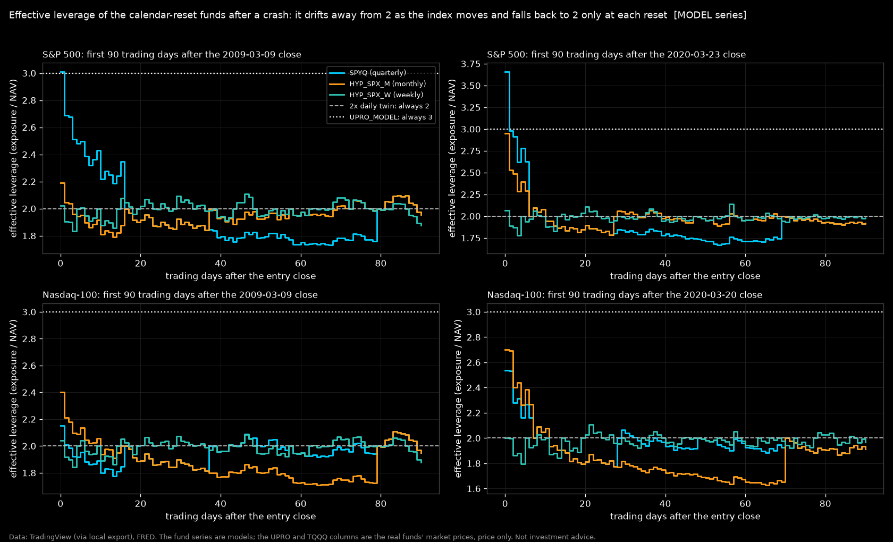
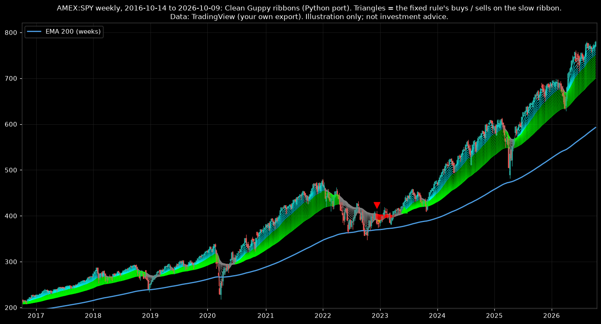

<p align="center"></p>

# calendar_letf

This is a small, fast, tested engine for one question. **Does a 2x leveraged ETF that resets its leverage once a
week, month or quarter lose less to volatility than one that resets every day?** The engine models Tradr's live
calendar-reset funds (SPYQ, MQQQ, QQQP) and the weekly and S&P monthly designs of the funds that Tradr closed in
2025. It also models a
daily-reset "twin" of each fund, on the same index and with the same costs. The history covers the S&P 500 since
1950 and the Nasdaq-100 since 1985. You can also plug in timing rules and test them without look-ahead.

Research tooling. Hypothetical results. **General information only: not financial product advice and not a
recommendation to buy, sell or hold any fund.** It does not take into account anyone's objectives, financial
situation or needs.

This project has no affiliation with, endorsement by or connection to any fund sponsor or index provider it names. The sponsors are Tradr ETFs / AXS Investments, Direxion, Rydex / Guggenheim, ProFunds, ProShares,
Roundhill, GraniteShares, iShares / BlackRock, Invesco and SPDR / State Street (SSGA). Fund names and tickers appear
only to identify the products that the project models.

## The answer, in short

Monthly and weekly resets beat daily resets by about **+0.3 percentage points a year** on the S&P 500 (1950-2026,
every month-end start, 10-year holds). On the Nasdaq-100 (1985-2026) they beat daily resets by **+1.1 to +1.3
pp/yr**. **Quarterly resets do not beat daily resets** (S&P -0.5 pp/yr; Nasdaq-100 -2.1 pp/yr). The Nasdaq-100
result uses the trigger that the prospectus describes: the ETF's own price during the day. That sign rests on one
day in 2008.

**None of the six ten-year gaps is distinguishable from zero on one history.** The 95% intervals built from windows
that do not overlap all cover zero:

- S&P monthly +0.38 [-0.59, +1.35]
- Nasdaq-100 monthly +1.04 [-2.23, +4.31]
- Nasdaq-100 weekly +1.17 [-0.24, +2.58]

The Nasdaq-100 weekly interval is wide because its 2 degrees of freedom give t = 4.30. A coverage simulation gives
the multiplier that this structure needs. On it, the row would be clear under independent windows and too close to
call under the mildest regime stress (FINDINGS F6).

The only clear rows at any horizon are the Nasdaq-100 weekly design at 1, 3 and 5 years. Those rows are clear only
if windows that do not overlap are independent. Under the mildest persistent-regime stress run, they are noisy at 1
year and too close to call at 3 and 5 years (FINDINGS F6).

The edge exists only when daily returns tend to *reverse* from one day to the next. That has been the case since the
1980s, and strongly since 2000. In the 1950s-70s, when daily returns tended to *follow through*, daily resets beat
the monthly design in every decade. The often-quoted "+1.15 pp/yr since 1990" holds up here (base case +1.16), but it
is that regime, not a law.

The cost level does not change the answer. The cost encoding moves the monthly and weekly gaps by at most 0.06 pp and
the quarterly ones by up to 0.14. The leverage, not the reset rule, sets the risk. On the S&P 500, every 2x series had
an 89-93% maximum drawdown, and on the Nasdaq-100 the figure was about 99%.

On the S&P, the monthly design wins a majority of its non-overlapping 10-year windows in 87% of start phases (median
win share 57%). On the Nasdaq-100, the monthly and weekly designs win a majority in every phase. Full detail with
provenance: [FINDINGS.md](FINDINGS.md), findings F6-F12.

Timing rules (step 4): none is a reliable improvement over buy-and-hold across both indexes. On the headline
interval, every rule's 10-year edge is noisy. On SPYQ the 200-day moving-average rule has the largest median edge
(+4.0 pp a year). It is not positive out-of-sample on a whole-era basis (1990-2026 as one run: -0.05 pp/yr). On the
Nasdaq-100 funds, the volatility-threshold rule has the largest median (+2.3 on MQQQ, +5.9 on QQQP). Findings
F13-F16.

Leverage below 2x (hypothetical funds, B17): on the S&P 500, the daily, weekly and monthly designs grow fastest at
2x. Their growth still rises at 2x. On the Nasdaq-100 the best L is 1.65 to 2.00, and one history cannot separate 1x
from 2x. On bad-case measures 1x wins. A 1.2x weekly index fund at a fee of 0.99% grew more slowly than the index, but only
one of four cases clears its interval.
Detail: FINDINGS F23.

Simulated decades (B11): the study builds 5000 ten-year paths from blocks of real days. On them the Nasdaq-100 weekly design
leads its daily twin by a median +0.61 pp a year, and the quarterly design trails by 0.92. On the S&P 500 the median gaps run
from -0.01 to +0.19 pp (252-day blocks). The paths also show how the gap grows with volatility, with a fan chart in
[results/montecarlo_fan.png](results/montecarlo_fan.png). Detail: FINDINGS F24.

Leverage of 3x (hypothetical funds, B1): a fall of 1/3 inside a period ends a 3x fund. So the live funds' 35% trigger
can never fire first. With no trigger, the quarterly S&P 500 design died on 2008-11-20, and the monthly and quarterly
Nasdaq-100 designs on 1987-10-26. An early reset at 23.33% prevents every wipeout. Only the weekly Nasdaq-100 design
leads its 3x daily twin (a median +2.80 pp a year over 10 years; every 10-year interval covers zero). Detail:
FINDINGS F25.

Semiconductors (hypothetical funds, B16, the PHLX Semiconductor index, price only): from 1994 to 2026 no fund from
1.2x to 3x kept up with the index. That holds even with no fee. Below 2x the weekly and monthly resets beat daily resets, and every
yearly interval of that lead excludes zero. Detail: FINDINGS F26.

The reset day (B12): another reset day moves the simulated 10-year gap by at most 0.09 pp a year. In history a Monday reset trailed the Friday one. The lag does not survive an adjustment for the 26
comparisons, and the simulated paths do not show it. Detail: FINDINGS F27.

Why the gap exists (B14): the calendar fund gains when the days inside a period reverse, and the daily fund gains in a
smooth trend. On the S&P 500 a second-order formula explains the weekly and monthly 2x gaps (R^2 0.93-0.99). Detail:
FINDINGS F28.

A rolling LEAP instead (B15, S&P 500, model prices): below 2x a deep in-the-money call is the index plus a loan near
the risk-free rate. But no exchange lists such strikes. With no trading cost it beats the calendar fund. A 0.5% cost per
quarterly roll leaves the two indistinguishable below 2x. Detail: FINDINGS F29.

## Headline facts (every one computed here and audited; sources in FINDINGS.md)

- **Monthly resets beat daily resets by +0.3 pp/yr on the S&P 500 over 799 ten-year windows since 1950. The
  Nasdaq-100 gap since 1985 is +1.3 pp/yr. Quarterly resets do not beat daily: -0.5 pp/yr on the S&P, -2.1 on the
  Nasdaq-100. None of the six ten-year gaps is distinguishable from zero on one history.** (F6)
- **The famous "+1.15 pp/yr since 1990" holds up: the base case gives +1.16 (rate encoding +1.15), ahead in 321 of
  321 windows. The same edge was negative in every decade of the 1950s, 60s and 70s.** Whether calendar resets help depends on whether daily returns follow through or
  reverse, and that has flipped sign over decades. (F7, F8)
- **The live funds deliver exactly 2.0x the ETF per period, less a constant cost.** The regression slopes are 2.015 /
  1.993 / 2.005 for SPYQ / MQQQ / QQQP. The intercepts are -1.3 pp per quarter, -0.55 pp per month and -1.6 pp per
  quarter. (F4)
- **Costs do not change the reset answer.** Across the six cost encodings, the gap between calendar and daily resets
  moves by at most 0.06 pp/yr for the monthly and weekly designs. The limit for the quarterly ones is 0.14. The
  leverage sets the risk. On the S&P 500, every 2x structure had an 89-93% maximum drawdown since 1950 and spent 94%
  of the time below its previous peak. The Nasdaq-100 2x series fell about 99% (F8, F12).
- **Bought mid-period after a 30% fall, a calendar fund is a 3.5x position, not a 2x one.** At the 2020 bottom SPYQ
  was a 3.66x fund. In three years, $10,000 became $31,391. The same sum became $26,113 in a daily 2x fund and
  $36,394 in a 3x daily fund (which ran a -64% drawdown on the way). (F17)
- **From the GFC low to the end of the data, $10,000 became $703,542 in the S&P monthly design and $3,080,655 in
  MQQQ.** Both figures come from MODELED designs at the fixed cost encoding; the rate encoding gives $804,289 and $3,531,497. The real
  SSO and QLD reached $776,671 and $3,053,260 (price only). So which side ends ahead depends on the assumed costs.
  The entry uses hindsight and gives one path: an illustration, not a statistic.
  [results/gfc_oracle.md](results/gfc_oracle.md) has the full table. (F21)
- **The 35% early reset fired once on the S&P 500 in 76 years (2008-11-20). On the Nasdaq-100 it fired four times
  for a quarterly fund (1987, 2000, 2001, 2008) and once for a monthly one (1987).** It never fired for a monthly
  fund on the S&P. (F9)
- **Bought at the seven S&P 500 bottoms since 1974, the quarterly fund beat its daily twin six times.** Over any
  random 10-year hold, it was the worst calendar structure. The longer the period, the more leverage waits at the
  low. (F17)
- **No timing rule is a reliable improvement on buy-and-hold on both indexes, and every rule's 10-year edge is noisy
  on the headline interval.** The S&P 200-day rule's edge was positive before 2009 and negative after. Its full-run
  edge by era was +5.29 / +6.91 / -8.37 pp/yr, and its whole-era out-of-sample edge was -0.05 pp/yr (1990-2026 as
  one run). No test on one history establishes that split (1990-2008 against 2009-2026: z 1.6; before against after
  2009: z 1.9-2.7). The second test uses a boundary chosen after a look at the data. (F13, F14)
  - The 50-day rules flip from positive in-sample to strongly negative out-of-sample to whipsaw (SPYQ 50-day EMA
    +4.8 / -10.2 pp/yr).
- **A wait for a trend confirmation after a bottom cost 15-20% of the rebound on the S&P.** An entry three months
  early moved the 3-year result about six times more than any cost assumption. (F19, F20)
- **The whole 76-year passive study is 3,972 full-history simulations in about a second of kernel time.**

## What the funds do (from the prospectus, 31 July 2026)

A calendar-reset 2x fund promises 2x the return of SPY or QQQ over one **calendar month** (MQQQ) or **calendar
quarter** (SPYQ, QQQP). The fund measures that return from the close of the last NYSE business day of one period to
the next. Between resets it does not rebalance: the exposure floats with price. If the underlying falls 35% inside a
period, the fund resets early. A daily-reset fund (SSO, QLD) rebalances to 2x every close instead.

Tradr also ran nine other calendar funds, among them weekly and S&P monthly designs (SPYB, QQQW, SPYM). Tradr
launched them on 2024-08-30 or 2024-09-30 and closed them on 2025-02-28. The engine models those designs too, with
the label MODELED everywhere they appear (FINDINGS F1b).

## What is in the box

| Path | What it does |
|---|---|
| `calendar_letf/kernel.py` | numba kernels: calendar-reset NAV (three early-reset modes), daily-reset NAV, `run(spec, ...)` |
| `calendar_letf/periods.py` | week / month / quarter ids on a trading calendar; reset "never" for a buy-once position |
| `calendar_letf/costs.py`, `products.py` | cost inputs with VERIFIED / ASSUMED / OPEN status and sources; the product registry; `twin_of` |
| `calendar_letf/loader.py`, `series.py` | strict loaders for TradingView exports and FRED files; the constructed total-return series |
| `calendar_letf/provenance.py` | SHA-256, row count and date range of every input file; the manifest and banner lines |
| `calendar_letf/validate.py` | fit to the live funds: fund total return with payouts, ETF total return, period regression |
| `calendar_letf/metrics.py`, `study.py` | risk metrics; the multi-start study (every window is a ratio of one full-history run) |
| `calendar_letf/indicators.py` | SMA, TradingView-exact EMA (`ta.ema`), Guppy ribbon states, week-end closes |
| `calendar_letf/backtest.py`, `strategies/` | the plugin contract, the wealth loop with fill delay and costs, seven example rules |
| `calendar_letf/navtr.py`, `leverage.py`, `coverage.py` | the total-return rebuild of the mutual-fund NAVs (B19); yearly growth, the plateau of the best L and the break-even fee (B17); the coverage simulations |
| `calendar_letf/montecarlo.py` | block-bootstrap, AR(1) and bridge paths on a real trading calendar, and the parallel kernel batch that runs every fund on every path (B11) |
| `scripts/` | the four studies: live-fund validation, calendar against daily, timing rules, entries from bottoms. `run_gfc_oracle.py` adds one hindsight entry at the 2007-2009 low. `run_live_monthly.py` checks the model on real monthly-reset mutual funds. `run_sub2x.py` runs every design from 1x to 3x. `run_montecarlo.py` runs the funds on simulated decades. `run_3x.py` runs the 3x designs. `run_semis.py` runs the designs on semiconductors. `run_reset_day.py` moves the reset day and tests entry on any day. `run_compounding.py` splits the gap into drag and compounding. `run_leap.py` compares a rolling LEAP. `run_coverage_sim.py` simulates the coverage of the interval conventions. `plot_guppy.py` draws candles with the Guppy ribbons for any symbol. `fresh_clone_check.py`, `scan_identifiers.py`, `ste_check.py` and `refreeze_golden.py` check and pin a release |
| `tests/run_tests.py` | known-answer checks, plus the golden files in `tests/golden/` that pin the published numbers; must print `0 failure(s)` |
| `results/` | the studies' tables (markdown + JSON; aggregates, never daily series) and charts |
| `reference/` | SEC N-PORT extract of the funds' swaps, their payouts, Shiller's monthly S&P dividends (derived) |
| `ASSUMPTIONS.md`, `FINDINGS.md` | every input with its status; every result with its provenance |
| [THEORY.md](THEORY.md), `docs/theory_examples.py` | the mathematics of calendar-reset funds and of this engine, with a formula, code and test map; the script computes every number the document quotes |

## How the model works

[THEORY.md](THEORY.md) gives the full mathematics: the payoff inside a period, the daily drag, the exact
calendar-minus-daily gap and the choice of leverage. It ties every formula the engine uses to its code and its test.

Between resets the fund is a fixed levered position: `NAV_t = NAV_0 x (2 x U_t/U_0 - 1)` minus financing and fees
accrued since the reset. At each period end (or at -35%), the model sets the base to the current NAV and level. The
daily twin applies `2 x daily return` every day. Both pay the same three costs: the reference rate on the borrowed
turn, a swap spread, and the expense ratio.

The project fitted the model to the three live funds over 2024-26 (findings F1-F5). The model reproduces their paths
(correlation 0.995-0.998). They deliver 2.0x the ETF per period less a constant cost, and that cost sits 1.27-1.67
pp/yr above their filed swap terms. The comparison covers the funds' whole lives. The funds' own balance sheet
explains the gap (F3). In 2024-25 the funds held all cash plus about two times swaps, and the cash earned below the
overnight rate.

The model carries the residual into history in two ways: a fixed 2.6%/yr spread, or the filed 1.4% plus 1.3 turns
of the reference rate. Every table shows both, because they differ when rates move. Every number that does not come
from a document carries the mark ASSUMED and has a sensitivity.

## What a calendar fund is after a crash (and why it is not a 2x fund)

This is the most product-specific thing in the study, and the one anyone considering an entry after a major
drawdown should understand before anything else.

A daily-reset fund is 2x every morning. A calendar-reset fund is 2x only at the close of the last trading day of
its period. Between resets its exposure is fixed in dollars. It holds 2 x NAV_0 of index exposure and owes NAV_0,
where NAV_0 is its value at the last reset. If the index then falls by a fraction f, the fund is worth
NAV_0 x (1 - 2f). It still holds 2 x NAV_0 x (1 - f) of exposure, so its leverage is

    leverage after a fall f inside the period = 2(1 - f) / (1 - 2f)

    fall       -10%    -20%    -30%    -35%    -37.5%  -40%    -50%
    leverage   2.25x   2.67x   3.5x    4.33x   5x      6x      wiped out

Two things follow. First, **an investor who buys the fund mid-period after a 30% fall buys a 3.5x position**, not a
2x one. That holds until the next period end: days to weeks for a monthly fund, up to three months for a quarterly
one. At that point the fund resets to 2x at the new, lower level. On a rebound, that is a large extra exposure
exactly where one wants it. If the fall continues, a further 7% drop in the index (from -30% to -35%) costs that
buyer a quarter of their money.

Second, **the 35% early reset is the safety valve**. At -35% the fund's design resets it to 2x on what is left (30%
of NAV_0). The fund does not run on toward zero, which a 2x position bought on margin does at -50%. The prospectus
says the reset happens "as soon as possible" after the underlying reaches the level, possibly the next day. After a
gap through the level, the reset fills wherever the fund can trade, so the valve is a design, not a guarantee.

The same arithmetic works against a buyer after a rise: bought mid-period after +20%, the fund is a 1.7x position
until the reset. (The table uses the price fall alone; the model's figure sits up to 0.12 higher because accrued
costs have already reduced the NAV.)

**Is it like a LEAP?** The intuition is fair in one respect and misleading in three. Like a deep-in-the-money
long-dated call, the fund's leverage rises as the market falls, so both offer "more juice at the lows". Unlike a
call:

1. The fund's payoff within a period is a straight line in the index, with no convexity and no time decay. A
   call's payoff curves and its premium bleeds.
2. The fund's "option-like" state lasts only until the next reset, after which it re-levers at the new level. That
   is more like rolling into a new strike every month or quarter than holding one LEAP.
3. The fund's costs are financing and a fee, which do not spike in a crash. A buyer of a LEAP at the bottom pays
   peak implied volatility.

The honest summary: a calendar fund bought in a crash does not behave like an option. It behaves like a levered,
linear, periodically re-struck position with a reset floor.

What the history says (findings F17-F20): each index has seven bottoms, so the medians are descriptive, not
statistics. Bought at the listed S&P 500 bottoms since 1974, SPYQ's effective leverage on the entry day was 2.0-3.7x
(3.67x on 1987-12-04, 3.66x on 2020-03-23). Its 3-year return beat the daily 2x twin at 6 of 7 bottoms (medians
+173% against +161%). With the 1962 and 1970 troughs that the list omitted, it beat the twin at 8 of 9 bottoms.

SPYQ lost to a 3x daily fund at 6 of 7 (+264%). But that 3x fund ran -38% to -64% drawdowns inside those three years
(-44% to -82% on the Nasdaq-100). From the 2002 entry, the 3x fund also trailed the plain index over ten years. At 5
and 10 years, the score of SPYQ against its twin is 4 of 6 and 3 of 5.

The extra leverage lasts only until the next reset. That was six trading days after the 2020 bottom and sixteen
after 2009-03-09 (to the 31 March quarter-end). At worst, it lasts up to a quarter.

On the S&P, rule-based entries at 20-50% below the high were positive on median at three years. At the 30% and 40%
levels, they did no better than the unlevered index. On the Nasdaq-100, the 40-70% entries of 2000-01 were all
3-year losses, and only the 80% level paid.

A wait for a Guppy confirmation after a bottom cost a median 15-20% of rebound on the S&P. Against the exact bottom,
any confirmation loses by construction. Against the rule-based entries, the confirmations lost more often than they
won on the S&P (8-9 of 21). They helped only after the catastrophic 2000-01 Nasdaq-100 entries. An entry three months
early moved the 3-year result about six times more than the range of the six cost encodings tested.

This reverses the passive ranking. Over any random 10-year hold, the quarterly fund was the worst calendar structure
(F6). Bought at a bottom, it was the best, because the longer the period, the more leverage waits at the low. On the
S&P 500, the quarterly fund entered the 1987 and 2020 bottoms at 3.7x. The monthly fund entered them at 2.1x and
3.0x. The weekly fund (which resets every Friday) entered them at 2.0x and 2.1x.

The 3-year dollar results follow that order (1987: $19,687 / $17,306 / $17,109 per $10,000; 2020: $31,391 /
$29,291 / $26,511). Where a bottom fell just after a reset (2022-10-12, all three at 2.0x) the structures finished
within $900 of each other. So for an entry after a drawdown, the question is not "monthly or quarterly" but "how far
into its period is the fund today". That is observable: leverage = 2 x (U_t / U_0) / (NAV_t / NAV_0), with U_0 and
NAV_0 the index and NAV at the fund's last reset. Both are readable from the fund's own published NAV history and
the index. The per-product dollar tables are in `results/from_bottoms.md`.



The engine captures all of this automatically, because an investor holds NAV units and the NAV already carries
the floated leverage. `results/from_bottoms.md` measures it. It tests entries at every major bottom, at rule-based
drawdown levels knowable at the time, and at Guppy-confirmed turns. The drawdown levels are 20-50% on the S&P 500
and 20-80% on the Nasdaq-100.

It compares each entry with the daily 2x twin and with a 3x daily fund at UPRO / TQQQ's filed terms. It also
compares them with the real UPRO / TQQQ where they exist, a buy-once margin position and the index. Each row shows
each fund's effective leverage on the entry day.

## Reproducing everything

No price data ships with this repository (see below). You need:

1. **TradingView daily exports** (split-adjusted, not dividend-adjusted, full history), saved as
   `<EXCHANGE>_<TICKER>_daily.csv`. You need `SP:SPX`, `SP:SPXTR`, `NASDAQ:NDX`, `NASDAQ:XNDX`, `AMEX:SPY`,
   `NASDAQ:QQQ`, `NASDAQ:SPYQ`, `NASDAQ:MQQQ` and `NASDAQ:QQQP`. The bottoms study also needs `AMEX:UPRO` and
   `NASDAQ:TQQQ`; the GFC oracle entry also needs `AMEX:SSO` and `AMEX:QLD`. The live monthly check also needs the
   mutual-fund NAVs `NASDAQ:DXSLX`, `NASDAQ:DXQLX`, `NASDAQ:RMQHX`, `NASDAQ:ULPIX`, `NASDAQ:UOPIX`, `NASDAQ:RYVYX` and
   `NASDAQ:RYNVX`. The loader reads raw exports (a `time` column) and the clean `date` format. Details and symbols:
   [data/README.md](data/README.md).
2. **FRED CSVs** in `data/rates/`: `DFF`, `DTB3`, `TB3MS`, `OBFR` (fred.stlouisfed.org, public).
3. Python 3.10+, `numpy`, `pandas`, `numba` and `matplotlib`. `pip install -e .`
   The tested versions are Python 3.13.15, numpy 2.5.3, pandas 3.0.6, numba 0.68.0 and matplotlib 3.11.2.
   `constraints.txt` holds them. If a newer release breaks a test, run `pip install -c constraints.txt -e .`.

```
set CALENDAR_LETF_DATA=path\to\your\exports        (defaults to data/)
set CALENDAR_LETF_RATES=path\to\fred\files         (defaults to data/rates/)
py tests\run_tests.py                               must end with 0 failure(s)
py scripts\run_validate_live.py                     live-fund fit (seconds)
py scripts\run_calendar_vs_daily.py                 the passive study (under 20 s; most of it the 10,000-draw bootstraps)
py scripts\run_coverage_sim.py                      coverage of the interval conventions (about 2 minutes on 24 threads)
py scripts\run_calendar_vs_daily.py                 the passive study again: its banner quotes the coverage file
py scripts\run_strategies.py                        the timing rules (under 30 s)
py scripts\run_from_bottoms.py                      entries from major bottoms (under 10 s)
py scripts\run_gfc_oracle.py                        the GFC oracle entry (seconds)
py scripts\run_live_monthly.py                      real monthly-reset mutual funds (seconds)
py scripts\run_sub2x.py                             leverage from 1x to 3x (about 2 minutes; reads results/live_monthly.json)
py scripts\run_montecarlo.py                        simulated decades (about 1 minute on 24 threads; reads results/sub2x.json)
py scripts\run_3x.py                                the 3x designs (under 1 minute)
py scripts\run_semis.py                             the semiconductor designs (under 1 minute; needs NASDAQ:SOX, NASDAQ:SOXX, AMEX:SOXL, AMEX:USD)
py scripts\run_reset_day.py                         the reset day and entry on any day (under 1 minute; reads results/montecarlo.json)
py scripts\run_compounding.py                       the compounding decomposition (about 2 minutes)
py scripts\run_leap.py                              the LEAP comparator (seconds; needs CBOE:VIX)
```
Run them in that order on your own data. The coverage simulation reads the passive study's per-start gaps from
`results/raw/`, so they must be yours, not the shipped ones. The passive study quotes the coverage file in one
sentence of its banner. The test suite checks the raw-file hashes and the code fingerprints.

The golden files pin the published numbers to the published inputs. A study that you re-run on your own data has
other inputs. The golden test then skips that study and names the files that differ. Other tests still check your
results.

The first run compiles the numba kernels (a few seconds); later runs use the cached kernels. The whole passive study
is 3,972 full-history simulations in about a second of kernel time; the bootstraps and the charts take the rest.

## Adding your own strategy

A strategy is one file in `calendar_letf/strategies/`:

```python
from .base import Strategy, register

@register("my_rule")
class MyRule(Strategy):
    name, params, warmup = "my_rule", {"n": 100}, 100
    def exposure(self, ctx):          # ctx.close = underlying price index, ctx.dates, ctx.product_nav, ctx.week_last
        ...                           # return float64 in [0, 1] per row, NaN before warmup
```

The engine applies it with a fill delay and trading costs. The base delay puts the signal on close t and the fill at
close t+1. The engine also runs delays 2 and 3.

Your row-t signal may use rows 0..t only. A generic look-ahead test runs every registered rule on the full history
and on the history cut at every fifth row. It fails any rule whose earlier signals change. Rules that only work with
hindsight fail loudly. The repository ships twelve variants. Their results are a lesson in why a rule fixed before
testing, a delay sweep and an out-of-sample split matter.

### The Guppy ribbons, from the Python port



Data: TradingView.

`py scripts\plot_guppy.py AMEX:SPY --weekly --years 10` draws this chart from your own export. The fast ribbon (EMAs
3-21) shows cyan when both groups stack up. The slow ribbon (EMAs 24-66) shows green / red / gray by its stack. The
200 EMA shows in blue, and triangles mark the fixed rule's buys and sells.

The same `indicators.guppy` call gives the ribbon states for any series. So you can scan a whole universe in a
second. The EMA matched TradingView's `ta.ema` to within 3.2e-12 (daily) and 1.7e-12 (weekly) on the author's own chart
exports, a local check that needs those exports. The public tests check the formula on made-up data.

## What this cannot tell you

- No calendar-reset fund existed before August 2024. Everything earlier is a model, and the project fitted its costs
  on two years of live data.
- The 35% early reset has never fired live. The model's trigger watches the ETF's daily low (the index before the
  ETF existed), so an intraday touch fires it. The three fill modes (reset at the level, at the close, next close)
  bracket where a fill lands once the price crosses the line. SPYQ's negative S&P result rests on one such episode
  (2008-11-20). Per historical episode, the fill rule changes fund value by between -17% and +27%:
  - SPYQ's 2008 episode: +2% at the close, +18% at the next close.
  - QQQP's 2000 episode: -16% at the close.
  - QQQP's 2008 episode: +27% at the next close.
- The gap between daily and calendar resets depends on day-to-day autocorrelation. That autocorrelation has changed
  sign over decades and may change sign again.
- S&P dividends before 1988 are Shiller's monthly series. Nasdaq-100 dividends of 1999-2006 come from QQQ's filings;
  before 1999 they are an assumption (0.3%/yr). Rates before July 1954 are a monthly proxy. The fit uses the funds'
  prices, not NAVs.
- Windows that overlap are not independent samples. The findings give the independent-window counts.
- The timing-rule costs use assumed half-spreads; thin funds may cost more.
- Short (inverse) calendar funds, such as Tradr's MSPY and DQQQ, are out of scope. The engine finances (L - 1) turns at
  the reference rate for L of 1 or more. An inverse fund earns the rate on its short proceeds, resets early on a RISE
  and dies at a rise of 1/L. Multi-year rolling windows are also the wrong test for funds meant for short holds. So v0.1.1 leaves them
  out.
- The LEAP comparator covers the S&P 500 only: the price library holds no Nasdaq-100 volatility index (VXN).

## Data, licenses, attribution

- **TradingView** market data comes with a display-only license. This repository ships no price data files and no
  daily synthetic series (a user could reverse them into prices). Its tables hold aggregates. Some charts plot prices
  or modeled paths from TradingView data, and they carry "Data: TradingView". Reproduce with your own export.
- **FRED** (Federal Reserve Bank of St. Louis): public U.S. data.
- **Robert J. Shiller**, Irrational Exuberance data (Yale): `reference/shiller_sp500_monthly.csv` derives from
  `ie_data.xls` (downloaded 2026-10-13; data to 2023-06). It carries his accuracy disclaimer; cite him if you use it.
- **SEC EDGAR**: the funds' N-PORT filings (public) are the source of `reference/nport_tradr_2026.json`.
- The Guppy Multiple Moving Average is Daryl Guppy's method. The ribbon lengths follow ChrisMoody's "CM Super
  Guppy". `strategies/guppy.py` is a Python port, verified against TradingView's own EMA output.
- **Fund names and tickers** belong to their sponsors, the ones named at the top of this file. The ETFs are SPYQ,
  MQQQ, QQQP, SOXM, SOXW, UPRO, TQQQ, SSO, QLD, SOXL, USD, SOXX, SPY and QQQ. The mutual funds are DXSLX, DXQLX,
  RMQHX, ULPIX, UOPIX, RYVYX and RYNVX. This project uses the names only to identify the products it models. It has
  no affiliation with any sponsor, and none of them endorses it. S&P 500, Nasdaq-100, PHLX Semiconductor and VIX are
  trademarks of their index providers.
- **Models, not issuer data.** The calendar funds, the daily twins and the 3x rows are models, not the issuer's data.
  The SSO, QLD, UPRO and TQQQ rows are the real funds' market prices, price only.
- **General information only.** Nothing here is financial product advice or a recommendation; past and modeled
  performance is not a reliable indicator of future performance. Leveraged funds can lose most or all of the money invested.
- Code: MIT license (see LICENSE): provided "as is", without warranty or liability.

Independent audits ran after every build step and at each release re-grade. FINDINGS.md logs each verdict and its
findings. The backlog (a Monte Carlo simulator, a reset-day sensitivity, the semiconductor-index designs Tradr also
ran) stays with the private review notes. FINDINGS.md names an item wherever it bears on a result.
