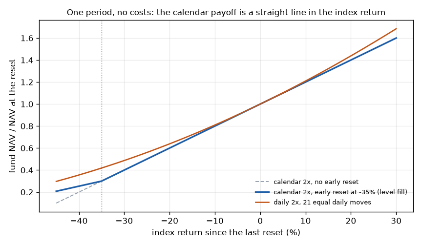
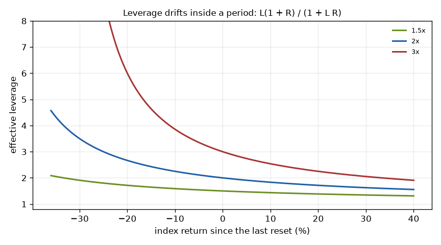

# Theory of calendar-reset leveraged funds

This document explains how calendar-reset leveraged funds work, what risks they carry, and what this engine computes.
It is for a quant, a student or an auditor. Each section opens with a plain summary, then gives the mathematics. Each
displayed equation carries a number. Section 14 maps every equation to the function that computes it and to the test
that proves it.

Rules this document follows:
- It names designs, not funds. A design is a leverage, a reset period and an underlying, for example "2x SPY monthly".
  FINDINGS.md and ASSUMPTIONS.md name the real funds, their filings and the live validation.
- Every computed number in the text comes from `docs/theory_examples.py`, which writes `docs/theory_examples.json`. The
  examples use planted inputs only, so you can reproduce them without market data. A test compares each printed number
  with that file.
- Each cited source carries a status in section 16: PRIMARY (read in the source itself), ABSTRACT, SECONDARY or NOT
  READ. The text says where a source and this engine differ.

## Notation

| Symbol | Meaning |
|---|---|
| $L$ | leverage: 2 for a 2x fund. The cited papers write $\beta{}$ |
| $U_t$ | the underlying level at the close of day $t$: a total-return index unless the text says otherwise |
| $P_t$ | the price index (no dividends) |
| $X_t$ | the trigger series: the price of the ETF that the fund tracks, and the price index before that ETF existed |
| $r_t = U_t / U_{t-1} - 1$ | the simple return of day $t$ |
| $R_t = U_t / U_0 - 1$ | the underlying's return since the last reset (day 0) |
| $V_t$ | the fund's net asset value (NAV) |
| $\rho_t$ | the annual reference rate known before day $t$ |
| $s$ | the swap spread per turn over the reference rate, a year |
| $s_N$ | the spread per unit of NAV, a year: $s$ times the turns that pay it ($L$ on the engine's base basis) |
| $f$ | the expense ratio, a year |
| $a^{fin}_t$, $a^{fee}_t$ | calendar days since the previous row over 360 and over 365 |
| $\delta{}$ | the early-reset drop: 0.35 in the filed designs |
| $T$ | the number of trading days in one reset period |
| $e_k$ | the $k$-th elementary symmetric sum of $r_1, \dots, r_T$ |
| $VR_T$ | the variance ratio of daily returns at horizon $T$ |

# Part I. The products

## 1. What a calendar-reset fund is

In plain words: a calendar-reset fund promises a multiple of an ETF's return over a calendar period. The period is a
week, a month or a quarter. Inside the period the fund does not trade. At the period's last close it sets its exposure
back to the multiple of its new value. A daily-reset fund does the same at every close.

A design has three parts:

| Part | Values this engine models | Where the results are |
|---|---|---|
| Leverage | 1.2x, 1.5x, 1.7x, 2x and 3x; a grid from 1x to 3x in steps of 0.05 | FINDINGS F23 (below 2x), F25 (3x) |
| Reset | weekly, monthly, quarterly; daily as the comparison | FINDINGS F6 to F8 |
| Underlying | the S&P 500 (SPY), the Nasdaq-100 (QQQ), the PHLX semiconductor index (SOX, price only; SOXX tracked three indexes over its life) | FINDINGS F23, F26 |

So "2x SPY monthly" means two times the return of SPY from one month's last close to the next month's last close.
"2x QQQ quarterly" and "2x SOXX weekly" read the same way.

The reset schedule follows the exchange. A period runs from the close of the last NYSE session of one period to the
close of the last session of the next. A holiday on the last weekday moves the reset to the session before it. The
engine builds the sessions from the exchange's holiday rules (`nyse.sessions`) and flags the reset rows with
`periods.period_end_flags`. A reset row that the data lacks stops the run with an error.

## 2. How the fund works day to day

In plain words: at a reset the fund holds some of the ETF itself, a set of swaps and cash. The swaps pay the ETF's
total return and cost a floating rate plus a spread. Between resets the swaps drift with the ETF. A fall of 35% inside
a period makes the fund reset early.

**The balance sheet at a reset.** Per unit of NAV, the fund holds the ETF directly with weight $d$, swaps with notional
$n$ and cash $k$. The exposure must equal $L$, and the holdings must add up to the NAV:

$$
d + n = L, \qquad d + k = 1.
\tag{1}
$$

The swaps cost the reference rate plus the spread $s$ on their notional. The cash earns a fraction $c$ of the
reference rate. The net financing cost per unit of NAV, a year, is

$$
\text{financing} = (n - k\,c)\,\rho + n\,s.
\tag{2}
$$

The engine holds this balance sheet in `validate.Structure`, and `validate.Structure.rate_turns` gives $n - k c$. A fund
with no direct holding and cash that earns the full rate ($d = 0$, $k = 1$, $c = 1$) pays $(L - 1)\rho + L s$. That is
the kernels' cost, $(L - 1)\rho + s_N$, with the spread on $L$ turns (`kernel.financing_rate`, `costs.spread_per_nav`).
Take swaps on 1.5 turns and cash of 0.5 that earns 0.9 of the rate. At a rate of 4% and a spread of 1%, that gives
1.05 rate turns and a financing cost of 5.70% of NAV a year.

**Between resets.** The swap notional moves with the ETF, so the exposure floats. The fund settles the swaps and resets
the notional at the next period end. The filings describe the fund as not rebalancing between resets.

**The early reset.** The filed designs watch the ETF's price. If it falls 35% from its level at the last reset, the
adviser resets the exposure as soon as it can during the day. A breach in the final 30 minutes of trading can move the
reset to the next session. The stub after an early reset counts as a new period, so the trigger arms again.

**A daily fund trades every day.** Take a daily fund with NAV $V$ at the start of a day with return $r$. At the close
it holds $L V (1 + r)$ of exposure but needs $L V (1 + L r)$. It trades the difference at the close:

$$
\Delta = L\,(L - 1)\,r\,V.
\tag{3}
$$

For $L > 1$ the fund buys after a rise and sells after a fall (Cheng and Madhavan 2009, equation 11). On a NAV of 100, a 2x fund buys 2.00 after a 1% rise and sells 2.00 after a 1% fall. A 3x fund buys
6.00 after the same rise. A calendar fund makes this trade only at its reset, once for the whole period.

**Creations, redemptions and the market price.** Authorized participants create and redeem shares in blocks at NAV.
That arbitrage keeps the market price near the NAV. A small fund with few trades can still close away from its NAV and
carry a wide bid-ask spread.

**Fees and payouts.** An adviser can cap the expense ratio for a time and let the cap lapse later. The kernels take one
fee per row, so a fee timeline is an input (`validate.fee_timeline`). A payout lowers the NAV on its ex-date by the
amount paid. The engine works with total returns, and `navtr.total_return` adds a fund's payouts back.

**Collateral and counterparties.** The swaps run with a few banks. The fund posts or receives collateral as the swap
value moves. Each bank charges its own spread over the reference rate. The filings name the overnight bank funding rate
(OBFR); over long histories the engine uses effective fed funds as its proxy (ASSUMPTIONS section 2).

## 3. Risks

In plain words: the fund can lose everything inside one period if it has no early reset. The early reset caps the loss
of one period, but a gap can pass it. A buyer between resets gets a leverage other than the stated one. Costs, thin
trading and closure risk come on top.

**Wipeout.** Inside a period the NAV is $V_0 (1 + L R_t)$ before costs (equation 6). With no early reset the NAV
reaches zero when the underlying has fallen by

$$
-R^{\text{wipe}} = 1 / L ,
\tag{4}
$$

that is 83.3% at 1.2x, 66.7% at 1.5x, 50.0% at 2x and 33.3% at 3x. The kernels end a fund at its first NAV at or below
zero and keep it at zero.

**The early reset.** Before costs, a reset exactly on the line keeps $1 - L\delta{}$ of the value at the last reset:
0.30 at 2x. That holds when the trigger watches the fund's own underlying. The filed designs watch the ETF's price
while the fund earns the total return, so dividends since the reset leave it a little more. With the total return 1%
above the price since the reset, the fund keeps 0.313. Below or above 2x, the engine also runs a trigger that keeps
the loss of 70% at 2x:

$$
\delta(L) = \frac{1 - 0.30}{L}.
\tag{5}
$$

The rule gives 58.3% at 1.2x, 35.0% at 2x and 23.3% at 3x (`products.trigger_for`). A fixed 35% line never fires first
at 3x: a 33.3% fall has already wiped the fund out.

**Gap risk.** An index can fall through the line before the fund can trade. Take a day that closes 40% down from the
last reset. A fill exactly on the line, with the rest of the day on the new base, leaves 0.254 of the NAV. A fill at
the close leaves 0.200. The engine runs three fills (section 10) and reports what each one is worth per episode.

**Leverage drift and buying between resets.** After the underlying has moved by $R$ since the reset, the fund's
leverage is no longer $L$ (equation 7). A buyer between resets gets that leverage, not the stated one.

**Reset timing.** The reset day decides which path each period sees. In this engine's simulations the choice of reset
day moves the 10-year gap by at most a tenth of a point a year (FINDINGS F27).

**Financing and spreads.** The fund pays the rate on its borrowed turns and a spread on its swaps. Funds do not publish
the spread as a cost; the engine fits it or reads it from filings. Spreads in a crisis are unknown (section 15).

**Thin trading and fund closure.** Small funds trade little, and a trader pays the bid-ask spread and any premium.
Sponsors close small funds: of the twelve calendar-reset funds in ASSUMPTIONS section 1, nine closed within six months.

# Part II. The mathematics of the payoff

## 4. Inside one period

In plain words: inside one period a calendar fund is a fixed bet. It holds $L$ units of the underlying for each unit of
NAV and owes $L - 1$ units of cash. Its value is a straight line in the underlying's return since the reset.

Before costs, the NAV at day $t$ of a period is

$$
\frac{V_t}{V_0} = 1 + L\,R_t, \qquad R_t = \frac{U_t}{U_0} - 1 .
\tag{6}
$$

The payoff depends on the path only through the trigger. Two days of +10% at 2x give 1.42 (the index ends at 1.21).
Two days of +10% and -10% give 0.98. The figure shows the straight line and its kink at the early reset.

The fund's exposure is $L V_0 U_t / U_0$ and its NAV is $V_0 (1 + L R_t)$. Their ratio is the effective leverage:

$$
L_t = \frac{L\,(1 + R_t)}{1 + L\,R_t}.
\tag{7}
$$

At 2x the leverage is 1.83 after a 10% rise, 2.25 after a 10% fall, 2.67 after 20%, 3.50 after 30% and 4.33 after 35%.
Trainor gives the same form for a monthly fund with no costs, as $1 + (L - 1)/(1 + L R_t)$ (his equation 6). With costs, the
engine reads the leverage off the kernel's own state (`bottoms.effective_leverage`). A daily fund holds $L$ at every
close.

**The trigger is a barrier.** The fund resets early at the first moment that

$$
X_t \le (1 - \delta)\,X_0 ,
\tag{8}
$$

where $X$ is the trigger series and $X_0$ its level at the last reset. The engine tests the day's low where the data
has one. At a fill on the line, the next period starts from $(1 - L\delta) V_0$ before costs, when $X$ moves with $U$.
Section 3 gives the case with dividends, and equation 30 the general one.

## 5. Daily reset

In plain words: a daily fund resets every evening, so its returns multiply. Over many days it earns about $L$ times
the underlying's log return, less a drag that grows with the variance. The drag is the price of the daily reset.

Before costs, a daily fund over $T$ days returns

$$
\frac{V_T}{V_0} = \prod_{t=1}^{T} \left(1 + L\,r_t\right).
\tag{9}
$$

A second-order expansion of each day's logarithm gives the link to the underlying. With financing and fee charged each
day:

$$
\ln\frac{V_T}{V_0} \approx L \ln\frac{U_T}{U_0} - \sum_{t=1}^{T}\big[(L - 1)\rho_t + s_N\big] a^{fin}_t - f\sum_{t=1}^{T} a^{fee}_t - \frac{L(L - 1)}{2}\sum_{t=1}^{T} r_t^2 .
\tag{10}
$$

Equation 10 is second order: with no costs its two sides differ by $\tfrac{L^3 - L}{3}\sum r_t^3$ plus higher terms.
Take a planted 63-day path at 3x and cut every daily return in half, twice. The error falls 7.28 and then 7.64 times,
close to the 8 that a cubic error gives.

Avellaneda and Zhang (2010, equations 4 to 6) and Leung and Santoli (2016, equation 2.8) write the same formula
with the squared returns DEMEANED. Avellaneda and Zhang's own expansion (their appendix) gives the raw sum; Leung and
Santoli state equation 2.8 without a derivation. The demeaned form drops $\tfrac{L(L-1)}{2}\,T\,\bar{r}^2$, and in a
trend that term matters. Take a planted 63-day path that rises 30%. There the
raw form of equation 10 misses the 3x kernel's log return by -0.04 points, and the demeaned form by +0.30. Cheng and Madhavan
(2009, equation 27) give the continuous-time version, with the model variance $\sigma^2 t$ in place of the sum.

At a constant volatility $\sigma{}$ a year, the last term becomes the volatility drag:

$$
\text{drag} = \frac{L(L - 1)}{2}\,\sigma^2 \text{ a year}.
\tag{11}
$$

At $\sigma{}$ = 20% the drag is 1.5% a year at 1.5x, 4.0% at 2x and 12.0% at 3x. Take a planted path that alternates up
and down and ends flat. The 2x daily fund's log return there is -0.0400, against a sum of squared returns of 0.0400. The drag
compares the fund with $L$ times the LOG return. In a steady trend a daily fund beats $L$ times the simple return: two
days of +10% give 1.44 daily against 1.42 calendar.

## 6. Calendar against daily reset

In plain words: over one period the two funds differ by how the days inside it combine. When the days reverse, the
calendar fund wins. When they trend, the daily fund wins. Averaged over many periods, the sign depends on the variance
ratio of daily returns at the period's horizon.

**The exact gap.** Let the period's daily returns be $r_1, \dots, r_T$. Their $k$-th elementary symmetric sum is
$e_k$: $e_1 = \sum r_t$, $e_2 = \sum_{i<j} r_i r_j$, and so on. With no costs and no trigger, the calendar fund returns
$L (\prod (1 + r_t) - 1) = L \sum_k e_k$ and the daily fund $\prod (1 + L r_t) - 1 = \sum_k L^k e_k$. So, at a zero
financing rate (Bessembinder 2026a, equation 6):

$$
\frac{V^{cal}_T - V^{day}_T}{V_0} = \sum_{k=2}^{T} \left(L - L^k\right) e_k .
\tag{12}
$$

The first-order terms cancel. For the two-day trend the gap is $(2 - 4) \times 0.01 = -0.02$; for the two-day reversal
it is +0.02. On a planted 21-day period at 2x, the kernels' gap equals the sum of equation 12 to 1e-12: 0.31330% of
NAV.

**The second order.** The term $k = 2$ alone gives:

$$
\frac{V^{cal}_T - V^{day}_T}{V_0} \approx -L(L - 1)\sum_{i<j} r_i r_j = \frac{L(L - 1)}{2}\left[\sum_{t} r_t^2 - \Big(\sum_{t} r_t\Big)^2\right].
\tag{13}
$$

The bracket compares the period's daily variation with its net move. Reversals make the daily squares large against
the net move, so the calendar fund leads. Trends make the net move large, so the daily fund leads. On the planted
21-day period, equation 13 gives 0.30038%, which is 4.1% below the exact gap. FINDINGS F28 tests this split on the
history.

**The expected gap.** Take returns with a stationary mean $\mu$ and variance $\sigma^2$ a day. Bessembinder (2026a,
equation 11) gives $\mathbb{E}[e_2]$ exactly, and his equation 13 adds the next term. The term $k = 2$ alone gives:

$$
\mathbb{E}\!\left[\frac{V^{cal}_T - V^{day}_T}{V_0}\right] \approx \left(L - L^2\right)\left[\binom{T}{2}\mu^2 + \frac{T\sigma^2}{2}\left(VR_T - 1\right)\right].
\tag{14}
$$

Since $L - L^2 < 0$ for $L > 1$, the calendar fund leads when the bracket is negative, that is when

$$
VR_T < VR^{*}_T = 1 - (T - 1)\,\frac{\mu^2}{\sigma^2}.
\tag{15}
$$

Here $VR_T$ is the variance of the $T$-day sum of SIMPLE daily returns over $T$ times the daily variance. The paper
does not print equation 15; it follows from equation 14. With $\mu$ = 0.04% and $\sigma{}$ = 1% a day and $T$ = 21, the
crossover is 0.968. At $VR_{21}$ = 0.90 the calendar fund leads by 0.0143% of NAV a month; at $VR_{21}$ = 1 the daily
fund leads by 0.0067%.

The terms $k \ge 3$ are small for iid returns: at 2x, $\mu$ = 0.1% a day and $T$ = 21 they add 1.92% to the second-order
term. Near the crossover, though, the bracket of equation 14 is close to zero, so the next term decides the sign.

**A planted law.** For an AR(1) with lag-1 autocorrelation $\phi$, the variance ratio has a closed form:

$$
VR_T = 1 + 2\sum_{j=1}^{T-1}\left(1 - \frac{j}{T}\right)\phi^{j}.
\tag{16}
$$

At $\phi$ = -0.05 and $T$ = 21 it is 0.909, below the crossover. So a small daily reversal is enough for the monthly
fund to lead. On a planted AR(1) series with $\phi$ = -0.10, the estimator of section 13 reads 0.829 against the
closed form 0.826.

**Where the expansion fails.** Equation 13 drops the terms in $e_3$ and higher. They grow with large moves, so a crash
period needs the exact form 12. A trigger breaks equation 6 at the barrier, and neither expansion covers it.

Costs also differ. The calendar fund pays its financing as simple interest on $V_0$ inside a period, and the daily fund
pays it on each day's NAV. Both pay the fee on each day's NAV.

The engine computes every result with the exact kernels (section 10). It uses equations 13 to 15 to explain and to
test the sign, never to compute a result.

## 7. Choosing the leverage

In plain words: more leverage adds return in proportion to $L$ but adds variance drag in proportion to $L^2$. So growth
rises, peaks and falls. Near the peak the curve is flat, so the data cannot tell nearby leverages apart. A fee can
easily wipe out the gain of a fund below 2x.

Let $\mu$ be the underlying's expected total return a year and $\sigma{}$ its volatility. The rate is $\rho$, the spread
per turn is $s$ on $L$ turns, and the fee is $f$. A daily fund's expected log growth a year is then

$$
g(L) = \rho + L\,(\mu - \rho - s) - f - \frac{L^2\sigma^2}{2}.
\tag{17}
$$

Kelly (1956, equations 1 to 3) proposes the growth rate of capital as the quantity to maximize. Rotando and Thorp (1992)
apply that rule to the stock market and solve their example numerically. Neither paper prints a closed form for this
case. Setting $dg/dL = 0$ in equation 17 gives the growth-optimal leverage:

$$
L^{*} = \frac{\mu - \rho - s}{\sigma^2}.
\tag{18}
$$

Around the peak the loss is quadratic:

$$
g(L^{*}) - g(L) = \frac{\sigma^2}{2}\left(L - L^{*}\right)^2 .
\tag{19}
$$

With a rate of 4%, an expected return of 10%, a volatility of 16%, and no spread and no fee, $L^{*}$ is 2.34. Growth is 8.72% a year at 1x,
10.88% at 2x, 11.03% at $L^{*}$ and 10.48% at 3x. Any $L$ within 0.44 of $L^{*}$ loses less than a quarter of a point a
year. A spread of 1% per turn moves $L^{*}$ to 1.95.

**The break-even fee.** A fund at $L$ grows as fast as the underlying itself (which grows at $\mu - \sigma^2/2$) when
its fee is

$$
f^{*}(L) = (L - 1)(\mu - \rho) - L\,s - \frac{(L^2 - 1)\,\sigma^2}{2}.
\tag{20}
$$

With the same inputs and a spread of 0.5% per turn, $f^{*}$ is 0.04% at 1.2x, 0.65% at 1.5x and 1.16% at 2x. So below
2x the fee decides the result. FINDINGS F23 measures the break-even fee on the history, with its interval.

**Sample forms.** On a history of daily returns the engine writes equations 18 and 20 as sums. The accrual $a_t$ and
the rate $\rho_t$ of each day enter directly:

$$
\hat{L}^{*} = \frac{\sum_t r_t - \sum_t (\rho_t + s)\,a^{fin}_t}{\sum_t r_t^2},
\tag{21}
$$

$$
\hat{f}^{*}(L) = \frac{(L - 1)\sum_t r_t - \sum_t k_t(L) - (L^2 - 1)\sum_t r_t^2 / 2}{\sum_t a^{fee}_t},
\qquad k_t(L) = \big[(L - 1)\rho_t + L s\big] a^{fin}_t .
\tag{22}
$$

Take 20 planted years whose daily mean and volatility equal the inputs above exactly. Equation 21 gives 2.37, and a
grid search of the daily kernel gives 2.37. It differs from the 2.34 of equation 18 because the planted dates accrue
19.6 years of rate on ACT/360, not 20. Equation 22 gives a break-even fee of 0.727% at 1.5x against the kernel's
0.730%. Both sit above the 0.65% of equation 20 for the same reason: the calendar accrues 19.6 years of rate and
19.3 years of fee. The study never reports these closed forms; the tests use them to check the kernel (`leverage.kelly_daily`,
`leverage.break_even_fee_second_order`).

**The plateau.** A history gives one growth figure per $L$, and nearby $L$ share the same years. So the engine reports
the best $L$ as a plateau. An $L$ belongs to it when its mean yearly log advantage over the best $L$, plus one standard
error, is not negative:

$$
L \in \mathcal{P} \iff \bar{\Delta}_L + \text{SE}(\Delta_L) \ge 0, \qquad \Delta_{L,y} = \ln\frac{V_{L,y}}{V_{L,y-1}} - \ln\frac{V_{L^{best},y}}{V_{L^{best},y-1}} .
\tag{23}
$$

Here $\bar{\Delta}_L$ is the mean of $\Delta_{L,y}$ over the $k$ full years and $\text{SE}(\Delta_L)$ its sample standard
deviation over $\sqrt{k}$. The test pairs the years: both funds see the same ones (`leverage.plateau`).

**3x, below 2x and the semiconductor index.** The same formulas hold at any $L$. At 3x the wipeout line sits at 33.3%,
so the trigger of equation 5 carries most of the risk (FINDINGS F25). Below 2x the drag is small, but so is the extra
return, and the fee decides the result (F23). The semiconductor index has a higher volatility, so $L^{*}$ is lower and
the drag larger (F26).

**A LEAP as another source of leverage.** A deep in-the-money call is a levered position on the index. Under
Black-Scholes-Merton with a dividend yield $q$ and a maturity $\tau$, the call and its leverage $\Lambda{}$ are:

$$
C = S e^{-q\tau} N(d_1) - K e^{-\rho\tau} N(d_2), \qquad d_{1,2} = \frac{\ln(S/K) + (\rho - q \pm \sigma^2/2)\,\tau}{\sigma\sqrt{\tau}},
\qquad \Lambda = \frac{\partial C}{\partial S}\,\frac{S}{C}.
\tag{24}
$$

For a check, a central difference of the call price in $S$ gives the same $\Lambda{}$ as the formula: 2.0000 at the strike
below. Put-call parity splits the call into the index less its dividends, minus money borrowed, plus a put:

$$
C - P = S e^{-q\tau} - K e^{-\rho\tau}.
\tag{25}
$$

For a two-year call at 2x leverage on an index at 100 (rate 4%, yield 1.5%, volatility 18%), the strike is 52.70. The
call costs 48.41, the money borrowed is worth 48.65, and the put only 0.0177. So at and below 2x the call is close to
the index bought with borrowed money, and the put adds almost nothing (FINDINGS F29). The study passes the option
formula a continuous rate: the daily-compounded value of the ACT/360 fed funds rate, $365 \ln(1 + \rho/360)$. It
takes the two-year volatility from VIX by mean reversion of variance:

$$
\sigma(\tau)^2 = \theta + \left(v_0 - \theta\right)\frac{1 - e^{-\kappa\tau}}{\kappa\tau}, \qquad v_0 = \text{VIX}^2 .
\tag{26}
$$

With VIX at 30%, a long-run volatility of 18% ($\theta{}$ = 0.18 squared) and $\kappa{}$ = 2, the two-year volatility is
21.6%. The study sets $\theta{}$ on each day to the mean of VIX squared from 1990 up to that day, so it uses no later
data. Equation 26 is the square root of Heston's expected average variance (Gatheral 2006, page 138). Two caveats
apply. VIX squared is a 30-day average variance, not the current one, and the formula gives a variance-swap
volatility, not the at-the-money implied one. The study brackets the skew with three settings but uses one assumed
speed of mean reversion (FINDINGS F29).

# Part III. The engine

## 8. Data and series

In plain words: a leveraged fund earns a multiple of the TOTAL return, dividends included. Where no published
total-return index exists, the engine builds one from the price index and a dividend yield. Every rate the engine
uses is the one known the day before.

The constructed total return grows each day by the price move and the dividend yield for the calendar days elapsed:

$$
TR_t = TR_{t-1}\,\frac{P_t}{P_{t-1}}\left(1 + y_t\,\frac{\text{days}_t}{365}\right).
\tag{27}
$$

From the first trusted day of a published total-return index, the engine uses that index, scaled to join without a
jump (`series._splice`). The yields $y_t$ come from:
- the S&P 500: Shiller's monthly dividend yield before 1988, then the published total-return index
  (`series.spx_total_return`);
- the Nasdaq-100: 0.3% a year before 1999, an assumption. From 1999-03-05 to 2006-11-07, the measured income yield of
  QQQ for each fiscal year. Then a measured 0.73% a year to 2010, and the published total-return index after that
  (`series.ndx_total_return`, FINDINGS F30);
- the semiconductor index: the price index alone, with no dividends, because no total-return series of it is on
  hand. The ETF's payouts enter only the validation and a yield sensitivity (FINDINGS F26).

**Rates known the day before.** The financing rate on day $t$ is effective fed funds from the last date before $t$
(`loader.reference_rate`). Before July 1954 the engine uses the 3-month bill rate of the prior month as a proxy. A
signal or a cost never uses a value from its own day.

**The trigger series.** On the S&P 500 and the Nasdaq-100 the trigger watches the ETF's price from the ETF's first
trading day. Before that it watches the price index, scaled to join (`study.splice_etf_trigger`). On the
semiconductor index it watches the index itself. The engine tests the day's low where the data has a real one.

## 9. Calendar and accrual

In plain words: resets fall on real exchange sessions, and interest accrues on calendar days, weekends included. The
financing legs count a year as 360 days, and the fee counts 365.

The sessions come from the exchange's holiday rules from 1970 (`nyse.sessions`). A reset falls on the last session of
each week, month or quarter (`periods.period_end_flags`). Before 1970 the engine uses the last row of each period.

The accrual of row $t$ over the calendar days since the previous row is

$$
a^{fin}_t = \frac{\text{days}_t}{360}, \qquad a^{fee}_t = \frac{\text{days}_t}{365}.
\tag{28}
$$

A Friday-to-Monday step accrues 3 days. At a 5% rate on one borrowed turn it costs 0.0417% of NAV on ACT/360,
against 0.0411% on a 365-day year (`periods.accrual_fraction`).

## 10. The kernels

In plain words: three short loops compute every fund in this project. The calendar loop marks a fixed position to each
close and resets it at period ends. The daily loop multiplies daily returns. The margin loop holds one position and a
loan that compounds.

**The calendar kernel** (`kernel.periodic_reset_nav`). The last reset fixes $V_0$, $U_0$ and $X_0$. Each day adds to
the financing $C_t$ and the fees $F_t$ accrued since the reset, and marks the position:

$$
\begin{aligned}
C_t &= C_{t-1} + \big[(L - 1)\rho_t + s_N\big]\,a^{fin}_t, \qquad F_t = F_{t-1} + f_t\,V_{t-1}\,a^{fee}_t,\\
V_t &= V_0\left(L\,\frac{U_t}{U_0} - (L - 1)\right) - V_0\,C_t - F_t .
\end{aligned}
\tag{29}
$$

At a period end the engine sets $V_0 = V_t$, $U_0 = U_t$, $X_0 = X_t$ and $C = F = 0$. The financing is simple interest
on $V_0$ inside the period: the swap's financing leg accrues on the reset notional and settles at the reset.

**The early-reset fills.** The kernel runs three fills once equation 8 holds:
- level (the base case): the fund resets during the day exactly on the line. With $(U^{ref}, X^{ref})$ the last point
  where both levels are known,

$$
X^{hit} = (1 - \delta) X_0, \qquad U^{hit} = X^{hit}\,\frac{U^{ref}}{X^{ref}}, \qquad
V^{hit} = V_0\left(L\,\frac{U^{hit}}{U_0} - (L - 1)\right) - V_0\,C_t - F_t ,
\tag{30}
$$

  and the rest of the day runs on the new base. A low past the next line resets again.
- close: the fund resets at the day's close.
- next close: the fund resets at the next session's close (the final-30-minutes clause).

**The daily kernel** (`kernel.daily_reset_nav`):

$$
V_t = V_{t-1}\left(1 + L\,r_t - \big[(L - 1)\rho_t + s_N\big]\,a^{fin}_t - f_t\,a^{fee}_t\right).
\tag{31}
$$

**The margin kernel** (`kernel.margin_position_nav`) holds $L V_0$ of the underlying and a loan that starts at
$(L - 1) V_0$. The loan capitalizes its interest daily and borrows the spread and the fee:

$$
D_t = D_{t-1}\left(1 + \rho_t\,a^{fin}_t\right) + V_0\,s_N\,a^{fin}_t + f_t\,V_{t-1}\,a^{fee}_t, \qquad V_t = L\,V_0\,\frac{U_t}{U_0} - D_t .
\tag{32}
$$

Over ten years of a flat index at 5%, the compounding loan leaves 0.153 less NAV than simple interest. That gap is the
interest on interest; its second-order part is 0.129.

**The floor.** In all three loops a NAV at or below zero ends the fund. The NAV stays at zero from that row on, and the
kernel reports the row.

## 11. The live-fund fit

In plain words: the engine checks its model against real funds. It rebuilds each fund's total return, writes the fund's
balance sheet from its filings, and fits the one number that no filing gives.

The validation of the live calendar-reset ETFs uses equation 2 with the filed balance sheet, the filed swap spreads
and the filed fee timeline. The one free number is the cash yield $c$. The engine picks the $c$ at which the model
grows at the fund's own rate over the window:

$$
\text{CAGR}^{model}(c) = \text{CAGR}^{fund}.
\tag{33}
$$

`validate.fit_cash_yield` solves it by bisection (`validate.fit_root`). For the monthly-reset mutual funds the free
number is one residual spread instead, found the same way (`validate.fit_spread`, FINDINGS F22). A fitted value is a
residual: it absorbs every cost the model leaves out. So the engine reports it with its window and never treats it as
a fact (FINDINGS S2 and F22).

## 12. Timing rules

In plain words: a timing rule decides each evening how much of the fund to hold. The engine acts on that decision only
at a later close, charges a trading cost on every change, and puts the rest in cash.

With $w$ the position held over the return into row $t$, the wealth of a rule is

$$
W_t = W_{t-1}\left(1 + w\,r^{prod}_t + (1 - w)\,r^{cash}_t\right) - \left|w - w_{prev}\right| h\,W_{t-1},
\tag{34}
$$

with $h$ the half-spread (`backtest.run_overlay`). A signal on the close of row $t$ moves the position at the close of
row $t + d$, with $d$ = 1, 2 or 3. Cash earns the 3-month bill rate, which the source quotes on a bank-discount basis.
The engine turns the discount $d_b$ into the yield that an investor earns:

$$
y = \frac{365\,d_b}{360 - 91\,d_b}.
\tag{35}
$$

A discount of 5% gives 5.134%, and 1% gives 1.016% (`backtest.discount_to_investment_yield`).

## 13. Statistics

In plain words: one history gives one path. Windows that start a month apart share most of their months, so they are
not independent. The engine builds its intervals from windows that do not overlap. A simulation checks that each
interval covers as often as it claims.

**Rolling starts and the phase-pooled interval.** A gap at every month-end start over $h$ months gives $h$ phases of
windows that do not overlap. Take the phases with at least two windows; in equation 36, $h$ counts those. With $k_p$
windows in phase $p$, mean $m_p$ and variance $s_p^2$ (`stats.phase_pooled_mean`):

$$
\bar{m} = \frac{1}{h}\sum_p m_p, \qquad \text{SE}^2 = \frac{1}{h}\sum_p \frac{s_p^2}{k_p}, \qquad
\bar{m} \pm t_{0.975}\!\left(\min_p k_p - 1\right)\text{SE}.
\tag{36}
$$

The phases share months, so the engine averages their variances and does not divide the result by $h$.

**The block bootstrap.** For a mean or a median over dependent values, the engine resamples blocks of $b$ consecutive
values in a circle. The SE is the standard deviation of the resampled statistic. The interval uses the number of
blocks $k = \lfloor n / b \rfloor$:

$$
\hat{\theta} \pm t_{0.975}(k - 1)\,\text{SE}_{boot}.
\tag{37}
$$

A percentile interval of the bootstrap draws covers less than 95% at small $k$, so the engine does not publish it
(`stats.block_bootstrap_mean`, `stats.block_bootstrap_median`).

**Coverage.** The engine simulates gap series with the overlap of the real ones and counts how often each interval
holds the true value (`coverage.simulate`). Where coverage falls short, the result says so (ASSUMPTIONS section 7). A
yearly interval $\bar{x} \pm t_{0.975}(k - 1)\,s/\sqrt{k}$ passes only when its simulated coverage reaches 0.92 at its
own $k$. It must do so in two worlds: the years resampled, and AR(1) years at the measured lag-1 autocorrelation
(`coverage.yearly_t_coverage`). At a small $k$ the measured autocorrelation runs low, so the second world can call
an interval valid too readily (section 15).

**The variance ratio.** Take $n$ daily returns with mean $\hat{\mu}$ and a horizon of $q$ days. The engine uses the
unbiased estimator of Lo and MacKinlay, with $q$-day sums $S_t$ that overlap (their equation 12a and note 8):

$$
\hat{\sigma}_a^2 = \frac{\sum_t (r_t - \hat{\mu})^2}{n - 1}, \qquad
\hat{\sigma}_c^2 = \frac{\sum_t \left(S_t - q\hat{\mu}\right)^2}{q\,(n - q + 1)\,(1 - q/n)}, \qquad
VR(q) = \frac{\hat{\sigma}_c^2}{\hat{\sigma}_a^2}.
\tag{38}
$$

Its heteroskedasticity-robust statistic is

$$
z^{*}(q) = \frac{VR(q) - 1}{\sqrt{\hat{\theta}(q)}}, \qquad
\hat{\theta}(q) = \sum_{j=1}^{q-1}\left[\frac{2(q - j)}{q}\right]^2 \hat{\delta}_j, \qquad
\hat{\delta}_j = \frac{\sum_{t>j} (r_t - \hat{\mu})^2 (r_{t-j} - \hat{\mu})^2}{\left[\sum_t (r_t - \hat{\mu})^2\right]^2}
\tag{39}
$$

(`stats.variance_ratio`; their equations 17 and 18). The working paper prints $z^{*}$ with an extra factor
$\sqrt{nq}$ that does not agree with its own equation 17; its tables use the form above. Lo and MacKinlay define returns
as log price changes. The engine feeds simple returns, because equations 14 and 15 need the variance ratio of simple
returns. It uses the statistic to test the sign of equation 15 decade by decade.

**Newey-West errors.** For an autocorrelated series with deviations $x_t - \bar{x}$, the long-run variance with
Bartlett weights is

$$
\hat{V} = \hat{\gamma}_0 + 2\sum_{j=1}^{m}\left(1 - \frac{j}{m + 1}\right)\hat{\gamma}_j, \qquad
\hat{\gamma}_j = \frac{1}{n}\sum_{t>j}(x_t - \bar{x})(x_{t-j} - \bar{x}),
\tag{40}
$$

and the z statistic for a change between two eras is $(\bar{x}_1 - \bar{x}_2) / \sqrt{\hat{V}_1/n_1 + \hat{V}_2/n_2}$
(`stats.newey_west_variance`, `stats.era_difference_z`; Newey and West, equations 4 and 5). The paper gives no rule for
the lag $m$, so the studies report several. A break date that the analyst picks after a look at the data needs a
larger critical value than 1.96 (section 15).

**Monte Carlo summaries.** The simulator (`montecarlo.simulate_batch`) copies blocks of real days onto a real calendar
and runs the same kernels. Each statistic over $N$ paths gets the mean with a normal interval. The median gets a
distribution-free interval from the order statistics $x_{(i)}$ and $x_{(j)}$. Their ranks come from the normal
approximation of the binomial, rounded outward (`montecarlo.describe`, `coverage.quantile_interval`):

$$
\bar{x} \pm 1.96\,\frac{s}{\sqrt{N}}, \qquad
i = \Big\lfloor \tfrac{N}{2} - z\,\tfrac{\sqrt{N}}{2} \Big\rfloor, \quad
j = \Big\lceil \tfrac{N}{2} + z\,\tfrac{\sqrt{N}}{2} \Big\rceil, \quad
\text{coverage} = \Pr(i \le B \le j - 1),\; B \sim \text{Binomial}(N, \tfrac{1}{2}).
\tag{41}
$$

Here $z$ = 1.95996, the 97.5% normal quantile. The exact coverage of the median interval is 0.9544 at 400 paths and 0.9523 at 5,000, the size of the simulations. A
Monte Carlo spread describes outcomes under the resampling model. It is not an interval for the true gap.

**Multiple testing.** The timing study picks the best rule after the fact from 12 variants. That count inflates the
best rule's edge, and the findings say so (FINDINGS S4). The reset-day study compares 26 anchors with the standard day.
Each comparison gets the two-sided p-value of its t statistic, with $k - 1$ degrees of freedom. The family gets
Holm's adjustment (`stats.t_two_sided_p`, `stats.holm`):

$$
p = I_{\nu/(\nu + t^2)}\!\left(\tfrac{\nu}{2}, \tfrac{1}{2}\right), \qquad
\tilde{p}_{(i)} = \max_{j \le i}\, \min\!\big(1, (m - j + 1)\,p_{(j)}\big),
\tag{42}
$$

with $I$ the regularized incomplete beta function, $\nu = k - 1$, the $m$ p-values sorted from the smallest, and
$\tilde{p}$ the adjusted value (FINDINGS F27).

# Part IV. Proof and provenance

## 14. Formula, code and test map

Each row names the function that computes an equation and one test that proves it. The suite runs every test; this
document's own test checks that each row resolves.

| Eq | What | Function | Test file | Check |
|---|---|---|---|---|
| (1) | balance sheet at a reset | `docs/theory_examples.ex_structure` | `tests/test_theory.py` | "at a reset the balance sheet has exposure L and holdings 1" |
| (2) | net financing of a balance sheet | `validate.Structure.rate_turns` | `tests/test_validate.py` | "Structure: rate turns = s - k c" |
| (3) | the daily fund's rebalancing trade | `docs/theory_examples.ex_rebalance` | `tests/test_theory.py` | "a daily fund's rebalancing trade equals L (L - 1) r x NAV" |
| (4) | the wipeout line | `kernel.periodic_reset_nav` | `tests/test_theory.py` | "eq. 4: the calendar kernel ends a fund whose index falls just past 1/L" |
| (5) | the scaled trigger | `products.trigger_for` | `tests/test_leverage.py` | "'scaled' is 0.70 / L" |
| (6) | the in-period payoff | `kernel.periodic_reset_nav` | `tests/test_kernel.py` | "returns 1 + 2 x underlying return (1e-12)" |
| (7) | effective leverage | `navtr.effective_leverage` | `tests/test_navtr.py` | "after +10% it is 2 x 1.1 / 1.2 = 1.8333" |
| (8) | the trigger barrier | `kernel.periodic_reset_nav` | `tests/test_kernel.py` | "low trigger, level: the low (64) breaches -35%" |
| (9) | the daily product | `kernel.daily_reset_nav` | `tests/test_kernel.py` | "kernel: 2x daily after +10%,+10% = 1.44" |
| (10) | the daily log formula | `kernel.daily_reset_nav` | `tests/test_theory.py` | "eq. 10 is second order: halving every daily return" |
| (10) | the daily log formula, demeaned form | `kernel.daily_reset_nav` | `tests/test_canon.py` | "the daily kernel satisfies the Avellaneda-Zhang log formula" |
| (11) | the volatility drag | `kernel.daily_reset_nav` | `tests/test_theory.py` | "log loss equals L (L - 1) / 2 x sum r^2 within 1%" |
| (12) | the exact gap | `kernel.periodic_reset_nav` | `tests/test_canon.py` | "calendar - daily = (2 - 4) x e_2" |
| (13) | the second-order gap | `docs/theory_examples.ex_gap_orders` | `tests/test_theory.py` | "the second order is within 5%" |
| (14) | the expected gap | `stats.predicted_reset_gap` | `tests/test_stats.py` | "predicted gap: VR = 1, mu 0.04%/day" |
| (15) | the crossover variance ratio | `stats.predicted_reset_gap` | `tests/test_stats.py` | "predicted gap: exactly zero at the crossover VR" |
| (16) | the AR(1) variance ratio | `montecarlo.ar1_variance_ratio` | `tests/test_montecarlo.py` | "ar1_variance_ratio: 1 at phi 0, 1 + phi at T = 2" |
| (17) | growth at leverage L | `kernel.daily_reset_nav` | `tests/test_theory.py` | "eq. 17 in sample form: the second-order log growth matches" |
| (18) | the Kelly leverage | `leverage.kelly_daily` | `tests/test_leverage.py` | "lands within 0.05 of sum(r) / sum(r^2)" |
| (19) | the quadratic loss near the optimum | `docs/theory_examples.ex_kelly` | `tests/test_theory.py` | "eq. 19: g(L*) - g(L) = sigma^2 / 2 (L - L*)^2" |
| (20) | the break-even fee | `leverage.break_even_fee` | `tests/test_sub2x.py` | "and the population form (L-1)(mu - r) - spread" |
| (21) | the sample Kelly leverage | `leverage.kelly_daily` | `tests/test_theory.py` | "Kelly sample form equals the kernel's grid optimum" |
| (22) | the sample break-even fee | `leverage.break_even_fee_second_order` | `tests/test_sub2x.py` | "matches the second-order formula within 0.05 pp" |
| (23) | the plateau rule | `leverage.plateau` | `tests/test_sub2x.py` | "plateau BREAK cases" |
| (24) | Black-Scholes-Merton with a yield | `options.call` | `tests/test_options.py` | "a second implementation" |
| (24) | the leverage of a call | `options.leverage` | `tests/test_theory.py` | "eq. 24: the call's leverage from the formula equals a central difference" |
| (25) | put-call parity | `options.put` | `tests/test_options.py` | "put-call parity WITH the dividend yield" |
| (26) | the term structure of volatility | `options.term_vol` | `tests/test_options.py` | "term_vol: at T -> 0 it is the VIX level" |
| (27) | the constructed total return | `series._accrue` | `tests/test_data.py` | "accrue: flat 3% yield on a flat index" |
| (28) | the accrual fractions | `periods.accrual_fraction` | `tests/test_kernel.py` | "ACT/360 accrual is 0, 1/360, 3/360" |
| (29) | the calendar kernel | `kernel.periodic_reset_nav` | `tests/test_theory.py` | "eq. 29: the calendar kernel equals the recursion written out again" |
| (30) | the level fill | `kernel.periodic_reset_nav` | `tests/test_kernel.py` | "kernel: level mode: reset at index 65 gives NAV 0.30" |
| (30) | the level fill on a price trigger | `kernel.periodic_reset_nav` | `tests/test_theory.py` | "eq. 30: with the total return 1% above the price" |
| (31) | the daily kernel | `kernel.daily_reset_nav` | `tests/test_theory.py` | "eq. 31: the daily kernel equals the recursion written out again" |
| (32) | the margin kernel | `kernel.margin_position_nav` | `tests/test_theory.py` | "eq. 32: the margin kernel equals the recursion written out again" |
| (33) | the cash-yield fit | `validate.fit_cash_yield` | `tests/test_validate.py` | "fit_cash_yield: recovers the planted c = 0.75" |
| (34) | the wealth of a timing rule | `backtest.run_overlay` | `tests/test_strategies.py` | "wealth loop (numba) equals the pure-Python loop" |
| (35) | the bill's investment yield | `backtest.discount_to_investment_yield` | `tests/test_strategies.py` | "discount to yield at 5%: 18.25 / 355.45" |
| (36) | the phase-pooled interval | `stats.phase_pooled_mean` | `tests/test_stats.py` | "phase-pooled mean: g = 0..11, step 6" |
| (37) | the block-bootstrap interval | `stats.block_bootstrap_mean` | `tests/test_stats.py` | "the interval is mean +/- t(k-1) x se exactly" |
| (38) | the variance ratio | `stats.variance_ratio` | `tests/test_stats.py` | "variance ratio, 6 returns, q = 2: VR = 18/35" |
| (39) | the robust z statistic | `stats.variance_ratio` | `tests/test_stats.py` | "robust z = (18/35 - 1)" |
| (40) | the Newey-West variance | `stats.newey_west_variance` | `tests/test_stats.py` | "newey_west_variance: L = 0 is the plain variance" |
| (41) | Monte Carlo summaries | `montecarlo.describe` | `tests/test_montecarlo.py` | "describe: [1, 2, 3, -4] gives n 4" |
| (41) | the median interval | `coverage.quantile_interval` | `tests/test_theory.py` | "eq. 41: the median interval's exact binomial coverage" |
| (42) | the t p-value | `stats.t_two_sided_p` | `tests/test_stats.py` | "t_two_sided_p equals the closed forms at df 1 (Cauchy) and df 2" |
| (42) | Holm's adjustment | `stats.holm` | `tests/test_stats.py` | "holm: p = (0.01, 0.04, 0.03) gives (0.03, 0.06, 0.06)" |

## 15. What cannot be known

- No calendar-reset ETF existed before August 2024. Monthly-reset mutual funds have existed since October 2009
  (FINDINGS F22). Every other earlier number is a model. Its costs come from two years of live ETF data and from the
  mutual funds since 2009.
- The 35% early reset has never fired in a live fund. The fill rule is an assumption; the engine brackets it with three
  fills and reports each.
- The cash yield, the swap spreads of the past and the spreads in a crisis are not in any filing. The engine fits or
  brackets them.
- One history is one path. Decades with different autocorrelation give different signs for equation 15, and no test
  can say which regime comes next.
- The dividend yield of the Nasdaq-100 before 1999 is an assumption.
- The coverage check of a yearly interval runs its second world at the lag-1 autocorrelation measured in 10 to 40
  yearly values. That estimate runs low at a small sample, so a "valid" verdict at about 12 years is optimistic.
- A break date chosen after a look at the data needs a critical value from Andrews (1993). This project has not read
  that paper and does not compute the value, so it calls such a break suggestive, not established.

## 16. References

Each entry carries a status and the date read. PRIMARY: read in the source itself, papers in full and books in the
parts named. ABSTRACT: the abstract or one page only. SECONDARY: through another source. NOT READ: not obtained.

- Avellaneda and Zhang (2010). "Path-Dependence of Leveraged ETF Returns." SIAM Journal on Financial
  Mathematics 1, 586-603. PRIMARY, read 2026-11-06. Equation 10 rests on equations 4 to 6 (page 591). The paper writes the
  variance sum demeaned; section 5 gives the raw form and the reason.
- Bessembinder (2026a). "Volatility and Returns to Leveraged ETFs." SSRN 7376118, dated 2026-08-31. PRIMARY, read
  2026-11-06. Equations 12 and 14 rest on equations 6, 11 and 13 (pages 8-10). Equation 15 follows from them; the paper does
  not print it.
- Bessembinder (2026b). "Returns to Constant Leverage Strategies: General Principles and Application to Levered
  Single-Stock ETFs." SSRN 5369417, draft of 2026-03-12. PRIMARY, read 2026-11-06. The source of the equations in
  2026a, so the two count as one source.
- Cheng and Madhavan (2009). "The Dynamics of Leveraged and Inverse Exchange-Traded Funds." Journal of
  Investment Management 7(4), 43-62. PRIMARY, read 2026-11-06. Equation 3 is their equation 11 (page 47).
- Kelly (1956). "A New Interpretation of Information Rate." Bell System Technical Journal, July 1956, 917-926.
  PRIMARY, read 2026-11-06, from a retypeset copy that keeps the journal's page numbers.
- Leung and Santoli (2016). Leveraged Exchange-Traded Funds: Price Dynamics and Options Valuation. Springer.
  PRIMARY, read 2026-11-06 in full. Equation 10 matches their equation 2.8 (page 14), with the same demeaned sum.
- Lo and MacKinlay (1988). "Stock market prices do not follow random walks: evidence from a simple
  specification test." Review of Financial Studies 1, 41-66. PRIMARY as NBER Working Paper 2168 (1987), read
  2026-11-06. This project has not read the journal version.
- Newey and West (1987). "A simple, positive semi-definite, heteroskedasticity and autocorrelation
  consistent covariance matrix." Econometrica 55, 703-708. PRIMARY as NBER Technical Working Paper 55, read
  2026-11-06. This project has not read the journal version.
- Rotando and Thorp (1992). "The Kelly Criterion and the Stock Market." American Mathematical Monthly
  99(10), 922-931. PRIMARY, read 2026-11-06.
- Trainor. "Daily vs. monthly rebalanced leveraged funds." Journal of Finance and Accountancy; the copy prints no
  volume or year (its data end in June 2010). PRIMARY, read 2026-10-24 and again 2026-11-06. Equation 7 matches his
  equation 6 (page 6).
- Wang (2025). "Multi-day Return Properties of Leveraged Index ETFs." SSRN 5119860, dated 2025-05-30. PRIMARY,
  read 2026-11-06. Equation 32 compounds the loan as his equation 2 does (page 11); the spread, the fee and the zero floor
  are this engine's own.
- Gatheral (2006). The Volatility Surface: A Practitioner's Guide. Wiley. PRIMARY for pages 11 and 138, read
  2026-11-06. Equation 26 is the square root of the Heston expected average variance on page 138.
- Shiller. Irrational Exuberance data (`ie_data.xls`, Yale). PRIMARY data, read 2026-10-13.
- Andrews (1993). "Tests for parameter instability and structural change with unknown change point."
  Econometrica 61, 821-856. NOT READ: paywalled, and the working-paper link is dead.
- Merton (1969). "Lifetime portfolio selection under uncertainty: the continuous-time case." Review of
  Economics and Statistics 51, 247-257. NOT READ: paywalled. Equation 18 follows here from equation 17, and the tests
  check it against the kernel.
- Holm (1979). "A simple sequentially rejective multiple test procedure." Scandinavian Journal of Statistics 6,
  65-70. NOT READ. Equation 42 states the procedure, and the tests check it on planted families.
- Press, Teukolsky, Vetterling and Flannery, Numerical Recipes, section 6.4 (the incomplete beta function by a
  continued fraction). NOT READ in this project. The tests check equation 42's p-value against two closed forms and
  against a second library.
- Black and Scholes (1973), and Merton (1973): the option-pricing papers behind equation 24. NOT READ.
  The tests check equation 24 against a second implementation by numerical integration and against parity.