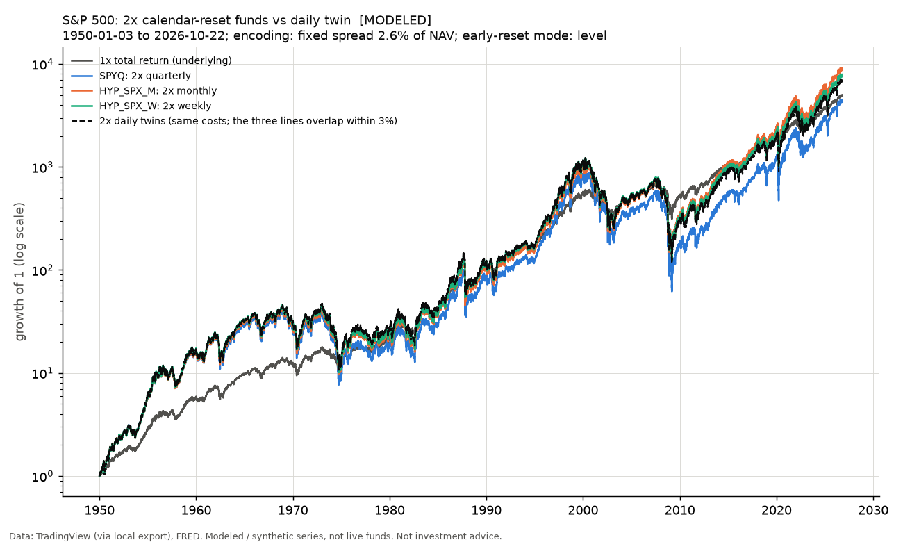
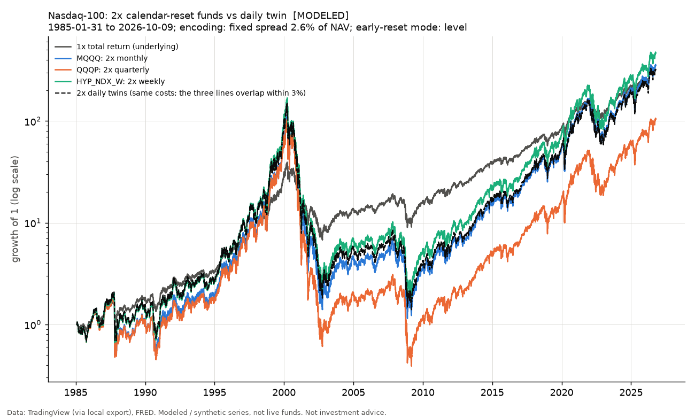

# Calendar-reset vs daily-reset 2x funds: the passive study (step 3)

Run 2026-10-27. Script `scripts/run_calendar_vs_daily.py`; numbers in `calendar_vs_daily.json`; per-start tables in `results/raw/` (git-ignored). **Every series here is synthetic. SPYQ, MQQQ and QQQP are modeled, not the live funds; the S&P 500 monthly, S&P 500 weekly and Nasdaq-100 weekly products are modeled designs (funds of those designs traded 2024-08-30 to 2025-02-28 and were liquidated; none trades today). Research tooling, not investment advice.**

## Inputs and conventions

```text
Inputs: 8 files; prices from <external>/library, rates from <external>/rates
  SP_SPX_daily.csv: 19326 rows, 1950-01-03 to 2026-10-22, sha256 8b0c1596b57e
  SP_SPXTR_daily.csv: 9780 rows, 1988-01-04 to 2026-10-23, sha256 ac309a0b90f5
  AMEX_SPY_daily.csv: 8482 rows, 1993-01-29 to 2026-10-09, sha256 38bb2ae821ff
  NASDAQ_NDX_daily.csv: 10504 rows, 1985-01-31 to 2026-10-09, sha256 4c3219bda720
  NASDAQ_XNDX_daily.csv: 5004 rows, 2006-11-08 to 2026-10-09, sha256 a10dab98993e
  NASDAQ_QQQ_daily.csv: 6940 rows, 1999-03-10 to 2026-10-09, sha256 1bf106f83579
  DFF.csv: 26398 rows, 1954-07-01 to 2026-10-08, sha256 a93504210b53
  TB3MS.csv: 1112 rows, 1934-01-01 to 2026-08-01, sha256 ebf04b1ae5bc
SPX early-reset trigger: the AMEX:SPY price (daily low) from 1993-01-29, scaled to the SP:SPX price index before that; trigger basis 'etf'; drop 35% from the fund's base; fill mode 'level'.
SPX day counts: financing (reference rate and swap spread) ACT/360; expense ratio ACT/365 (calendar days between rows, so weekends and holidays accrue).
SPX reset dates: last NYSE session of the week / month / quarter from 1970-01-01 (calendar_letf/nyse.py, refuses data that lack it); before that the last row of the period.
NDX early-reset trigger: the NASDAQ:QQQ price (daily low) from 1999-03-10, scaled to the NASDAQ:NDX price index before that; trigger basis 'etf'; drop 35% from the fund's base; fill mode 'level'.
NDX day counts: financing (reference rate and swap spread) ACT/360; expense ratio ACT/365 (calendar days between rows, so weekends and holidays accrue).
NDX reset dates: last NYSE session of the week / month / quarter from 1970-01-01 (calendar_letf/nyse.py, refuses data that lack it); before that the last row of the period.
MODELED: a live fund of this design traded 2024-08-30 to 2025-02-28; no live fund exists today
```

## Method in brief

- **Question.** Does a 2x fund that resets weekly / monthly / quarterly lose less to volatility than a 2x fund that resets daily, on the same index with the same fee, rate and spread? **Reset gap** = calendar fund CAGR minus its daily twin's CAGR over the same window, in percentage points a year (pp). Positive = the calendar fund did better.
- **Underlyings.** S&P 500 and Nasdaq-100 TOTAL RETURN (constructed before the published total-return indexes begin; see the banners). Reference rate: effective fed funds (DFF), lagged one row; TB3MS proxy before 1954-07-01.
- **Early-reset trigger (base case, R2 step 3).** The prospectus trigger watches the price of the ETF (SPY, QQQ) during the day. The base case therefore tests the ETF's daily LOW from the ETF's first bar (SPY 1993-01-29, QQQ 1999-03-10) and the index price (daily low where the export has a real one, else the close) before that; the two series are scaled to be continuous. S&P 500: ETF low prints rejected as bad: none; Nasdaq-100: ETF low prints rejected as bad: 2000-04-12, 2002-05-03, 2002-06-27. The v1 results used the index price close only (the long-history case, 1950 on); it is one row of table 9b, next to the drop sensitivity (34 / 35 / 36%) and the ETF-versus-index comparison. Fill rule: at the trigger level (mode `level`).
- **Cost encodings (both ASSUMED, always side by side).** The 2024-26 fit leaves a residual cost beyond the filed one (FINDINGS F3-F5). It is written into history two ways:

| encoding | spread per NAV | rate turns | status | sensitivities |
|---|---|---|---|---|
| fixed | 2.6% a year | 1.0 x DFF | ASSUMED | spread 1.4% / 3.5% |
| rate | 1.4% a year | 1.3 x DFF | ASSUMED | rate turns 1.0 / 1.5 |

- **Early reset.** Base mode `level` (resets at exactly -35% of the trigger); `close` and `next_close` are sensitivities (table 9). Fees: live funds VERIFIED (prospectus 2026-07-31), modeled products and the twins' copies 1.00% ASSUMED.
- **Multi-start.** Each NAV is computed once over the full history; a result for "buy at month-end s, hold h" is nav[e]/nav[s]. A month-end start is MID-PERIOD for a quarterly or weekly fund (a real investor's situation): the fund's leverage on the day of purchase is whatever it has floated to since its last reset. Starts: every month-end with a full horizon ahead.
- **Margin benchmark.** A 2x position bought once on margin, never reset (`periods.NEVER`), financed at the same rate and spread and paying the same fee, finished when the index falls 50% from the purchase. A real margin account is called well before equity hits zero, so the benchmark is OPTIMISTIC. It is bought at 2.0x on the start date, whereas a calendar fund bought mid-period has floated leverage.

## Headline: the 10-year median reset gap (all month-end starts, level mode)

Each row: the median gap in pp a year (the headline statistic), the share of starts the calendar fund wins, and the mean gap with its **headline 95% interval, the phase-pooled one**: the non-overlapping 10-year windows of each of the 120 start phases are pooled, interval = mean +/- t(df) x SE with df = the fewest windows in a phase - 1 (shown per row). **NOISY** = that interval covers zero, so this one history cannot tell the sign; **clear** = it excludes zero. Only this interval defines "clear". The block-bootstrap intervals (block = 120 months, t(k-1) x SE, 10,000 resamples) of the median and of the mean are SECONDARY columns. Block-bootstrap SE biased low with block = window length: simulated coverage of its 95% intervals 0.86-0.92 (mean) and 0.87-0.94 (median) at the published configurations, against 0.94-1.00 for the phase-pooled interval under independent months (results/coverage_sim.md, which also states the limit under persistent regimes; ASSUMPTIONS section 7). The median interval is for the median of the window gaps; the bootstrap SE of a median is a reasonable device, not an exact one. Detail: section "What one history can tell".

| underlying | product | encoding | median gap pp | wins | HEADLINE: mean, phase-pooled [95% interval] | reading | secondary: median, block bootstrap [95% interval] | reading (bb) | secondary: mean, block bootstrap [95% interval] | reading (bb) | windows |
|---|---|---|---|---|---|---|---|---|---|---|---|
| S&P 500 | SPYQ (quarterly) | fixed | -0.54 | 44% | -0.68 [-1.90, +0.54] (df 5) | NOISY | -0.54 [-2.21, +1.14] | NOISY | -0.68 [-1.49, +0.14] | NOISY | 801 |
| S&P 500 | SPYQ (quarterly) | rate | -0.59 | 44% | -0.70 [-1.94, +0.54] (df 5) | NOISY | -0.59 [-2.31, +1.12] | NOISY | -0.70 [-1.54, +0.14] | NOISY | 801 |
| S&P 500 | HYP_SPX_M (monthly) | fixed | +0.29 | 58% | +0.38 [-0.59, +1.34] (df 5) | NOISY | +0.29 [-0.85, +1.42] | NOISY | +0.38 [-0.42, +1.18] | NOISY | 801 |
| S&P 500 | HYP_SPX_M (monthly) | rate | +0.29 | 58% | +0.38 [-0.60, +1.35] (df 5) | NOISY | +0.29 [-0.86, +1.44] | NOISY | +0.38 [-0.43, +1.18] | NOISY | 801 |
| S&P 500 | HYP_SPX_W (weekly) | fixed | +0.28 | 68% | +0.19 [-0.36, +0.74] (df 5) | NOISY | +0.28 [-0.28, +0.83] | NOISY | +0.19 [-0.24, +0.62] | NOISY | 801 |
| S&P 500 | HYP_SPX_W (weekly) | rate | +0.28 | 68% | +0.19 [-0.36, +0.73] (df 5) | NOISY | +0.28 [-0.28, +0.83] | NOISY | +0.19 [-0.24, +0.62] | NOISY | 801 |
| Nasdaq-100 | MQQQ (monthly) | fixed | +1.36 | 91% | +1.02 [-2.34, +4.37] (df 2) | NOISY | +1.36 [+0.21, +2.50] | clear | +0.98 [-0.55, +2.50] | NOISY | 381 |
| Nasdaq-100 | MQQQ (monthly) | rate | +1.35 | 91% | +1.01 [-2.33, +4.36] (df 2) | NOISY | +1.35 [+0.20, +2.50] | clear | +0.97 [-0.55, +2.50] | NOISY | 381 |
| Nasdaq-100 | QQQP (quarterly) | fixed | -2.10 | 30% | -2.44 [-10.77, +5.89] (df 2) | NOISY | -2.10 [-9.90, +5.71] | NOISY | -2.46 [-7.03, +2.10] | NOISY | 381 |
| Nasdaq-100 | QQQP (quarterly) | rate | -2.13 | 30% | -2.46 [-10.78, +5.85] (df 2) | NOISY | -2.13 [-9.91, +5.66] | NOISY | -2.49 [-7.04, +2.06] | NOISY | 381 |
| Nasdaq-100 | HYP_NDX_W (weekly) | fixed | +1.13 | 96% | +1.16 [-0.26, +2.58] (df 2) | NOISY | +1.13 [+0.35, +1.91] | clear | +1.15 [+0.38, +1.93] | clear | 381 |
| Nasdaq-100 | HYP_NDX_W (weekly) | rate | +1.14 | 96% | +1.17 [-0.25, +2.58] (df 2) | NOISY | +1.14 [+0.36, +1.91] | clear | +1.16 [+0.39, +1.93] | clear | 381 |

Provenance: as the multi-start tables below (section 2 of each underlying); underlying total return, level mode, both ASSUMED cost encodings.

## What one history can tell

Every headline above is one number from one history. Two intervals say how far it could move. (1) **HEADLINE: non-overlapping windows, pooled over start phases.** Every 120th start forms one set of independent windows; the 120 sets (phases) are pooled (SE^2 = average of each phase's s^2/k; df = smallest k - 1; interval = mean +/- t(df) x SE). It uses only independent windows and is wide because there are 3-7 of them. Simulated coverage on gap series with the overlap of rolling 120-month windows is 0.97-1.00 (conservative; tests/test_stats.py). A headline is **NOISY** when this interval covers zero: the data cannot separate it from no effect; "clear" is defined on this interval only. (2) **SECONDARY: block bootstrap over all month-end starts.** Windows that start a month apart share all but one month, so the bootstrap resamples blocks of consecutive starts, one block = the horizon in months; interval = mean +/- t(k-1) x SE, k = starts // block, 10,000 resamples, seed 0. Block-bootstrap SE biased low with block = window length: simulated coverage of its 95% intervals 0.86-0.92 (mean) and 0.87-0.94 (median) at the published configurations, against 0.94-1.00 for the phase-pooled interval under independent months (results/coverage_sim.md, which also states the limit under persistent regimes; ASSUMPTIONS section 7). The median has its own block-bootstrap interval (same blocks, same resamples; median +/- t(k-1) x SE of the median); the bootstrap SE of a median is a reasonable device, not an exact one on skewed data. Median and mean sit side by side because a median comparison favors the less convex structure (the calendar fund).

| underlying | product | encoding | median pp | mean pp | HEADLINE: phase-pooled SE of the mean | df (t; windows per phase) | 95% interval of the mean | reading | phases whose own interval excludes 0 | secondary: bootstrap SE of mean | blocks k (t) | 95% interval of the mean (block bootstrap) | reading (bb) | secondary: bootstrap SE of median | 95% interval of the median (block bootstrap) | reading (bb) |
|---|---|---|---|---|---|---|---|---|---|---|---|---|---|---|---|---|
| S&P 500 | SPYQ (quarterly) | fixed | -0.54 | -0.68 | +0.47 | 5 (t = 2.57; windows 6-7) | [-1.90, +0.54] | NOISY | 0% | +0.32 | 6 (t = 2.57) | [-1.49, +0.14] | NOISY | +0.65 | [-2.21, +1.14] | NOISY |
| S&P 500 | SPYQ (quarterly) | rate | -0.59 | -0.70 | +0.48 | 5 (t = 2.57; windows 6-7) | [-1.94, +0.54] | NOISY | 0% | +0.33 | 6 (t = 2.57) | [-1.54, +0.14] | NOISY | +0.67 | [-2.31, +1.12] | NOISY |
| S&P 500 | HYP_SPX_M (monthly) | fixed | +0.29 | +0.38 | +0.38 | 5 (t = 2.57; windows 6-7) | [-0.59, +1.34] | NOISY | 0% | +0.31 | 6 (t = 2.57) | [-0.42, +1.18] | NOISY | +0.44 | [-0.85, +1.42] | NOISY |
| S&P 500 | HYP_SPX_M (monthly) | rate | +0.29 | +0.38 | +0.38 | 5 (t = 2.57; windows 6-7) | [-0.60, +1.35] | NOISY | 0% | +0.31 | 6 (t = 2.57) | [-0.43, +1.18] | NOISY | +0.45 | [-0.86, +1.44] | NOISY |
| S&P 500 | HYP_SPX_W (weekly) | fixed | +0.28 | +0.19 | +0.21 | 5 (t = 2.57; windows 6-7) | [-0.36, +0.74] | NOISY | 0% | +0.17 | 6 (t = 2.57) | [-0.24, +0.62] | NOISY | +0.22 | [-0.28, +0.83] | NOISY |
| S&P 500 | HYP_SPX_W (weekly) | rate | +0.28 | +0.19 | +0.21 | 5 (t = 2.57; windows 6-7) | [-0.36, +0.73] | NOISY | 0% | +0.17 | 6 (t = 2.57) | [-0.24, +0.62] | NOISY | +0.22 | [-0.28, +0.83] | NOISY |
| Nasdaq-100 | MQQQ (monthly) | fixed | +1.36 | +0.98 | +0.78 | 2 (t = 4.30; windows 3-4) | [-2.34, +4.37] | NOISY | 41% | +0.36 | 3 (t = 4.30) | [-0.55, +2.50] | NOISY | +0.27 | [+0.21, +2.50] | clear |
| Nasdaq-100 | MQQQ (monthly) | rate | +1.35 | +0.97 | +0.78 | 2 (t = 4.30; windows 3-4) | [-2.33, +4.36] | NOISY | 41% | +0.35 | 3 (t = 4.30) | [-0.55, +2.50] | NOISY | +0.27 | [+0.20, +2.50] | clear |
| Nasdaq-100 | QQQP (quarterly) | fixed | -2.10 | -2.46 | +1.94 | 2 (t = 4.30; windows 3-4) | [-10.77, +5.89] | NOISY | 0% | +1.06 | 3 (t = 4.30) | [-7.03, +2.10] | NOISY | +1.81 | [-9.90, +5.71] | NOISY |
| Nasdaq-100 | QQQP (quarterly) | rate | -2.13 | -2.49 | +1.93 | 2 (t = 4.30; windows 3-4) | [-10.78, +5.85] | NOISY | 0% | +1.06 | 3 (t = 4.30) | [-7.04, +2.06] | NOISY | +1.81 | [-9.91, +5.66] | NOISY |
| Nasdaq-100 | HYP_NDX_W (weekly) | fixed | +1.13 | +1.15 | +0.33 | 2 (t = 4.30; windows 3-4) | [-0.26, +2.58] | NOISY | 42% | +0.18 | 3 (t = 4.30) | [+0.38, +1.93] | clear | +0.18 | [+0.35, +1.91] | clear |
| Nasdaq-100 | HYP_NDX_W (weekly) | rate | +1.14 | +1.16 | +0.33 | 2 (t = 4.30; windows 3-4) | [-0.25, +2.58] | NOISY | 42% | +0.18 | 3 (t = 4.30) | [+0.39, +1.93] | clear | +0.18 | [+0.36, +1.91] | clear |

Ten-year headlines whose phase-pooled interval covers zero (NOISY): 6 of 6 (fixed encoding), 6 of 6 (rate encoding). For comparison, the secondary block-bootstrap interval of the mean covers zero in 5 of 6 (fixed) and 5 of 6 (rate). Provenance: `multi_start` in `calendar_letf/study.py`; intervals from `calendar_letf/stats.py`; ASSUMPTIONS section 7 states the conventions.


---

# S&P 500

Underlying banner: `[SPX_TR] symbols: SP:SPX, SP:SPXTR; basis: constructed; published 1988-01-04 on (PUBLISHED (SP:SPXTR as exported)); before that price + Shiller's measured monthly dividend yield (mean 4.10%/yr over the pre-splice years) (MEASURED (Shiller monthly D/P; quarterly dividends interpolated to months by the source)); splice date 1988-01-04; days missing from the published series carried by the price move: ['1994-04-27']; stale published rows on non-trading days dropped: ['2001-09-11', '2001-09-12', '2001-09-13', '2001-09-14']; published rows after the price file's last date dropped: ['2026-10-23'] (top up the price file)`

Rate: FRED DFF (effective fed funds), lagged one row; TB3MS proxy where DFF is not yet published. Proxy rows (TB3MS, before 1954-07-01): 1125 (until 1954-07-01); rule: TB3MS monthly average shifted forward one month (month t uses month t-1's average), then lagged one row. Last published DFF date 2026-10-08; stale (forward-filled) rows: 10.

## S&P 500 1. Full-history equity curves and risk statistics



*Chart: fixed-spread encoding, level mode. Data: TradingView (via local export), FRED. Modeled / synthetic series, not live funds. Not investment advice.*

*Underlying: S&P 500 total return 1950-01-03 to 2026-10-22 (early-reset trigger: the AMEX:SPY price (daily low) from 1993-01-29, scaled to the SP:SPX price index before that). Window: full history 1950-01-03 to 2026-10-22. Encoding: fixed spread 2.6% of NAV: spread 2.60% of NAV a year + 1 x reference rate on the borrowed turn + product fee [ASSUMED]. Early-reset mode: level. Fees: SPYQ 1.00% [VERIFIED_prospectus_2026-07-31]; HYP_SPX_M 1.00% [ASSUMED]; HYP_SPX_W 1.00% [ASSUMED]; daily twins copy their fund's fee. Spread and rate turns: ASSUMED (fitted on 2024-26). All series synthetic; the live funds are modeled, and the other calendar-reset products are MODELED designs (MODELED: a live fund of this design traded 2024-08-30 to 2025-02-28; no live fund exists today).*

| series | CAGR | ann. vol | max drawdown | Calmar | Sortino | Ulcer index | time under water | longest recovery (trading days) | growth of 1 |
|---|---|---|---|---|---|---|---|---|---|
| 1x total return | 11.7% | 15.7% | -55.3% | 0.21 | 1.11 | 0.117 | 89% | 1542 | 4,901.7 |
| SPYQ | 11.5% | 34.0% | -93.3% | 0.12 | 0.70 | 0.378 | 94% | 4458 | 4,334.0 |
| TWIN_SPYQ | 12.2% | 31.5% | -90.5% | 0.13 | 0.74 | 0.344 | 94% | 4320 | 6,746.0 |
| HYP_SPX_M | 12.6% | 33.1% | -88.6% | 0.14 | 0.75 | 0.332 | 94% | 4150 | 8,800.8 |
| TWIN_HYP_SPX_M | 12.2% | 31.5% | -90.5% | 0.13 | 0.74 | 0.344 | 94% | 4320 | 6,746.0 |
| HYP_SPX_W | 12.3% | 31.8% | -89.8% | 0.14 | 0.75 | 0.341 | 94% | 4236 | 7,599.1 |
| TWIN_HYP_SPX_W | 12.2% | 31.5% | -90.5% | 0.13 | 0.74 | 0.344 | 94% | 4320 | 6,746.0 |

*Underlying: S&P 500 total return 1950-01-03 to 2026-10-22 (early-reset trigger: the AMEX:SPY price (daily low) from 1993-01-29, scaled to the SP:SPX price index before that). Window: full history 1950-01-03 to 2026-10-22. Encoding: rate-proportional (1.4% spread + 1.3 x rate): spread 1.40% of NAV a year + 1.3 x reference rate on the borrowed turn + product fee [ASSUMED]. Early-reset mode: level. Fees: SPYQ 1.00% [VERIFIED_prospectus_2026-07-31]; HYP_SPX_M 1.00% [ASSUMED]; HYP_SPX_W 1.00% [ASSUMED]; daily twins copy their fund's fee. Spread and rate turns: ASSUMED (fitted on 2024-26). All series synthetic; the live funds are modeled, and the other calendar-reset products are MODELED designs (MODELED: a live fund of this design traded 2024-08-30 to 2025-02-28; no live fund exists today).*

| series | CAGR | ann. vol | max drawdown | Calmar | Sortino | Ulcer index | time under water | longest recovery (trading days) | growth of 1 |
|---|---|---|---|---|---|---|---|---|---|
| 1x total return | 11.7% | 15.7% | -55.3% | 0.21 | 1.11 | 0.117 | 89% | 1542 | 4,901.7 |
| SPYQ | 11.4% | 34.0% | -93.1% | 0.12 | 0.70 | 0.387 | 94% | 4395 | 3,861.6 |
| TWIN_SPYQ | 12.0% | 31.5% | -90.3% | 0.13 | 0.73 | 0.350 | 94% | 4290 | 6,118.7 |
| HYP_SPX_M | 12.4% | 33.1% | -88.4% | 0.14 | 0.74 | 0.342 | 94% | 4302 | 7,935.6 |
| TWIN_HYP_SPX_M | 12.0% | 31.5% | -90.3% | 0.13 | 0.73 | 0.350 | 94% | 4290 | 6,118.7 |
| HYP_SPX_W | 12.2% | 31.8% | -89.6% | 0.14 | 0.74 | 0.350 | 94% | 4316 | 6,886.7 |
| TWIN_HYP_SPX_W | 12.0% | 31.5% | -90.3% | 0.13 | 0.73 | 0.350 | 94% | 4290 | 6,118.7 |

## S&P 500 2. Multi-start summary (every month-end start; horizons 1 / 3 / 5 / 10 years)

CAGR columns: median (10th to 90th percentile). Max drawdown: median over windows. Worst terminal: lowest growth of 1 over any window. Gap = calendar CAGR minus twin CAGR (pp a year). A month-end start is mid-period for a quarterly or weekly fund.

**Encoding fixed.**

*Underlying: S&P 500 total return 1950-01-03 to 2026-10-22 (early-reset trigger: the AMEX:SPY price (daily low) from 1993-01-29, scaled to the SP:SPX price index before that). Window: 1950-01-31 start to 2025-09-30 start, 1-10 year horizons. Encoding: fixed spread 2.6% of NAV: spread 2.60% of NAV a year + 1 x reference rate on the borrowed turn + product fee [ASSUMED]. Early-reset mode: level. Fees: SPYQ 1.00% [VERIFIED_prospectus_2026-07-31]; HYP_SPX_M 1.00% [ASSUMED]; HYP_SPX_W 1.00% [ASSUMED]; daily twins copy their fund's fee. Spread and rate turns: ASSUMED (fitted on 2024-26). All series synthetic; the live funds are modeled, and the other calendar-reset products are MODELED designs (MODELED: a live fund of this design traded 2024-08-30 to 2025-02-28; no live fund exists today).*

| product | years | starts | calendar CAGR | cal. max DD | cal. worst x | twin CAGR | twin max DD | twin worst x | gap pp (p10 to p90) | calendar wins | 1x CAGR |
|---|---|---|---|---|---|---|---|---|---|---|---|
| SPYQ (quarterly) | 1 | 909 | 18.8% (-29% to 59%) | -21% | 0.19 | 17.9% (-27% to 60%) | -21% | 0.25 | +0.16 (-2.3 to +1.6) | 55% | 14.2% |
| SPYQ (quarterly) | 3 | 885 | 13.6% (-15% to 37%) | -39% | 0.18 | 13.9% (-12% to 36%) | -37% | 0.24 | -0.05 (-2.4 to +1.1) | 48% | 11.9% |
| SPYQ (quarterly) | 5 | 861 | 12.5% (-12% to 32%) | -54% | 0.21 | 12.9% (-10% to 31%) | -49% | 0.28 | -0.06 (-3.5 to +0.8) | 47% | 12.0% |
| SPYQ (quarterly) | 10 | 801 | 10.8% (-6% to 23%) | -65% | 0.12 | 11.0% (-5% to 24%) | -61% | 0.15 | -0.54 (-2.2 to +0.6) | 44% | 11.1% |
| HYP_SPX_M (monthly) | 1 | 909 | 18.5% (-27% to 61%) | -21% | 0.28 | 17.9% (-27% to 60%) | -21% | 0.25 | +0.04 (-1.0 to +1.8) | 52% | 14.2% |
| HYP_SPX_M (monthly) | 3 | 885 | 14.1% (-11% to 37%) | -38% | 0.25 | 13.9% (-12% to 36%) | -37% | 0.24 | +0.11 (-0.8 to +1.5) | 56% | 11.9% |
| HYP_SPX_M (monthly) | 5 | 861 | 13.2% (-9% to 32%) | -50% | 0.31 | 12.9% (-10% to 31%) | -49% | 0.28 | +0.18 (-0.7 to +1.6) | 58% | 12.0% |
| HYP_SPX_M (monthly) | 10 | 801 | 11.5% (-4% to 24%) | -64% | 0.19 | 11.0% (-5% to 24%) | -61% | 0.15 | +0.29 (-0.6 to +1.9) | 58% | 11.1% |
| HYP_SPX_W (weekly) | 1 | 909 | 18.2% (-27% to 61%) | -21% | 0.26 | 17.9% (-27% to 60%) | -21% | 0.25 | +0.02 (-0.5 to +0.9) | 52% | 14.2% |
| HYP_SPX_W (weekly) | 3 | 885 | 14.3% (-12% to 36%) | -37% | 0.24 | 13.9% (-12% to 36%) | -37% | 0.24 | +0.09 (-0.4 to +0.9) | 59% | 11.9% |
| HYP_SPX_W (weekly) | 5 | 861 | 13.1% (-10% to 32%) | -49% | 0.29 | 12.9% (-10% to 31%) | -49% | 0.28 | +0.15 (-0.5 to +1.1) | 65% | 12.0% |
| HYP_SPX_W (weekly) | 10 | 801 | 11.2% (-4% to 24%) | -59% | 0.16 | 11.0% (-5% to 24%) | -61% | 0.15 | +0.28 (-0.6 to +0.8) | 68% | 11.1% |

Uncertainty of the gap (mean over starts). HEADLINE interval: non-overlapping windows pooled over start phases (step = the horizon in months; mean +/- t(df) x SE); NOISY = it covers zero. Secondary intervals: block bootstrap (block = horizon in months, 10,000 resamples) for the mean and the median. Block-bootstrap SE biased low with block = window length: simulated coverage of its 95% intervals 0.86-0.92 (mean) and 0.87-0.94 (median) at the published configurations, against 0.94-1.00 for the phase-pooled interval under independent months (results/coverage_sim.md, which also states the limit under persistent regimes; ASSUMPTIONS section 7).

| product | years | median gap pp | mean gap pp | HEADLINE: phase-pooled mean [95% interval] | df | reading | secondary: bootstrap mean [95% interval] | SE | blocks k | reading (bb) | secondary: bootstrap median [95% interval] | reading (bb) |
|---|---|---|---|---|---|---|---|---|---|---|---|---|
| SPYQ (quarterly) | 1 | +0.16 | -0.27 | -0.27 [-0.87, +0.33] | 74 | NOISY | [-0.71, +0.18] | +0.22 | 75 | NOISY | [-0.12, +0.43] | NOISY |
| SPYQ (quarterly) | 3 | -0.05 | -0.49 | -0.49 [-1.27, +0.30] | 23 | NOISY | [-1.07, +0.10] | +0.28 | 24 | NOISY | [-0.37, +0.28] | NOISY |
| SPYQ (quarterly) | 5 | -0.06 | -0.58 | -0.58 [-1.47, +0.32] | 13 | NOISY | [-1.25, +0.10] | +0.31 | 14 | NOISY | [-0.64, +0.52] | NOISY |
| SPYQ (quarterly) | 10 | -0.54 | -0.68 | -0.68 [-1.90, +0.54] | 5 | NOISY | [-1.49, +0.14] | +0.32 | 6 | NOISY | [-2.21, +1.14] | NOISY |
| HYP_SPX_M (monthly) | 1 | +0.04 | +0.30 | +0.30 [-0.03, +0.63] | 74 | NOISY | [+0.03, +0.57] | +0.14 | 75 | clear | [-0.16, +0.24] | NOISY |
| HYP_SPX_M (monthly) | 3 | +0.11 | +0.34 | +0.34 [-0.10, +0.78] | 23 | NOISY | [-0.04, +0.72] | +0.18 | 24 | NOISY | [-0.32, +0.53] | NOISY |
| HYP_SPX_M (monthly) | 5 | +0.18 | +0.37 | +0.37 [-0.20, +0.93] | 13 | NOISY | [-0.13, +0.86] | +0.23 | 14 | NOISY | [-0.49, +0.85] | NOISY |
| HYP_SPX_M (monthly) | 10 | +0.29 | +0.38 | +0.38 [-0.59, +1.34] | 5 | NOISY | [-0.42, +1.18] | +0.31 | 6 | NOISY | [-0.85, +1.42] | NOISY |
| HYP_SPX_W (weekly) | 1 | +0.02 | +0.13 | +0.13 [-0.08, +0.34] | 74 | NOISY | [-0.04, +0.30] | +0.09 | 75 | NOISY | [-0.06, +0.10] | NOISY |
| HYP_SPX_W (weekly) | 3 | +0.09 | +0.18 | +0.18 [-0.13, +0.49] | 23 | NOISY | [-0.07, +0.43] | +0.12 | 24 | NOISY | [-0.08, +0.27] | NOISY |
| HYP_SPX_W (weekly) | 5 | +0.15 | +0.19 | +0.19 [-0.17, +0.55] | 13 | NOISY | [-0.11, +0.49] | +0.14 | 14 | NOISY | [-0.11, +0.40] | NOISY |
| HYP_SPX_W (weekly) | 10 | +0.28 | +0.19 | +0.19 [-0.36, +0.74] | 5 | NOISY | [-0.24, +0.62] | +0.17 | 6 | NOISY | [-0.28, +0.83] | NOISY |

**Encoding rate.**

*Underlying: S&P 500 total return 1950-01-03 to 2026-10-22 (early-reset trigger: the AMEX:SPY price (daily low) from 1993-01-29, scaled to the SP:SPX price index before that). Window: 1950-01-31 start to 2025-09-30 start, 1-10 year horizons. Encoding: rate-proportional (1.4% spread + 1.3 x rate): spread 1.40% of NAV a year + 1.3 x reference rate on the borrowed turn + product fee [ASSUMED]. Early-reset mode: level. Fees: SPYQ 1.00% [VERIFIED_prospectus_2026-07-31]; HYP_SPX_M 1.00% [ASSUMED]; HYP_SPX_W 1.00% [ASSUMED]; daily twins copy their fund's fee. Spread and rate turns: ASSUMED (fitted on 2024-26). All series synthetic; the live funds are modeled, and the other calendar-reset products are MODELED designs (MODELED: a live fund of this design traded 2024-08-30 to 2025-02-28; no live fund exists today).*

| product | years | starts | calendar CAGR | cal. max DD | cal. worst x | twin CAGR | twin max DD | twin worst x | gap pp (p10 to p90) | calendar wins | 1x CAGR |
|---|---|---|---|---|---|---|---|---|---|---|---|
| SPYQ (quarterly) | 1 | 909 | 18.1% (-29% to 59%) | -21% | 0.19 | 17.5% (-28% to 61%) | -21% | 0.26 | +0.12 (-2.3 to +1.6) | 54% | 14.2% |
| SPYQ (quarterly) | 3 | 885 | 13.5% (-15% to 37%) | -39% | 0.18 | 13.7% (-12% to 36%) | -37% | 0.24 | -0.06 (-2.4 to +1.1) | 48% | 11.9% |
| SPYQ (quarterly) | 5 | 861 | 12.1% (-12% to 32%) | -54% | 0.22 | 12.4% (-10% to 32%) | -49% | 0.28 | -0.08 (-3.6 to +0.8) | 47% | 12.0% |
| SPYQ (quarterly) | 10 | 801 | 9.9% (-7% to 24%) | -65% | 0.12 | 10.3% (-5% to 24%) | -61% | 0.16 | -0.59 (-2.3 to +0.6) | 44% | 11.1% |
| HYP_SPX_M (monthly) | 1 | 909 | 18.3% (-28% to 61%) | -21% | 0.28 | 17.5% (-28% to 61%) | -21% | 0.26 | +0.04 (-1.0 to +1.8) | 51% | 14.2% |
| HYP_SPX_M (monthly) | 3 | 885 | 14.1% (-12% to 37%) | -38% | 0.25 | 13.7% (-12% to 36%) | -37% | 0.24 | +0.12 (-0.8 to +1.5) | 55% | 11.9% |
| HYP_SPX_M (monthly) | 5 | 861 | 12.4% (-9% to 32%) | -50% | 0.31 | 12.4% (-10% to 32%) | -49% | 0.28 | +0.17 (-0.7 to +1.6) | 58% | 12.0% |
| HYP_SPX_M (monthly) | 10 | 801 | 10.5% (-5% to 24%) | -64% | 0.19 | 10.3% (-5% to 24%) | -61% | 0.16 | +0.29 (-0.6 to +1.9) | 58% | 11.1% |
| HYP_SPX_W (weekly) | 1 | 909 | 17.5% (-28% to 61%) | -21% | 0.27 | 17.5% (-28% to 61%) | -21% | 0.26 | +0.02 (-0.5 to +0.9) | 52% | 14.2% |
| HYP_SPX_W (weekly) | 3 | 885 | 14.3% (-12% to 36%) | -37% | 0.24 | 13.7% (-12% to 36%) | -37% | 0.24 | +0.09 (-0.4 to +0.9) | 59% | 11.9% |
| HYP_SPX_W (weekly) | 5 | 861 | 12.7% (-10% to 32%) | -49% | 0.29 | 12.4% (-10% to 32%) | -49% | 0.28 | +0.15 (-0.5 to +1.1) | 65% | 12.0% |
| HYP_SPX_W (weekly) | 10 | 801 | 10.5% (-5% to 24%) | -59% | 0.17 | 10.3% (-5% to 24%) | -61% | 0.16 | +0.28 (-0.6 to +0.8) | 68% | 11.1% |

Uncertainty of the gap (mean over starts). HEADLINE interval: non-overlapping windows pooled over start phases (step = the horizon in months; mean +/- t(df) x SE); NOISY = it covers zero. Secondary intervals: block bootstrap (block = horizon in months, 10,000 resamples) for the mean and the median. Block-bootstrap SE biased low with block = window length: simulated coverage of its 95% intervals 0.86-0.92 (mean) and 0.87-0.94 (median) at the published configurations, against 0.94-1.00 for the phase-pooled interval under independent months (results/coverage_sim.md, which also states the limit under persistent regimes; ASSUMPTIONS section 7).

| product | years | median gap pp | mean gap pp | HEADLINE: phase-pooled mean [95% interval] | df | reading | secondary: bootstrap mean [95% interval] | SE | blocks k | reading (bb) | secondary: bootstrap median [95% interval] | reading (bb) |
|---|---|---|---|---|---|---|---|---|---|---|---|---|
| SPYQ (quarterly) | 1 | +0.12 | -0.29 | -0.29 [-0.89, +0.32] | 74 | NOISY | [-0.74, +0.16] | +0.23 | 75 | NOISY | [-0.17, +0.40] | NOISY |
| SPYQ (quarterly) | 3 | -0.06 | -0.51 | -0.51 [-1.30, +0.28] | 23 | NOISY | [-1.10, +0.09] | +0.29 | 24 | NOISY | [-0.41, +0.29] | NOISY |
| SPYQ (quarterly) | 5 | -0.08 | -0.60 | -0.60 [-1.51, +0.31] | 13 | NOISY | [-1.29, +0.09] | +0.32 | 14 | NOISY | [-0.66, +0.51] | NOISY |
| SPYQ (quarterly) | 10 | -0.59 | -0.70 | -0.70 [-1.94, +0.54] | 5 | NOISY | [-1.54, +0.14] | +0.33 | 6 | NOISY | [-2.31, +1.12] | NOISY |
| HYP_SPX_M (monthly) | 1 | +0.04 | +0.30 | +0.30 [-0.03, +0.62] | 74 | NOISY | [+0.02, +0.57] | +0.14 | 75 | clear | [-0.16, +0.23] | NOISY |
| HYP_SPX_M (monthly) | 3 | +0.12 | +0.34 | +0.34 [-0.11, +0.78] | 23 | NOISY | [-0.05, +0.72] | +0.19 | 24 | NOISY | [-0.31, +0.54] | NOISY |
| HYP_SPX_M (monthly) | 5 | +0.17 | +0.36 | +0.36 [-0.21, +0.93] | 13 | NOISY | [-0.14, +0.86] | +0.23 | 14 | NOISY | [-0.51, +0.84] | NOISY |
| HYP_SPX_M (monthly) | 10 | +0.29 | +0.38 | +0.38 [-0.60, +1.35] | 5 | NOISY | [-0.43, +1.18] | +0.31 | 6 | NOISY | [-0.86, +1.44] | NOISY |
| HYP_SPX_W (weekly) | 1 | +0.02 | +0.13 | +0.13 [-0.08, +0.34] | 74 | NOISY | [-0.04, +0.30] | +0.09 | 75 | NOISY | [-0.06, +0.09] | NOISY |
| HYP_SPX_W (weekly) | 3 | +0.09 | +0.18 | +0.18 [-0.13, +0.48] | 23 | NOISY | [-0.07, +0.43] | +0.12 | 24 | NOISY | [-0.08, +0.27] | NOISY |
| HYP_SPX_W (weekly) | 5 | +0.15 | +0.19 | +0.19 [-0.17, +0.55] | 13 | NOISY | [-0.11, +0.48] | +0.14 | 14 | NOISY | [-0.11, +0.40] | NOISY |
| HYP_SPX_W (weekly) | 10 | +0.28 | +0.19 | +0.19 [-0.36, +0.73] | 5 | NOISY | [-0.24, +0.62] | +0.17 | 6 | NOISY | [-0.28, +0.83] | NOISY |

## S&P 500 2b. The same 10-year gap over NON-overlapping windows (how many independent samples there really are)

The month-end starts above overlap, so 801 windows are far fewer independent observations. Taking every 120th month-end gives one set of non-overlapping 10-year windows; there are 120 such sets (phases). Cells: windows per phase, the share of phases in which the calendar fund won a majority of its windows, and the median (min to max) win share across phases.

**Encoding fixed.**

| product | windows per phase | phases with a majority of wins | phases all positive | win share: median (min to max) |
|---|---|---|---|---|
| SPYQ (quarterly) | 6-7 | 11% | 0% | 43% (29% to 57%) |
| HYP_SPX_M (monthly) | 6-7 | 87% | 0% | 57% (50% to 67%) |
| HYP_SPX_W (weekly) | 6-7 | 90% | 0% | 71% (50% to 71%) |

**Encoding rate.**

| product | windows per phase | phases with a majority of wins | phases all positive | win share: median (min to max) |
|---|---|---|---|---|
| SPYQ (quarterly) | 6-7 | 10% | 0% | 43% (29% to 57%) |
| HYP_SPX_M (monthly) | 6-7 | 87% | 0% | 57% (50% to 67%) |
| HYP_SPX_W (weekly) | 6-7 | 90% | 0% | 71% (50% to 71%) |

## S&P 500 3. By decade (C2): does the sign follow the index's day-to-day autocorrelation?

A decade runs from the last close before 1 January of its first year to the last close of its last year (partial decades marked). Autocorrelation: lag-1 of the total-return series' daily log returns, with its standard error 1/sqrt(n) and z (and the robust z of VR(2)). Win share: month-end starts in the decade, 1-year horizon. Variance ratios VR(5) / VR(21) / VR(63) (weekly / monthly / quarterly horizon) are Lo-MacKinlay unbiased estimates on simple daily returns with the heteroskedasticity-robust z; **\*** marks |z| > 1.96, a ratio that differs from 1 at the 5% level. VR below 1 = daily moves tend to reverse.

| decade | days | mean daily | sd daily | AR(1) (se; z; robust z) | VR(5) (z) | VR(21) (z) | VR(63) (z) |
|---|---|---|---|---|---|---|---|
| 1950s | 2510 | +0.073% | 0.72% | +0.094 (0.020; +4.7*; +3.4*) | 1.054 (+0.9) | 1.115 (+0.9) | 1.038 (+0.2) |
| 1960s | 2489 | +0.032% | 0.64% | +0.154 (0.020; +7.7*; +3.3*) | 1.274 (+3.0*) | 1.475 (+2.8*) | 1.473 (+1.8) |
| 1970s | 2526 | +0.026% | 0.86% | +0.251 (0.020; +12.6*; +9.2*) | 1.408 (+6.8*) | 1.414 (+3.0*) | 1.407 (+1.7) |
| 1980s | 2529 | +0.070% | 1.08% | +0.049 (0.020; +2.5*; +0.8) | 0.977 (-0.2) | 0.910 (-0.4) | 0.897 (-0.3) |
| 1990s | 2529 | +0.070% | 0.89% | +0.016 (0.020; +0.8; +0.5) | 0.977 (-0.4) | 0.819 (-1.3) | 0.740 (-1.1) |
| 2000s | 2515 | +0.006% | 1.40% | -0.086 (0.020; -4.3*; -2.5*) | 0.792 (-2.6*) | 0.695 (-1.6) | 0.655 (-1.1) |
| 2010s | 2516 | +0.055% | 0.93% | -0.046 (0.020; -2.3*; -1.4) | 0.901 (-1.4) | 0.697 (-1.9) | 0.524 (-1.9) |
| 2020s (partial) | 1711 | +0.064% | 1.27% | -0.164 (0.024; -6.8*; -2.3*) | 0.807 (-1.3) | 0.771 (-0.7) | 0.501 (-1.1) |
| **full sample** | 19325 | +0.049% | 0.99% | -0.002 (0.007; -0.3; -0.1) | 0.960 (-1.0) | 0.895 (-1.3) | 0.828 (-1.4) |

Decades whose variance ratio differs from 1 at the 5% level (robust z): VR(5) 3 of 8, VR(21) 2 of 8, VR(63) 0 of 8. Ratios and z do not depend on the cost encoding.

**Encoding fixed.**

*Underlying: S&P 500 total return 1950-01-03 to 2026-10-22 (early-reset trigger: the AMEX:SPY price (daily low) from 1993-01-29, scaled to the SP:SPX price index before that). Window: 1950-01-03 to 2026-10-22 by decade. Encoding: fixed spread 2.6% of NAV: spread 2.60% of NAV a year + 1 x reference rate on the borrowed turn + product fee [ASSUMED]. Early-reset mode: level. Fees: SPYQ 1.00% [VERIFIED_prospectus_2026-07-31]; HYP_SPX_M 1.00% [ASSUMED]; HYP_SPX_W 1.00% [ASSUMED]; daily twins copy their fund's fee. Spread and rate turns: ASSUMED (fitted on 2024-26). All series synthetic; the live funds are modeled, and the other calendar-reset products are MODELED designs (MODELED: a live fund of this design traded 2024-08-30 to 2025-02-28; no live fund exists today).*

| decade | autocorr lag-1 | 1x CAGR | SPYQ gap pp / 1y wins | HYP_SPX_M gap pp / 1y wins | HYP_SPX_W gap pp / 1y wins |
|---|---|---|---|---|---|
| 1950s | +0.094 | 19.4% | -0.34 / 26% | -0.21 / 27% | +0.06 / 62% |
| 1960s | +0.154 | 7.7% | -0.96 / 32% | -0.49 / 14% | -0.18 / 15% |
| 1970s | +0.251 | 5.8% | -2.35 / 43% | -0.73 / 17% | -0.71 / 5% |
| 1980s | +0.049 | 17.5% | +0.33 / 64% | +0.37 / 52% | +0.69 / 44% |
| 1990s | +0.016 | 18.2% | +0.28 / 78% | +0.18 / 57% | +0.25 / 65% |
| 2000s | -0.086 | -0.9% | -1.86 / 62% | +1.84 / 98% | +0.66 / 84% |
| 2010s | -0.046 | 13.6% | +0.42 / 75% | +0.74 / 86% | +0.26 / 78% |
| 2020s (partial) | -0.164 | 15.2% | +0.79 / 62% | +1.53 / 70% | +0.50 / 75% |

| decade | SPYQ cal / twin CAGR | HYP_SPX_M cal / twin CAGR | HYP_SPX_W cal / twin CAGR |
|---|---|---|---|
| 1950s | 32.5% / 32.9% | 32.6% / 32.9% | 32.9% / 32.9% |
| 1960s | 5.2% / 6.2% | 5.7% / 6.2% | 6.0% / 6.2% |
| 1970s | -3.8% / -1.5% | -2.2% / -1.5% | -2.2% / -1.5% |
| 1980s | 16.7% / 16.4% | 16.8% / 16.4% | 17.1% / 16.4% |
| 1990s | 25.6% / 25.3% | 25.5% / 25.3% | 25.6% / 25.3% |
| 2000s | -14.5% / -12.6% | -10.8% / -12.6% | -12.0% / -12.6% |
| 2010s | 21.3% / 20.9% | 21.6% / 20.9% | 21.2% / 20.9% |
| 2020s | 20.1% / 19.3% | 20.9% / 19.3% | 19.8% / 19.3% |

Predicted versus realized sign of the calendar-minus-daily gap, per decade. Prediction = Bessembinder's second-order formula -2 x [C(T,2) mu^2 + T sigma^2 / 2 (VR_T - 1)] per reset period, with mu and sigma the decade's mean and sd of the daily simple return and VR_T at the product's own horizon (T = 5 weekly, 21 monthly, 63 quarterly), shown in pp a year. It leaves out costs, the early-reset trigger and the financing difference; the calendar fund is ahead when VR_T < 1 - (T-1) mu^2 / sigma^2 (the crossover VR). Cells: predicted pp a year / realized pp a year; ok = same sign, MISS = different sign.

| decade | SPYQ (quarterly, T=63): crossover VR; VR_T; predicted / realized | HYP_SPX_M (monthly, T=21): crossover VR; VR_T; predicted / realized | HYP_SPX_W (weekly, T=5): crossover VR; VR_T; predicted / realized |
|---|---|---|---|
| 1950s | 0.364; 1.038; -0.88 / -0.34 ok | 0.795; 1.115; -0.42 / -0.21 ok | 0.959; 1.054; -0.12 / +0.06 MISS |
| 1960s | 0.845; 1.473; -0.65 / -0.96 ok | 0.950; 1.475; -0.54 / -0.49 ok | 0.990; 1.274; -0.29 / -0.18 ok |
| 1970s | 0.944; 1.407; -0.86 / -2.35 ok | 0.982; 1.414; -0.80 / -0.73 ok | 0.996; 1.408; -0.76 / -0.71 ok |
| 1980s | 0.744; 0.897; -0.46 / +0.33 MISS | 0.917; 0.910; +0.02 / +0.37 ok | 0.983; 0.977; +0.02 / +0.69 ok |
| 1990s | 0.614; 0.740; -0.25 / +0.28 MISS | 0.876; 0.819; +0.11 / +0.18 ok | 0.975; 0.977; -0.00 / +0.25 MISS |
| 2000s | 0.999; 0.655; +1.70 / -1.86 MISS | 1.000; 0.695; +1.51 / +1.84 ok | 1.000; 0.792; +1.03 / +0.66 ok |
| 2010s | 0.784; 0.524; +0.57 / +0.42 ok | 0.930; 0.697; +0.51 / +0.74 ok | 0.986; 0.901; +0.19 / +0.26 ok |
| 2020s | 0.840; 0.501; +1.37 / +0.79 ok | 0.948; 0.771; +0.72 / +1.53 ok | 0.990; 0.807; +0.74 / +0.50 ok |

- SPYQ sign of the decade gap: 1950s -, 1960s -, 1970s -, 1980s +, 1990s +, 2000s -, 2010s +, 2020s +. Predicted sign equals the realized sign in 5 of 8 decades. Correlation across decades between autocorrelation and gap: -0.57 (n = 8 decades; descriptive only: no sampling distribution, and the decades differ in drift and volatility too).
- HYP_SPX_M sign of the decade gap: 1950s -, 1960s -, 1970s -, 1980s +, 1990s +, 2000s +, 2010s +, 2020s +. Predicted sign equals the realized sign in 8 of 8 decades. Correlation across decades between autocorrelation and gap: -0.94 (n = 8 decades; descriptive only: no sampling distribution, and the decades differ in drift and volatility too).
- HYP_SPX_W sign of the decade gap: 1950s +, 1960s -, 1970s -, 1980s +, 1990s +, 2000s +, 2010s +, 2020s +. Predicted sign equals the realized sign in 6 of 8 decades. Correlation across decades between autocorrelation and gap: -0.83 (n = 8 decades; descriptive only: no sampling distribution, and the decades differ in drift and volatility too).

**Encoding rate.**

*Underlying: S&P 500 total return 1950-01-03 to 2026-10-22 (early-reset trigger: the AMEX:SPY price (daily low) from 1993-01-29, scaled to the SP:SPX price index before that). Window: 1950-01-03 to 2026-10-22 by decade. Encoding: rate-proportional (1.4% spread + 1.3 x rate): spread 1.40% of NAV a year + 1.3 x reference rate on the borrowed turn + product fee [ASSUMED]. Early-reset mode: level. Fees: SPYQ 1.00% [VERIFIED_prospectus_2026-07-31]; HYP_SPX_M 1.00% [ASSUMED]; HYP_SPX_W 1.00% [ASSUMED]; daily twins copy their fund's fee. Spread and rate turns: ASSUMED (fitted on 2024-26). All series synthetic; the live funds are modeled, and the other calendar-reset products are MODELED designs (MODELED: a live fund of this design traded 2024-08-30 to 2025-02-28; no live fund exists today).*

| decade | autocorr lag-1 | 1x CAGR | SPYQ gap pp / 1y wins | HYP_SPX_M gap pp / 1y wins | HYP_SPX_W gap pp / 1y wins |
|---|---|---|---|---|---|
| 1950s | +0.094 | 19.4% | -0.41 / 27% | -0.24 / 25% | +0.06 / 58% |
| 1960s | +0.154 | 7.7% | -0.98 / 30% | -0.49 / 14% | -0.18 / 15% |
| 1970s | +0.251 | 5.8% | -2.43 / 42% | -0.75 / 16% | -0.70 / 5% |
| 1980s | +0.049 | 17.5% | +0.33 / 63% | +0.37 / 52% | +0.68 / 44% |
| 1990s | +0.016 | 18.2% | +0.30 / 79% | +0.18 / 61% | +0.25 / 68% |
| 2000s | -0.086 | -0.9% | -1.84 / 61% | +1.85 / 98% | +0.66 / 83% |
| 2010s | -0.046 | 13.6% | +0.37 / 73% | +0.73 / 85% | +0.26 / 78% |
| 2020s (partial) | -0.164 | 15.2% | +0.80 / 58% | +1.54 / 67% | +0.50 / 77% |

| decade | SPYQ cal / twin CAGR | HYP_SPX_M cal / twin CAGR | HYP_SPX_W cal / twin CAGR |
|---|---|---|---|
| 1950s | 33.3% / 33.7% | 33.4% / 33.7% | 33.7% / 33.7% |
| 1960s | 5.1% / 6.1% | 5.6% / 6.1% | 5.9% / 6.1% |
| 1970s | -4.9% / -2.4% | -3.2% / -2.4% | -3.1% / -2.4% |
| 1980s | 14.6% / 14.3% | 14.7% / 14.3% | 15.0% / 14.3% |
| 1990s | 25.2% / 24.9% | 25.1% / 24.9% | 25.1% / 24.9% |
| 2000s | -14.2% / -12.4% | -10.5% / -12.4% | -11.7% / -12.4% |
| 2010s | 22.5% / 22.1% | 22.9% / 22.1% | 22.4% / 22.1% |
| 2020s | 20.6% / 19.8% | 21.3% / 19.8% | 20.3% / 19.8% |

Predicted versus realized sign of the calendar-minus-daily gap, per decade. Prediction = Bessembinder's second-order formula -2 x [C(T,2) mu^2 + T sigma^2 / 2 (VR_T - 1)] per reset period, with mu and sigma the decade's mean and sd of the daily simple return and VR_T at the product's own horizon (T = 5 weekly, 21 monthly, 63 quarterly), shown in pp a year. It leaves out costs, the early-reset trigger and the financing difference; the calendar fund is ahead when VR_T < 1 - (T-1) mu^2 / sigma^2 (the crossover VR). Cells: predicted pp a year / realized pp a year; ok = same sign, MISS = different sign.

| decade | SPYQ (quarterly, T=63): crossover VR; VR_T; predicted / realized | HYP_SPX_M (monthly, T=21): crossover VR; VR_T; predicted / realized | HYP_SPX_W (weekly, T=5): crossover VR; VR_T; predicted / realized |
|---|---|---|---|
| 1950s | 0.364; 1.038; -0.88 / -0.41 ok | 0.795; 1.115; -0.42 / -0.24 ok | 0.959; 1.054; -0.12 / +0.06 MISS |
| 1960s | 0.845; 1.473; -0.65 / -0.98 ok | 0.950; 1.475; -0.54 / -0.49 ok | 0.990; 1.274; -0.29 / -0.18 ok |
| 1970s | 0.944; 1.407; -0.86 / -2.43 ok | 0.982; 1.414; -0.80 / -0.75 ok | 0.996; 1.408; -0.76 / -0.70 ok |
| 1980s | 0.744; 0.897; -0.46 / +0.33 MISS | 0.917; 0.910; +0.02 / +0.37 ok | 0.983; 0.977; +0.02 / +0.68 ok |
| 1990s | 0.614; 0.740; -0.25 / +0.30 MISS | 0.876; 0.819; +0.11 / +0.18 ok | 0.975; 0.977; -0.00 / +0.25 MISS |
| 2000s | 0.999; 0.655; +1.70 / -1.84 MISS | 1.000; 0.695; +1.51 / +1.85 ok | 1.000; 0.792; +1.03 / +0.66 ok |
| 2010s | 0.784; 0.524; +0.57 / +0.37 ok | 0.930; 0.697; +0.51 / +0.73 ok | 0.986; 0.901; +0.19 / +0.26 ok |
| 2020s | 0.840; 0.501; +1.37 / +0.80 ok | 0.948; 0.771; +0.72 / +1.54 ok | 0.990; 0.807; +0.74 / +0.50 ok |

- SPYQ sign of the decade gap: 1950s -, 1960s -, 1970s -, 1980s +, 1990s +, 2000s -, 2010s +, 2020s +. Predicted sign equals the realized sign in 5 of 8 decades. Correlation across decades between autocorrelation and gap: -0.58 (n = 8 decades; descriptive only: no sampling distribution, and the decades differ in drift and volatility too).
- HYP_SPX_M sign of the decade gap: 1950s -, 1960s -, 1970s -, 1980s +, 1990s +, 2000s +, 2010s +, 2020s +. Predicted sign equals the realized sign in 8 of 8 decades. Correlation across decades between autocorrelation and gap: -0.94 (n = 8 decades; descriptive only: no sampling distribution, and the decades differ in drift and volatility too).
- HYP_SPX_W sign of the decade gap: 1950s +, 1960s -, 1970s -, 1980s +, 1990s +, 2000s +, 2010s +, 2020s +. Predicted sign equals the realized sign in 6 of 8 decades. Correlation across decades between autocorrelation and gap: -0.83 (n = 8 decades; descriptive only: no sampling distribution, and the decades differ in drift and volatility too).

## S&P 500 4. Horizon curve (C8): median reset gap by holding period (month-end starts)

Chart: `horizon_curve.png` (both underlyings, both encodings). Cells: median gap in pp a year (annualized, so the 1-month figures are the monthly difference scaled up).

**Encoding fixed.**

*Underlying: S&P 500 total return 1950-01-03 to 2026-10-22 (early-reset trigger: the AMEX:SPY price (daily low) from 1993-01-29, scaled to the SP:SPX price index before that). Window: month-end starts, holding periods 1, 3, 6, 12, 36, 60, 120 months. Encoding: fixed spread 2.6% of NAV: spread 2.60% of NAV a year + 1 x reference rate on the borrowed turn + product fee [ASSUMED]. Early-reset mode: level. Fees: SPYQ 1.00% [VERIFIED_prospectus_2026-07-31]; HYP_SPX_M 1.00% [ASSUMED]; HYP_SPX_W 1.00% [ASSUMED]; daily twins copy their fund's fee. Spread and rate turns: ASSUMED (fitted on 2024-26). All series synthetic; the live funds are modeled, and the other calendar-reset products are MODELED designs (MODELED: a live fund of this design traded 2024-08-30 to 2025-02-28; no live fund exists today).*

| product | 1m | 3m | 6m | 12m | 36m | 60m | 120m |
|---|---|---|---|---|---|---|---|
| SPYQ (quarterly) | +0.44 | +0.33 | +0.26 | +0.16 | -0.05 | -0.06 | -0.54 |
| HYP_SPX_M (monthly) | +0.41 | +0.17 | +0.11 | +0.04 | +0.11 | +0.18 | +0.29 |
| HYP_SPX_W (weekly) | +0.02 | +0.03 | +0.01 | +0.02 | +0.09 | +0.15 | +0.28 |

**Encoding rate.**

*Underlying: S&P 500 total return 1950-01-03 to 2026-10-22 (early-reset trigger: the AMEX:SPY price (daily low) from 1993-01-29, scaled to the SP:SPX price index before that). Window: month-end starts, holding periods 1, 3, 6, 12, 36, 60, 120 months. Encoding: rate-proportional (1.4% spread + 1.3 x rate): spread 1.40% of NAV a year + 1.3 x reference rate on the borrowed turn + product fee [ASSUMED]. Early-reset mode: level. Fees: SPYQ 1.00% [VERIFIED_prospectus_2026-07-31]; HYP_SPX_M 1.00% [ASSUMED]; HYP_SPX_W 1.00% [ASSUMED]; daily twins copy their fund's fee. Spread and rate turns: ASSUMED (fitted on 2024-26). All series synthetic; the live funds are modeled, and the other calendar-reset products are MODELED designs (MODELED: a live fund of this design traded 2024-08-30 to 2025-02-28; no live fund exists today).*

| product | 1m | 3m | 6m | 12m | 36m | 60m | 120m |
|---|---|---|---|---|---|---|---|
| SPYQ (quarterly) | +0.47 | +0.33 | +0.24 | +0.12 | -0.06 | -0.08 | -0.59 |
| HYP_SPX_M (monthly) | +0.41 | +0.17 | +0.11 | +0.04 | +0.12 | +0.17 | +0.29 |
| HYP_SPX_W (weekly) | +0.02 | +0.03 | +0.01 | +0.02 | +0.09 | +0.15 | +0.28 |

## S&P 500 5. Rolling 10-year windows from 1990-01-31 (C1, the Summitward replication)

Next to it: BACKLOG C1 preliminary scratch (pre-audit, step-1 kernels, S&P 500 monthly vs daily): +1.13 pp median, 321/321 windows. Zero costs = no rate, no spread, no fee for fund and twin (the gap is then the reset effect alone); rate only = real DFF carry, no spread, no fee.

**Reproduction check (monthly, S&P 500, 1990 on):** this run gives +1.14 pp median with zero costs (321/321 windows), +1.16 under the fixed encoding (321/321) and +1.15 under the rate encoding (321/321); the scratch result was +1.13 pp, 321/321. (The scratch run's costs, price/total-return basis and early-reset variant are not recorded, so agreement is approximate.)

*Underlying: S&P 500 total return; windows: 321 month-end starts 1990-01-31 to 2016-09-30, 10 years each; mode level. Fees: SPYQ 1.00% [VERIFIED_prospectus_2026-07-31]; HYP_SPX_M 1.00% [ASSUMED]; HYP_SPX_W 1.00% [ASSUMED]; daily twins copy their fund's fee (zero-cost rows: 0). Spread and rate turns per row: ASSUMED (fitted on 2024-26) or defined.*

| product | cost case | median gap pp | min | max | calendar wins |
|---|---|---|---|---|---|
| SPYQ (quarterly) | ZERO costs (no rate, spread or fee) | +0.11 | -3.04 | +1.00 | 188/321 |
| SPYQ (quarterly) | rate only (no spread, no fee) | +0.25 | -3.03 | +1.02 | 201/321 |
| SPYQ (quarterly) | fixed spread 2.6% of NAV | +0.29 | -2.86 | +1.17 | 201/321 |
| SPYQ (quarterly) | rate-proportional (1.4% spread + 1.3 x rate) | +0.28 | -2.92 | +1.12 | 201/321 |
| HYP_SPX_M (monthly) | ZERO costs (no rate, spread or fee) | +1.14 | +0.06 | +2.29 | 321/321 |
| HYP_SPX_M (monthly) | rate only (no spread, no fee) | +1.14 | +0.19 | +2.26 | 321/321 |
| HYP_SPX_M (monthly) | fixed spread 2.6% of NAV | +1.16 | +0.25 | +2.19 | 321/321 |
| HYP_SPX_M (monthly) | rate-proportional (1.4% spread + 1.3 x rate) | +1.15 | +0.25 | +2.20 | 321/321 |
| HYP_SPX_W (weekly) | ZERO costs (no rate, spread or fee) | +0.39 | +0.02 | +1.07 | 321/321 |
| HYP_SPX_W (weekly) | rate only (no spread, no fee) | +0.38 | +0.03 | +1.05 | 321/321 |
| HYP_SPX_W (weekly) | fixed spread 2.6% of NAV | +0.37 | +0.03 | +1.01 | 321/321 |
| HYP_SPX_W (weekly) | rate-proportional (1.4% spread + 1.3 x rate) | +0.37 | +0.03 | +1.02 | 321/321 |

## S&P 500 6. Early resets and wipeouts (C6)

The daily twin cannot force-reset; its column counts days with a loss worse than -40% (the 2x daily move of an index fall of about 20%). 'fund hit zero' = the NAV reached zero and the fund was finished.

*Underlying: S&P 500 total return 1950-01-03 to 2026-10-22 (early-reset trigger: the AMEX:SPY price (daily low) from 1993-01-29, scaled to the SP:SPX price index before that). Window: full history; encodings fixed and rate as listed. Encoding: fixed spread 2.6% of NAV: spread 2.60% of NAV a year + 1 x reference rate on the borrowed turn + product fee [ASSUMED]. Early-reset mode: level / close / next_close (as listed). Fees: SPYQ 1.00% [VERIFIED_prospectus_2026-07-31]; HYP_SPX_M 1.00% [ASSUMED]; HYP_SPX_W 1.00% [ASSUMED]; daily twins copy their fund's fee. Spread and rate turns: ASSUMED (fitted on 2024-26). All series synthetic; the live funds are modeled, and the other calendar-reset products are MODELED designs (MODELED: a live fund of this design traded 2024-08-30 to 2025-02-28; no live fund exists today).*

| product | encoding | mode | early resets (n) | dates | fund hit zero | twin days < -40% | twin hit zero |
|---|---|---|---|---|---|---|---|
| SPYQ (quarterly) | fixed | level | 1 | 2008-11-20 | no | 1987-10-19 (-41.0%) | no |
| HYP_SPX_M (monthly) | fixed | level | 0 | none | no | 1987-10-19 (-41.0%) | no |
| HYP_SPX_W (weekly) | fixed | level | 0 | none | no | 1987-10-19 (-41.0%) | no |
| SPYQ (quarterly) | fixed | close | 1 | 2008-11-20 | no | 1987-10-19 (-41.0%) | no |
| HYP_SPX_M (monthly) | fixed | close | 0 | none | no | 1987-10-19 (-41.0%) | no |
| HYP_SPX_W (weekly) | fixed | close | 0 | none | no | 1987-10-19 (-41.0%) | no |
| SPYQ (quarterly) | fixed | next_close | 1 | 2008-11-21 | no | 1987-10-19 (-41.0%) | no |
| HYP_SPX_M (monthly) | fixed | next_close | 0 | none | no | 1987-10-19 (-41.0%) | no |
| HYP_SPX_W (weekly) | fixed | next_close | 0 | none | no | 1987-10-19 (-41.0%) | no |
| SPYQ (quarterly) | rate | level | 1 | 2008-11-20 | no | 1987-10-19 (-41.0%) | no |
| HYP_SPX_M (monthly) | rate | level | 0 | none | no | 1987-10-19 (-41.0%) | no |
| HYP_SPX_W (weekly) | rate | level | 0 | none | no | 1987-10-19 (-41.0%) | no |
| SPYQ (quarterly) | rate | close | 1 | 2008-11-20 | no | 1987-10-19 (-41.0%) | no |
| HYP_SPX_M (monthly) | rate | close | 0 | none | no | 1987-10-19 (-41.0%) | no |
| HYP_SPX_W (weekly) | rate | close | 0 | none | no | 1987-10-19 (-41.0%) | no |
| SPYQ (quarterly) | rate | next_close | 1 | 2008-11-21 | no | 1987-10-19 (-41.0%) | no |
| HYP_SPX_M (monthly) | rate | next_close | 0 | none | no | 1987-10-19 (-41.0%) | no |
| HYP_SPX_W (weekly) | rate | next_close | 0 | none | no | 1987-10-19 (-41.0%) | no |

## S&P 500 6b. How much of the 10-year gap is the early-reset days? (windows containing one vs not; trigger switched off)

A 10-year window 'contains' an early reset if one of the dates in table 6 falls inside it. 'Trigger off' is the same product with no early reset at all: NOT the product, a sensitivity that prices the trigger days.

**Encoding fixed.**

*Underlying: S&P 500 total return 1950-01-03 to 2026-10-22 (early-reset trigger: the AMEX:SPY price (daily low) from 1993-01-29, scaled to the SP:SPX price index before that). Window: month-end starts, 10-year horizon. Encoding: fixed spread 2.6% of NAV: spread 2.60% of NAV a year + 1 x reference rate on the borrowed turn + product fee [ASSUMED]. Early-reset mode: level. Fees: SPYQ 1.00% [VERIFIED_prospectus_2026-07-31]; HYP_SPX_M 1.00% [ASSUMED]; HYP_SPX_W 1.00% [ASSUMED]; daily twins copy their fund's fee. Spread and rate turns: ASSUMED (fitted on 2024-26). All series synthetic; the live funds are modeled, and the other calendar-reset products are MODELED designs (MODELED: a live fund of this design traded 2024-08-30 to 2025-02-28; no live fund exists today).*

| product | early-reset dates | windows containing one | gap / wins inside | windows without | gap / wins outside | all windows | trigger OFF: gap / wins |
|---|---|---|---|---|---|---|---|
| SPYQ (quarterly) | 2008-11-20 | 120 | -2.10 / 0% | 681 | +0.06 / 52% | -0.54 / 44% | +0.27 / 59% |
| HYP_SPX_M (monthly) | none | 0 | - | 801 | +0.29 / 58% | +0.29 / 58% | +0.29 / 58% |
| HYP_SPX_W (weekly) | none | 0 | - | 801 | +0.28 / 68% | +0.28 / 68% | +0.28 / 68% |

**Encoding rate.**

*Underlying: S&P 500 total return 1950-01-03 to 2026-10-22 (early-reset trigger: the AMEX:SPY price (daily low) from 1993-01-29, scaled to the SP:SPX price index before that). Window: month-end starts, 10-year horizon. Encoding: rate-proportional (1.4% spread + 1.3 x rate): spread 1.40% of NAV a year + 1.3 x reference rate on the borrowed turn + product fee [ASSUMED]. Early-reset mode: level. Fees: SPYQ 1.00% [VERIFIED_prospectus_2026-07-31]; HYP_SPX_M 1.00% [ASSUMED]; HYP_SPX_W 1.00% [ASSUMED]; daily twins copy their fund's fee. Spread and rate turns: ASSUMED (fitted on 2024-26). All series synthetic; the live funds are modeled, and the other calendar-reset products are MODELED designs (MODELED: a live fund of this design traded 2024-08-30 to 2025-02-28; no live fund exists today).*

| product | early-reset dates | windows containing one | gap / wins inside | windows without | gap / wins outside | all windows | trigger OFF: gap / wins |
|---|---|---|---|---|---|---|---|
| SPYQ (quarterly) | 2008-11-20 | 120 | -2.11 / 0% | 681 | +0.04 / 52% | -0.59 / 44% | +0.27 / 59% |
| HYP_SPX_M (monthly) | none | 0 | - | 801 | +0.29 / 58% | +0.29 / 58% | +0.29 / 58% |
| HYP_SPX_W (weekly) | none | 0 | - | 801 | +0.28 / 68% | +0.28 / 68% | +0.28 / 68% |

## S&P 500 7. Buy-once margin benchmark (C7 / B3)

Cells: MEDIAN and MEAN over month-end starts of (fund CAGR minus margin-position CAGR) in pp a year, and the share of starts where the fund beats the margin position. Negative = the fund fell short of buying once. `margin finished` = number (share) of windows in which the margin position's equity hit zero (the index fell about 50% from purchase at some point); a finished window counts as -100% CAGR, an automatic fund win, so the `survivors` columns repeat the comparison over the windows the margin position survives. The loan compounds (R2 step 1). Median and mean differ because the fund's payoff is convex and the margin position's is linear: the median favors the linear side, the mean the convex one. The all-window mean is dominated by the finished windows (each adds about +100 pp to fund minus margin), so read the mean from the survivors table. OPTIMISTIC benchmark: a real account is called earlier.

**Encoding fixed.**

*Underlying: S&P 500 total return 1950-01-03 to 2026-10-22 (early-reset trigger: the AMEX:SPY price (daily low) from 1993-01-29, scaled to the SP:SPX price index before that). Window: month-end starts, horizons 1 / 3 / 5 / 10 years; margin position 2.0x at purchase, never reset, same rate, spread and fee. Encoding: fixed spread 2.6% of NAV: spread 2.60% of NAV a year + 1 x reference rate on the borrowed turn + product fee [ASSUMED]. Early-reset mode: level. Fees: SPYQ 1.00% [VERIFIED_prospectus_2026-07-31]; HYP_SPX_M 1.00% [ASSUMED]; HYP_SPX_W 1.00% [ASSUMED]; daily twins copy their fund's fee. Spread and rate turns: ASSUMED (fitted on 2024-26). All series synthetic; the live funds are modeled, and the other calendar-reset products are MODELED designs (MODELED: a live fund of this design traded 2024-08-30 to 2025-02-28; no live fund exists today).*

| product | years | starts | margin CAGR median / mean | margin finished | fund - margin pp: median / mean | fund beats margin | twin - margin pp: median / mean | twin beats margin |
|---|---|---|---|---|---|---|---|---|
| SPYQ (quarterly) | 1 | 909 | 20.0% / 17.0% | 4 (0%) | -0.26 / -0.09 | 42% | -0.61 / +0.18 | 38% |
| SPYQ (quarterly) | 3 | 885 | 16.1% / 8.5% | 57 (6%) | -0.90 / +3.85 | 39% | -0.98 / +4.34 | 34% |
| SPYQ (quarterly) | 5 | 861 | 15.4% / 2.2% | 96 (11%) | -1.07 / +9.06 | 42% | -0.68 / +9.63 | 43% |
| SPYQ (quarterly) | 10 | 801 | 13.7% / -12.1% | 190 (24%) | -0.45 / +21.70 | 48% | -0.31 / +22.37 | 47% |
| HYP_SPX_M (monthly) | 1 | 909 | 20.0% / 17.0% | 4 (0%) | -0.43 / +0.48 | 41% | -0.61 / +0.18 | 38% |
| HYP_SPX_M (monthly) | 3 | 885 | 16.1% / 8.5% | 57 (6%) | -0.77 / +4.68 | 38% | -0.98 / +4.34 | 34% |
| HYP_SPX_M (monthly) | 5 | 861 | 15.4% / 2.2% | 96 (11%) | -0.49 / +10.00 | 44% | -0.68 / +9.63 | 43% |
| HYP_SPX_M (monthly) | 10 | 801 | 13.7% / -12.1% | 190 (24%) | +0.08 / +22.75 | 50% | -0.31 / +22.37 | 47% |
| HYP_SPX_W (weekly) | 1 | 909 | 20.0% / 17.0% | 4 (0%) | -0.59 / +0.31 | 38% | -0.61 / +0.18 | 38% |
| HYP_SPX_W (weekly) | 3 | 885 | 16.1% / 8.5% | 57 (6%) | -0.98 / +4.52 | 34% | -0.98 / +4.34 | 34% |
| HYP_SPX_W (weekly) | 5 | 861 | 15.4% / 2.2% | 96 (11%) | -0.66 / +9.82 | 43% | -0.68 / +9.63 | 43% |
| HYP_SPX_W (weekly) | 10 | 801 | 13.7% / -12.1% | 190 (24%) | -0.12 / +22.56 | 49% | -0.31 / +22.37 | 47% |

Survivors only (windows in which the margin position was not finished):

| product | years | survivor windows | fund - margin pp: median / mean | fund beats margin | twin - margin pp: median / mean | twin beats margin |
|---|---|---|---|---|---|---|
| SPYQ (quarterly) | 1 | 905 | -0.28 / -0.20 | 42% | -0.62 / +0.04 | 38% |
| SPYQ (quarterly) | 3 | 828 | -1.16 / -0.79 | 35% | -1.10 / -0.56 | 30% |
| SPYQ (quarterly) | 5 | 765 | -1.45 / -0.66 | 35% | -1.00 / -0.39 | 36% |
| SPYQ (quarterly) | 10 | 611 | -2.07 / -1.31 | 32% | -1.67 / -1.09 | 31% |
| HYP_SPX_M (monthly) | 1 | 905 | -0.44 / +0.33 | 41% | -0.62 / +0.04 | 38% |
| HYP_SPX_M (monthly) | 3 | 828 | -0.95 / -0.30 | 33% | -1.10 / -0.56 | 30% |
| HYP_SPX_M (monthly) | 5 | 765 | -1.03 / -0.16 | 38% | -1.00 / -0.39 | 36% |
| HYP_SPX_M (monthly) | 10 | 611 | -1.78 / -0.79 | 35% | -1.67 / -1.09 | 31% |
| HYP_SPX_W (weekly) | 1 | 905 | -0.61 / +0.16 | 38% | -0.62 / +0.04 | 38% |
| HYP_SPX_W (weekly) | 3 | 828 | -1.08 / -0.39 | 30% | -1.10 / -0.56 | 30% |
| HYP_SPX_W (weekly) | 5 | 765 | -1.05 / -0.23 | 36% | -1.00 / -0.39 | 36% |
| HYP_SPX_W (weekly) | 10 | 611 | -1.52 / -0.86 | 33% | -1.67 / -1.09 | 31% |

**Encoding rate.**

*Underlying: S&P 500 total return 1950-01-03 to 2026-10-22 (early-reset trigger: the AMEX:SPY price (daily low) from 1993-01-29, scaled to the SP:SPX price index before that). Window: month-end starts, horizons 1 / 3 / 5 / 10 years; margin position 2.0x at purchase, never reset, same rate, spread and fee. Encoding: rate-proportional (1.4% spread + 1.3 x rate): spread 1.40% of NAV a year + 1.3 x reference rate on the borrowed turn + product fee [ASSUMED]. Early-reset mode: level. Fees: SPYQ 1.00% [VERIFIED_prospectus_2026-07-31]; HYP_SPX_M 1.00% [ASSUMED]; HYP_SPX_W 1.00% [ASSUMED]; daily twins copy their fund's fee. Spread and rate turns: ASSUMED (fitted on 2024-26). All series synthetic; the live funds are modeled, and the other calendar-reset products are MODELED designs (MODELED: a live fund of this design traded 2024-08-30 to 2025-02-28; no live fund exists today).*

| product | years | starts | margin CAGR median / mean | margin finished | fund - margin pp: median / mean | fund beats margin | twin - margin pp: median / mean | twin beats margin |
|---|---|---|---|---|---|---|---|---|
| SPYQ (quarterly) | 1 | 909 | 19.5% / 16.8% | 3 (0%) | -0.20 / +0.02 | 43% | -0.53 / +0.31 | 40% |
| SPYQ (quarterly) | 3 | 885 | 15.9% / 7.8% | 60 (7%) | -0.57 / +4.35 | 43% | -0.68 / +4.86 | 38% |
| SPYQ (quarterly) | 5 | 861 | 14.6% / 0.6% | 106 (12%) | -0.54 / +10.51 | 46% | -0.07 / +11.11 | 49% |
| SPYQ (quarterly) | 10 | 801 | 12.8% / -14.0% | 201 (25%) | +0.43 / +23.36 | 52% | +0.50 / +24.06 | 54% |
| HYP_SPX_M (monthly) | 1 | 909 | 19.5% / 16.8% | 3 (0%) | -0.37 / +0.61 | 43% | -0.53 / +0.31 | 40% |
| HYP_SPX_M (monthly) | 3 | 885 | 15.9% / 7.8% | 60 (7%) | -0.48 / +5.19 | 44% | -0.68 / +4.86 | 38% |
| HYP_SPX_M (monthly) | 5 | 861 | 14.6% / 0.6% | 106 (12%) | +0.02 / +11.47 | 50% | -0.07 / +11.11 | 49% |
| HYP_SPX_M (monthly) | 10 | 801 | 12.8% / -14.0% | 201 (25%) | +1.00 / +24.43 | 54% | +0.50 / +24.06 | 54% |
| HYP_SPX_W (weekly) | 1 | 909 | 19.5% / 16.8% | 3 (0%) | -0.55 / +0.44 | 39% | -0.53 / +0.31 | 40% |
| HYP_SPX_W (weekly) | 3 | 885 | 15.9% / 7.8% | 60 (7%) | -0.67 / +5.04 | 40% | -0.68 / +4.86 | 38% |
| HYP_SPX_W (weekly) | 5 | 861 | 14.6% / 0.6% | 106 (12%) | -0.06 / +11.30 | 49% | -0.07 / +11.11 | 49% |
| HYP_SPX_W (weekly) | 10 | 801 | 12.8% / -14.0% | 201 (25%) | +0.65 / +24.24 | 54% | +0.50 / +24.06 | 54% |

Survivors only (windows in which the margin position was not finished):

| product | years | survivor windows | fund - margin pp: median / mean | fund beats margin | twin - margin pp: median / mean | twin beats margin |
|---|---|---|---|---|---|---|
| SPYQ (quarterly) | 1 | 906 | -0.21 / -0.06 | 43% | -0.54 / +0.20 | 39% |
| SPYQ (quarterly) | 3 | 825 | -0.91 / -0.52 | 39% | -0.90 / -0.28 | 34% |
| SPYQ (quarterly) | 5 | 755 | -1.12 / -0.18 | 39% | -0.66 / +0.08 | 42% |
| SPYQ (quarterly) | 10 | 600 | -1.92 / -0.85 | 36% | -1.19 / -0.64 | 38% |
| HYP_SPX_M (monthly) | 1 | 906 | -0.38 / +0.49 | 42% | -0.54 / +0.20 | 39% |
| HYP_SPX_M (monthly) | 3 | 825 | -0.70 / -0.02 | 40% | -0.90 / -0.28 | 34% |
| HYP_SPX_M (monthly) | 5 | 755 | -0.54 / +0.32 | 43% | -0.66 / +0.08 | 42% |
| HYP_SPX_M (monthly) | 10 | 600 | -1.55 / -0.33 | 38% | -1.19 / -0.64 | 38% |
| HYP_SPX_W (weekly) | 1 | 906 | -0.56 / +0.33 | 39% | -0.54 / +0.20 | 39% |
| HYP_SPX_W (weekly) | 3 | 825 | -0.84 / -0.11 | 35% | -0.90 / -0.28 | 34% |
| HYP_SPX_W (weekly) | 5 | 755 | -0.63 / +0.25 | 42% | -0.66 / +0.08 | 42% |
| HYP_SPX_W (weekly) | 10 | 600 | -1.36 / -0.40 | 39% | -1.19 / -0.64 | 38% |

## S&P 500 8. Key periods (fixed list)

Periods: 1973-74 (1973-01-01 to 1974-12-31); 1987 Aug-Dec (1987-08-01 to 1987-12-31); 2000-02 (2000-01-01 to 2002-12-31); 2008-09 (2008-01-01 to 2009-12-31); 2020 Feb-Dec (2020-02-01 to 2020-12-31); 2022 (2022-01-01 to 2022-12-31). Start = the close before the first day; end = the last close in the period. Each cell is return / max drawdown inside the window.

*Underlying: S&P 500 total return 1950-01-03 to 2026-10-22 (early-reset trigger: the AMEX:SPY price (daily low) from 1993-01-29, scaled to the SP:SPX price index before that). Window: each period as listed. Encoding: fixed spread 2.6% of NAV: spread 2.60% of NAV a year + 1 x reference rate on the borrowed turn + product fee [ASSUMED]. Early-reset mode: level. Fees: SPYQ 1.00% [VERIFIED_prospectus_2026-07-31]; HYP_SPX_M 1.00% [ASSUMED]; HYP_SPX_W 1.00% [ASSUMED]; daily twins copy their fund's fee. Spread and rate turns: ASSUMED (fitted on 2024-26). All series synthetic; the live funds are modeled, and the other calendar-reset products are MODELED designs (MODELED: a live fund of this design traded 2024-08-30 to 2025-02-28; no live fund exists today).*

| period | series | fund (or 1x) | daily twin | margin benchmark | early resets inside |
|---|---|---|---|---|---|
| 1973-74 (1972-12-29 to 1974-12-31) | 1x total return | -37.5% / -45.0% |  |  |  |
|  | SPYQ (quarterly) | -75.9% / -80.6% | -72.2% / -77.3% | -100.0% / -100.0% | none |
|  | HYP_SPX_M (monthly) | -72.9% / -77.8% | -72.2% / -77.3% | -100.0% / -100.0% | none |
|  | HYP_SPX_W (weekly) | -73.4% / -78.0% | -72.2% / -77.3% | -100.0% / -100.0% | none |
| 1987 Aug-Dec (1987-07-31 to 1987-12-31) | 1x total return | -21.4% / -32.9% |  |  |  |
|  | SPYQ (quarterly) | -47.1% / -65.1% | -47.5% / -60.9% | -47.3% / -65.5% | none |
|  | HYP_SPX_M (monthly) | -46.6% / -64.2% | -47.5% / -60.9% | -47.3% / -65.5% | none |
|  | HYP_SPX_W (weekly) | -43.9% / -59.4% | -47.5% / -60.9% | -47.3% / -65.5% | none |
| 2000-02 (1999-12-31 to 2002-12-31) | 1x total return | -37.6% / -47.4% |  |  |  |
|  | SPYQ (quarterly) | -73.9% / -80.8% | -73.7% / -80.1% | -100.0% / -100.0% | none |
|  | HYP_SPX_M (monthly) | -72.6% / -79.4% | -73.7% / -80.1% | -100.0% / -100.0% | none |
|  | HYP_SPX_W (weekly) | -73.4% / -80.0% | -73.7% / -80.1% | -100.0% / -100.0% | none |
| 2008-09 (2007-12-31 to 2009-12-31) | 1x total return | -20.3% / -52.5% |  |  |  |
|  | SPYQ (quarterly) | -64.8% / -87.9% | -54.8% / -82.7% | -100.0% / -100.0% | 2008-11-20 |
|  | HYP_SPX_M (monthly) | -49.2% / -81.0% | -54.8% / -82.7% | -100.0% / -100.0% | none |
|  | HYP_SPX_W (weekly) | -52.6% / -81.9% | -54.8% / -82.7% | -100.0% / -100.0% | none |
| 2020 Feb-Dec (2020-01-31 to 2020-12-31) | 1x total return | 18.4% / -33.8% |  |  |  |
|  | SPYQ (quarterly) | 21.0% / -65.3% | 19.8% / -59.2% | 33.3% / -65.0% | none |
|  | HYP_SPX_M (monthly) | 26.9% / -61.1% | 19.8% / -59.2% | 33.3% / -65.0% | none |
|  | HYP_SPX_W (weekly) | 21.6% / -58.9% | 19.8% / -59.2% | 33.3% / -65.0% | none |
| 2022 (2021-12-31 to 2022-12-30) | 1x total return | -18.1% / -24.5% |  |  |  |
|  | SPYQ (quarterly) | -39.7% / -47.7% | -40.0% / -47.5% | -41.3% / -52.2% | none |
|  | HYP_SPX_M (monthly) | -39.9% / -47.4% | -40.0% / -47.5% | -41.3% / -52.2% | none |
|  | HYP_SPX_W (weekly) | -39.7% / -47.4% | -40.0% / -47.5% | -41.3% / -52.2% | none |


---

# Nasdaq-100

Underlying banner: `[NDX_TR] symbols: NASDAQ:NDX, NASDAQ:XNDX; basis: constructed; published 2010-01-04 on (VERIFIED (NASDAQ:XNDX, anchor-checked)); 2006-11-08..2010-01-04 price + 0.73%/yr (MEASURED (level change of mis-dated XNDX block)); before 2006-11-08 price + 0.30%/yr (ASSUMED); splice date 2010-01-04; days missing from the published series carried by the price move: ['2012-10-31']`

Rate: FRED DFF (effective fed funds), lagged one row; TB3MS proxy where DFF is not yet published. Proxy rows (TB3MS, before 1954-07-01): 0 (none: DFF covers the whole sample); rule: TB3MS monthly average shifted forward one month (month t uses month t-1's average), then lagged one row. Last published DFF date 2026-10-08; stale (forward-filled) rows: 1.

## Nasdaq-100 1. Full-history equity curves and risk statistics



*Chart: fixed-spread encoding, level mode. Data: TradingView (via local export), FRED. Modeled / synthetic series, not live funds. Not investment advice.*

*Underlying: Nasdaq-100 total return 1985-01-31 to 2026-10-09 (early-reset trigger: the NASDAQ:QQQ price (daily low) from 1999-03-10, scaled to the NASDAQ:NDX price index before that). Window: full history 1985-01-31 to 2026-10-09. Encoding: fixed spread 2.6% of NAV: spread 2.60% of NAV a year + 1 x reference rate on the borrowed turn + product fee [ASSUMED]. Early-reset mode: level. Fees: MQQQ 1.03% [VERIFIED_prospectus_2026-07-31]; QQQP 1.00% [VERIFIED_prospectus_2026-07-31]; HYP_NDX_W 1.00% [ASSUMED]; daily twins copy their fund's fee. Spread and rate turns: ASSUMED (fitted on 2024-26). All series synthetic; the live funds are modeled, and the other calendar-reset products are MODELED designs (MODELED: a live fund of this design traded 2024-08-30 to 2025-02-28; no live fund exists today).*

| series | CAGR | ann. vol | max drawdown | Calmar | Sortino | Ulcer index | time under water | longest recovery (trading days) | growth of 1 |
|---|---|---|---|---|---|---|---|---|---|
| 1x total return | 14.8% | 25.7% | -82.8% | 0.18 | 0.96 | 0.351 | 92% | 3689 | 319.1 |
| MQQQ | 15.1% | 54.2% | -99.0% | 0.15 | 0.77 | 0.653 | 96% | 5240 | 352.1 |
| TWIN_MQQQ | 14.9% | 51.4% | -99.1% | 0.15 | 0.75 | 0.656 | 97% | 5437 | 322.0 |
| QQQP | 11.8% | 56.1% | -99.6% | 0.12 | 0.69 | 0.721 | 97% | 6584 | 104.4 |
| TWIN_QQQP | 14.9% | 51.4% | -99.1% | 0.15 | 0.76 | 0.656 | 97% | 5437 | 326.0 |
| HYP_NDX_W | 15.9% | 52.1% | -98.9% | 0.16 | 0.78 | 0.646 | 96% | 5343 | 466.0 |
| TWIN_HYP_NDX_W | 14.9% | 51.4% | -99.1% | 0.15 | 0.76 | 0.656 | 97% | 5437 | 326.0 |

*Underlying: Nasdaq-100 total return 1985-01-31 to 2026-10-09 (early-reset trigger: the NASDAQ:QQQ price (daily low) from 1999-03-10, scaled to the NASDAQ:NDX price index before that). Window: full history 1985-01-31 to 2026-10-09. Encoding: rate-proportional (1.4% spread + 1.3 x rate): spread 1.40% of NAV a year + 1.3 x reference rate on the borrowed turn + product fee [ASSUMED]. Early-reset mode: level. Fees: MQQQ 1.03% [VERIFIED_prospectus_2026-07-31]; QQQP 1.00% [VERIFIED_prospectus_2026-07-31]; HYP_NDX_W 1.00% [ASSUMED]; daily twins copy their fund's fee. Spread and rate turns: ASSUMED (fitted on 2024-26). All series synthetic; the live funds are modeled, and the other calendar-reset products are MODELED designs (MODELED: a live fund of this design traded 2024-08-30 to 2025-02-28; no live fund exists today).*

| series | CAGR | ann. vol | max drawdown | Calmar | Sortino | Ulcer index | time under water | longest recovery (trading days) | growth of 1 |
|---|---|---|---|---|---|---|---|---|---|
| 1x total return | 14.8% | 25.7% | -82.8% | 0.18 | 0.96 | 0.351 | 92% | 3689 | 319.1 |
| MQQQ | 15.3% | 54.2% | -99.0% | 0.15 | 0.77 | 0.649 | 96% | 5142 | 375.9 |
| TWIN_MQQQ | 15.0% | 51.4% | -99.1% | 0.15 | 0.76 | 0.651 | 97% | 5352 | 344.8 |
| QQQP | 12.0% | 56.1% | -99.6% | 0.12 | 0.70 | 0.715 | 97% | 6565 | 111.1 |
| TWIN_QQQP | 15.1% | 51.4% | -99.1% | 0.15 | 0.76 | 0.650 | 97% | 5351 | 349.1 |
| HYP_NDX_W | 16.1% | 52.1% | -98.9% | 0.16 | 0.79 | 0.641 | 96% | 5230 | 498.9 |
| TWIN_HYP_NDX_W | 15.1% | 51.4% | -99.1% | 0.15 | 0.76 | 0.650 | 97% | 5351 | 349.1 |

## Nasdaq-100 2. Multi-start summary (every month-end start; horizons 1 / 3 / 5 / 10 years)

CAGR columns: median (10th to 90th percentile). Max drawdown: median over windows. Worst terminal: lowest growth of 1 over any window. Gap = calendar CAGR minus twin CAGR (pp a year). A month-end start is mid-period for a quarterly or weekly fund.

**Encoding fixed.**

*Underlying: Nasdaq-100 total return 1985-01-31 to 2026-10-09 (early-reset trigger: the NASDAQ:QQQ price (daily low) from 1999-03-10, scaled to the NASDAQ:NDX price index before that). Window: 1985-01-31 start to 2025-09-30 start, 1-10 year horizons. Encoding: fixed spread 2.6% of NAV: spread 2.60% of NAV a year + 1 x reference rate on the borrowed turn + product fee [ASSUMED]. Early-reset mode: level. Fees: MQQQ 1.03% [VERIFIED_prospectus_2026-07-31]; QQQP 1.00% [VERIFIED_prospectus_2026-07-31]; HYP_NDX_W 1.00% [ASSUMED]; daily twins copy their fund's fee. Spread and rate turns: ASSUMED (fitted on 2024-26). All series synthetic; the live funds are modeled, and the other calendar-reset products are MODELED designs (MODELED: a live fund of this design traded 2024-08-30 to 2025-02-28; no live fund exists today).*

| product | years | starts | calendar CAGR | cal. max DD | cal. worst x | twin CAGR | twin max DD | twin worst x | gap pp (p10 to p90) | calendar wins | 1x CAGR |
|---|---|---|---|---|---|---|---|---|---|---|---|
| MQQQ (monthly) | 1 | 489 | 28.7% (-46% to 95%) | -31% | 0.06 | 26.7% (-40% to 91%) | -31% | 0.07 | +0.73 (-2.0 to +4.9) | 69% | 19.1% |
| MQQQ (monthly) | 3 | 465 | 22.4% (-17% to 56%) | -47% | 0.02 | 22.2% (-19% to 54%) | -47% | 0.02 | +0.99 (-1.7 to +3.3) | 81% | 16.0% |
| MQQQ (monthly) | 5 | 441 | 20.7% (-18% to 47%) | -63% | 0.04 | 19.7% (-19% to 44%) | -63% | 0.04 | +1.30 (-0.8 to +2.7) | 82% | 16.1% |
| MQQQ (monthly) | 10 | 381 | 15.6% (-7% to 36%) | -83% | 0.04 | 15.7% (-8% to 35%) | -84% | 0.03 | +1.36 (+0.2 to +2.0) | 91% | 14.9% |
| QQQP (quarterly) | 1 | 489 | 28.2% (-48% to 93%) | -31% | 0.03 | 26.7% (-40% to 91%) | -31% | 0.07 | +1.04 (-7.6 to +4.9) | 60% | 19.1% |
| QQQP (quarterly) | 3 | 465 | 21.5% (-25% to 56%) | -49% | 0.01 | 22.3% (-19% to 54%) | -47% | 0.02 | +0.77 (-8.9 to +3.1) | 58% | 16.0% |
| QQQP (quarterly) | 5 | 441 | 19.3% (-27% to 46%) | -64% | 0.02 | 19.8% (-19% to 44%) | -63% | 0.04 | +0.38 (-8.8 to +2.6) | 53% | 16.1% |
| QQQP (quarterly) | 10 | 381 | 12.6% (-13% to 36%) | -87% | 0.01 | 15.7% (-8% to 35%) | -84% | 0.03 | -2.10 (-6.0 to +1.2) | 30% | 14.9% |
| HYP_NDX_W (weekly) | 1 | 489 | 27.3% (-38% to 93%) | -31% | 0.07 | 26.7% (-40% to 91%) | -31% | 0.07 | +0.41 (-0.5 to +3.3) | 71% | 19.1% |
| HYP_NDX_W (weekly) | 3 | 465 | 22.1% (-17% to 55%) | -47% | 0.02 | 22.3% (-19% to 54%) | -47% | 0.02 | +0.66 (-0.4 to +2.7) | 84% | 16.0% |
| HYP_NDX_W (weekly) | 5 | 441 | 20.9% (-18% to 46%) | -64% | 0.04 | 19.8% (-19% to 44%) | -63% | 0.04 | +1.24 (+0.1 to +2.0) | 92% | 16.1% |
| HYP_NDX_W (weekly) | 10 | 381 | 16.4% (-6% to 36%) | -82% | 0.04 | 15.7% (-8% to 35%) | -84% | 0.03 | +1.13 (+0.4 to +1.9) | 96% | 14.9% |

Uncertainty of the gap (mean over starts). HEADLINE interval: non-overlapping windows pooled over start phases (step = the horizon in months; mean +/- t(df) x SE); NOISY = it covers zero. Secondary intervals: block bootstrap (block = horizon in months, 10,000 resamples) for the mean and the median. Block-bootstrap SE biased low with block = window length: simulated coverage of its 95% intervals 0.86-0.92 (mean) and 0.87-0.94 (median) at the published configurations, against 0.94-1.00 for the phase-pooled interval under independent months (results/coverage_sim.md, which also states the limit under persistent regimes; ASSUMPTIONS section 7).

| product | years | median gap pp | mean gap pp | HEADLINE: phase-pooled mean [95% interval] | df | reading | secondary: bootstrap mean [95% interval] | SE | blocks k | reading (bb) | secondary: bootstrap median [95% interval] | reading (bb) |
|---|---|---|---|---|---|---|---|---|---|---|---|---|
| MQQQ (monthly) | 1 | +0.73 | +0.95 | +0.95 [-0.53, +2.43] | 39 | NOISY | [-0.28, +2.18] | +0.61 | 40 | NOISY | [+0.42, +1.05] | clear |
| MQQQ (monthly) | 3 | +0.99 | +0.57 | +0.57 [-1.54, +2.69] | 11 | NOISY | [-1.09, +2.23] | +0.75 | 12 | NOISY | [+0.45, +1.54] | clear |
| MQQQ (monthly) | 5 | +1.30 | +0.80 | +0.82 [-1.49, +3.13] | 6 | NOISY | [-0.75, +2.36] | +0.63 | 7 | NOISY | [+0.43, +2.17] | clear |
| MQQQ (monthly) | 10 | +1.36 | +0.98 | +1.02 [-2.34, +4.37] | 2 | NOISY | [-0.55, +2.50] | +0.36 | 3 | NOISY | [+0.21, +2.50] | clear |
| QQQP (quarterly) | 1 | +1.04 | -0.32 | -0.31 [-2.29, +1.66] | 39 | NOISY | [-1.83, +1.20] | +0.75 | 40 | NOISY | [+0.19, +1.89] | clear |
| QQQP (quarterly) | 3 | +0.77 | -1.43 | -1.43 [-4.48, +1.63] | 11 | NOISY | [-3.71, +0.84] | +1.03 | 12 | NOISY | [-2.12, +3.66] | NOISY |
| QQQP (quarterly) | 5 | +0.38 | -1.83 | -1.83 [-6.00, +2.35] | 6 | NOISY | [-4.47, +0.80] | +1.08 | 7 | NOISY | [-4.17, +4.94] | NOISY |
| QQQP (quarterly) | 10 | -2.10 | -2.46 | -2.44 [-10.77, +5.89] | 2 | NOISY | [-7.03, +2.10] | +1.06 | 3 | NOISY | [-9.90, +5.71] | NOISY |
| HYP_NDX_W (weekly) | 1 | +0.41 | +1.05 | +1.05 [+0.14, +1.95] | 39 | clear | [+0.35, +1.74] | +0.34 | 40 | clear | [+0.03, +0.79] | clear |
| HYP_NDX_W (weekly) | 3 | +0.66 | +1.06 | +1.06 [+0.21, +1.91] | 11 | clear | [+0.42, +1.69] | +0.29 | 12 | clear | [+0.05, +1.26] | clear |
| HYP_NDX_W (weekly) | 5 | +1.24 | +1.10 | +1.10 [+0.18, +2.02] | 6 | clear | [+0.47, +1.73] | +0.26 | 7 | clear | [+0.38, +2.10] | clear |
| HYP_NDX_W (weekly) | 10 | +1.13 | +1.15 | +1.16 [-0.26, +2.58] | 2 | NOISY | [+0.38, +1.93] | +0.18 | 3 | clear | [+0.35, +1.91] | clear |

**Encoding rate.**

*Underlying: Nasdaq-100 total return 1985-01-31 to 2026-10-09 (early-reset trigger: the NASDAQ:QQQ price (daily low) from 1999-03-10, scaled to the NASDAQ:NDX price index before that). Window: 1985-01-31 start to 2025-09-30 start, 1-10 year horizons. Encoding: rate-proportional (1.4% spread + 1.3 x rate): spread 1.40% of NAV a year + 1.3 x reference rate on the borrowed turn + product fee [ASSUMED]. Early-reset mode: level. Fees: MQQQ 1.03% [VERIFIED_prospectus_2026-07-31]; QQQP 1.00% [VERIFIED_prospectus_2026-07-31]; HYP_NDX_W 1.00% [ASSUMED]; daily twins copy their fund's fee. Spread and rate turns: ASSUMED (fitted on 2024-26). All series synthetic; the live funds are modeled, and the other calendar-reset products are MODELED designs (MODELED: a live fund of this design traded 2024-08-30 to 2025-02-28; no live fund exists today).*

| product | years | starts | calendar CAGR | cal. max DD | cal. worst x | twin CAGR | twin max DD | twin worst x | gap pp (p10 to p90) | calendar wins | 1x CAGR |
|---|---|---|---|---|---|---|---|---|---|---|---|
| MQQQ (monthly) | 1 | 489 | 28.7% (-47% to 97%) | -31% | 0.06 | 27.3% (-40% to 92%) | -31% | 0.07 | +0.73 (-2.1 to +4.9) | 69% | 19.1% |
| MQQQ (monthly) | 3 | 465 | 22.8% (-17% to 56%) | -48% | 0.02 | 22.2% (-18% to 54%) | -47% | 0.02 | +0.99 (-1.7 to +3.3) | 80% | 16.0% |
| MQQQ (monthly) | 5 | 441 | 20.7% (-18% to 48%) | -63% | 0.04 | 20.0% (-19% to 45%) | -63% | 0.04 | +1.31 (-0.8 to +2.7) | 82% | 16.1% |
| MQQQ (monthly) | 10 | 381 | 16.5% (-7% to 38%) | -83% | 0.04 | 15.9% (-8% to 36%) | -83% | 0.03 | +1.35 (+0.2 to +2.0) | 91% | 14.9% |
| QQQP (quarterly) | 1 | 489 | 28.1% (-49% to 94%) | -31% | 0.03 | 27.3% (-40% to 92%) | -31% | 0.07 | +1.02 (-7.5 to +5.0) | 60% | 19.1% |
| QQQP (quarterly) | 3 | 465 | 22.3% (-25% to 56%) | -49% | 0.01 | 22.2% (-18% to 54%) | -47% | 0.02 | +0.74 (-8.9 to +3.1) | 58% | 16.0% |
| QQQP (quarterly) | 5 | 441 | 19.1% (-27% to 47%) | -64% | 0.02 | 20.0% (-19% to 45%) | -63% | 0.04 | +0.39 (-8.8 to +2.6) | 53% | 16.1% |
| QQQP (quarterly) | 10 | 381 | 12.9% (-13% to 37%) | -87% | 0.01 | 16.0% (-8% to 36%) | -83% | 0.03 | -2.13 (-6.0 to +1.1) | 30% | 14.9% |
| HYP_NDX_W (weekly) | 1 | 489 | 27.8% (-39% to 95%) | -31% | 0.07 | 27.3% (-40% to 92%) | -31% | 0.07 | +0.42 (-0.5 to +3.4) | 71% | 19.1% |
| HYP_NDX_W (weekly) | 3 | 465 | 22.7% (-16% to 56%) | -47% | 0.02 | 22.2% (-18% to 54%) | -47% | 0.02 | +0.66 (-0.4 to +2.8) | 84% | 16.0% |
| HYP_NDX_W (weekly) | 5 | 441 | 20.9% (-18% to 47%) | -63% | 0.04 | 20.0% (-19% to 45%) | -63% | 0.04 | +1.25 (+0.1 to +2.0) | 92% | 16.1% |
| HYP_NDX_W (weekly) | 10 | 381 | 16.6% (-6% to 37%) | -82% | 0.04 | 16.0% (-8% to 36%) | -83% | 0.03 | +1.14 (+0.4 to +1.9) | 96% | 14.9% |

Uncertainty of the gap (mean over starts). HEADLINE interval: non-overlapping windows pooled over start phases (step = the horizon in months; mean +/- t(df) x SE); NOISY = it covers zero. Secondary intervals: block bootstrap (block = horizon in months, 10,000 resamples) for the mean and the median. Block-bootstrap SE biased low with block = window length: simulated coverage of its 95% intervals 0.86-0.92 (mean) and 0.87-0.94 (median) at the published configurations, against 0.94-1.00 for the phase-pooled interval under independent months (results/coverage_sim.md, which also states the limit under persistent regimes; ASSUMPTIONS section 7).

| product | years | median gap pp | mean gap pp | HEADLINE: phase-pooled mean [95% interval] | df | reading | secondary: bootstrap mean [95% interval] | SE | blocks k | reading (bb) | secondary: bootstrap median [95% interval] | reading (bb) |
|---|---|---|---|---|---|---|---|---|---|---|---|---|
| MQQQ (monthly) | 1 | +0.73 | +0.96 | +0.96 [-0.52, +2.43] | 39 | NOISY | [-0.27, +2.18] | +0.60 | 40 | NOISY | [+0.41, +1.05] | clear |
| MQQQ (monthly) | 3 | +0.99 | +0.58 | +0.58 [-1.53, +2.69] | 11 | NOISY | [-1.07, +2.23] | +0.75 | 12 | NOISY | [+0.45, +1.54] | clear |
| MQQQ (monthly) | 5 | +1.31 | +0.81 | +0.82 [-1.48, +3.12] | 6 | NOISY | [-0.73, +2.35] | +0.63 | 7 | NOISY | [+0.42, +2.21] | clear |
| MQQQ (monthly) | 10 | +1.35 | +0.97 | +1.01 [-2.33, +4.36] | 2 | NOISY | [-0.55, +2.50] | +0.35 | 3 | NOISY | [+0.20, +2.50] | clear |
| QQQP (quarterly) | 1 | +1.02 | -0.33 | -0.32 [-2.29, +1.64] | 39 | NOISY | [-1.83, +1.18] | +0.75 | 40 | NOISY | [+0.15, +1.89] | clear |
| QQQP (quarterly) | 3 | +0.74 | -1.44 | -1.43 [-4.48, +1.62] | 11 | NOISY | [-3.71, +0.83] | +1.03 | 12 | NOISY | [-2.13, +3.61] | NOISY |
| QQQP (quarterly) | 5 | +0.39 | -1.85 | -1.84 [-6.02, +2.34] | 6 | NOISY | [-4.48, +0.78] | +1.07 | 7 | NOISY | [-4.12, +4.90] | NOISY |
| QQQP (quarterly) | 10 | -2.13 | -2.49 | -2.46 [-10.78, +5.85] | 2 | NOISY | [-7.04, +2.06] | +1.06 | 3 | NOISY | [-9.91, +5.66] | NOISY |
| HYP_NDX_W (weekly) | 1 | +0.42 | +1.05 | +1.05 [+0.15, +1.96] | 39 | clear | [+0.36, +1.74] | +0.34 | 40 | clear | [+0.03, +0.80] | clear |
| HYP_NDX_W (weekly) | 3 | +0.66 | +1.06 | +1.06 [+0.21, +1.91] | 11 | clear | [+0.42, +1.70] | +0.29 | 12 | clear | [+0.05, +1.27] | clear |
| HYP_NDX_W (weekly) | 5 | +1.25 | +1.10 | +1.11 [+0.18, +2.03] | 6 | clear | [+0.47, +1.73] | +0.26 | 7 | clear | [+0.39, +2.11] | clear |
| HYP_NDX_W (weekly) | 10 | +1.14 | +1.16 | +1.17 [-0.25, +2.58] | 2 | NOISY | [+0.39, +1.93] | +0.18 | 3 | clear | [+0.36, +1.91] | clear |

## Nasdaq-100 2b. The same 10-year gap over NON-overlapping windows (how many independent samples there really are)

The month-end starts above overlap, so 801 windows are far fewer independent observations. Taking every 120th month-end gives one set of non-overlapping 10-year windows; there are 120 such sets (phases). Cells: windows per phase, the share of phases in which the calendar fund won a majority of its windows, and the median (min to max) win share across phases.

**Encoding fixed.**

| product | windows per phase | phases with a majority of wins | phases all positive | win share: median (min to max) |
|---|---|---|---|---|
| MQQQ (monthly) | 3-4 | 100% | 72% | 100% (67% to 100%) |
| QQQP (quarterly) | 3-4 | 15% | 0% | 33% (0% to 67%) |
| HYP_NDX_W (weekly) | 3-4 | 100% | 86% | 100% (75% to 100%) |

**Encoding rate.**

| product | windows per phase | phases with a majority of wins | phases all positive | win share: median (min to max) |
|---|---|---|---|---|
| MQQQ (monthly) | 3-4 | 100% | 72% | 100% (67% to 100%) |
| QQQP (quarterly) | 3-4 | 15% | 0% | 33% (0% to 67%) |
| HYP_NDX_W (weekly) | 3-4 | 100% | 86% | 100% (75% to 100%) |

## Nasdaq-100 3. By decade (C2): does the sign follow the index's day-to-day autocorrelation?

A decade runs from the last close before 1 January of its first year to the last close of its last year (partial decades marked). Autocorrelation: lag-1 of the total-return series' daily log returns, with its standard error 1/sqrt(n) and z (and the robust z of VR(2)). Win share: month-end starts in the decade, 1-year horizon. Variance ratios VR(5) / VR(21) / VR(63) (weekly / monthly / quarterly horizon) are Lo-MacKinlay unbiased estimates on simple daily returns with the heteroskedasticity-robust z; **\*** marks |z| > 1.96, a ratio that differs from 1 at the 5% level. VR below 1 = daily moves tend to reverse.

| decade | days | mean daily | sd daily | AR(1) (se; z; robust z) | VR(5) (z) | VR(21) (z) | VR(63) (z) |
|---|---|---|---|---|---|---|---|
| 1980s (partial) | 1242 | +0.056% | 1.26% | +0.190 (0.028; +6.7*; +2.0*) | 1.243 (+1.2) | 1.344 (+0.8) | 1.339 (+0.6) |
| 1990s | 2528 | +0.124% | 1.51% | +0.019 (0.020; +1.0; +0.7) | 0.975 (-0.4) | 0.922 (-0.6) | 0.966 (-0.2) |
| 2000s | 2515 | -0.001% | 2.23% | -0.066 (0.020; -3.3*; -2.1*) | 0.795 (-3.0*) | 0.721 (-1.8) | 0.699 (-1.1) |
| 2010s | 2516 | +0.072% | 1.09% | -0.029 (0.020; -1.5; -1.0) | 0.909 (-1.4) | 0.704 (-2.1*) | 0.513 (-2.1*) |
| 2020s (partial) | 1702 | +0.090% | 1.58% | -0.148 (0.024; -6.1*; -2.8*) | 0.795 (-1.9) | 0.753 (-1.1) | 0.614 (-1.2) |
| **full sample** | 10503 | +0.068% | 1.62% | -0.037 (0.010; -3.8*; -1.9) | 0.879 (-2.9*) | 0.820 (-2.0*) | 0.825 (-1.2) |

Decades whose variance ratio differs from 1 at the 5% level (robust z): VR(5) 1 of 5, VR(21) 1 of 5, VR(63) 1 of 5. Ratios and z do not depend on the cost encoding.

**Encoding fixed.**

*Underlying: Nasdaq-100 total return 1985-01-31 to 2026-10-09 (early-reset trigger: the NASDAQ:QQQ price (daily low) from 1999-03-10, scaled to the NASDAQ:NDX price index before that). Window: 1985-01-31 to 2026-10-09 by decade. Encoding: fixed spread 2.6% of NAV: spread 2.60% of NAV a year + 1 x reference rate on the borrowed turn + product fee [ASSUMED]. Early-reset mode: level. Fees: MQQQ 1.03% [VERIFIED_prospectus_2026-07-31]; QQQP 1.00% [VERIFIED_prospectus_2026-07-31]; HYP_NDX_W 1.00% [ASSUMED]; daily twins copy their fund's fee. Spread and rate turns: ASSUMED (fitted on 2024-26). All series synthetic; the live funds are modeled, and the other calendar-reset products are MODELED designs (MODELED: a live fund of this design traded 2024-08-30 to 2025-02-28; no live fund exists today).*

| decade | autocorr lag-1 | 1x CAGR | MQQQ gap pp / 1y wins | QQQP gap pp / 1y wins | HYP_NDX_W gap pp / 1y wins |
|---|---|---|---|---|---|
| 1980s (partial) | +0.190 | 12.9% | -6.93 / 8% | -7.36 / 32% | -0.64 / 15% |
| 1990s | +0.019 | 32.8% | +0.28 / 72% | -0.86 / 78% | +1.80 / 81% |
| 2000s | -0.066 | -6.3% | +1.35 / 72% | -5.99 / 52% | +1.17 / 77% |
| 2010s | -0.029 | 18.1% | +0.93 / 89% | +0.69 / 62% | +0.31 / 78% |
| 2020s (partial) | -0.148 | 21.4% | +2.67 / 77% | +1.32 / 62% | +1.63 / 83% |

| decade | MQQQ cal / twin CAGR | QQQP cal / twin CAGR | HYP_NDX_W cal / twin CAGR |
|---|---|---|---|
| 1980s | 2.0% / 8.9% | 1.6% / 9.0% | 8.3% / 9.0% |
| 1990s | 52.5% / 52.2% | 51.4% / 52.3% | 54.1% / 52.3% |
| 2000s | -26.0% / -27.4% | -33.3% / -27.3% | -26.2% / -27.3% |
| 2010s | 30.5% / 29.6% | 30.3% / 29.6% | 29.9% / 29.6% |
| 2020s | 32.3% / 29.6% | 31.0% / 29.7% | 31.3% / 29.7% |

Predicted versus realized sign of the calendar-minus-daily gap, per decade. Prediction = Bessembinder's second-order formula -2 x [C(T,2) mu^2 + T sigma^2 / 2 (VR_T - 1)] per reset period, with mu and sigma the decade's mean and sd of the daily simple return and VR_T at the product's own horizon (T = 5 weekly, 21 monthly, 63 quarterly), shown in pp a year. It leaves out costs, the early-reset trigger and the financing difference; the calendar fund is ahead when VR_T < 1 - (T-1) mu^2 / sigma^2 (the crossover VR). Cells: predicted pp a year / realized pp a year; ok = same sign, MISS = different sign.

| decade | MQQQ (monthly, T=21): crossover VR; VR_T; predicted / realized | QQQP (quarterly, T=63): crossover VR; VR_T; predicted / realized | HYP_NDX_W (weekly, T=5): crossover VR; VR_T; predicted / realized |
|---|---|---|---|
| 1980s | 0.960; 1.344; -1.55 / -6.93 ok | 0.877; 1.339; -1.86 / -7.36 ok | 0.992; 1.243; -1.01 / -0.64 ok |
| 1990s | 0.866; 0.922; -0.32 / +0.28 MISS | 0.585; 0.966; -2.19 / -0.86 ok | 0.973; 0.975; -0.01 / +1.80 MISS |
| 2000s | 1.000; 0.721; +3.49 / +1.35 ok | 1.000; 0.699; +3.76 / -5.99 MISS | 1.000; 0.795; +2.56 / +1.17 ok |
| 2010s | 0.913; 0.704; +0.63 / +0.93 ok | 0.730; 0.513; +0.65 / +0.69 ok | 0.983; 0.909; +0.22 / +0.31 ok |
| 2020s | 0.935; 0.753; +1.15 / +2.67 ok | 0.800; 0.614; +1.17 / +1.32 ok | 0.987; 0.795; +1.21 / +1.63 ok |

- MQQQ sign of the decade gap: 1980s -, 1990s +, 2000s +, 2010s +, 2020s +. Predicted sign equals the realized sign in 4 of 5 decades. Correlation across decades between autocorrelation and gap: -0.96 (n = 5 decades; descriptive only: no sampling distribution, and the decades differ in drift and volatility too).
- QQQP sign of the decade gap: 1980s -, 1990s -, 2000s -, 2010s +, 2020s +. Predicted sign equals the realized sign in 4 of 5 decades. Correlation across decades between autocorrelation and gap: -0.66 (n = 5 decades; descriptive only: no sampling distribution, and the decades differ in drift and volatility too).
- HYP_NDX_W sign of the decade gap: 1980s -, 1990s +, 2000s +, 2010s +, 2020s +. Predicted sign equals the realized sign in 4 of 5 decades. Correlation across decades between autocorrelation and gap: -0.75 (n = 5 decades; descriptive only: no sampling distribution, and the decades differ in drift and volatility too).

**Encoding rate.**

*Underlying: Nasdaq-100 total return 1985-01-31 to 2026-10-09 (early-reset trigger: the NASDAQ:QQQ price (daily low) from 1999-03-10, scaled to the NASDAQ:NDX price index before that). Window: 1985-01-31 to 2026-10-09 by decade. Encoding: rate-proportional (1.4% spread + 1.3 x rate): spread 1.40% of NAV a year + 1.3 x reference rate on the borrowed turn + product fee [ASSUMED]. Early-reset mode: level. Fees: MQQQ 1.03% [VERIFIED_prospectus_2026-07-31]; QQQP 1.00% [VERIFIED_prospectus_2026-07-31]; HYP_NDX_W 1.00% [ASSUMED]; daily twins copy their fund's fee. Spread and rate turns: ASSUMED (fitted on 2024-26). All series synthetic; the live funds are modeled, and the other calendar-reset products are MODELED designs (MODELED: a live fund of this design traded 2024-08-30 to 2025-02-28; no live fund exists today).*

| decade | autocorr lag-1 | 1x CAGR | MQQQ gap pp / 1y wins | QQQP gap pp / 1y wins | HYP_NDX_W gap pp / 1y wins |
|---|---|---|---|---|---|
| 1980s (partial) | +0.190 | 12.9% | -6.87 / 8% | -7.26 / 35% | -0.63 / 15% |
| 1990s | +0.019 | 32.8% | +0.29 / 72% | -0.85 / 78% | +1.80 / 81% |
| 2000s | -0.066 | -6.3% | +1.35 / 72% | -6.02 / 50% | +1.18 / 77% |
| 2010s | -0.029 | 18.1% | +0.91 / 87% | +0.62 / 61% | +0.31 / 77% |
| 2020s (partial) | -0.148 | 21.4% | +2.68 / 77% | +1.34 / 62% | +1.63 / 83% |

| decade | MQQQ cal / twin CAGR | QQQP cal / twin CAGR | HYP_NDX_W cal / twin CAGR |
|---|---|---|---|
| 1980s | 0.9% / 7.7% | 0.5% / 7.8% | 7.1% / 7.8% |
| 1990s | 52.0% / 51.7% | 50.9% / 51.7% | 53.5% / 51.7% |
| 2000s | -25.8% / -27.1% | -33.1% / -27.1% | -25.9% / -27.1% |
| 2010s | 31.8% / 30.9% | 31.6% / 31.0% | 31.3% / 31.0% |
| 2020s | 32.8% / 30.1% | 31.5% / 30.1% | 31.8% / 30.1% |

Predicted versus realized sign of the calendar-minus-daily gap, per decade. Prediction = Bessembinder's second-order formula -2 x [C(T,2) mu^2 + T sigma^2 / 2 (VR_T - 1)] per reset period, with mu and sigma the decade's mean and sd of the daily simple return and VR_T at the product's own horizon (T = 5 weekly, 21 monthly, 63 quarterly), shown in pp a year. It leaves out costs, the early-reset trigger and the financing difference; the calendar fund is ahead when VR_T < 1 - (T-1) mu^2 / sigma^2 (the crossover VR). Cells: predicted pp a year / realized pp a year; ok = same sign, MISS = different sign.

| decade | MQQQ (monthly, T=21): crossover VR; VR_T; predicted / realized | QQQP (quarterly, T=63): crossover VR; VR_T; predicted / realized | HYP_NDX_W (weekly, T=5): crossover VR; VR_T; predicted / realized |
|---|---|---|---|
| 1980s | 0.960; 1.344; -1.55 / -6.87 ok | 0.877; 1.339; -1.86 / -7.26 ok | 0.992; 1.243; -1.01 / -0.63 ok |
| 1990s | 0.866; 0.922; -0.32 / +0.29 MISS | 0.585; 0.966; -2.19 / -0.85 ok | 0.973; 0.975; -0.01 / +1.80 MISS |
| 2000s | 1.000; 0.721; +3.49 / +1.35 ok | 1.000; 0.699; +3.76 / -6.02 MISS | 1.000; 0.795; +2.56 / +1.18 ok |
| 2010s | 0.913; 0.704; +0.63 / +0.91 ok | 0.730; 0.513; +0.65 / +0.62 ok | 0.983; 0.909; +0.22 / +0.31 ok |
| 2020s | 0.935; 0.753; +1.15 / +2.68 ok | 0.800; 0.614; +1.17 / +1.34 ok | 0.987; 0.795; +1.21 / +1.63 ok |

- MQQQ sign of the decade gap: 1980s -, 1990s +, 2000s +, 2010s +, 2020s +. Predicted sign equals the realized sign in 4 of 5 decades. Correlation across decades between autocorrelation and gap: -0.96 (n = 5 decades; descriptive only: no sampling distribution, and the decades differ in drift and volatility too).
- QQQP sign of the decade gap: 1980s -, 1990s -, 2000s -, 2010s +, 2020s +. Predicted sign equals the realized sign in 4 of 5 decades. Correlation across decades between autocorrelation and gap: -0.65 (n = 5 decades; descriptive only: no sampling distribution, and the decades differ in drift and volatility too).
- HYP_NDX_W sign of the decade gap: 1980s -, 1990s +, 2000s +, 2010s +, 2020s +. Predicted sign equals the realized sign in 4 of 5 decades. Correlation across decades between autocorrelation and gap: -0.75 (n = 5 decades; descriptive only: no sampling distribution, and the decades differ in drift and volatility too).

## Nasdaq-100 4. Horizon curve (C8): median reset gap by holding period (month-end starts)

Chart: `horizon_curve.png` (both underlyings, both encodings). Cells: median gap in pp a year (annualized, so the 1-month figures are the monthly difference scaled up).

**Encoding fixed.**

*Underlying: Nasdaq-100 total return 1985-01-31 to 2026-10-09 (early-reset trigger: the NASDAQ:QQQ price (daily low) from 1999-03-10, scaled to the NASDAQ:NDX price index before that). Window: month-end starts, holding periods 1, 3, 6, 12, 36, 60, 120 months. Encoding: fixed spread 2.6% of NAV: spread 2.60% of NAV a year + 1 x reference rate on the borrowed turn + product fee [ASSUMED]. Early-reset mode: level. Fees: MQQQ 1.03% [VERIFIED_prospectus_2026-07-31]; QQQP 1.00% [VERIFIED_prospectus_2026-07-31]; HYP_NDX_W 1.00% [ASSUMED]; daily twins copy their fund's fee. Spread and rate turns: ASSUMED (fitted on 2024-26). All series synthetic; the live funds are modeled, and the other calendar-reset products are MODELED designs (MODELED: a live fund of this design traded 2024-08-30 to 2025-02-28; no live fund exists today).*

| product | 1m | 3m | 6m | 12m | 36m | 60m | 120m |
|---|---|---|---|---|---|---|---|
| MQQQ (monthly) | +1.03 | +0.78 | +0.71 | +0.73 | +0.99 | +1.30 | +1.36 |
| QQQP (quarterly) | +1.35 | +1.01 | +0.74 | +1.04 | +0.77 | +0.38 | -2.10 |
| HYP_NDX_W (weekly) | +0.29 | +0.39 | +0.39 | +0.41 | +0.66 | +1.24 | +1.13 |

**Encoding rate.**

*Underlying: Nasdaq-100 total return 1985-01-31 to 2026-10-09 (early-reset trigger: the NASDAQ:QQQ price (daily low) from 1999-03-10, scaled to the NASDAQ:NDX price index before that). Window: month-end starts, holding periods 1, 3, 6, 12, 36, 60, 120 months. Encoding: rate-proportional (1.4% spread + 1.3 x rate): spread 1.40% of NAV a year + 1.3 x reference rate on the borrowed turn + product fee [ASSUMED]. Early-reset mode: level. Fees: MQQQ 1.03% [VERIFIED_prospectus_2026-07-31]; QQQP 1.00% [VERIFIED_prospectus_2026-07-31]; HYP_NDX_W 1.00% [ASSUMED]; daily twins copy their fund's fee. Spread and rate turns: ASSUMED (fitted on 2024-26). All series synthetic; the live funds are modeled, and the other calendar-reset products are MODELED designs (MODELED: a live fund of this design traded 2024-08-30 to 2025-02-28; no live fund exists today).*

| product | 1m | 3m | 6m | 12m | 36m | 60m | 120m |
|---|---|---|---|---|---|---|---|
| MQQQ (monthly) | +1.08 | +0.78 | +0.71 | +0.73 | +0.99 | +1.31 | +1.35 |
| QQQP (quarterly) | +1.27 | +1.04 | +0.69 | +1.02 | +0.74 | +0.39 | -2.13 |
| HYP_NDX_W (weekly) | +0.29 | +0.39 | +0.39 | +0.42 | +0.66 | +1.25 | +1.14 |

## Nasdaq-100 5. Rolling 10-year windows from 1990-01-31 (C1, the Summitward replication)

Next to it: BACKLOG C1 preliminary scratch (pre-audit, step-1 kernels, S&P 500 monthly vs daily): +1.13 pp median, 321/321 windows. Zero costs = no rate, no spread, no fee for fund and twin (the gap is then the reset effect alone); rate only = real DFF carry, no spread, no fee.

*Underlying: Nasdaq-100 total return; windows: 321 month-end starts 1990-01-31 to 2016-09-30, 10 years each; mode level. Fees: MQQQ 1.03% [VERIFIED_prospectus_2026-07-31]; QQQP 1.00% [VERIFIED_prospectus_2026-07-31]; HYP_NDX_W 1.00% [ASSUMED]; daily twins copy their fund's fee (zero-cost rows: 0). Spread and rate turns per row: ASSUMED (fitted on 2024-26) or defined.*

| product | cost case | median gap pp | min | max | calendar wins |
|---|---|---|---|---|---|
| MQQQ (monthly) | ZERO costs (no rate, spread or fee) | +1.66 | +0.22 | +2.59 | 321/321 |
| MQQQ (monthly) | rate only (no spread, no fee) | +1.63 | +0.48 | +2.59 | 321/321 |
| MQQQ (monthly) | fixed spread 2.6% of NAV | +1.60 | +0.49 | +2.57 | 321/321 |
| MQQQ (monthly) | rate-proportional (1.4% spread + 1.3 x rate) | +1.60 | +0.49 | +2.57 | 321/321 |
| QQQP (quarterly) | ZERO costs (no rate, spread or fee) | -2.18 | -7.11 | +2.77 | 101/321 |
| QQQP (quarterly) | rate only (no spread, no fee) | -2.18 | -7.54 | +3.52 | 102/321 |
| QQQP (quarterly) | fixed spread 2.6% of NAV | -2.08 | -7.73 | +3.85 | 104/321 |
| QQQP (quarterly) | rate-proportional (1.4% spread + 1.3 x rate) | -2.11 | -7.78 | +3.90 | 104/321 |
| HYP_NDX_W (weekly) | ZERO costs (no rate, spread or fee) | +1.22 | +0.16 | +2.37 | 321/321 |
| HYP_NDX_W (weekly) | rate only (no spread, no fee) | +1.21 | +0.16 | +2.27 | 321/321 |
| HYP_NDX_W (weekly) | fixed spread 2.6% of NAV | +1.18 | +0.17 | +2.19 | 321/321 |
| HYP_NDX_W (weekly) | rate-proportional (1.4% spread + 1.3 x rate) | +1.18 | +0.17 | +2.18 | 321/321 |

## Nasdaq-100 6. Early resets and wipeouts (C6)

The daily twin cannot force-reset; its column counts days with a loss worse than -40% (the 2x daily move of an index fall of about 20%). 'fund hit zero' = the NAV reached zero and the fund was finished.

*Underlying: Nasdaq-100 total return 1985-01-31 to 2026-10-09 (early-reset trigger: the NASDAQ:QQQ price (daily low) from 1999-03-10, scaled to the NASDAQ:NDX price index before that). Window: full history; encodings fixed and rate as listed. Encoding: fixed spread 2.6% of NAV: spread 2.60% of NAV a year + 1 x reference rate on the borrowed turn + product fee [ASSUMED]. Early-reset mode: level / close / next_close (as listed). Fees: MQQQ 1.03% [VERIFIED_prospectus_2026-07-31]; QQQP 1.00% [VERIFIED_prospectus_2026-07-31]; HYP_NDX_W 1.00% [ASSUMED]; daily twins copy their fund's fee. Spread and rate turns: ASSUMED (fitted on 2024-26). All series synthetic; the live funds are modeled, and the other calendar-reset products are MODELED designs (MODELED: a live fund of this design traded 2024-08-30 to 2025-02-28; no live fund exists today).*

| product | encoding | mode | early resets (n) | dates | fund hit zero | twin days < -40% | twin hit zero |
|---|---|---|---|---|---|---|---|
| MQQQ (monthly) | fixed | level | 1 | 1987-10-26 | no | none | no |
| QQQP (quarterly) | fixed | level | 4 | 1987-10-26, 2000-12-20, 2001-09-19, 2008-11-21 | no | none | no |
| HYP_NDX_W (weekly) | fixed | level | 0 | none | no | none | no |
| MQQQ (monthly) | fixed | close | 1 | 1987-10-26 | no | none | no |
| QQQP (quarterly) | fixed | close | 4 | 1987-10-26, 2000-12-20, 2001-09-19, 2008-11-21 | no | none | no |
| HYP_NDX_W (weekly) | fixed | close | 0 | none | no | none | no |
| MQQQ (monthly) | fixed | next_close | 1 | 1987-10-27 | no | none | no |
| QQQP (quarterly) | fixed | next_close | 4 | 1987-10-27, 2000-12-21, 2001-09-20, 2008-11-24 | no | none | no |
| HYP_NDX_W (weekly) | fixed | next_close | 0 | none | no | none | no |
| MQQQ (monthly) | rate | level | 1 | 1987-10-26 | no | none | no |
| QQQP (quarterly) | rate | level | 4 | 1987-10-26, 2000-12-20, 2001-09-19, 2008-11-21 | no | none | no |
| HYP_NDX_W (weekly) | rate | level | 0 | none | no | none | no |
| MQQQ (monthly) | rate | close | 1 | 1987-10-26 | no | none | no |
| QQQP (quarterly) | rate | close | 4 | 1987-10-26, 2000-12-20, 2001-09-19, 2008-11-21 | no | none | no |
| HYP_NDX_W (weekly) | rate | close | 0 | none | no | none | no |
| MQQQ (monthly) | rate | next_close | 1 | 1987-10-27 | no | none | no |
| QQQP (quarterly) | rate | next_close | 4 | 1987-10-27, 2000-12-21, 2001-09-20, 2008-11-24 | no | none | no |
| HYP_NDX_W (weekly) | rate | next_close | 0 | none | no | none | no |

## Nasdaq-100 6b. How much of the 10-year gap is the early-reset days? (windows containing one vs not; trigger switched off)

A 10-year window 'contains' an early reset if one of the dates in table 6 falls inside it. 'Trigger off' is the same product with no early reset at all: NOT the product, a sensitivity that prices the trigger days.

**Encoding fixed.**

*Underlying: Nasdaq-100 total return 1985-01-31 to 2026-10-09 (early-reset trigger: the NASDAQ:QQQ price (daily low) from 1999-03-10, scaled to the NASDAQ:NDX price index before that). Window: month-end starts, 10-year horizon. Encoding: fixed spread 2.6% of NAV: spread 2.60% of NAV a year + 1 x reference rate on the borrowed turn + product fee [ASSUMED]. Early-reset mode: level. Fees: MQQQ 1.03% [VERIFIED_prospectus_2026-07-31]; QQQP 1.00% [VERIFIED_prospectus_2026-07-31]; HYP_NDX_W 1.00% [ASSUMED]; daily twins copy their fund's fee. Spread and rate turns: ASSUMED (fitted on 2024-26). All series synthetic; the live funds are modeled, and the other calendar-reset products are MODELED designs (MODELED: a live fund of this design traded 2024-08-30 to 2025-02-28; no live fund exists today).*

| product | early-reset dates | windows containing one | gap / wins inside | windows without | gap / wins outside | all windows | trigger OFF: gap / wins |
|---|---|---|---|---|---|---|---|
| MQQQ (monthly) | 1987-10-26 | 33 | -3.35 / 0% | 348 | +1.55 / 100% | +1.36 / 91% | +1.36 / 91% |
| QQQP (quarterly) | 1987-10-26, 2000-12-20, 2001-09-19, 2008-11-21 | 248 | -5.07 / 1% | 133 | +0.97 / 85% | -2.10 / 30% | +0.35 / 53% |
| HYP_NDX_W (weekly) | none | 0 | - | 381 | +1.13 / 96% | +1.13 / 96% | +1.13 / 96% |

**Encoding rate.**

*Underlying: Nasdaq-100 total return 1985-01-31 to 2026-10-09 (early-reset trigger: the NASDAQ:QQQ price (daily low) from 1999-03-10, scaled to the NASDAQ:NDX price index before that). Window: month-end starts, 10-year horizon. Encoding: rate-proportional (1.4% spread + 1.3 x rate): spread 1.40% of NAV a year + 1.3 x reference rate on the borrowed turn + product fee [ASSUMED]. Early-reset mode: level. Fees: MQQQ 1.03% [VERIFIED_prospectus_2026-07-31]; QQQP 1.00% [VERIFIED_prospectus_2026-07-31]; HYP_NDX_W 1.00% [ASSUMED]; daily twins copy their fund's fee. Spread and rate turns: ASSUMED (fitted on 2024-26). All series synthetic; the live funds are modeled, and the other calendar-reset products are MODELED designs (MODELED: a live fund of this design traded 2024-08-30 to 2025-02-28; no live fund exists today).*

| product | early-reset dates | windows containing one | gap / wins inside | windows without | gap / wins outside | all windows | trigger OFF: gap / wins |
|---|---|---|---|---|---|---|---|
| MQQQ (monthly) | 1987-10-26 | 33 | -3.34 / 0% | 348 | +1.55 / 100% | +1.35 / 91% | +1.35 / 91% |
| QQQP (quarterly) | 1987-10-26, 2000-12-20, 2001-09-19, 2008-11-21 | 248 | -5.09 / 1% | 133 | +0.94 / 85% | -2.13 / 30% | +0.33 / 53% |
| HYP_NDX_W (weekly) | none | 0 | - | 381 | +1.14 / 96% | +1.14 / 96% | +1.14 / 96% |

## Nasdaq-100 7. Buy-once margin benchmark (C7 / B3)

Cells: MEDIAN and MEAN over month-end starts of (fund CAGR minus margin-position CAGR) in pp a year, and the share of starts where the fund beats the margin position. Negative = the fund fell short of buying once. `margin finished` = number (share) of windows in which the margin position's equity hit zero (the index fell about 50% from purchase at some point); a finished window counts as -100% CAGR, an automatic fund win, so the `survivors` columns repeat the comparison over the windows the margin position survives. The loan compounds (R2 step 1). Median and mean differ because the fund's payoff is convex and the margin position's is linear: the median favors the linear side, the mean the convex one. The all-window mean is dominated by the finished windows (each adds about +100 pp to fund minus margin), so read the mean from the survivors table. OPTIMISTIC benchmark: a real account is called earlier.

**Encoding fixed.**

*Underlying: Nasdaq-100 total return 1985-01-31 to 2026-10-09 (early-reset trigger: the NASDAQ:QQQ price (daily low) from 1999-03-10, scaled to the NASDAQ:NDX price index before that). Window: month-end starts, horizons 1 / 3 / 5 / 10 years; margin position 2.0x at purchase, never reset, same rate, spread and fee. Encoding: fixed spread 2.6% of NAV: spread 2.60% of NAV a year + 1 x reference rate on the borrowed turn + product fee [ASSUMED]. Early-reset mode: level. Fees: MQQQ 1.03% [VERIFIED_prospectus_2026-07-31]; QQQP 1.00% [VERIFIED_prospectus_2026-07-31]; HYP_NDX_W 1.00% [ASSUMED]; daily twins copy their fund's fee. Spread and rate turns: ASSUMED (fitted on 2024-26). All series synthetic; the live funds are modeled, and the other calendar-reset products are MODELED designs (MODELED: a live fund of this design traded 2024-08-30 to 2025-02-28; no live fund exists today).*

| product | years | starts | margin CAGR median / mean | margin finished | fund - margin pp: median / mean | fund beats margin | twin - margin pp: median / mean | twin beats margin |
|---|---|---|---|---|---|---|---|---|
| MQQQ (monthly) | 1 | 489 | 32.1% / 29.4% | 18 (4%) | -1.51 / +0.96 | 42% | -2.10 / +0.01 | 34% |
| MQQQ (monthly) | 3 | 465 | 24.1% / 15.2% | 43 (9%) | +0.97 / +4.88 | 55% | -0.62 / +4.31 | 45% |
| MQQQ (monthly) | 5 | 441 | 22.9% / 8.6% | 55 (12%) | +1.26 / +9.42 | 56% | -0.45 / +8.62 | 47% |
| MQQQ (monthly) | 10 | 381 | 18.6% / 2.4% | 60 (16%) | +2.61 / +13.41 | 54% | +1.35 / +12.44 | 54% |
| QQQP (quarterly) | 1 | 489 | 32.1% / 29.4% | 18 (4%) | -0.97 / -0.30 | 42% | -2.11 / +0.02 | 34% |
| QQQP (quarterly) | 3 | 465 | 24.1% / 15.3% | 43 (9%) | +0.77 / +2.88 | 54% | -0.61 / +4.32 | 45% |
| QQQP (quarterly) | 5 | 441 | 22.9% / 8.6% | 55 (12%) | +0.93 / +6.79 | 53% | -0.43 / +8.63 | 47% |
| QQQP (quarterly) | 10 | 381 | 18.6% / 2.5% | 60 (16%) | +1.06 / +9.99 | 52% | +1.38 / +12.45 | 54% |
| HYP_NDX_W (weekly) | 1 | 489 | 32.1% / 29.4% | 18 (4%) | -1.75 / +1.06 | 39% | -2.11 / +0.02 | 34% |
| HYP_NDX_W (weekly) | 3 | 465 | 24.1% / 15.3% | 43 (9%) | -0.05 / +5.37 | 50% | -0.61 / +4.32 | 45% |
| HYP_NDX_W (weekly) | 5 | 441 | 22.9% / 8.6% | 55 (12%) | +0.57 / +9.73 | 54% | -0.43 / +8.63 | 47% |
| HYP_NDX_W (weekly) | 10 | 381 | 18.6% / 2.5% | 60 (16%) | +2.28 / +13.61 | 54% | +1.38 / +12.45 | 54% |

Survivors only (windows in which the margin position was not finished):

| product | years | survivor windows | fund - margin pp: median / mean | fund beats margin | twin - margin pp: median / mean | twin beats margin |
|---|---|---|---|---|---|---|
| MQQQ (monthly) | 1 | 471 | -1.60 / +0.18 | 40% | -2.22 / -0.81 | 31% |
| MQQQ (monthly) | 3 | 422 | +0.15 / -0.64 | 50% | -1.82 / -1.19 | 39% |
| MQQQ (monthly) | 5 | 386 | +0.05 / -0.05 | 50% | -1.91 / -0.84 | 40% |
| MQQQ (monthly) | 10 | 321 | -1.17 / -0.93 | 45% | -2.29 / -1.85 | 45% |
| QQQP (quarterly) | 1 | 471 | -1.11 / -0.93 | 39% | -2.22 / -0.80 | 31% |
| QQQP (quarterly) | 3 | 422 | -0.30 / -1.94 | 49% | -1.81 / -1.18 | 39% |
| QQQP (quarterly) | 5 | 386 | -1.18 / -1.89 | 46% | -1.90 / -0.83 | 40% |
| QQQP (quarterly) | 10 | 321 | -4.71 / -3.78 | 43% | -2.27 / -1.84 | 45% |
| HYP_NDX_W (weekly) | 1 | 471 | -1.98 / +0.24 | 37% | -2.22 / -0.80 | 31% |
| HYP_NDX_W (weekly) | 3 | 422 | -0.82 / -0.16 | 45% | -1.81 / -1.18 | 39% |
| HYP_NDX_W (weekly) | 5 | 386 | -0.69 / +0.21 | 47% | -1.90 / -0.83 | 40% |
| HYP_NDX_W (weekly) | 10 | 321 | -1.71 / -0.71 | 45% | -2.27 / -1.84 | 45% |

**Encoding rate.**

*Underlying: Nasdaq-100 total return 1985-01-31 to 2026-10-09 (early-reset trigger: the NASDAQ:QQQ price (daily low) from 1999-03-10, scaled to the NASDAQ:NDX price index before that). Window: month-end starts, horizons 1 / 3 / 5 / 10 years; margin position 2.0x at purchase, never reset, same rate, spread and fee. Encoding: rate-proportional (1.4% spread + 1.3 x rate): spread 1.40% of NAV a year + 1.3 x reference rate on the borrowed turn + product fee [ASSUMED]. Early-reset mode: level. Fees: MQQQ 1.03% [VERIFIED_prospectus_2026-07-31]; QQQP 1.00% [VERIFIED_prospectus_2026-07-31]; HYP_NDX_W 1.00% [ASSUMED]; daily twins copy their fund's fee. Spread and rate turns: ASSUMED (fitted on 2024-26). All series synthetic; the live funds are modeled, and the other calendar-reset products are MODELED designs (MODELED: a live fund of this design traded 2024-08-30 to 2025-02-28; no live fund exists today).*

| product | years | starts | margin CAGR median / mean | margin finished | fund - margin pp: median / mean | fund beats margin | twin - margin pp: median / mean | twin beats margin |
|---|---|---|---|---|---|---|---|---|
| MQQQ (monthly) | 1 | 489 | 32.3% / 29.6% | 17 (3%) | -1.43 / +0.99 | 42% | -2.05 / +0.04 | 35% |
| MQQQ (monthly) | 3 | 465 | 24.3% / 15.3% | 43 (9%) | +1.41 / +5.06 | 57% | -0.53 / +4.49 | 48% |
| MQQQ (monthly) | 5 | 441 | 23.3% / 8.1% | 57 (13%) | +1.87 / +10.18 | 58% | -0.04 / +9.37 | 50% |
| MQQQ (monthly) | 10 | 381 | 18.4% / 2.1% | 61 (16%) | +3.26 / +14.10 | 56% | +1.66 / +13.13 | 54% |
| QQQP (quarterly) | 1 | 489 | 32.3% / 29.6% | 17 (3%) | -0.91 / -0.28 | 42% | -2.05 / +0.04 | 35% |
| QQQP (quarterly) | 3 | 465 | 24.3% / 15.4% | 43 (9%) | +1.19 / +3.05 | 55% | -0.51 / +4.49 | 48% |
| QQQP (quarterly) | 5 | 441 | 23.3% / 8.2% | 57 (13%) | +1.38 / +7.53 | 55% | -0.02 / +9.38 | 50% |
| QQQP (quarterly) | 10 | 381 | 18.5% / 2.2% | 61 (16%) | +0.69 / +10.65 | 52% | +1.68 / +13.14 | 54% |
| HYP_NDX_W (weekly) | 1 | 489 | 32.3% / 29.6% | 17 (3%) | -1.69 / +1.09 | 39% | -2.05 / +0.04 | 35% |
| HYP_NDX_W (weekly) | 3 | 465 | 24.3% / 15.4% | 43 (9%) | +0.49 / +5.55 | 53% | -0.51 / +4.49 | 48% |
| HYP_NDX_W (weekly) | 5 | 441 | 23.3% / 8.2% | 57 (13%) | +1.22 / +10.48 | 55% | -0.02 / +9.38 | 50% |
| HYP_NDX_W (weekly) | 10 | 381 | 18.5% / 2.2% | 61 (16%) | +2.72 / +14.30 | 55% | +1.68 / +13.14 | 54% |

Survivors only (windows in which the margin position was not finished):

| product | years | survivor windows | fund - margin pp: median / mean | fund beats margin | twin - margin pp: median / mean | twin beats margin |
|---|---|---|---|---|---|---|
| MQQQ (monthly) | 1 | 472 | -1.55 / +0.31 | 40% | -2.17 / -0.69 | 32% |
| MQQQ (monthly) | 3 | 422 | +0.44 / -0.39 | 52% | -1.40 / -0.94 | 43% |
| MQQQ (monthly) | 5 | 384 | +0.66 / +0.40 | 52% | -1.49 / -0.39 | 42% |
| MQQQ (monthly) | 10 | 320 | -0.33 / -0.43 | 48% | -1.93 / -1.36 | 45% |
| QQQP (quarterly) | 1 | 472 | -1.09 / -0.84 | 39% | -2.16 / -0.69 | 32% |
| QQQP (quarterly) | 3 | 422 | +0.07 / -1.70 | 50% | -1.39 / -0.94 | 43% |
| QQQP (quarterly) | 5 | 384 | -0.54 / -1.41 | 48% | -1.47 / -0.39 | 42% |
| QQQP (quarterly) | 10 | 320 | -3.97 / -3.29 | 43% | -1.91 / -1.34 | 45% |
| HYP_NDX_W (weekly) | 1 | 472 | -1.82 / +0.36 | 37% | -2.16 / -0.69 | 32% |
| HYP_NDX_W (weekly) | 3 | 422 | -0.53 / +0.09 | 48% | -1.39 / -0.94 | 43% |
| HYP_NDX_W (weekly) | 5 | 384 | -0.28 / +0.65 | 49% | -1.47 / -0.39 | 42% |
| HYP_NDX_W (weekly) | 10 | 320 | -1.08 / -0.22 | 47% | -1.91 / -1.34 | 45% |

## Nasdaq-100 8. Key periods (fixed list)

Periods: 1973-74 (1973-01-01 to 1974-12-31); 1987 Aug-Dec (1987-08-01 to 1987-12-31); 2000-02 (2000-01-01 to 2002-12-31); 2008-09 (2008-01-01 to 2009-12-31); 2020 Feb-Dec (2020-02-01 to 2020-12-31); 2022 (2022-01-01 to 2022-12-31). Start = the close before the first day; end = the last close in the period. Each cell is return / max drawdown inside the window.

*Underlying: Nasdaq-100 total return 1985-01-31 to 2026-10-09 (early-reset trigger: the NASDAQ:QQQ price (daily low) from 1999-03-10, scaled to the NASDAQ:NDX price index before that). Window: each period as listed. Encoding: fixed spread 2.6% of NAV: spread 2.60% of NAV a year + 1 x reference rate on the borrowed turn + product fee [ASSUMED]. Early-reset mode: level. Fees: MQQQ 1.03% [VERIFIED_prospectus_2026-07-31]; QQQP 1.00% [VERIFIED_prospectus_2026-07-31]; HYP_NDX_W 1.00% [ASSUMED]; daily twins copy their fund's fee. Spread and rate turns: ASSUMED (fitted on 2024-26). All series synthetic; the live funds are modeled, and the other calendar-reset products are MODELED designs (MODELED: a live fund of this design traded 2024-08-30 to 2025-02-28; no live fund exists today).*

| period | series | fund (or 1x) | daily twin | margin benchmark | early resets inside |
|---|---|---|---|---|---|
| 1973-74 | - | not covered: NDX data start 1985-01-31 |  |  |  |
| 1987 Aug-Dec (1987-07-31 to 1987-12-31) | 1x total return | -20.3% / -39.9% |  |  |  |
|  | MQQQ (monthly) | -59.3% / -75.1% | -45.5% / -66.8% | -45.1% / -75.6% | 1987-10-26 |
|  | QQQP (quarterly) | -58.5% / -75.0% | -45.5% / -66.8% | -45.1% / -75.6% | 1987-10-26 |
|  | HYP_NDX_W (weekly) | -46.1% / -67.7% | -45.5% / -66.8% | -45.1% / -75.6% | none |
| 2000-02 (1999-12-31 to 2002-12-31) | 1x total return | -73.2% / -82.8% |  |  |  |
|  | MQQQ (monthly) | -97.4% / -98.8% | -97.5% / -98.8% | -100.0% / -100.0% | none |
|  | QQQP (quarterly) | -98.7% / -99.4% | -97.5% / -98.8% | -100.0% / -100.0% | 2000-12-20, 2001-09-19 |
|  | HYP_NDX_W (weekly) | -97.3% / -98.7% | -97.5% / -98.8% | -100.0% / -100.0% | none |
| 2008-09 (2007-12-31 to 2009-12-31) | 1x total return | -9.5% / -50.0% |  |  |  |
|  | MQQQ (monthly) | -37.4% / -80.6% | -42.0% / -80.6% | -100.0% / -100.0% | none |
|  | QQQP (quarterly) | -55.4% / -85.4% | -42.0% / -80.5% | -100.0% / -100.0% | 2008-11-21 |
|  | HYP_NDX_W (weekly) | -38.0% / -79.4% | -42.0% / -80.5% | -100.0% / -100.0% | none |
| 2020 Feb-Dec (2020-01-31 to 2020-12-31) | 1x total return | 44.5% / -28.0% |  |  |  |
|  | MQQQ (monthly) | 88.6% / -50.6% | 76.0% / -51.7% | 85.2% / -52.5% | none |
|  | QQQP (quarterly) | 83.9% / -51.3% | 76.0% / -51.7% | 85.2% / -52.5% | none |
|  | HYP_NDX_W (weekly) | 83.3% / -50.3% | 76.0% / -51.7% | 85.2% / -52.5% | none |
| 2022 (2021-12-31 to 2022-12-30) | 1x total return | -32.4% / -34.8% |  |  |  |
|  | MQQQ (monthly) | -60.6% / -63.4% | -61.0% / -63.6% | -69.7% / -73.5% | none |
|  | QQQP (quarterly) | -61.1% / -63.8% | -61.0% / -63.6% | -69.7% / -73.5% | none |
|  | HYP_NDX_W (weekly) | -60.2% / -62.9% | -61.0% / -63.6% | -69.7% / -73.5% | none |


---

# 9. What moves the answer: the 10-year median gap under every encoding, sensitivity and early-reset mode

One number per cell: median over all month-end starts of the 10-year reset gap (pp a year), total-return underlying. Columns are per underlying (S&P 500: 1950-2026, Nasdaq-100: 1985-2026). Fee and costs as in the encodings above; all ASSUMED.

| scenario | SPX SPYQ | SPX HYP_SPX_M | SPX HYP_SPX_W | NDX MQQQ | NDX QQQP | NDX HYP_NDX_W |
|---|---|---|---|---|---|---|
| fixed 2.6% of NAV (base), level | -0.54 | +0.29 | +0.28 | +1.36 | -2.10 | +1.13 |
| fixed 1.4%, level | -0.62 | +0.28 | +0.28 | +1.39 | -2.12 | +1.14 |
| fixed 3.5%, level | -0.48 | +0.30 | +0.28 | +1.33 | -2.08 | +1.12 |
| rate 1.3 turns + 1.4% (base), level | -0.59 | +0.29 | +0.28 | +1.35 | -2.13 | +1.14 |
| rate 1.0 turn + 1.4%, level | -0.62 | +0.28 | +0.28 | +1.39 | -2.12 | +1.14 |
| rate 1.5 turns + 1.4%, level | -0.58 | +0.29 | +0.28 | +1.33 | -2.13 | +1.13 |
| fixed (base), early reset at close | -0.54 | +0.29 | +0.28 | +1.36 | -0.62 | +1.13 |
| fixed (base), early reset next close | -0.29 | +0.29 | +0.28 | +1.36 | +0.09 | +1.13 |
| rate (base), early reset at close | -0.59 | +0.29 | +0.28 | +1.35 | -0.65 | +1.14 |
| rate (base), early reset next close | -0.30 | +0.29 | +0.28 | +1.35 | +0.11 | +1.14 |
| fixed (base), 35% trigger OFF (not the product; shows what the trigger days are worth) | +0.27 | +0.29 | +0.28 | +1.36 | +0.35 | +1.13 |
| rate (base), 35% trigger OFF | +0.27 | +0.29 | +0.28 | +1.35 | +0.33 | +1.14 |


---

# 9b. What the early reset watches: the trigger-basis sensitivity (R1 E4)

The prospectus trigger watches the ETF's price (SPY, QQQ), not the index, and the fund reacts during the day. The engine can test the index or the ETF price, on the close or on the day's low, and the drop that fires it is itself a rounding of the prospectus text. This table runs all combinations for the three live products: {close, daily low} x {index price, ETF price} x early-reset drop 34 / 35 / 36%. ETF price = AMEX:SPY from 1993-01-29 / NASDAQ:QQQ from 1999-03-10, scaled to be continuous with the index price before that (so an episode before those dates is the same on both bases). Cells: 10-year median gap in pp a year (fixed encoding) and the share of starts the calendar fund wins; level mode. The BASE CASE of this report is the row 'daily low, ETF price' at 35%; the v1 results are 'close, index price' at 35%.

**10-year median gap pp a year / calendar wins (fixed encoding).**

| product | trigger tested on | price | drop 34% | drop 35% | drop 36% |
|---|---|---|---|---|---|
| SPYQ | close | index price | -0.54 / 44% | -0.54 / 44% | +0.27 / 59% |
| SPYQ | close | ETF price | -0.54 / 44% | +0.27 / 59% | +0.27 / 59% |
| SPYQ | daily low | index price | -0.54 / 44% | -0.54 / 44% | -0.54 / 44% |
| SPYQ | daily low | ETF price | -0.54 / 44% | -0.54 / 44% | +0.27 / 59% |
| MQQQ | close | index price | +1.36 / 91% | +1.36 / 91% | +1.36 / 91% |
| MQQQ | close | ETF price | +1.36 / 91% | +1.36 / 91% | +1.36 / 91% |
| MQQQ | daily low | index price | +1.36 / 91% | +1.36 / 91% | +1.36 / 91% |
| MQQQ | daily low | ETF price | +1.36 / 91% | +1.36 / 91% | +1.36 / 91% |
| QQQP | close | index price | -1.35 / 30% | +0.32 / 52% | +0.32 / 52% |
| QQQP | close | ETF price | -1.68 / 30% | +0.32 / 53% | +0.32 / 52% |
| QQQP | daily low | index price | -1.43 / 28% | -1.78 / 30% | -2.27 / 30% |
| QQQP | daily low | ETF price | -1.77 / 28% | -2.10 / 30% | +0.32 / 52% |

**Early-reset dates found (fixed encoding).** An episode marked "index only" fires on the index but has no counterpart (within 4 days) on the ETF price, so the fund would not have reset; "same episode as" marks one episode seen a day apart on the two bases.

| product | trigger tested on | price | drop 34% | drop 35% | drop 36% |
|---|---|---|---|---|---|
| SPYQ | close | index price | 2008-11-20 | 2008-11-20 (index only) | none |
| SPYQ | close | ETF price | 2008-11-20 | none | none |
| SPYQ | daily low | index price | 2008-11-20 | 2008-11-20 | 2008-11-21 (index only) |
| SPYQ | daily low | ETF price | 2008-11-20 | 2008-11-20 | none |
| MQQQ | close | index price | 1987-10-26 | 1987-10-26 | 1987-10-26 |
| MQQQ | close | ETF price | 1987-10-26 | 1987-10-26 | 1987-10-26 |
| MQQQ | daily low | index price | 1987-10-26 | 1987-10-26 | 1987-10-26 |
| MQQQ | daily low | ETF price | 1987-10-26 | 1987-10-26 | 1987-10-26 |
| QQQP | close | index price | 1987-10-26, 2000-12-20, 2001-09-20 (same episode as 2001-09-19 on the ETF), 2008-11-20 | 1987-10-26, 2000-12-20, 2001-09-20 | 1987-10-26, 2000-12-20, 2001-09-20 |
| QQQP | close | ETF price | 1987-10-26, 2000-12-20, 2001-09-19 (same episode as 2001-09-20 on the index), 2008-11-20 | 1987-10-26, 2000-12-20, 2001-09-20 | 1987-10-26, 2000-12-20, 2001-09-20 |
| QQQP | daily low | index price | 1987-10-26, 2000-05-24, 2000-12-20, 2001-03-29, 2001-09-19, 2008-11-20 | 1987-10-26, 2000-12-20, 2001-09-19, 2008-11-20 (same episode as 2008-11-21 on the ETF) | 1987-10-26, 2000-12-20, 2001-09-19, 2008-11-21 (index only) |
| QQQP | daily low | ETF price | 1987-10-26, 2000-05-24, 2000-12-20, 2001-03-29, 2001-09-19, 2008-11-20 | 1987-10-26, 2000-12-20, 2001-09-19, 2008-11-21 (same episode as 2008-11-20 on the index) | 1987-10-26, 2000-12-20, 2001-09-19 |

The rate encoding moves any cell of the gap table by at most 0.06 pp, and its episode dates are identical. Both encodings are in `calendar_vs_daily.json` under `trigger_basis`. Provenance: `trigger_basis_table` in `calendar_letf/study.py`; ETF and index prices and lows from the local price library (TradingView exports); ETF low prints rejected as bad: S&P 500 none; Nasdaq-100 2000-04-12, 2002-05-03, 2002-06-27.


# 10. Timing

Whole script 11.7 s wall (including numba compile/cache load, data load 0.6 s, charts and files); kernel runs 3972 in 0.95 s (full-history NAVs plus the per-start margin runs).


# What this cannot tell you

- **No live calendar fund existed before 2024-08.** Everything earlier is a model; the live check (step 2) covers 2024-26 only, a bull market with no 35% fall, so it says nothing about stress behavior.
- **The 35% early-reset trigger has never fired in a live fund.** The base case tests the ETF's daily low from the ETF's first bar (index price before), so an intraday touch that recovers by the close fires the model as it would the fund; the real trigger time, the fill price and a gap through the level are not known (mode `level` fills exactly at the level; `close` and `next_close` change fund value by between -16% and +27% per historical episode relative to it, `fill_effect_vs_level` in section 6 of each underlying). Whether a headline holds depends on single episodes at the edge of the rounding of the trigger (table 9b): the S&P and one Nasdaq-100 quarterly episode sit within 0.1 point of the 35% line on a close or a low.
- **Costs were fitted on 2024-26 only** and are carried back as two different ASSUMED encodings (a fixed spread; a rate-proportional charge). They agree in 2024-26 and part when rates move (fixed minus rate CAGR +1.2 to +1.3 pp a year in 1966-82 and -1.6 to -1.4 pp a year in 2009-15; `encoding_gap` under each underlying). The fitted residual is not a verified input; crisis financing spreads are not modeled.
- **Pre-1988 S&P 500 dividend yields are Shiller's measured monthly series** (MEASURED; the decade map and flat yields are sensitivities). Nasdaq-100 yields before 2006 are assumed (0.3% a year, ASSUMED).
- **Pre-1954-07 reference rates are a proxy** (monthly 3-month T-bill, shifted one month); the 1950-54 rows are flagged.
- **Prices, not NAVs.** The funds' own validation compared model with traded prices (bid-ask noise on thin funds); the underlying indexes are index levels.
- **Few early-reset events.** Any quarterly-versus-monthly difference that rests on 1-3 days (see section 6 of each underlying) is an anecdote, not a statistic.
- **Overlapping windows.** Month-end starts overlap heavily (a 10-year window shares 119 of its 120 months with its neighbor), so win shares are NOT independent observations; do not read them as p-values. The headline intervals in "What one history can tell" (phase-pooled) use only non-overlapping windows and rest on 3-7 independent windows at 10 years, so the t multiplier is 2.5-4.3 and the intervals are wide. The block-bootstrap intervals next to them are narrower because their SE is biased low with block = window length (coverage in results/coverage_sim.md). The headline interval takes windows that do not overlap as independent; where the real gap series shows persistence between such windows (the S&P monthly design at 1-5 years, results/coverage_sim.md section 4) the interval is too short, and the register states by how much. Both describe the sampling error of ONE history; they do not cover a different market regime, a different cost level or the model's own assumptions.
- **Autocorrelation regime.** The variance ratios and z in section 3 test whether each decade's returns reverse or continue; the predicted sign is a second-order formula that leaves out costs and the trigger. Eight decades are too few for a correlation to carry weight.
- **One history.** 1950-2026 on one market; the daily-versus-calendar answer depends on the order of days, which a single path cannot vary (the Monte Carlo item B11 is not built). Entry on every trading day with the leverage at entry (B10) is not done here.
- **Margin benchmark is optimistic** (no margin call before equity is zero, no financing spread widening) and starts at exactly 2.0x.
- Research tooling, not investment advice.
