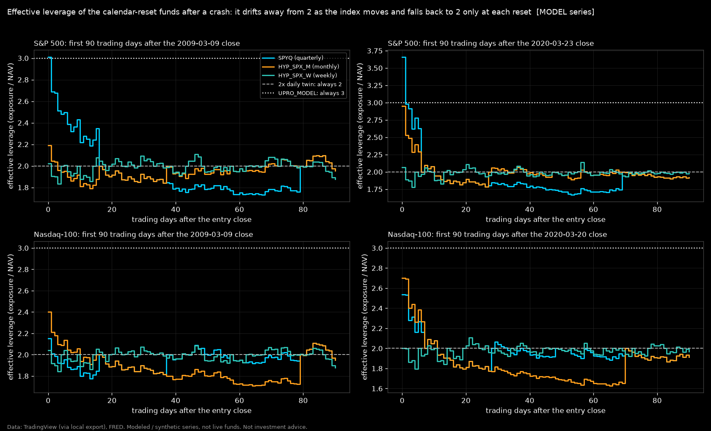
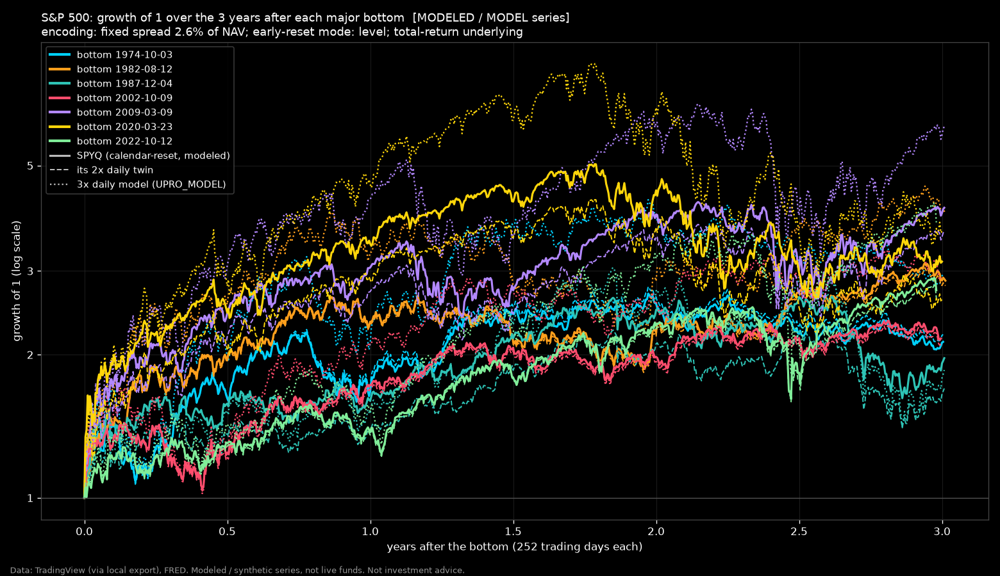
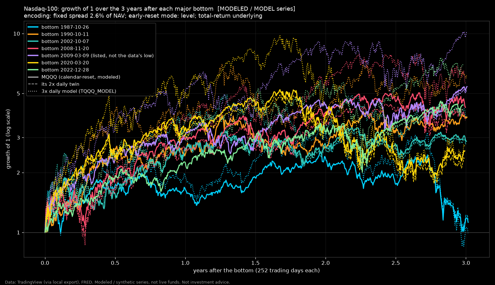

# Entries from major bottoms: what a calendar-reset 2x fund is after a crash (B13)

Run 2026-10-27. Script `scripts/run_from_bottoms.py`, maths in `calendar_letf/bottoms.py`; numbers in `from_bottoms.json`; per-entry tables in `results/raw/` (git-ignored). **Every fund series is synthetic or a model: SPYQ, MQQQ and QQQP are modeled, HYP_* are MODELED designs (MODELED: a live fund of this design traded 2024-08-30 to 2025-02-28; no live fund exists today), the 3x series are MODELS of UPRO / TQQQ at their filed terms, and the real UPRO / TQQQ are price-only overlays. Research tooling, not investment advice.**

## Inputs and conventions

```text
Inputs: 10 files; prices from <external>/library, rates from <external>/rates
  SP_SPX_daily.csv: 19326 rows, 1950-01-03 to 2026-10-22, sha256 8b0c1596b57e
  SP_SPXTR_daily.csv: 9780 rows, 1988-01-04 to 2026-10-23, sha256 ac309a0b90f5
  AMEX_SPY_daily.csv: 8482 rows, 1993-01-29 to 2026-10-09, sha256 38bb2ae821ff
  NASDAQ_NDX_daily.csv: 10504 rows, 1985-01-31 to 2026-10-09, sha256 4c3219bda720
  NASDAQ_XNDX_daily.csv: 5004 rows, 2006-11-08 to 2026-10-09, sha256 a10dab98993e
  NASDAQ_QQQ_daily.csv: 6940 rows, 1999-03-10 to 2026-10-09, sha256 1bf106f83579
  AMEX_UPRO_daily.csv: 4345 rows, 2009-06-25 to 2026-10-02, sha256 2462a547956a
  NASDAQ_TQQQ_daily.csv: 4191 rows, 2010-02-11 to 2026-10-09, sha256 d3dc0fa8dc69
  DFF.csv: 26398 rows, 1954-07-01 to 2026-10-08, sha256 a93504210b53
  TB3MS.csv: 1112 rows, 1934-01-01 to 2026-08-01, sha256 ebf04b1ae5bc
SPX early-reset trigger: the AMEX:SPY price (daily low) from 1993-01-29, scaled to the SP:SPX price index before that; trigger basis 'etf'; drop 35% from the fund's base; fill mode 'level'.
SPX day counts: financing (reference rate and swap spread) ACT/360; expense ratio ACT/365 (calendar days between rows, so weekends and holidays accrue).
SPX reset dates: last NYSE session of the week / month / quarter from 1970-01-01 (calendar_letf/nyse.py, refuses data that lack it); before that the last row of the period.
NDX early-reset trigger: the NASDAQ:QQQ price (daily low) from 1999-03-10, scaled to the NASDAQ:NDX price index before that; trigger basis 'etf'; drop 35% from the fund's base; fill mode 'level'.
NDX day counts: financing (reference rate and swap spread) ACT/360; expense ratio ACT/365 (calendar days between rows, so weekends and holidays accrue).
NDX reset dates: last NYSE session of the week / month / quarter from 1970-01-01 (calendar_letf/nyse.py, refuses data that lack it); before that the last row of the period.
Entries (drawdowns, falls from the high, Guppy signals) read the INDEX price; the entry-day leverage reads the kernel run with the base-case trigger and its daily low.
MODELED: a live fund of this design traded 2024-08-30 to 2025-02-28; no live fund exists today
```

## Headline numbers (all from this run; fixed encoding; live product = SPYQ on the S&P 500, MQQQ on the Nasdaq-100)

- **S&P 500 (SPYQ), 7 major bottoms:** entry leverage 2.01x to 3.67x (median 2.18x); twin exactly 2x, 3x model exactly 3x. Median 3-year total return: SPYQ +173%, 2x twin +161%, 3x model +264%, margin 2x +152%, 1x index +85.2%. The fund returned more than its twin at 3 years in 6 of 7 bottoms and less than the 3x model in 6 of 7.
  Timing: median change in the SPYQ 3-year return from entering 3 months early 113% (late 43%), against a median range of 18% over the six cost assumptions; early beat the cost range in 7 of 7 bottoms.
  Guppy-confirmed entries after the major bottoms (median trading days waited / index rebound given up / confirmed entry beat the bottom entry at the same end date): daily red->gray 18 d / +14.8% / 0 of 7; daily gray->green 71 d / +20.1% / 0 of 7; weekly red->gray 122 d / +25.6% / 0 of 5; weekly gray->green 224 d / +42.1% / 0 of 7; daily green & close > 200 EMA 71 d / +20.1% / 0 of 7.
- **Nasdaq-100 (MQQQ), 7 major bottoms:** entry leverage 2.07x to 2.82x (median 2.17x); twin exactly 2x, 3x model exactly 3x. Median 3-year total return: MQQQ +280%, 2x twin +267%, 3x model +460%, margin 2x +229%, 1x index +123%. The fund returned more than its twin at 3 years in 6 of 7 bottoms and less than the 3x model in 6 of 7.
  Timing: median change in the MQQQ 3-year return from entering 3 months early 136% (late 86%), against a median range of 25% over the six cost assumptions; early beat the cost range in 7 of 7 bottoms.
  Guppy-confirmed entries after the major bottoms (median trading days waited / index rebound given up / confirmed entry beat the bottom entry at the same end date): daily red->gray 20 d / +21.7% / 0 of 7; daily gray->green 38 d / +31.6% / 0 of 7; weekly red->gray 87 d / +38.7% / 0 of 5; weekly gray->green 180 d / +63.5% / 0 of 6; daily green & close > 200 EMA 67 d / +33.6% / 0 of 7.

## Method in brief

- **Question.** If you buy a calendar-reset 2x fund after a crash, what do you own (its leverage that day), and how does that compare with a daily-reset 2x twin, a daily 3x fund, a buy-once margin position and the plain index, at 1 / 3 / 5 / 10 years?
- **Comparators, all on the same total-return underlying and the same reference rate (DFF, lagged), early-reset mode `level`:** the calendar product; its daily 2x twin (same costs, `twin_of`); a synthetic 3x daily twin at the filed UPRO / TQQQ terms (below); the real UPRO (from 2009-06-25) and TQQQ (from 2010-02-11) price series where the entry is after their first bar (PRICE ONLY: distributions are not reinvested, so these are slightly below a total-return series); the buy-once 2x margin position (`World.margin_slice`, same costs, never reset, finished at -50%; OPTIMISTIC: no margin call); and the 1x total-return index.
- **Cost encodings (ASSUMED, F5).** The 2x products are run under both: `fixed` (2.6% of NAV a year) and `rate` (1.4% + 1.3 x the reference rate). Tables show `fixed`; `rate` is in the JSON, the raw tables and the timing section. The 3x models use the plain rate and the filed costs (no residual encoding).
- **UPRO_MODEL** (L=3, daily reset, kernel convention: 2 turns of the reference rate): spread 0.9218% over fed funds [VERIFIED_NPORT_2026-05-31] on 2.4215 swap turns [VERIFIED_NPORT_2026-05-31, swaps basis] + fee 0.89% [VERIFIED_issuer_page_2026-09-25_RECHECK]. Source: SEC N-PORT 0002071691-26-017443 (period end 2026-05-31), over fed funds; fee: UPRO issuer page 2026-09-25 (re-check).
- **TQQQ_MODEL** (L=3, daily reset, kernel convention: 2 turns of the reference rate): spread 1.0576% over fed funds [VERIFIED_NPORT_2026-05-31] on 2.563 swap turns [VERIFIED_NPORT_2026-05-31, swaps basis] + fee 0.82% [ASSUMED]. Source: SEC N-PORT 0002071691-26-017348 (period end 2026-05-31), over fed funds; fee: 0.82% as given in the B13 brief (issuer page); no TQQQ expense ratio is on file, so not re-verified here.
- **S&P 500**: total return 1950-01-03 to 2026-10-22 (19326 rows); entries on the price index `SP:SPX`; early-reset trigger (base case): the AMEX:SPY price (daily low) from 1993-01-29, scaled to the SP:SPX price index before that, drop 35%, mode level. [SPX_TR] symbols: SP:SPX, SP:SPXTR; basis: constructed; published 1988-01-04 on (PUBLISHED (SP:SPXTR as exported)); before that price + Shiller's measured monthly dividend yield (mean 4.10%/yr over the pre-splice years) (MEASURED (Shiller monthly D/P; quarterly dividends interpolated to months by the source)); splice date 1988-01-04; days missing from the published series carried by the price move: ['1994-04-27']; stale published rows on non-trading days dropped: ['2001-09-11', '2001-09-12', '2001-09-13', '2001-09-14']; published rows after the price file's last date dropped: ['2026-10-23'] (top up the price file) Rate: FRED DFF (effective fed funds), lagged one row; TB3MS proxy where DFF is not yet published (proxy rows 1125, stale rows 10).
- **Nasdaq-100**: total return 1985-01-31 to 2026-10-09 (10504 rows); entries on the price index `NASDAQ:NDX`; early-reset trigger (base case): the NASDAQ:QQQ price (daily low) from 1999-03-10, scaled to the NASDAQ:NDX price index before that, drop 35%, mode level. [NDX_TR] symbols: NASDAQ:NDX, NASDAQ:XNDX; basis: constructed; published 2010-01-04 on (VERIFIED (NASDAQ:XNDX, anchor-checked)); 2006-11-08..2010-01-04 price + 0.73%/yr (MEASURED (level change of mis-dated XNDX block)); before 2006-11-08 price + 0.30%/yr (ASSUMED); splice date 2010-01-04; days missing from the published series carried by the price move: ['2012-10-31'] Rate: FRED DFF (effective fed funds), lagged one row; TB3MS proxy where DFF is not yet published (proxy rows 0, stale rows 1).
- **Effective leverage** (entry day) is read from the kernel's own state: exactly L if the entry close is itself a reset close, otherwise the kernel is re-run from the last reset and the exposure is read from the NAV's slope in the index level (`bottoms.effective_leverage`); it equals 2 x (U_t/U_0) / (NAV_t/NAV_0) wherever the base is the last reset's close (cross-check below: SPX 208 cases, max difference 7.1e-10; NDX 142 cases, max difference 7.4e-10). Daily twins are exactly 2, the 3x models exactly 3.
- **Returns** are NAV ratios of full-history runs (DESIGN section 8), CAGR in calendar days / 365.25; the end is the last close on or before the entry date plus h years; n/a where the data end first. Max drawdown is measured from the entry level and any later high.

## S&P 500

### A. Hindsight bottoms: troughs of every drawdown deeper than 19% in the price index, found from the data (1950-01-03 to 2026-10-22)

A drawdown starts at a new all-time-high close and ends at the next one; its trough is the lowest close in between. The search then repeats inside a drawdown that never regained its old high (so the Nasdaq-100's 2008-09 low is found inside its 2000-2015 fall). The index data start in 1950, so a fall from a high before that is invisible.

**The brief's list against the data**

| listed date | trough in the data | difference | fall from its peak | note |
|---|---|---|---|---|
| 1974-10-03 | 1974-10-03 | same day | -48.2% |  |
| 1982-08-12 | 1982-08-12 | same day | -27.1% |  |
| 1987-12-04 | 1987-12-04 | same day | -33.5% |  |
| 2002-10-09 | 2002-10-09 | same day | -49.1% |  |
| 2009-03-09 | 2009-03-09 | same day | -56.8% |  |
| 2020-03-23 | 2020-03-23 | same day | -33.9% |  |
| 2022-10-12 | 2022-10-12 | same day | -25.4% |  |

**Troughs deeper than 19% that the list does not contain** (shallow = the brief's "19-30%" group, kept as separate entries; "major (added)" = deeper than 40% or, for the Nasdaq-100, the 1987 / 1990 lows the brief asks for)

| trough | peak it fell from | fall | kind | back at the peak | tier here |
|---|---|---|---|---|---|
| 1957-10-22 | 1956-08-02 | -21.5% | all-time-high fall | 1958-09-24 | shallow |
| 1962-06-26 | 1961-12-12 | -28.0% | all-time-high fall | 1963-09-03 | shallow |
| 1966-10-07 | 1966-02-09 | -22.2% | all-time-high fall | 1967-05-04 | shallow |
| 1970-05-26 | 1968-11-29 | -36.1% | all-time-high fall | 1972-03-06 | shallow |
| 1978-03-06 | 1976-09-21 | -19.4% | inside a longer fall (level 1) | 1979-08-15 | shallow |
| 1990-10-11 | 1990-07-16 | -19.9% | all-time-high fall | 1991-02-13 | shallow |
| 1998-08-31 | 1998-07-17 | -19.3% | all-time-high fall | 1998-11-23 | shallow |
| 2011-10-03 | 2011-04-29 | -19.4% | inside a longer fall (level 1) | 2012-02-24 | shallow |
| 2018-12-24 | 2018-09-20 | -19.8% | all-time-high fall | 2019-04-23 | shallow |


### A1. SPYQ bought at each major bottom's close (fixed-cost encoding)

Entry leverage = the fund's effective leverage after the entry close. A `*` marks a listed date that is not the data's trough. Real fund: UPRO price only.

**1-year result after buying SPYQ at each bottom's close** (total return; 'fall' = the drop into the bottom from its peak; n/a = the data end first, UPRO did not exist yet, or its file ends earlier)

| bottom | fall | entry leverage | SPYQ | 2x daily twin | UPRO_MODEL (3x) | UPRO (price only) | margin 2x (buy once) | 1x index (TR) |
|---|---|---|---|---|---|---|---|---|
| 1974-10-03 | -48% | 2.04x | +75.7% | +80.9% | +128% | n/a | +77.4% | +44.4% |
| 1982-08-12 | -27% | 2.18x | +136% | +134% | +232% | n/a | +118% | +66.1% |
| 1987-12-04 | -34% | 3.67x | +59.9% | +37.1% | +50.1% | n/a | +40.0% | +25.9% |
| 2002-10-09 | -49% | 2.11x | +72.8% | +69.5% | +111% | n/a | +67.0% | +36.2% |
| 2009-03-09 | -57% | 3.01x | +205% | +172% | +324% | n/a | +140% | +72.3% |
| 2020-03-23 | -34% | 3.66x | +242% | +187% | +356% | +361% | +151% | +77.8% |
| 2022-10-12 | -25% | 2.01x | +39.0% | +37.0% | +54.1% | +52.8% | +38.5% | +23.7% |

**3-year result after buying SPYQ at each bottom's close** (total return; CAGR in brackets; 'fall' = the drop into the bottom from its peak; n/a = the data end first, UPRO did not exist yet, or its file ends earlier)

| bottom | fall | entry leverage | SPYQ | 2x daily twin | UPRO_MODEL (3x) | UPRO (price only) | margin 2x (buy once) | 1x index (TR) |
|---|---|---|---|---|---|---|---|---|
| 1974-10-03 | -48% | 2.04x | +113% (+28.6%/yr) | +121% (+30.2%/yr) | +195% (+43.4%/yr) | n/a | +118% (+29.7%/yr) | +76.1% (+20.8%/yr) |
| 1982-08-12 | -27% | 2.18x | +186% (+42.0%/yr) | +179% (+40.8%/yr) | +296% (+58.2%/yr) | n/a | +170% (+39.3%/yr) | +110% (+28.0%/yr) |
| 1987-12-04 | -34% | 3.67x | +96.7% (+25.3%/yr) | +69.8% (+19.3%/yr) | +85.7% (+22.9%/yr) | n/a | +81.2% (+21.9%/yr) | +62.3% (+17.5%/yr) |
| 2002-10-09 | -49% | 2.11x | +116% (+29.4%/yr) | +111% (+28.3%/yr) | +191% (+42.8%/yr) | n/a | +106% (+27.3%/yr) | +62.4% (+17.6%/yr) |
| 2009-03-09 | -57% | 3.01x | +307% (+59.7%/yr) | +263% (+53.7%/yr) | +504% (+82.0%/yr) | n/a | +216% (+46.7%/yr) | +116% (+29.2%/yr) |
| 2020-03-23 | -34% | 3.66x | +214% (+46.5%/yr) | +161% (+37.7%/yr) | +264% (+53.9%/yr) | +268% (+54.5%/yr) | +152% (+36.1%/yr) | +85.2% (+22.8%/yr) |
| 2022-10-12 | -25% | 2.01x | +173% (+39.9%/yr) | +163% (+38.2%/yr) | +280% (+56.1%/yr) | +274% (+55.3%/yr) | +153% (+36.4%/yr) | +91.5% (+24.2%/yr) |

**5-year result after buying SPYQ at each bottom's close** (total return; CAGR in brackets; 'fall' = the drop into the bottom from its peak; n/a = the data end first, UPRO did not exist yet, or its file ends earlier)

| bottom | fall | entry leverage | SPYQ | 2x daily twin | UPRO_MODEL (3x) | UPRO (price only) | margin 2x (buy once) | 1x index (TR) |
|---|---|---|---|---|---|---|---|---|
| 1974-10-03 | -48% | 2.04x | +156% (+20.7%/yr) | +164% (+21.4%/yr) | +256% (+28.9%/yr) | n/a | +171% (+22.1%/yr) | +121% (+17.2%/yr) |
| 1982-08-12 | -27% | 2.18x | +675% (+50.6%/yr) | +678% (+50.8%/yr) | +1,589% (+76.0%/yr) | n/a | +509% (+43.6%/yr) | +298% (+31.8%/yr) |
| 1987-12-04 | -34% | 3.67x | +224% (+26.5%/yr) | +176% (+22.5%/yr) | +268% (+29.7%/yr) | n/a | +189% (+23.6%/yr) | +129% (+18.0%/yr) |
| 2002-10-09 | -49% | 2.11x | +234% (+27.3%/yr) | +218% (+26.0%/yr) | +414% (+38.7%/yr) | n/a | +199% (+24.5%/yr) | +121% (+17.2%/yr) |
| 2009-03-09 | -57% | 3.01x | +654% (+49.9%/yr) | +570% (+46.4%/yr) | +1,412% (+72.3%/yr) | n/a | +389% (+37.4%/yr) | +209% (+25.3%/yr) |
| 2020-03-23 | -34% | 3.66x | +461% (+41.2%/yr) | +363% (+35.9%/yr) | +715% (+52.2%/yr) | +721% (+52.4%/yr) | +303% (+32.2%/yr) | +174% (+22.3%/yr) |
| 2022-10-12 | -25% | 2.01x | n/a | n/a | n/a | n/a | n/a | n/a |

**10-year result after buying SPYQ at each bottom's close** (total return; CAGR in brackets; 'fall' = the drop into the bottom from its peak; n/a = the data end first, UPRO did not exist yet, or its file ends earlier)

| bottom | fall | entry leverage | SPYQ | 2x daily twin | UPRO_MODEL (3x) | UPRO (price only) | margin 2x (buy once) | 1x index (TR) |
|---|---|---|---|---|---|---|---|---|
| 1974-10-03 | -48% | 2.04x | +268% (+13.9%/yr) | +276% (+14.1%/yr) | +315% (+15.3%/yr) | n/a | +377% (+16.9%/yr) | +320% (+15.4%/yr) |
| 1982-08-12 | -27% | 2.18x | +738% (+23.7%/yr) | +709% (+23.3%/yr) | +1,040% (+27.6%/yr) | n/a | +766% (+24.1%/yr) | +493% (+19.5%/yr) |
| 1987-12-04 | -34% | 3.67x | +1,222% (+29.5%/yr) | +996% (+27.0%/yr) | +2,500% (+38.5%/yr) | n/a | +809% (+24.7%/yr) | +482% (+19.3%/yr) |
| 2002-10-09 | -49% | 2.11x | +57.2% (+4.6%/yr) | +89.9% (+6.6%/yr) | +52.2% (+4.3%/yr) | n/a | +183% (+11.0%/yr) | +127% (+8.5%/yr) |
| 2009-03-09 | -57% | 3.01x | +1,390% (+31.0%/yr) | +1,188% (+29.1%/yr) | +3,777% (+44.2%/yr) | n/a | +719% (+23.4%/yr) | +400% (+17.5%/yr) |
| 2020-03-23 | -34% | 3.66x | n/a | n/a | n/a | n/a | n/a | n/a |
| 2022-10-12 | -25% | 2.01x | n/a | n/a | n/a | n/a | n/a | n/a |

**Worst fall inside the first 3 years after entry, and early (-35%) resets inside them**

| bottom | SPYQ max DD | twin max DD | 3x model max DD | margin max DD | 1x max DD | early resets in 3y |
|---|---|---|---|---|---|---|
| 1974-10-03 | -29% | -27% | -38% | -23% | -14% | 0 |
| 1982-08-12 | -30% | -30% | -45% | -23% | -11% | 0 |
| 1987-12-04 | -39% | -38% | -54% | -33% | -19% | 0 |
| 2002-10-09 | -27% | -28% | -40% | -25% | -14% | 0 |
| 2009-03-09 | -37% | -37% | -52% | -26% | -19% | 0 |
| 2020-03-23 | -48% | -48% | -64% | -34% | -24% | 0 |
| 2022-10-12 | -36% | -35% | -49% | -29% | -19% | 0 |


**Same entries, `rate` encoding: SPYQ and its twin**

| bottom | entry leverage | 1y SPYQ | 1y twin | 3y SPYQ | 3y twin | 5y SPYQ | 5y twin | 10y SPYQ | 10y twin |
|---|---|---|---|---|---|---|---|---|---|
| 1974-10-03 | 2.04x | +74.3% | +79.4% | +110% (+28.0%/yr) | +117% (+29.5%/yr) | +146% (+19.7%/yr) | +153% (+20.4%/yr) | +209% (+11.9%/yr) | +216% (+12.2%/yr) |
| 1982-08-12 | 2.19x | +134% | +130% | +174% (+39.9%/yr) | +166% (+38.5%/yr) | +629% (+48.8%/yr) | +628% (+48.8%/yr) | +652% (+22.3%/yr) | +622% (+21.9%/yr) |
| 1987-12-04 | 3.69x | +58.4% | +35.7% | +89.4% (+23.7%/yr) | +63.3% (+17.8%/yr) | +211% (+25.4%/yr) | +164% (+21.5%/yr) | +1,156% (+28.8%/yr) | +937% (+26.4%/yr) |
| 2002-10-09 | 2.11x | +74.2% | +71.0% | +121% (+30.2%/yr) | +115% (+29.2%/yr) | +239% (+27.7%/yr) | +223% (+26.4%/yr) | +68.1% (+5.3%/yr) | +103% (+7.3%/yr) |
| 2009-03-09 | 3.00x | +208% | +175% | +321% (+61.4%/yr) | +276% (+55.5%/yr) | +696% (+51.5%/yr) | +610% (+48.1%/yr) | +1,548% (+32.4%/yr) | +1,334% (+30.5%/yr) |
| 2020-03-23 | 3.64x | +245% | +191% | +222% (+47.7%/yr) | +169% (+39.0%/yr) | +472% (+41.8%/yr) | +373% (+36.5%/yr) | n/a | n/a |
| 2022-10-12 | 2.01x | +38.7% | +36.7% | +171% (+39.6%/yr) | +161% (+37.8%/yr) | n/a | n/a | n/a | n/a |


### A2. Every calendar product at each major bottom: 3-year return and entry leverage (fixed encoding)

| entry | fall from ATH | SPYQ lev | HYP_SPX_M lev | HYP_SPX_W lev | SPYQ 3y | HYP_SPX_M 3y | HYP_SPX_W 3y | twin 3y (of SPYQ) | 1x 3y |
|---|---|---|---|---|---|---|---|---|---|
| 1974-10-03 | 48% | 2.04x | 2.04x | 2.09x | +113% | +117% | +116% | +121% | +76.1% |
| 1982-08-12 | 27% | 2.18x | 2.10x | 2.03x | +186% | +183% | +178% | +179% | +110% |
| 1987-12-04 | 34% | 3.67x | 2.06x | 2.00x | +96.7% | +72.9% | +71.0% | +69.8% | +62.3% |
| 2002-10-09 | 49% | 2.11x | 2.11x | 2.06x | +116% | +117% | +114% | +111% | +62.4% |
| 2009-03-09 | 57% | 3.01x | 2.19x | 2.02x | +307% | +284% | +270% | +263% | +116% |
| 2020-03-23 | 34% | 3.66x | 2.95x | 2.06x | +214% | +193% | +165% | +161% | +85.2% |
| 2022-10-12 | 25% | 2.01x | 2.01x | 2.04x | +173% | +169% | +165% | +163% | +91.5% |


### A3. Shallower bottoms (falls of 19-30%, and any other trough deeper than 19% not on the list)

| trough | fall | SPYQ lev | SPYQ 1y | SPYQ 3y | twin 3y | 3x model 3y | margin 3y | 1x 3y |
|---|---|---|---|---|---|---|---|---|
| 1957-10-22 | -21% | 2.20x | +74.1% | +86.3% | +87.3% | +151% | +83.9% | +53.2% |
| 1962-06-26 | -28% | 3.02x | +81.0% | +151% | +140% | +267% | +124% | +74.3% |
| 1966-10-07 | -22% | 2.10x | +71.7% | +42.2% | +43.2% | +61.8% | +46.4% | +39.8% |
| 1970-05-26 | -36% | 2.89x | +104% | +123% | +116% | +197% | +111% | +71.2% |
| 1978-03-06 | -19% | 2.23x | +23.4% | +85.5% | +81.0% | +101% | +91.5% | +74.1% |
| 1990-10-11 | -20% | 2.08x | +59.1% | +125% | +120% | +208% | +114% | +71.1% |
| 1998-08-31 | -19% | 2.50x | +78.0% | +6.9% | +0.9% | -17.9% | +14.4% | +23.0% |
| 2011-10-03 | -19% | 2.06x | +71.4% | +212% | +209% | +437% | +168% | +91.1% |
| 2018-12-24 | -20% | 2.67x | +87.8% | +251% | +234% | +405% | +207% | +112% |

(5- and 10-year numbers for these are in the JSON and `results/raw/`.)


### A4. Sensitivity: the v1 trigger (index price, close only) next to the base case

Same major bottoms, fixed encoding, every calendar product. Base case: the AMEX:SPY price (daily low) from 1993-01-29, scaled to the SP:SPX price index before that. v1 trigger: the SP:SPX price index, close only (the trigger of the v1 results). Entry leverage is the kernel's own state under each trigger: a fund whose early reset fired between the last ordinary reset and the entry has a different base, so its leverage differs.

| bottom | SPYQ entry leverage (base / v1) | HYP_SPX_M entry leverage (base / v1) | HYP_SPX_W entry leverage (base / v1) | SPYQ 3y return (base / v1) | HYP_SPX_M 3y return (base / v1) | HYP_SPX_W 3y return (base / v1) |
|---|---|---|---|---|---|---|
| 1974-10-03 | 2.04x / 2.04x | 2.04x / 2.04x | 2.09x / 2.09x | +113% / +113% | +117% / +117% | +116% / +116% |
| 1982-08-12 | 2.18x / 2.18x | 2.10x / 2.10x | 2.03x / 2.03x | +186% / +186% | +183% / +183% | +178% / +178% |
| 1987-12-04 | 3.67x / 3.67x | 2.06x / 2.06x | 2.00x / 2.00x | +96.7% / +96.7% | +72.9% / +72.9% | +71.0% / +71.0% |
| 2002-10-09 | 2.11x / 2.11x | 2.11x / 2.11x | 2.06x / 2.06x | +116% / +116% | +117% / +117% | +114% / +114% |
| 2009-03-09 | 3.01x / 3.01x | 2.19x / 2.19x | 2.02x / 2.02x | +307% / +307% | +284% / +284% | +270% / +270% |
| 2020-03-23 | 3.66x / 3.66x | 2.95x / 2.95x | 2.06x / 2.06x | +214% / +214% | +193% / +193% | +165% / +165% |
| 2022-10-12 | 2.01x / 2.01x | 2.01x / 2.01x | 2.04x / 2.04x | +173% / +173% | +169% / +169% | +165% / +165% |


### B. Rule-based entries: the first close at least X below the prior all-time high of the price index, once per fall (re-armed by a new high)

The deepest close-to-high fall in the data is 56.8% (2007-10-09 to 2009-03-09).

Every level triggered at least once.

**By level (SPYQ, fixed encoding)**

| level | episodes | trigger dates | median entry leverage | median SPYQ 1y | median SPYQ 3y | median twin 3y | median 3x model 3y | median margin 3y | median 1x 3y | SPYQ 3y positive |
|---|---|---|---|---|---|---|---|---|---|---|
| 20% | 11 | 1957-10-21, 1962-05-28, 1966-08-29, 1970-01-29, 1973-11-27, 1982-02-22, 1987-10-19, 2001-03-12, 2008-07-09, 2020-03-12, 2022-06-13 | 2.35x | +52.1% | +75.5% | +63.2% | +94.3% | +68.3% | +52.5% | 8 of 11 |
| 30% | 6 | 1970-05-14, 1974-07-05, 1987-10-19, 2001-09-17, 2008-10-06, 2020-03-20 | 2.49x | +31.0% | +38.3% | +38.4% | +36.1% | +52.1% | +45.1% | 4 of 6 |
| 40% | 3 | 1974-08-23, 2002-07-16, 2008-10-09 | 2.58x | +12.6% | +46.0% | +61.0% | +85.9% | +70.4% | +43.7% | 3 of 3 |
| 50% | 1 | 2008-11-20 | 1.98x | +96.2% | +127% | +121% | +165% | +131% | +72.6% | 1 of 1 |

**Every rule entry (SPYQ, fixed encoding)**

| level | entry date | prior high | fall that day | entry leverage | SPYQ 1y | SPYQ 3y | twin 3y | 3x model 3y | margin 3y | 1x 3y |
|---|---|---|---|---|---|---|---|---|---|---|
| 20% | 1957-10-21 | 1956-08-02 | 21.1% | 2.19x | +73.7% | +84.5% | +85.7% | +148% | +82.6% | +52.5% |
| 20% | 1962-05-28 | 1961-12-12 | 23.6% | 2.70x | +55.5% | +141% | +141% | +265% | +126% | +75.0% |
| 20% | 1966-08-29 | 1966-02-09 | 20.8% | 2.35x | +52.1% | +46.4% | +45.9% | +66.2% | +49.4% | +40.9% |
| 20% | 1970-01-29 | 1968-11-29 | 20.9% | 2.18x | +11.9% | +54.7% | +63.2% | +94.3% | +68.3% | +49.3% |
| 20% | 1973-11-27 | 1973-01-11 | 20.4% | 2.36x | -58.2% | -17.7% | -2.3% | -19.1% | +7.7% | +22.0% |
| 20% | 1982-02-22 | 1980-11-28 | 20.6% | 2.27x | +59.2% | +116% | +112% | +157% | +120% | +85.7% |
| 20% | 1987-10-19 | 1987-08-25 | 33.2% | 3.56x | +61.3% | +75.5% | +49.7% | +47.4% | +65.8% | +54.5% |
| 20% | 2001-03-12 | 2000-03-24 | 22.7% | 2.32x | -11.2% | -28.8% | -26.5% | -46.4% | -16.9% | -0.3% |
| 20% | 2008-07-09 | 2007-10-09 | 20.5% | 2.06x | -68.0% | -29.6% | -9.0% | -38.1% | +19.7% | +15.4% |
| 20% | 2020-03-12 | 2020-02-19 | 26.7% | 2.90x | +149% | +115% | +96.7% | +125% | +109% | +63.4% |
| 20% | 2022-06-13 | 2022-01-03 | 21.8% | 2.55x | +29.6% | +111% | +98.5% | +144% | +106% | +66.9% |
| 30% | 1970-05-14 | 1968-11-29 | 30.4% | 2.50x | +70.9% | +70.6% | +75.2% | +116% | +77.6% | +54.4% |
| 30% | 1974-07-05 | 1973-01-11 | 30.4% | 2.06x | +0.7% | +6.0% | +27.0% | +24.8% | +38.4% | +35.8% |
| 30% | 1987-10-19 | 1987-08-25 | 33.2% | 3.56x | +61.3% | +75.5% | +49.7% | +47.4% | +65.8% | +54.5% |
| 30% | 2001-09-17 | 2000-03-24 | 32.0% | 2.48x | -34.8% | -0.4% | -0.2% | -12.1% | +13.2% | +14.3% |
| 30% | 2008-10-06 | 2007-10-09 | 32.5% | 2.23x | -35.9% | -26.9% | -4.2% | -32.3% | +24.1% | +17.9% |
| 30% | 2020-03-20 | 2020-02-19 | 31.9% | 3.39x | +209% | +183% | +146% | +233% | +141% | +79.9% |
| 40% | 1974-08-23 | 1973-01-11 | 40.5% | 2.58x | +14.1% | +46.0% | +67.8% | +92.5% | +76.2% | +54.8% |
| 40% | 2002-07-16 | 2000-03-24 | 41.0% | 2.22x | +12.6% | +62.9% | +61.0% | +85.9% | +70.4% | +43.7% |
| 40% | 2008-10-09 | 2007-10-09 | 41.9% | 2.79x | -4.1% | +4.2% | +28.5% | +7.0% | +58.8% | +35.8% |
| 50% | 2008-11-20 | 2007-10-09 | 51.9% | 1.98x | +96.2% | +127% | +121% | +165% | +131% | +72.6% |


### C. Guppy-confirmed entries after each entry (Clean Guppy v1 slow ribbon; fill at the next close)

A signal is the first bar after the entry on which the daily (or weekly, on week-end closes) slow ribbon changes state; the entry is the NEXT close (the repo's delay-1 convention). `days waited` counts trading days from the bottom entry to that fill; the index move is the price index from the bottom to the fill (the price of waiting). "none within 2y" = no such transition inside two years of the entry. The first transition after the entry is taken literally: if the ribbon was already gray at the entry, a red->gray needs a later red phase.

**Major bottoms: each confirmation as signal date (trading days waited to the fill, index move while waiting)**

| bottom | ribbon at entry (daily / weekly) | daily red->gray | daily gray->green | weekly red->gray | weekly gray->green | daily green & close > 200 EMA |
|---|---|---|---|---|---|---|
| 1974-10-03 | red / red | 1974-10-25 (+17d, +12.5%) | 1975-02-05 (+87d, +26.1%) | 1975-03-27 (+122d, +33.8%) | 1976-01-16 (+326d, +57.9%) | 1975-02-05 (+87d, +26.1%) |
| 1982-08-12 | red / red | 1982-08-24 (+9d, +14.8%) | 1982-09-03 (+17d, +18.5%) | 1982-10-01 (+36d, +18.6%) | 1982-11-05 (+61d, +37.1%) | 1982-09-03 (+17d, +18.5%) |
| 1987-12-04 | red / gray | 1988-01-06 (+22d, +16.6%) | 1988-03-22 (+75d, +20.1%) | none within 2y | 1988-10-21 (+224d, +26.1%) | 1988-03-22 (+75d, +20.1%) |
| 2002-10-09 | red / red | 2002-10-25 (+13d, +14.6%) | 2003-04-25 (+137d, +17.8%) | 2003-06-06 (+166d, +25.6%) | 2004-01-09 (+316d, +45.1%) | 2003-04-28 (+138d, +18.2%) |
| 2009-03-09 | red / red | 2009-04-01 (+18d, +23.3%) | 2009-05-15 (+49d, +34.5%) | 2009-08-21 (+117d, +51.6%) | 2010-04-30 (+290d, +77.7%) | 2009-06-02 (+60d, +37.7%) |
| 2020-03-23 | red / green | 2020-04-29 (+27d, +30.2%) | 2020-06-08 (+54d, +43.3%) | none within 2y | 2020-07-02 (+72d, +42.1%) | 2020-06-08 (+54d, +43.3%) |
| 2022-10-12 | red / gray | 2022-11-11 (+23d, +10.6%) | 2023-01-24 (+71d, +12.3%) | 2023-04-14 (+127d, +16.1%) | 2023-06-09 (+166d, +21.3%) | 2023-01-24 (+71d, +12.3%) |

**Summary: hindsight bottoms, major, SPYQ fixed encoding**

| confirmation (hindsight bottoms, major) | entries | confirmed in 2y | median trading days waited (to the fill) | median index move while waiting | median SPYQ 3y return, confirmed entry | median 3y return, parent entry | confirmed beats parent (own 3y windows) | confirmed beats parent (same end date) | median gap, same end date |
|---|---|---|---|---|---|---|---|---|---|
| daily red->gray | 7 | 7 | 18 | +14.8% | +76.6% | +173% | 0 of 7 | 0 of 7 | -67.7% |
| daily gray->green | 7 | 7 | 71 | +20.1% | +82.0% | +173% | 0 of 7 | 0 of 7 | -75.7% |
| weekly red->gray | 7 | 5 | 122 | +25.6% | +73.0% | +173% | 0 of 5 | 0 of 5 | -82.6% |
| weekly gray->green | 7 | 7 | 224 | +42.1% | +63.5% | +173% | 0 of 7 | 0 of 7 | -119% |
| daily green & close > 200 EMA | 7 | 7 | 71 | +20.1% | +69.3% | +173% | 0 of 7 | 0 of 7 | -75.7% |

**Summary: hindsight bottoms, shallow, SPYQ fixed encoding**

| confirmation (hindsight bottoms, shallow) | entries | confirmed in 2y | median trading days waited (to the fill) | median index move while waiting | median SPYQ 3y return, confirmed entry | median 3y return, parent entry | confirmed beats parent (own 3y windows) | confirmed beats parent (same end date) | median gap, same end date |
|---|---|---|---|---|---|---|---|---|---|
| daily red->gray | 9 | 9 | 25 | +10.1% | +97.9% | +123% | 2 of 9 | 0 of 9 | -29.3% |
| daily gray->green | 9 | 9 | 62 | +15.1% | +83.1% | +123% | 1 of 9 | 0 of 9 | -48.7% |
| weekly red->gray | 9 | 5 | 136 | +19.4% | +42.7% | +86.3% | 1 of 5 | 0 of 5 | -44.5% |
| weekly gray->green | 9 | 8 | 126 | +24.0% | +62.2% | +124% | 1 of 8 | 0 of 8 | -85.1% |
| daily green & close > 200 EMA | 9 | 9 | 63 | +15.1% | +83.1% | +123% | 1 of 9 | 0 of 9 | -48.7% |

**Summary: rule entries, SPYQ fixed encoding**

| confirmation (rule entries) | entries | confirmed in 2y | median trading days waited (to the fill) | median index move while waiting | median SPYQ 3y return, confirmed entry | median 3y return, parent entry | confirmed beats parent (own 3y windows) | confirmed beats parent (same end date) | median gap, same end date |
|---|---|---|---|---|---|---|---|---|---|
| daily red->gray | 21 | 21 | 53 | +5.0% | +70.2% | +62.9% | 8 of 21 | 6 of 21 | -14.2% |
| daily gray->green | 21 | 21 | 128 | +8.4% | +57.6% | +62.9% | 9 of 21 | 8 of 21 | -20.1% |
| weekly red->gray | 21 | 16 | 200 | +9.8% | +61.5% | +50.6% | 7 of 16 | 7 of 16 | -16.4% |
| weekly gray->green | 21 | 18 | 257 | +25.3% | +64.5% | +73.0% | 5 of 18 | 2 of 18 | -57.4% |
| daily green & close > 200 EMA | 21 | 21 | 132 | +8.8% | +57.6% | +62.9% | 9 of 21 | 8 of 21 | -22.4% |


### D. Entry-timing sensitivity around each major bottom

The entry moves to the month-end close nearest to the bottom date plus k months (so the dates used are listed). 'Range over the 6 cost assumptions' = max minus min of the SPYQ 3-year total return at the bottom itself over `fixed`, `rate` and the four F5 sensitivities (spread 1.4% / 3.5%, rate turns 1.0 / 1.5).

| bottom | SPYQ 3y at the bottom | 3 months early (-3m) | 3 months late (+3m) | change if early | change if late | range over the 6 cost assumptions | -3m change larger than cost range? |
|---|---|---|---|---|---|---|---|
| 1974-10-03 | +113% | +0.1% | +71.1% | -113% | -42% | 17% | yes |
| 1982-08-12 | +186% | +101% | +70.8% | -85% | -115% | 37% | yes |
| 1987-12-04 | +96.7% | -27.9% | +53.3% | -125% | -43% | 23% | yes |
| 2002-10-09 | +116% | +28.1% | +83.2% | -88% | -33% | 13% | yes |
| 2009-03-09 | +307% | +58.5% | +89.7% | -249% | -218% | 24% | yes |
| 2020-03-23 | +214% | +14.0% | +77.8% | -200% | -136% | 18% | yes |
| 2022-10-12 | +173% | +120% | +163% | -53% | -11% | 18% | yes |

Over 7 bottoms with all three numbers: median |3-year return change| from entering 3 months early 113%, from entering 3 months late 43%, median range over the six cost assumptions 18%; the early shift is larger than the cost range in 7 of 7 bottoms.

**SPYQ, encoding `fixed`: total return after buying at the month-end nearest to the bottom plus k months** (0m = the bottom close itself)

| bottom | series | -6m | -3m | -1m | +0m | +1m | +3m | +6m |
|---|---|---|---|---|---|---|---|---|
| 1974-10-03 | SPYQ 3y | -19.3% | +0.1% | +39.4% | +113% | +40.2% | +71.1% | +4.4% |
|  | 2x twin 3y | -2.5% | +20.0% | +61.2% | +121% | +44.3% | +79.4% | +7.7% |
|  | 3x model 3y | -17.3% | +14.5% | +81.7% | +195% | +58.2% | +122% | +3.9% |
|  | 1x 3y | +20.2% | +32.1% | +51.6% | +76.1% | +41.7% | +57.2% | +21.5% |
|  | SPYQ 1y | -38.3% | -3.9% | +19.9% | +75.7% | +36.2% | +60.3% | +42.9% |
|  | entry date used | 74-03-29 | 74-06-28 | 74-08-30 | 74-10-03 | 74-10-31 | 74-12-31 | 75-03-31 |
| 1982-08-12 | SPYQ 3y | +82.6% | +101% | +160% | +186% | +112% | +70.8% | +79.6% |
|  | 2x twin 3y | +81.1% | +97.1% | +155% | +179% | +108% | +68.3% | +79.2% |
|  | 3x model 3y | +102% | +132% | +244% | +296% | +156% | +88.7% | +110% |
|  | 1x 3y | +72.1% | +77.9% | +101% | +110% | +80.5% | +61.6% | +66.0% |
|  | SPYQ 1y | +32.8% | +86.9% | +121% | +136% | +77.9% | +41.2% | +20.0% |
|  | entry date used | 82-01-29 | 82-04-30 | 82-06-30 | 82-08-12 | 82-08-31 | 82-10-29 | 83-01-31 |
| 1987-12-04 | SPYQ 3y | +17.7% | -27.9% | +16.6% | +96.7% | +46.2% | +53.3% | +79.1% |
|  | 2x twin 3y | +12.2% | -30.9% | +15.6% | +69.8% | +43.2% | +51.7% | +79.0% |
|  | 3x model 3y | -18.3% | -61.0% | +3.4% | +85.7% | +44.8% | +59.4% | +105% |
|  | 1x 3y | +37.9% | +8.7% | +34.2% | +62.3% | +48.7% | +52.5% | +65.3% |
|  | SPYQ 1y | -34.4% | -45.9% | +14.5% | +59.9% | +21.2% | +11.6% | +41.1% |
|  | entry date used | 87-05-29 | 87-08-31 | 87-10-30 | 87-12-04 | 87-12-31 | 88-02-29 | 88-05-31 |
| 2002-10-09 | SPYQ 3y | -11.5% | +28.1% | +52.0% | +116% | +69.7% | +83.2% | +111% |
|  | 2x twin 3y | -10.1% | +27.2% | +53.4% | +111% | +65.7% | +80.1% | +109% |
|  | 3x model 3y | -23.5% | +29.8% | +77.7% | +191% | +104% | +133% | +195% |
|  | 1x 3y | +7.9% | +28.0% | +39.2% | +62.4% | +43.7% | +49.7% | +61.1% |
|  | SPYQ 1y | -48.9% | -11.0% | +11.8% | +72.8% | +36.4% | +53.6% | +69.7% |
|  | entry date used | 02-03-28 | 02-06-28 | 02-08-30 | 02-10-09 | 02-10-31 | 02-12-31 | 03-03-31 |
| 2009-03-09 | SPYQ 3y | -46.7% | +58.5% | +126% | +307% | +178% | +89.7% | +73.5% |
|  | 2x twin 3y | -31.4% | +50.7% | +121% | +263% | +179% | +90.1% | +72.6% |
|  | 3x model 3y | -60.3% | +50.8% | +180% | +504% | +315% | +137% | +106% |
|  | 1x 3y | +0.9% | +42.1% | +69.6% | +116% | +88.0% | +54.3% | +46.7% |
|  | SPYQ 1y | -59.3% | +42.2% | +63.0% | +205% | +108% | +37.3% | +2.7% |
|  | entry date used | 08-08-29 | 08-11-28 | 09-01-30 | 09-03-09 | 09-03-31 | 09-05-29 | 09-08-31 |
| 2020-03-23 | SPYQ 3y | +17.5% | +14.0% | +46.3% | +214% | +76.6% | +77.8% | +38.7% |
|  | 2x twin 3y | +17.2% | +12.0% | +42.7% | +161% | +75.3% | +76.1% | +37.7% |
|  | 3x model 3y | +1.0% | -7.7% | +32.9% | +264% | +107% | +111% | +45.8% |
|  | 1x 3y | +26.5% | +24.8% | +41.1% | +85.2% | +50.2% | +50.5% | +33.6% |
|  | SPYQ 1y | +14.0% | +20.4% | +49.9% | +242% | +98.2% | +86.6% | +59.9% |
|  | entry date used | 19-09-30 | 19-12-31 | 20-02-28 | 20-03-23 | 20-04-30 | 20-06-30 | 20-09-30 |
| 2022-10-12 | SPYQ 3y | +22.6% | +120% | +118% | +173% | +155% | +163% | +105% |
|  | 2x twin 3y | +21.4% | +110% | +109% | +163% | +145% | +155% | +99.6% |
|  | 3x model 3y | +17.8% | +167% | +165% | +280% | +243% | +266% | +155% |
|  | 1x 3y | +29.7% | +71.5% | +70.8% | +91.5% | +84.6% | +87.5% | +65.6% |
|  | SPYQ 1y | -24.2% | +30.9% | +22.5% | +39.0% | +10.6% | +43.9% | +51.4% |
|  | entry date used | 22-03-31 | 22-06-30 | 22-08-31 | 22-10-12 | 22-10-31 | 22-12-30 | 23-03-31 |

**SPYQ, encoding `rate`: total return after buying at the month-end nearest to the bottom plus k months** (0m = the bottom close itself)

| bottom | series | -6m | -3m | -1m | +0m | +1m | +3m | +6m |
|---|---|---|---|---|---|---|---|---|
| 1974-10-03 | SPYQ 3y | -21.9% | -2.6% | +36.4% | +110% | +38.2% | +68.9% | +2.9% |
|  | 2x twin 3y | -4.9% | +17.6% | +58.5% | +117% | +42.2% | +77.0% | +6.2% |
|  | 3x model 3y | -17.3% | +14.5% | +81.7% | +195% | +58.2% | +122% | +3.9% |
|  | 1x 3y | +20.2% | +32.1% | +51.6% | +76.1% | +41.7% | +57.2% | +21.5% |
|  | SPYQ 1y | -39.9% | -5.8% | +18.2% | +74.3% | +35.3% | +59.5% | +42.2% |
|  | entry date used | 74-03-29 | 74-06-28 | 74-08-30 | 74-10-03 | 74-10-31 | 74-12-31 | 75-03-31 |
| 1982-08-12 | SPYQ 3y | +72.3% | +91.2% | +148% | +174% | +102% | +63.1% | +71.6% |
|  | 2x twin 3y | +70.8% | +86.8% | +142% | +166% | +98.2% | +60.4% | +71.0% |
|  | 3x model 3y | +102% | +132% | +244% | +296% | +156% | +88.7% | +110% |
|  | 1x 3y | +72.1% | +77.9% | +101% | +110% | +80.5% | +61.6% | +66.0% |
|  | SPYQ 1y | +29.6% | +83.6% | +118% | +134% | +75.5% | +39.3% | +18.3% |
|  | entry date used | 82-01-29 | 82-04-30 | 82-06-30 | 82-08-12 | 82-08-31 | 82-10-29 | 83-01-31 |
| 1987-12-04 | SPYQ 3y | +13.5% | -30.6% | +12.1% | +89.4% | +40.7% | +47.5% | +72.5% |
|  | 2x twin 3y | +8.1% | -33.5% | +11.2% | +63.3% | +37.7% | +45.8% | +72.2% |
|  | 3x model 3y | -18.3% | -61.0% | +3.4% | +85.7% | +44.8% | +59.4% | +105% |
|  | 1x 3y | +37.9% | +8.7% | +34.2% | +62.3% | +48.7% | +52.5% | +65.3% |
|  | SPYQ 1y | -35.1% | -46.5% | +13.2% | +58.4% | +19.9% | +10.3% | +39.2% |
|  | entry date used | 87-05-29 | 87-08-31 | 87-10-30 | 87-12-04 | 87-12-31 | 88-02-29 | 88-05-31 |
| 2002-10-09 | SPYQ 3y | -9.3% | +31.0% | +55.3% | +121% | +73.1% | +86.6% | +114% |
|  | 2x twin 3y | -7.9% | +30.1% | +56.8% | +115% | +69.2% | +83.6% | +113% |
|  | 3x model 3y | -23.5% | +29.8% | +77.7% | +191% | +104% | +133% | +195% |
|  | 1x 3y | +7.9% | +28.0% | +39.2% | +62.4% | +43.7% | +49.7% | +61.1% |
|  | SPYQ 1y | -48.4% | -10.2% | +12.7% | +74.2% | +37.5% | +54.8% | +71.1% |
|  | entry date used | 02-03-28 | 02-06-28 | 02-08-30 | 02-10-09 | 02-10-31 | 02-12-31 | 03-03-31 |
| 2009-03-09 | SPYQ 3y | -44.7% | +64.0% | +134% | +321% | +187% | +96.2% | +79.5% |
|  | 2x twin 3y | -29.0% | +56.1% | +129% | +276% | +189% | +96.9% | +78.8% |
|  | 3x model 3y | -60.3% | +50.8% | +180% | +504% | +315% | +137% | +106% |
|  | 1x 3y | +0.9% | +42.1% | +69.6% | +116% | +88.0% | +54.3% | +46.7% |
|  | SPYQ 1y | -58.7% | +43.8% | +64.7% | +208% | +110% | +38.7% | +3.9% |
|  | entry date used | 08-08-29 | 08-11-28 | 09-01-30 | 09-03-09 | 09-03-31 | 09-05-29 | 09-08-31 |
| 2020-03-23 | SPYQ 3y | +21.3% | +17.5% | +50.5% | +222% | +81.1% | +82.0% | +41.5% |
|  | 2x twin 3y | +21.0% | +15.4% | +46.8% | +169% | +80.0% | +80.4% | +40.5% |
|  | 3x model 3y | +1.0% | -7.7% | +32.9% | +264% | +107% | +111% | +45.8% |
|  | 1x 3y | +26.5% | +24.8% | +41.1% | +85.2% | +50.2% | +50.5% | +33.6% |
|  | SPYQ 1y | +15.1% | +21.6% | +51.5% | +245% | +100% | +88.5% | +61.6% |
|  | entry date used | 19-09-30 | 19-12-31 | 20-02-28 | 20-03-23 | 20-04-30 | 20-06-30 | 20-09-30 |
| 2022-10-12 | SPYQ 3y | +22.5% | +119% | +116% | +171% | +153% | +161% | +104% |
|  | 2x twin 3y | +21.1% | +109% | +107% | +161% | +144% | +153% | +98.2% |
|  | 3x model 3y | +17.8% | +167% | +165% | +280% | +243% | +266% | +155% |
|  | 1x 3y | +29.7% | +71.5% | +70.8% | +91.5% | +84.6% | +87.5% | +65.6% |
|  | SPYQ 1y | -23.8% | +31.0% | +22.4% | +38.7% | +10.3% | +43.4% | +50.9% |
|  | entry date used | 22-03-31 | 22-06-30 | 22-08-31 | 22-10-12 | 22-10-31 | 22-12-30 | 23-03-31 |

## Nasdaq-100

### A. Hindsight bottoms: troughs of every drawdown deeper than 19% in the price index, found from the data (1985-01-31 to 2026-10-09)

A drawdown starts at a new all-time-high close and ends at the next one; its trough is the lowest close in between. The search then repeats inside a drawdown that never regained its old high (so the Nasdaq-100's 2008-09 low is found inside its 2000-2015 fall). The index data start in 1985, so a fall from a high before that is invisible.

**The brief's list against the data**

| listed date | trough in the data | difference | fall from its peak | note |
|---|---|---|---|---|
| 2002-10-07 | 2002-10-07 | same day | -82.9% |  |
| 2009-03-09 | NOT found as a trough |  |  | nearest in the data: 2008-11-20 (-53.7%) |
| 2020-03-23 | 2020-03-20 | -3 days | -28.0% |  |
| 2022-12-28 | 2022-12-28 | same day | -35.6% |  |

**Troughs deeper than 19% that the list does not contain** (shallow = the brief's "19-30%" group, kept as separate entries; "major (added)" = deeper than 40% or, for the Nasdaq-100, the 1987 / 1990 lows the brief asks for)

| trough | peak it fell from | fall | kind | back at the peak | tier here |
|---|---|---|---|---|---|
| 1987-10-26 | 1987-10-05 | -39.9% | all-time-high fall | 1989-05-26 | major (added) |
| 1990-10-11 | 1990-07-16 | -32.9% | all-time-high fall | 1991-02-06 | major (added) |
| 1998-10-08 | 1998-07-20 | -23.0% | all-time-high fall | 1998-11-09 | shallow |
| 2008-11-20 | 2007-10-31 | -53.7% | inside a longer fall (level 1) | 2011-01-03 | major (added) |
| 2018-12-24 | 2018-08-29 | -23.0% | all-time-high fall | 2019-04-17 | shallow |
| 2025-04-08 | 2025-02-19 | -22.9% | all-time-high fall | 2025-06-24 | shallow |


### A1. MQQQ bought at each major bottom's close (fixed-cost encoding)

Entry leverage = the fund's effective leverage after the entry close. A `*` marks a listed date that is not the data's trough. Real fund: TQQQ price only.

**1-year result after buying MQQQ at each bottom's close** (total return; 'fall' = the drop into the bottom from its peak; n/a = the data end first, TQQQ did not exist yet, or its file ends earlier)

| bottom | fall | entry leverage | MQQQ | 2x daily twin | TQQQ_MODEL (3x) | TQQQ (price only) | margin 2x (buy once) | 1x index (TR) |
|---|---|---|---|---|---|---|---|---|
| 1987-10-26 | -40% | 2.08x | +60.8% | +60.8% | +84.7% | n/a | +63.4% | +37.7% |
| 1990-10-11 | -33% | 2.17x | +152% | +153% | +273% | n/a | +130% | +70.9% |
| 2002-10-07 | -83% | 2.07x | +166% | +161% | +271% | n/a | +141% | +73.6% |
| 2008-11-20 | -54% | 2.82x | +192% | +157% | +263% | n/a | +138% | +71.5% |
| 2009-03-09 * | -53% | 2.15x | +211% | +208% | +412% | n/a | +162% | +83.5% |
| 2020-03-20 | -28% | 2.54x | +226% | +206% | +383% | +387% | +166% | +85.5% |
| 2022-12-28 | -36% | 2.31x | +126% | +126% | +221% | +218% | +110% | +59.6% |

**3-year result after buying MQQQ at each bottom's close** (total return; CAGR in brackets; 'fall' = the drop into the bottom from its peak; n/a = the data end first, TQQQ did not exist yet, or its file ends earlier)

| bottom | fall | entry leverage | MQQQ | 2x daily twin | TQQQ_MODEL (3x) | TQQQ (price only) | margin 2x (buy once) | 1x index (TR) |
|---|---|---|---|---|---|---|---|---|
| 1987-10-26 | -40% | 2.08x | +12.4% (+4.0%/yr) | +16.2% (+5.1%/yr) | -1.8% (-0.6%/yr) | n/a | +29.8% (+9.1%/yr) | +36.9% (+11.0%/yr) |
| 1990-10-11 | -33% | 2.17x | +280% (+56.0%/yr) | +277% (+55.6%/yr) | +509% (+82.6%/yr) | n/a | +234% (+49.5%/yr) | +133% (+32.5%/yr) |
| 2002-10-07 | -83% | 2.07x | +188% (+42.2%/yr) | +178% (+40.6%/yr) | +281% (+56.1%/yr) | n/a | +169% (+39.1%/yr) | +95.1% (+25.0%/yr) |
| 2008-11-20 | -54% | 2.82x | +326% (+62.2%/yr) | +267% (+54.4%/yr) | +460% (+77.8%/yr) | n/a | +229% (+48.9%/yr) | +123% (+30.7%/yr) |
| 2009-03-09 * | -53% | 2.15x | +441% (+75.5%/yr) | +423% (+73.6%/yr) | +923% (+117%/yr) | n/a | +303% (+59.1%/yr) | +160% (+37.5%/yr) |
| 2020-03-20 | -28% | 2.54x | +157% (+37.0%/yr) | +137% (+33.3%/yr) | +174% (+39.9%/yr) | +180% (+40.9%/yr) | +149% (+35.5%/yr) | +84.0% (+22.6%/yr) |
| 2022-12-28 | -36% | 2.31x | +337% (+63.7%/yr) | +315% (+60.8%/yr) | +596% (+91.1%/yr) | +585% (+90.1%/yr) | +260% (+53.3%/yr) | +146% (+35.0%/yr) |

**5-year result after buying MQQQ at each bottom's close** (total return; CAGR in brackets; 'fall' = the drop into the bottom from its peak; n/a = the data end first, TQQQ did not exist yet, or its file ends earlier)

| bottom | fall | entry leverage | MQQQ | 2x daily twin | TQQQ_MODEL (3x) | TQQQ (price only) | margin 2x (buy once) | 1x index (TR) |
|---|---|---|---|---|---|---|---|---|
| 1987-10-26 | -40% | 2.08x | +207% (+25.2%/yr) | +220% (+26.1%/yr) | +289% (+31.2%/yr) | n/a | +246% (+28.2%/yr) | +159% (+20.9%/yr) |
| 1990-10-11 | -33% | 2.17x | +587% (+47.0%/yr) | +561% (+45.9%/yr) | +1,165% (+66.1%/yr) | n/a | +435% (+39.9%/yr) | +247% (+28.2%/yr) |
| 2002-10-07 | -83% | 2.07x | +359% (+35.7%/yr) | +334% (+34.1%/yr) | +581% (+46.9%/yr) | n/a | +299% (+31.9%/yr) | +172% (+22.2%/yr) |
| 2008-11-20 | -54% | 2.82x | +799% (+55.1%/yr) | +667% (+50.3%/yr) | +1,544% (+75.1%/yr) | n/a | +453% (+40.8%/yr) | +242% (+27.9%/yr) |
| 2009-03-09 * | -53% | 2.15x | +907% (+58.8%/yr) | +864% (+57.4%/yr) | +2,400% (+90.5%/yr) | n/a | +516% (+43.9%/yr) | +274% (+30.2%/yr) |
| 2020-03-20 | -28% | 2.54x | +420% (+39.1%/yr) | +371% (+36.4%/yr) | +588% (+47.1%/yr) | +594% (+47.3%/yr) | +340% (+34.5%/yr) | +193% (+24.0%/yr) |
| 2022-12-28 | -36% | 2.31x | n/a | n/a | n/a | n/a | n/a | n/a |

**10-year result after buying MQQQ at each bottom's close** (total return; CAGR in brackets; 'fall' = the drop into the bottom from its peak; n/a = the data end first, TQQQ did not exist yet, or its file ends earlier)

| bottom | fall | entry leverage | MQQQ | 2x daily twin | TQQQ_MODEL (3x) | TQQQ (price only) | margin 2x (buy once) | 1x index (TR) |
|---|---|---|---|---|---|---|---|---|
| 1987-10-26 | -40% | 2.08x | +1,764% (+34.0%/yr) | +1,727% (+33.7%/yr) | +3,676% (+43.8%/yr) | n/a | +1,326% (+30.5%/yr) | +748% (+23.9%/yr) |
| 1990-10-11 | -33% | 2.17x | +8,181% (+55.5%/yr) | +7,190% (+53.5%/yr) | +18,376% (+68.5%/yr) | n/a | +3,439% (+42.8%/yr) | +1,834% (+34.5%/yr) |
| 2002-10-07 | -83% | 2.07x | +423% (+18.0%/yr) | +344% (+16.1%/yr) | +329% (+15.7%/yr) | n/a | +461% (+18.8%/yr) | +271% (+14.0%/yr) |
| 2008-11-20 | -54% | 2.82x | +2,687% (+39.5%/yr) | +2,197% (+36.8%/yr) | +7,490% (+54.2%/yr) | n/a | +1,111% (+28.3%/yr) | +603% (+21.5%/yr) |
| 2009-03-09 * | -53% | 2.15x | +2,836% (+40.2%/yr) | +2,601% (+39.1%/yr) | +10,087% (+58.8%/yr) | n/a | +1,203% (+29.3%/yr) | +652% (+22.4%/yr) |
| 2020-03-20 | -28% | 2.54x | n/a | n/a | n/a | n/a | n/a | n/a |
| 2022-12-28 | -36% | 2.31x | n/a | n/a | n/a | n/a | n/a | n/a |

**Worst fall inside the first 3 years after entry, and early (-35%) resets inside them**

| bottom | MQQQ max DD | twin max DD | 3x model max DD | margin max DD | 1x max DD | early resets in 3y |
|---|---|---|---|---|---|---|
| 1987-10-26 | -60% | -59% | -76% | -53% | -33% | 0 |
| 1990-10-11 | -37% | -38% | -53% | -26% | -18% | 0 |
| 2002-10-07 | -32% | -33% | -46% | -25% | -16% | 0 |
| 2008-11-20 | -34% | -35% | -49% | -31% | -19% | 0 |
| 2009-03-09 | -31% | -31% | -44% | -22% | -16% | 0 |
| 2020-03-20 | -64% | -64% | -82% | -47% | -35% | 0 |
| 2022-12-28 | -43% | -43% | -58% | -33% | -23% | 0 |


**Same entries, `rate` encoding: MQQQ and its twin**

| bottom | entry leverage | 1y MQQQ | 1y twin | 3y MQQQ | 3y twin | 5y MQQQ | 5y twin | 10y MQQQ | 10y twin |
|---|---|---|---|---|---|---|---|---|---|
| 1987-10-26 | 2.08x | +59.2% | +59.3% | +8.1% (+2.6%/yr) | +11.8% (+3.8%/yr) | +194% (+24.1%/yr) | +206% (+25.0%/yr) | +1,665% (+33.3%/yr) | +1,628% (+33.0%/yr) |
| 1990-10-11 | 2.17x | +150% | +151% | +279% (+55.8%/yr) | +275% (+55.4%/yr) | +582% (+46.8%/yr) | +556% (+45.7%/yr) | +7,944% (+55.1%/yr) | +6,974% (+53.1%/yr) |
| 2002-10-07 | 2.07x | +168% | +163% | +194% (+43.2%/yr) | +184% (+41.6%/yr) | +366% (+36.1%/yr) | +340% (+34.6%/yr) | +458% (+18.8%/yr) | +374% (+16.8%/yr) |
| 2008-11-20 | 2.81x | +195% | +160% | +340% (+64.1%/yr) | +280% (+56.2%/yr) | +851% (+56.9%/yr) | +713% (+52.1%/yr) | +3,002% (+41.0%/yr) | +2,463% (+38.3%/yr) |
| 2009-03-09 | 2.15x | +214% | +212% | +460% (+77.5%/yr) | +442% (+75.6%/yr) | +966% (+60.6%/yr) | +923% (+59.3%/yr) | +3,162% (+41.7%/yr) | +2,908% (+40.6%/yr) |
| 2020-03-20 | 2.54x | +230% | +209% | +164% (+38.2%/yr) | +144% (+34.6%/yr) | +432% (+39.7%/yr) | +382% (+37.0%/yr) | n/a | n/a |
| 2022-12-28 | 2.31x | +125% | +125% | +334% (+63.3%/yr) | +312% (+60.5%/yr) | n/a | n/a | n/a | n/a |


### A2. Every calendar product at each major bottom: 3-year return and entry leverage (fixed encoding)

| entry | fall from ATH | MQQQ lev | QQQP lev | HYP_NDX_W lev | MQQQ 3y | QQQP 3y | HYP_NDX_W 3y | twin 3y (of MQQQ) | 1x 3y |
|---|---|---|---|---|---|---|---|---|---|
| 1987-10-26 | 40% | 2.08x | 2.08x | 2.31x | +12.4% | +5.7% | +17.7% | +16.2% | +36.9% |
| 1990-10-11 | 33% | 2.17x | 2.17x | 2.18x | +280% | +281% | +285% | +277% | +133% |
| 2002-10-07 | 83% | 2.07x | 2.07x | 2.03x | +188% | +194% | +188% | +178% | +95.1% |
| 2008-11-20 | 78% | 2.82x | 4.40x | 2.32x | +326% | +279% | +285% | +267% | +123% |
| 2009-03-09 | 78% | 2.15x | 2.40x | 2.04x | +441% | +448% | +428% | +423% | +160% |
| 2020-03-20 | 28% | 2.54x | 2.70x | 2.00x | +157% | +151% | +148% | +137% | +84.0% |
| 2022-12-28 | 36% | 2.31x | 2.09x | 2.06x | +337% | +328% | +320% | +315% | +146% |


### A3. Shallower bottoms (falls of 19-30%, and any other trough deeper than 19% not on the list)

| trough | fall | MQQQ lev | MQQQ 1y | MQQQ 3y | twin 3y | 3x model 3y | margin 3y | 1x 3y |
|---|---|---|---|---|---|---|---|---|
| 1998-10-08 | -23% | 2.48x | +353% | -49.7% | -51.5% | -88.9% | -8.5% | +14.4% |
| 2018-12-24 | -23% | 2.44x | +108% | +542% | +474% | +954% | +349% | +184% |
| 2025-04-08 | -23% | 2.30x | +98.7% | n/a | n/a | n/a | n/a | n/a |

(5- and 10-year numbers for these are in the JSON and `results/raw/`.)


### A4. Sensitivity: the v1 trigger (index price, close only) next to the base case

Same major bottoms, fixed encoding, every calendar product. Base case: the NASDAQ:QQQ price (daily low) from 1999-03-10, scaled to the NASDAQ:NDX price index before that. v1 trigger: the NASDAQ:NDX price index, close only (the trigger of the v1 results). Entry leverage is the kernel's own state under each trigger: a fund whose early reset fired between the last ordinary reset and the entry has a different base, so its leverage differs.

| bottom | MQQQ entry leverage (base / v1) | QQQP entry leverage (base / v1) | HYP_NDX_W entry leverage (base / v1) | MQQQ 3y return (base / v1) | QQQP 3y return (base / v1) | HYP_NDX_W 3y return (base / v1) |
|---|---|---|---|---|---|---|
| 1987-10-26 | 2.08x / 2.08x | 2.08x / 2.08x | 2.31x / 2.31x | +12.4% / +12.4% | +5.7% / +5.7% | +17.7% / +17.7% |
| 1990-10-11 | 2.17x / 2.17x | 2.17x / 2.17x | 2.18x / 2.18x | +280% / +280% | +281% / +281% | +285% / +285% |
| 2002-10-07 | 2.07x / 2.07x | 2.07x / 2.07x | 2.03x / 2.03x | +188% / +188% | +194% / +194% | +188% / +188% |
| 2008-11-20 | 2.82x / 2.82x | 4.40x / 4.40x | 2.32x / 2.32x | +326% / +326% | +279% / +407% | +285% / +285% |
| 2009-03-09 * | 2.15x / 2.15x | 2.40x / 2.40x | 2.04x / 2.04x | +441% / +441% | +448% / +448% | +428% / +428% |
| 2020-03-20 | 2.54x / 2.54x | 2.70x / 2.70x | 2.00x / 2.00x | +157% / +157% | +151% / +151% | +148% / +148% |
| 2022-12-28 | 2.31x / 2.31x | 2.09x / 2.09x | 2.06x / 2.06x | +337% / +337% | +328% / +328% | +320% / +320% |


### B. Rule-based entries: the first close at least X below the prior all-time high of the price index, once per fall (re-armed by a new high)

The deepest close-to-high fall in the data is 82.9% (2000-03-27 to 2002-10-07).

Every level triggered at least once.

**By level (MQQQ, fixed encoding)**

| level | episodes | trigger dates | median entry leverage | median MQQQ 1y | median MQQQ 3y | median twin 3y | median 3x model 3y | median margin 3y | median 1x 3y | MQQQ 3y positive |
|---|---|---|---|---|---|---|---|---|---|---|
| 20% | 8 | 1987-10-19, 1990-08-17, 1998-08-31, 2000-04-12, 2018-12-21, 2020-03-12, 2022-03-14, 2025-04-04 | 2.34x | +74.3% | +65.7% | +60.6% | +58.2% | +83.1% | +54.9% | 4 of 7 |
| 30% | 4 | 1987-10-20, 1990-10-10, 2000-04-14, 2022-06-13 | 2.74x | +35.1% | +73.8% | +73.7% | +92.9% | +82.9% | +59.4% | 2 of 4 |
| 40% | 1 | 2000-11-20 | 2.44x | -81.7% | -89.3% | -89.0% | -98.5% | -100% | -50.7% | 0 of 1 |
| 50% | 1 | 2000-12-20 | 2.33x | -67.7% | -79.3% | -79.8% | -96.0% | -100% | -34.9% | 0 of 1 |
| 60% | 1 | 2001-03-02 | 2.03x | -57.1% | -64.7% | -67.2% | -90.6% | -100% | -21.0% | 0 of 1 |
| 70% | 1 | 2001-04-03 | 2.29x | -21.8% | -30.1% | -36.4% | -72.6% | -1.4% | +7.5% | 0 of 1 |
| 80% | 1 | 2002-07-22 | 2.28x | +57.8% | +121% | +106% | +126% | +125% | +72.0% | 1 of 1 |

**Every rule entry (MQQQ, fixed encoding)**

| level | entry date | prior high | fall that day | entry leverage | MQQQ 1y | MQQQ 3y | twin 3y | 3x model 3y | margin 3y | 1x 3y |
|---|---|---|---|---|---|---|---|---|---|---|
| 20% | 1987-10-19 | 1987-10-05 | 27.2% | 2.98x | -14.0% | -40.0% | -23.4% | -50.5% | -15.7% | +13.2% |
| 20% | 1990-08-17 | 1990-07-16 | 20.0% | 2.33x | +70.3% | +150% | +151% | +223% | +154% | +91.8% |
| 20% | 1998-08-31 | 1998-07-20 | 22.2% | 2.00x | +269% | -33.9% | -37.5% | -83.8% | +22.7% | +30.0% |
| 20% | 2000-04-12 | 2000-03-27 | 22.8% | 2.54x | -86.2% | -96.8% | -96.9% | -99.8% | -100% | -71.5% |
| 20% | 2018-12-21 | 2018-08-29 | 21.1% | 2.36x | +95.5% | +481% | +425% | +820% | +325% | +172% |
| 20% | 2020-03-12 | 2020-02-19 | 25.3% | 2.40x | +200% | +108% | +88.5% | +83.8% | +115% | +66.8% |
| 20% | 2022-03-14 | 2021-11-19 | 21.3% | 2.20x | -23.0% | +65.7% | +60.6% | +58.2% | +83.1% | +54.9% |
| 20% | 2025-04-04 | 2025-02-19 | 21.5% | 2.24x | +78.2% | n/a | n/a | n/a | n/a | n/a |
| 30% | 1987-10-20 | 1987-10-05 | 32.7% | 3.55x | +15.1% | -22.7% | -9.8% | -36.1% | +2.1% | +22.4% |
| 30% | 1990-10-10 | 1990-07-16 | 31.2% | 2.10x | +134% | +261% | +259% | +466% | +223% | +127% |
| 30% | 2000-04-14 | 2000-03-27 | 31.9% | 3.21x | -80.3% | -95.2% | -95.8% | -99.7% | -100% | -67.0% |
| 30% | 2022-06-13 | 2021-11-19 | 31.9% | 2.28x | +55.0% | +170% | +157% | +222% | +164% | +96.5% |
| 40% | 2000-11-20 | 2000-03-27 | 40.6% | 2.44x | -81.7% | -89.3% | -89.0% | -98.5% | -100% | -50.7% |
| 50% | 2000-12-20 | 2000-03-27 | 53.0% | 2.33x | -67.7% | -79.3% | -79.8% | -96.0% | -100% | -34.9% |
| 60% | 2001-03-02 | 2000-03-27 | 60.0% | 2.03x | -57.1% | -64.7% | -67.2% | -90.6% | -100% | -21.0% |
| 70% | 2001-04-03 | 2000-03-27 | 70.3% | 2.29x | -21.8% | -30.1% | -36.4% | -72.6% | -1.4% | +7.5% |
| 80% | 2002-07-22 | 2000-03-27 | 80.0% | 2.28x | +57.8% | +121% | +106% | +126% | +125% | +72.0% |


### C. Guppy-confirmed entries after each entry (Clean Guppy v1 slow ribbon; fill at the next close)

A signal is the first bar after the entry on which the daily (or weekly, on week-end closes) slow ribbon changes state; the entry is the NEXT close (the repo's delay-1 convention). `days waited` counts trading days from the bottom entry to that fill; the index move is the price index from the bottom to the fill (the price of waiting). "none within 2y" = no such transition inside two years of the entry. The first transition after the entry is taken literally: if the ribbon was already gray at the entry, a red->gray needs a later red phase.

**Major bottoms: each confirmation as signal date (trading days waited to the fill, index move while waiting)**

| bottom | ribbon at entry (daily / weekly) | daily red->gray | daily gray->green | weekly red->gray | weekly gray->green | daily green & close > 200 EMA |
|---|---|---|---|---|---|---|
| 1987-10-26 | red / green | 1987-12-30 (+46d, +21.7%) | 1988-03-04 (+91d, +39.0%) | none within 2y | 1988-06-10 (+159d, +43.8%) | 1988-03-04 (+91d, +39.0%) |
| 1990-10-11 | red / gray | 1990-11-14 (+25d, +14.7%) | 1991-01-15 (+66d, +22.9%) | 1991-02-08 (+84d, +50.9%) | 1991-02-15 (+89d, +51.8%) | 1991-01-16 (+67d, +26.7%) |
| 2002-10-07 | red / red | 2002-10-22 (+12d, +23.0%) | 2002-11-27 (+38d, +38.7%) | 2003-05-16 (+154d, +38.3%) | 2004-01-23 (+327d, +93.1%) | 2003-03-20 (+114d, +35.9%) |
| 2008-11-20 | red / red | 2009-02-06 (+53d, +23.7%) | 2009-04-23 (+105d, +32.5%) | 2009-07-10 (+159d, +39.7%) | 2009-12-18 (+272d, +76.4%) | 2009-04-29 (+109d, +34.5%) |
| 2009-03-09 | red / red | 2009-03-24 (+12d, +18.5%) | 2009-04-23 (+33d, +31.6%) | 2009-07-10 (+87d, +38.7%) | 2009-12-18 (+200d, +75.2%) | 2009-04-29 (+37d, +33.6%) |
| 2020-03-20 | red / green | 2020-04-17 (+20d, +24.8%) | 2020-05-05 (+32d, +28.5%) | none within 2y | none within 2y | 2020-05-05 (+32d, +28.5%) |
| 2022-12-28 | red / red | 2023-01-23 (+17d, +10.9%) | 2023-02-06 (+27d, +19.2%) | 2023-04-06 (+69d, +22.2%) | 2023-06-16 (+118d, +41.1%) | 2023-02-06 (+27d, +19.2%) |

**Summary: hindsight bottoms, major, MQQQ fixed encoding**

| confirmation (hindsight bottoms, major) | entries | confirmed in 2y | median trading days waited (to the fill) | median index move while waiting | median MQQQ 3y return, confirmed entry | median 3y return, parent entry | confirmed beats parent (own 3y windows) | confirmed beats parent (same end date) | median gap, same end date |
|---|---|---|---|---|---|---|---|---|---|
| daily red->gray | 7 | 7 | 20 | +21.7% | +207% | +280% | 0 of 7 | 0 of 7 | -92.4% |
| daily gray->green | 7 | 7 | 38 | +31.6% | +195% | +280% | 1 of 7 | 0 of 7 | -126% |
| weekly red->gray | 7 | 5 | 87 | +38.7% | +171% | +326% | 0 of 5 | 0 of 5 | -202% |
| weekly gray->green | 7 | 6 | 180 | +63.5% | +83.3% | +303% | 1 of 6 | 0 of 6 | -206% |
| daily green & close > 200 EMA | 7 | 7 | 67 | +33.6% | +181% | +280% | 1 of 7 | 0 of 7 | -126% |

**Summary: hindsight bottoms, shallow, MQQQ fixed encoding**

| confirmation (hindsight bottoms, shallow) | entries | confirmed in 2y | median trading days waited (to the fill) | median index move while waiting | median MQQQ 3y return, confirmed entry | median 3y return, parent entry | confirmed beats parent (own 3y windows) | confirmed beats parent (same end date) | median gap, same end date |
|---|---|---|---|---|---|---|---|---|---|
| daily red->gray | 3 | 3 | 22 | +17.4% | +109% | +246% | 0 of 2 | 0 of 2 | -84.4% |
| daily gray->green | 3 | 3 | 35 | +24.1% | +70.5% | +246% | 0 of 2 | 0 of 2 | -114% |
| weekly red->gray | 3 | 0 | n/a | n/a | n/a | n/a | 0 of 0 | 0 of 0 | n/a |
| weekly gray->green | 3 | 2 | 42 | +24.8% | +218% | +542% | 0 of 1 | 0 of 1 | -229% |
| daily green & close > 200 EMA | 3 | 3 | 35 | +24.1% | +70.5% | +246% | 0 of 2 | 0 of 2 | -114% |

**Summary: rule entries, MQQQ fixed encoding**

| confirmation (rule entries) | entries | confirmed in 2y | median trading days waited (to the fill) | median index move while waiting | median MQQQ 3y return, confirmed entry | median 3y return, parent entry | confirmed beats parent (own 3y windows) | confirmed beats parent (same end date) | median gap, same end date |
|---|---|---|---|---|---|---|---|---|---|
| daily red->gray | 17 | 17 | 43 | +10.8% | +2.8% | -26.4% | 6 of 16 | 6 of 16 | -6.6% |
| daily gray->green | 17 | 17 | 95 | +18.3% | +34.8% | -26.4% | 9 of 16 | 6 of 16 | -6.0% |
| weekly red->gray | 17 | 5 | 206 | +18.5% | +93.2% | +150% | 2 of 5 | 1 of 5 | -47.0% |
| weekly gray->green | 17 | 9 | 163 | +27.4% | +97.1% | +136% | 4 of 8 | 1 of 8 | -89.2% |
| daily green & close > 200 EMA | 17 | 14 | 82 | +17.3% | +88.0% | +65.7% | 7 of 13 | 3 of 13 | -14.0% |


### D. Entry-timing sensitivity around each major bottom

The entry moves to the month-end close nearest to the bottom date plus k months (so the dates used are listed). 'Range over the 6 cost assumptions' = max minus min of the MQQQ 3-year total return at the bottom itself over `fixed`, `rate` and the four F5 sensitivities (spread 1.4% / 3.5%, rate turns 1.0 / 1.5).

| bottom | MQQQ 3y at the bottom | 3 months early (-3m) | 3 months late (+3m) | change if early | change if late | range over the 6 cost assumptions | -3m change larger than cost range? |
|---|---|---|---|---|---|---|---|
| 1987-10-26 | +12.4% | -42.9% | +23.0% | -55% | 11% | 14% | yes |
| 1990-10-11 | +280% | +58.7% | +187% | -221% | -93% | 25% | yes |
| 2002-10-07 | +188% | +55.7% | +125% | -132% | -63% | 18% | yes |
| 2008-11-20 | +326% | +9.0% | +356% | -316% | 31% | 26% | yes |
| 2009-03-09 | +441% | +195% | +171% | -246% | -270% | 33% | yes |
| 2020-03-20 | +157% | +20.8% | +70.5% | -136% | -86% | 16% | yes |
| 2022-12-28 | +337% | +277% | +147% | -60% | -190% | 31% | yes |

Over 7 bottoms with all three numbers: median |3-year return change| from entering 3 months early 136%, from entering 3 months late 86%, median range over the six cost assumptions 25%; the early shift is larger than the cost range in 7 of 7 bottoms.

**MQQQ, encoding `fixed`: total return after buying at the month-end nearest to the bottom plus k months** (0m = the bottom close itself)

| bottom | series | -6m | -3m | -1m | +0m | +1m | +3m | +6m |
|---|---|---|---|---|---|---|---|---|
| 1987-10-26 | MQQQ 3y | -44.0% | -42.9% | -68.4% | +12.4% | +21.8% | +23.0% | +40.5% |
|  | 2x twin 3y | -25.3% | -22.4% | -56.2% | +16.2% | +26.2% | +28.7% | +47.5% |
|  | 3x model 3y | -54.1% | -51.6% | -79.9% | -1.8% | +13.3% | +18.8% | +44.8% |
|  | 1x 3y | +12.4% | +14.8% | -13.1% | +36.9% | +41.8% | +42.3% | +52.7% |
|  | MQQQ 1y | -45.4% | -49.2% | -54.7% | +60.8% | +32.0% | +16.4% | +12.7% |
|  | entry date used | 87-04-30 | 87-07-31 | 87-09-30 | 87-10-26 | 87-11-30 | 88-01-29 | 88-04-29 |
| 1990-10-11 | MQQQ 3y | +86.0% | +58.7% | +159% | +280% | +267% | +187% | +65.2% |
|  | 2x twin 3y | +91.5% | +61.7% | +160% | +277% | +266% | +184% | +61.9% |
|  | 3x model 3y | +113% | +65.1% | +243% | +509% | +486% | +303% | +76.4% |
|  | 1x 3y | +69.3% | +54.9% | +94.2% | +133% | +129% | +100% | +50.1% |
|  | MQQQ 1y | +26.0% | -6.4% | +87.3% | +152% | +148% | +134% | +32.0% |
|  | entry date used | 90-03-30 | 90-06-29 | 90-08-31 | 90-10-11 | 90-10-31 | 90-12-31 | 91-03-28 |
| 2002-10-07 | MQQQ 3y | -25.3% | +55.7% | +109% | +188% | +100% | +125% | +123% |
|  | 2x twin 3y | -30.9% | +44.0% | +102% | +178% | +91.6% | +114% | +117% |
|  | 3x model 3y | -59.7% | +28.6% | +131% | +281% | +122% | +169% | +182% |
|  | 1x 3y | +2.3% | +44.9% | +67.6% | +95.1% | +61.0% | +68.6% | +68.8% |
|  | MQQQ 1y | -56.7% | +14.3% | +76.9% | +166% | +85.8% | +108% | +86.5% |
|  | entry date used | 02-03-28 | 02-06-28 | 02-08-30 | 02-10-07 | 02-10-31 | 02-12-31 | 03-03-31 |
| 2008-11-20 | MQQQ 3y | +0.6% | +9.0% | +158% | +326% | +197% | +356% | +171% |
|  | 2x twin 3y | -6.6% | -0.6% | +137% | +267% | +181% | +342% | +164% |
|  | 3x model 3y | -36.9% | -31.7% | +182% | +460% | +287% | +690% | +277% |
|  | 1x 3y | +17.6% | +21.6% | +80.9% | +123% | +92.6% | +139% | +82.9% |
|  | MQQQ 1y | -57.4% | -33.6% | +44.3% | +192% | +121% | +148% | +57.2% |
|  | entry date used | 08-05-30 | 08-08-29 | 08-10-31 | 08-11-20 | 08-12-31 | 09-02-27 | 09-05-29 |
| 2009-03-09 | MQQQ 3y | +9.0% | +195% | +264% | +441% | +318% | +171% | +149% |
|  | 2x twin 3y | -0.6% | +175% | +250% | +423% | +309% | +164% | +143% |
|  | 3x model 3y | -31.7% | +266% | +450% | +923% | +620% | +277% | +234% |
|  | 1x 3y | +21.6% | +92.2% | +114% | +160% | +128% | +82.9% | +75.3% |
|  | MQQQ 1y | -33.6% | +108% | +103% | +211% | +135% | +57.2% | +11.0% |
|  | entry date used | 08-08-29 | 08-11-28 | 09-01-30 | 09-03-09 | 09-03-31 | 09-05-29 | 09-08-31 |
| 2020-03-20 | MQQQ 3y | +56.8% | +20.8% | +54.6% | +157% | +67.1% | +70.5% | +26.9% |
|  | 2x twin 3y | +43.6% | +9.4% | +40.4% | +137% | +61.8% | +66.0% | +23.4% |
|  | 3x model 3y | +21.7% | -21.8% | +13.5% | +174% | +59.4% | +66.1% | +7.6% |
|  | 1x 3y | +45.1% | +28.4% | +45.8% | +84.0% | +50.7% | +53.0% | +32.0% |
|  | MQQQ 1y | +99.8% | +99.1% | +114% | +226% | +123% | +93.3% | +57.6% |
|  | entry date used | 19-09-30 | 19-12-31 | 20-02-28 | 20-03-20 | 20-04-30 | 20-06-30 | 20-09-30 |
| 2022-12-28 | MQQQ 3y | +184% | +277% | +233% | +337% | +239% | +147% | +199% |
|  | 2x twin 3y | +173% | +259% | +221% | +315% | +222% | +135% | +187% |
|  | 3x model 3y | +255% | +447% | +371% | +596% | +378% | +199% | +300% |
|  | 1x 3y | +102% | +131% | +117% | +146% | +116% | +84.3% | +104% |
|  | MQQQ 1y | +53.7% | +61.7% | +56.4% | +126% | +81.2% | +73.9% | +52.1% |
|  | entry date used | 22-06-30 | 22-09-30 | 22-11-30 | 22-12-28 | 23-01-31 | 23-03-31 | 23-06-30 |

**MQQQ, encoding `rate`: total return after buying at the month-end nearest to the bottom plus k months** (0m = the bottom close itself)

| bottom | series | -6m | -3m | -1m | +0m | +1m | +3m | +6m |
|---|---|---|---|---|---|---|---|---|
| 1987-10-26 | MQQQ 3y | -46.1% | -45.1% | -69.6% | +8.1% | +17.1% | +18.3% | +35.1% |
|  | 2x twin 3y | -28.0% | -25.3% | -57.8% | +11.8% | +21.4% | +23.8% | +41.9% |
|  | 3x model 3y | -54.1% | -51.6% | -79.9% | -1.8% | +13.3% | +18.8% | +44.8% |
|  | 1x 3y | +12.4% | +14.8% | -13.1% | +36.9% | +41.8% | +42.3% | +52.7% |
|  | MQQQ 1y | -45.9% | -49.7% | -55.2% | +59.2% | +30.7% | +15.1% | +11.2% |
|  | entry date used | 87-04-30 | 87-07-31 | 87-09-30 | 87-10-26 | 87-11-30 | 88-01-29 | 88-04-29 |
| 1990-10-11 | MQQQ 3y | +83.6% | +57.3% | +158% | +279% | +266% | +186% | +65.4% |
|  | 2x twin 3y | +89.2% | +60.3% | +158% | +275% | +265% | +184% | +62.2% |
|  | 3x model 3y | +113% | +65.1% | +243% | +509% | +486% | +303% | +76.4% |
|  | 1x 3y | +69.3% | +54.9% | +94.2% | +133% | +129% | +100% | +50.1% |
|  | MQQQ 1y | +24.6% | -7.3% | +85.9% | +150% | +147% | +133% | +31.6% |
|  | entry date used | 90-03-30 | 90-06-29 | 90-08-31 | 90-10-11 | 90-10-31 | 90-12-31 | 91-03-28 |
| 2002-10-07 | MQQQ 3y | -23.5% | +59.2% | +113% | +194% | +104% | +129% | +127% |
|  | 2x twin 3y | -29.2% | +47.3% | +107% | +184% | +95.6% | +118% | +120% |
|  | 3x model 3y | -59.7% | +28.6% | +131% | +281% | +122% | +169% | +182% |
|  | 1x 3y | +2.3% | +44.9% | +67.6% | +95.1% | +61.0% | +68.6% | +68.8% |
|  | MQQQ 1y | -56.3% | +15.2% | +78.3% | +168% | +87.3% | +110% | +88.1% |
|  | entry date used | 02-03-28 | 02-06-28 | 02-08-30 | 02-10-07 | 02-10-31 | 02-12-31 | 03-03-31 |
| 2008-11-20 | MQQQ 3y | +4.0% | +12.8% | +167% | +340% | +207% | +372% | +180% |
|  | 2x twin 3y | -3.5% | +2.9% | +146% | +280% | +191% | +358% | +174% |
|  | 3x model 3y | -36.9% | -31.7% | +182% | +460% | +287% | +690% | +277% |
|  | 1x 3y | +17.6% | +21.6% | +80.9% | +123% | +92.6% | +139% | +82.9% |
|  | MQQQ 1y | -57.0% | -32.9% | +46.0% | +195% | +123% | +150% | +59.0% |
|  | entry date used | 08-05-30 | 08-08-29 | 08-10-31 | 08-11-20 | 08-12-31 | 09-02-27 | 09-05-29 |
| 2009-03-09 | MQQQ 3y | +12.8% | +205% | +277% | +460% | +333% | +180% | +158% |
|  | 2x twin 3y | +2.9% | +185% | +263% | +442% | +324% | +174% | +152% |
|  | 3x model 3y | -31.7% | +266% | +450% | +923% | +620% | +277% | +234% |
|  | 1x 3y | +21.6% | +92.2% | +114% | +160% | +128% | +82.9% | +75.3% |
|  | MQQQ 1y | -32.9% | +110% | +105% | +214% | +138% | +59.0% | +12.3% |
|  | entry date used | 08-08-29 | 08-11-28 | 09-01-30 | 09-03-09 | 09-03-31 | 09-05-29 | 09-08-31 |
| 2020-03-20 | MQQQ 3y | +61.7% | +24.4% | +59.0% | +164% | +71.5% | +74.6% | +29.4% |
|  | 2x twin 3y | +48.2% | +12.7% | +44.5% | +144% | +66.1% | +70.0% | +25.8% |
|  | 3x model 3y | +21.7% | -21.8% | +13.5% | +174% | +59.4% | +66.1% | +7.6% |
|  | 1x 3y | +45.1% | +28.4% | +45.8% | +84.0% | +50.7% | +53.0% | +32.0% |
|  | MQQQ 1y | +102% | +101% | +117% | +230% | +125% | +95.5% | +59.5% |
|  | entry date used | 19-09-30 | 19-12-31 | 20-02-28 | 20-03-20 | 20-04-30 | 20-06-30 | 20-09-30 |
| 2022-12-28 | MQQQ 3y | +182% | +275% | +231% | +334% | +236% | +146% | +197% |
|  | 2x twin 3y | +172% | +257% | +219% | +312% | +220% | +133% | +185% |
|  | 3x model 3y | +255% | +447% | +371% | +596% | +378% | +199% | +300% |
|  | 1x 3y | +102% | +131% | +117% | +146% | +116% | +84.3% | +104% |
|  | MQQQ 1y | +53.8% | +61.4% | +56.0% | +125% | +80.6% | +73.3% | +51.5% |
|  | entry date used | 22-06-30 | 22-09-30 | 22-11-30 | 22-12-28 | 23-01-31 | 23-03-31 | 23-06-30 |

## Effective leverage after the 2009 and 2020 bottoms



The first 90 trading days after the S&P 500 (2009-03-09, 2020-03-23) and Nasdaq-100 (2009-03-09, 2020-03-20) closes, fixed encoding, for every calendar product on that index.



### S&P 500: the overlay chart in dollars

**What $10,000 invested at each bottom's close became** (calendar years, the last close on or before the entry date plus 6 / 12 / ... / 36 months, as in every other table; fixed encoding; modeled series; n/a = the data end first).

*SPYQ (calendar-reset, modeled)*

| bottom | 0.5y | 1y | 1.5y | 2y | 2.5y | 3y |
|---|---|---|---|---|---|---|
| 1974-10-03 | $16,458 | $17,567 | $24,356 | $25,089 | $22,475 | $21,288 |
| 1982-08-12 | $20,179 | $23,646 | $21,394 | $23,242 | $26,997 | $28,621 |
| 1987-12-04 | $15,722 | $15,988 | $22,104 | $24,959 | $26,443 | $19,672 |
| 2002-10-09 | $12,301 | $17,282 | $20,495 | $19,726 | $21,467 | $21,627 |
| 2009-03-09 | $25,203 | $30,513 | $27,917 | $39,347 | $29,464 | $40,744 |
| 2020-03-23 | $23,885 | $34,232 | $43,778 | $43,167 | $28,201 | $31,391 |
| 2022-10-12 | $12,735 | $13,896 | $18,461 | $23,046 | $18,955 | $27,323 |

*2x daily twin*

| bottom | 0.5y | 1y | 1.5y | 2y | 2.5y | 3y |
|---|---|---|---|---|---|---|
| 1974-10-03 | $16,561 | $18,093 | $25,284 | $25,900 | $23,324 | $22,059 |
| 1982-08-12 | $19,982 | $23,412 | $21,117 | $22,858 | $26,435 | $27,932 |
| 1987-12-04 | $13,595 | $13,710 | $18,966 | $21,182 | $22,395 | $16,984 |
| 2002-10-09 | $12,003 | $16,955 | $20,150 | $19,286 | $21,016 | $21,079 |
| 2009-03-09 | $22,550 | $27,158 | $24,894 | $35,350 | $26,261 | $36,321 |
| 2020-03-23 | $19,993 | $28,722 | $36,777 | $36,150 | $23,846 | $26,113 |
| 2022-10-12 | $12,558 | $13,701 | $18,319 | $22,671 | $18,280 | $26,333 |

*UPRO_MODEL (3x daily model)*

| bottom | 0.5y | 1y | 1.5y | 2y | 2.5y | 3y |
|---|---|---|---|---|---|---|
| 1974-10-03 | $20,360 | $22,765 | $37,115 | $38,119 | $32,330 | $29,493 |
| 1982-08-12 | $26,878 | $33,240 | $27,863 | $30,482 | $37,032 | $39,606 |
| 1987-12-04 | $15,170 | $15,013 | $23,904 | $27,408 | $29,137 | $18,573 |
| 2002-10-09 | $12,701 | $21,134 | $27,367 | $25,604 | $29,072 | $29,062 |
| 2009-03-09 | $32,349 | $42,416 | $36,342 | $61,499 | $38,036 | $60,354 |
| 2020-03-23 | $26,728 | $45,627 | $66,263 | $63,742 | $32,806 | $36,394 |
| 2022-10-12 | $13,682 | $15,410 | $23,533 | $31,906 | $22,220 | $37,959 |

*1x index (total return)*

| bottom | 0.5y | 1y | 1.5y | 2y | 2.5y | 3y |
|---|---|---|---|---|---|---|
| 1974-10-03 | $13,412 | $14,443 | $17,521 | $18,180 | $17,661 | $17,614 |
| 1982-08-12 | $14,794 | $16,606 | $16,350 | $17,711 | $19,777 | $20,981 |
| 1987-12-04 | $12,120 | $12,593 | $15,355 | $16,855 | $17,935 | $16,231 |
| 2002-10-09 | $11,254 | $13,616 | $15,063 | $14,965 | $15,894 | $16,239 |
| 2009-03-09 | $15,456 | $17,229 | $16,850 | $20,344 | $17,967 | $21,584 |
| 2020-03-23 | $14,602 | $17,780 | $20,370 | $20,548 | $17,170 | $18,524 |
| 2022-10-12 | $11,541 | $12,367 | $14,679 | $16,774 | $15,573 | $19,148 |

*Median across the bottoms*

| series | 0.5y | 1y | 1.5y | 2y | 2.5y | 3y |
|---|---|---|---|---|---|---|
| SPYQ (calendar-reset, modeled) | $16,458 | $17,567 | $22,104 | $24,959 | $26,443 | $27,323 |
| 2x daily twin | $16,561 | $18,093 | $21,117 | $22,858 | $23,324 | $26,113 |
| UPRO_MODEL (3x daily model) | $20,360 | $22,765 | $27,863 | $31,906 | $32,330 | $36,394 |
| 1x index (total return) | $13,412 | $14,443 | $16,350 | $17,711 | $17,661 | $18,524 |

**Key facts per bottom** (3-year CAGR and max drawdown inside the 3 years; CAGR is annualized, so +114% over 3 years is 28.9%/yr)

| bottom | fall | entry leverage | SPYQ CAGR / max DD | twin CAGR / max DD | 3x CAGR / max DD | 1x CAGR / max DD | early resets |
|---|---|---|---|---|---|---|---|
| 1974-10-03 | -48% | 2.04x | 28.6% / -29% | 30.2% / -27% | 43.4% / -38% | 20.8% / -14% | 0 |
| 1982-08-12 | -27% | 2.18x | 42.0% / -30% | 40.8% / -30% | 58.2% / -45% | 28.0% / -11% | 0 |
| 1987-12-04 | -34% | 3.67x | 25.3% / -39% | 19.3% / -38% | 22.9% / -54% | 17.5% / -19% | 0 |
| 2002-10-09 | -49% | 2.11x | 29.4% / -27% | 28.3% / -28% | 42.8% / -40% | 17.6% / -14% | 0 |
| 2009-03-09 | -57% | 3.01x | 59.7% / -37% | 53.7% / -37% | 82.0% / -52% | 29.2% / -19% | 0 |
| 2020-03-23 | -34% | 3.66x | 46.5% / -48% | 37.7% / -48% | 53.9% / -64% | 22.8% / -24% | 0 |
| 2022-10-12 | -25% | 2.01x | 39.9% / -36% | 38.2% / -35% | 56.1% / -49% | 24.2% / -19% | 0 |

**Every calendar product on this index, $10,000 at each bottom's close** (fixed encoding; the daily twins differ from the live product's twin above only by fee, so they are not repeated). Products other than the live fund are MODELED designs (MODELED: a live fund of this design traded 2024-08-30 to 2025-02-28; no live fund exists today).

*SPYQ (quarterly reset; live product, modeled)*

| bottom | entry leverage | 0.5y | 1y | 1.5y | 2y | 2.5y | 3y | 3y CAGR | 3y max DD | early resets |
|---|---|---|---|---|---|---|---|---|---|---|
| 1974-10-03 | 2.04x | $16,458 | $17,567 | $24,356 | $25,089 | $22,475 | $21,288 | 28.6% | -29% | 0 |
| 1982-08-12 | 2.18x | $20,179 | $23,646 | $21,394 | $23,242 | $26,997 | $28,621 | 42.0% | -30% | 0 |
| 1987-12-04 | 3.67x | $15,722 | $15,988 | $22,104 | $24,959 | $26,443 | $19,672 | 25.3% | -39% | 0 |
| 2002-10-09 | 2.11x | $12,301 | $17,282 | $20,495 | $19,726 | $21,467 | $21,627 | 29.4% | -27% | 0 |
| 2009-03-09 | 3.01x | $25,203 | $30,513 | $27,917 | $39,347 | $29,464 | $40,744 | 59.7% | -37% | 0 |
| 2020-03-23 | 3.66x | $23,885 | $34,232 | $43,778 | $43,167 | $28,201 | $31,391 | 46.5% | -48% | 0 |
| 2022-10-12 | 2.01x | $12,735 | $13,896 | $18,461 | $23,046 | $18,955 | $27,323 | 39.9% | -36% | 0 |

| median | 0.5y | 1y | 1.5y | 2y | 2.5y | 3y |
|---|---|---|---|---|---|---|
| SPYQ | $16,458 | $17,567 | $22,104 | $24,959 | $26,443 | $27,323 |

*HYP_SPX_M (monthly reset; MODELED design)*

| bottom | entry leverage | 0.5y | 1y | 1.5y | 2y | 2.5y | 3y | 3y CAGR | 3y max DD | early resets |
|---|---|---|---|---|---|---|---|---|---|---|
| 1974-10-03 | 2.04x | $16,368 | $17,866 | $24,802 | $25,477 | $22,890 | $21,659 | 29.4% | -27% | 0 |
| 1982-08-12 | 2.10x | $20,133 | $23,637 | $21,384 | $23,063 | $26,724 | $28,288 | 41.4% | -30% | 0 |
| 1987-12-04 | 2.06x | $13,839 | $14,020 | $19,376 | $21,734 | $22,834 | $17,293 | 20.0% | -38% | 0 |
| 2002-10-09 | 2.11x | $12,204 | $17,275 | $20,580 | $19,779 | $21,582 | $21,694 | 29.5% | -28% | 0 |
| 2009-03-09 | 2.19x | $23,107 | $27,955 | $25,641 | $36,306 | $27,558 | $38,441 | 56.6% | -36% | 0 |
| 2020-03-23 | 2.95x | $22,229 | $32,103 | $41,145 | $40,580 | $26,714 | $29,291 | 43.1% | -47% | 0 |
| 2022-10-12 | 2.01x | $12,600 | $13,736 | $18,284 | $22,727 | $18,602 | $26,911 | 39.2% | -36% | 0 |

| median | 0.5y | 1y | 1.5y | 2y | 2.5y | 3y |
|---|---|---|---|---|---|---|
| HYP_SPX_M | $16,368 | $17,866 | $21,384 | $23,063 | $22,890 | $26,911 |

*HYP_SPX_W (weekly reset; MODELED design)*

| bottom | entry leverage | 0.5y | 1y | 1.5y | 2y | 2.5y | 3y | 3y CAGR | 3y max DD | early resets |
|---|---|---|---|---|---|---|---|---|---|---|
| 1974-10-03 | 2.09x | $16,302 | $17,813 | $24,838 | $25,466 | $22,890 | $21,607 | 29.3% | -27% | 0 |
| 1982-08-12 | 2.03x | $19,989 | $23,444 | $21,124 | $22,779 | $26,326 | $27,834 | 40.7% | -30% | 0 |
| 1987-12-04 | 2.00x | $13,667 | $13,810 | $19,117 | $21,304 | $22,483 | $17,095 | 19.6% | -38% | 0 |
| 2002-10-09 | 2.06x | $12,111 | $17,165 | $20,438 | $19,574 | $21,328 | $21,386 | 28.9% | -28% | 0 |
| 2009-03-09 | 2.02x | $22,717 | $27,358 | $25,113 | $35,721 | $26,801 | $37,005 | 54.7% | -37% | 0 |
| 2020-03-23 | 2.06x | $20,185 | $28,897 | $37,065 | $36,508 | $24,062 | $26,511 | 38.4% | -47% | 0 |
| 2022-10-12 | 2.04x | $12,598 | $13,757 | $18,379 | $22,737 | $18,426 | $26,491 | 38.4% | -36% | 0 |

| median | 0.5y | 1y | 1.5y | 2y | 2.5y | 3y |
|---|---|---|---|---|---|---|
| HYP_SPX_W | $16,302 | $17,813 | $21,124 | $22,779 | $22,890 | $26,491 |



### Nasdaq-100: the overlay chart in dollars

**What $10,000 invested at each bottom's close became** (calendar years, the last close on or before the entry date plus 6 / 12 / ... / 36 months, as in every other table; fixed encoding; modeled series; n/a = the data end first).

*MQQQ (calendar-reset, modeled)*

| bottom | 0.5y | 1y | 1.5y | 2y | 2.5y | 3y |
|---|---|---|---|---|---|---|
| 1987-10-26 | $17,326 | $16,075 | $18,759 | $22,095 | $17,615 | $11,240 |
| 1990-10-11 | $26,182 | $25,156 | $29,181 | $26,663 | $31,909 | $37,994 |
| 2002-10-07 | $15,844 | $26,572 | $29,349 | $27,370 | $27,993 | $28,759 |
| 2008-11-20 | $18,690 | $29,183 | $29,214 | $39,776 | $47,462 | $42,553 |
| 2009-03-09 * | $24,657 | $31,094 | $29,458 | $43,465 | $37,152 | $54,090 |
| 2020-03-20 | $23,948 | $32,613 | $43,412 | $38,834 | $24,439 | $25,690 |
| 2022-12-28 | $18,718 | $22,601 | $29,246 | $33,464 | $35,061 | $43,739 |

*2x daily twin*

| bottom | 0.5y | 1y | 1.5y | 2y | 2.5y | 3y |
|---|---|---|---|---|---|---|
| 1987-10-26 | $17,251 | $16,085 | $18,765 | $22,124 | $17,711 | $11,622 |
| 1990-10-11 | $26,342 | $25,318 | $29,312 | $26,588 | $31,704 | $37,682 |
| 2002-10-07 | $15,695 | $26,109 | $28,414 | $26,337 | $26,900 | $27,796 |
| 2008-11-20 | $16,528 | $25,687 | $25,942 | $35,403 | $42,016 | $36,697 |
| 2009-03-09 * | $24,369 | $30,830 | $29,204 | $43,334 | $36,071 | $52,339 |
| 2020-03-20 | $22,997 | $30,571 | $40,678 | $35,908 | $22,551 | $23,683 |
| 2022-12-28 | $18,604 | $22,578 | $29,171 | $32,784 | $33,493 | $41,515 |

*TQQQ_MODEL (3x daily model)*

| bottom | 0.5y | 1y | 1.5y | 2y | 2.5y | 3y |
|---|---|---|---|---|---|---|
| 1987-10-26 | $21,060 | $18,474 | $22,679 | $28,212 | $19,598 | $9,824 |
| 1990-10-11 | $40,863 | $37,348 | $44,521 | $37,523 | $47,791 | $60,884 |
| 2002-10-07 | $17,944 | $37,138 | $41,250 | $36,030 | $36,689 | $38,073 |
| 2008-11-20 | $19,079 | $36,267 | $36,126 | $56,425 | $72,536 | $56,003 |
| 2009-03-09 * | $36,405 | $51,179 | $45,788 | $82,245 | $60,040 | $102,337 |
| 2020-03-20 | $32,612 | $48,283 | $73,648 | $58,669 | $26,971 | $27,382 |
| 2022-12-28 | $24,561 | $32,086 | $46,118 | $53,032 | $51,342 | $69,595 |

*1x index (total return)*

| bottom | 0.5y | 1y | 1.5y | 2y | 2.5y | 3y |
|---|---|---|---|---|---|---|
| 1987-10-26 | $13,783 | $13,773 | $15,428 | $17,395 | $16,144 | $13,688 |
| 1990-10-11 | $16,881 | $17,092 | $19,031 | $18,612 | $20,831 | $23,251 |
| 2002-10-07 | $13,110 | $17,359 | $18,501 | $18,201 | $18,779 | $19,512 |
| 2008-11-20 | $13,495 | $17,147 | $17,556 | $20,915 | $23,117 | $22,277 |
| 2009-03-09 * | $16,050 | $18,351 | $18,271 | $22,586 | $21,139 | $26,000 |
| 2020-03-20 | $15,704 | $18,546 | $21,710 | $20,927 | $17,274 | $18,398 |
| 2022-12-28 | $14,073 | $15,961 | $18,669 | $20,444 | $21,536 | $24,589 |

*Median across the bottoms*

| series | 0.5y | 1y | 1.5y | 2y | 2.5y | 3y |
|---|---|---|---|---|---|---|
| MQQQ (calendar-reset, modeled) | $18,718 | $26,572 | $29,246 | $33,464 | $31,909 | $37,994 |
| 2x daily twin | $18,604 | $25,687 | $29,171 | $32,784 | $31,704 | $36,697 |
| TQQQ_MODEL (3x daily model) | $24,561 | $37,138 | $44,521 | $53,032 | $47,791 | $56,003 |
| 1x index (total return) | $14,073 | $17,147 | $18,501 | $20,444 | $20,831 | $22,277 |

**Key facts per bottom** (3-year CAGR and max drawdown inside the 3 years; CAGR is annualized, so +114% over 3 years is 28.9%/yr)

| bottom | fall | entry leverage | MQQQ CAGR / max DD | twin CAGR / max DD | 3x CAGR / max DD | 1x CAGR / max DD | early resets |
|---|---|---|---|---|---|---|---|
| 1987-10-26 | -40% | 2.08x | 4.0% / -60% | 5.1% / -59% | -0.6% / -76% | 11.0% / -33% | 0 |
| 1990-10-11 | -33% | 2.17x | 56.0% / -37% | 55.6% / -38% | 82.6% / -53% | 32.5% / -18% | 0 |
| 2002-10-07 | -83% | 2.07x | 42.2% / -32% | 40.6% / -33% | 56.1% / -46% | 25.0% / -16% | 0 |
| 2008-11-20 | -54% | 2.82x | 62.2% / -34% | 54.4% / -35% | 77.8% / -49% | 30.7% / -19% | 0 |
| 2009-03-09 * | -53% | 2.15x | 75.5% / -31% | 73.6% / -31% | 117.1% / -44% | 37.5% / -16% | 0 |
| 2020-03-20 | -28% | 2.54x | 37.0% / -64% | 33.3% / -64% | 39.9% / -82% | 22.6% / -35% | 0 |
| 2022-12-28 | -36% | 2.31x | 63.7% / -43% | 60.8% / -43% | 91.1% / -58% | 35.0% / -23% | 0 |

**Every calendar product on this index, $10,000 at each bottom's close** (fixed encoding; the daily twins differ from the live product's twin above only by fee, so they are not repeated). Products other than the live fund are MODELED designs (MODELED: a live fund of this design traded 2024-08-30 to 2025-02-28; no live fund exists today).

*MQQQ (monthly reset; live product, modeled)*

| bottom | entry leverage | 0.5y | 1y | 1.5y | 2y | 2.5y | 3y | 3y CAGR | 3y max DD | early resets |
|---|---|---|---|---|---|---|---|---|---|---|
| 1987-10-26 | 2.08x | $17,326 | $16,075 | $18,759 | $22,095 | $17,615 | $11,240 | 4.0% | -60% | 0 |
| 1990-10-11 | 2.17x | $26,182 | $25,156 | $29,181 | $26,663 | $31,909 | $37,994 | 56.0% | -37% | 0 |
| 2002-10-07 | 2.07x | $15,844 | $26,572 | $29,349 | $27,370 | $27,993 | $28,759 | 42.2% | -32% | 0 |
| 2008-11-20 | 2.82x | $18,690 | $29,183 | $29,214 | $39,776 | $47,462 | $42,553 | 62.2% | -34% | 0 |
| 2009-03-09 * | 2.15x | $24,657 | $31,094 | $29,458 | $43,465 | $37,152 | $54,090 | 75.5% | -31% | 0 |
| 2020-03-20 | 2.54x | $23,948 | $32,613 | $43,412 | $38,834 | $24,439 | $25,690 | 37.0% | -64% | 0 |
| 2022-12-28 | 2.31x | $18,718 | $22,601 | $29,246 | $33,464 | $35,061 | $43,739 | 63.7% | -43% | 0 |

| median | 0.5y | 1y | 1.5y | 2y | 2.5y | 3y |
|---|---|---|---|---|---|---|
| MQQQ | $18,718 | $26,572 | $29,246 | $33,464 | $31,909 | $37,994 |

*QQQP (quarterly reset; live product, modeled)*

| bottom | entry leverage | 0.5y | 1y | 1.5y | 2y | 2.5y | 3y | 3y CAGR | 3y max DD | early resets |
|---|---|---|---|---|---|---|---|---|---|---|
| 1987-10-26 | 2.08x | $17,651 | $16,471 | $19,328 | $22,866 | $18,394 | $10,570 | 1.9% | -64% | 0 |
| 1990-10-11 | 2.17x | $25,527 | $24,671 | $28,944 | $26,500 | $31,594 | $38,130 | 56.2% | -36% | 0 |
| 2002-10-07 | 2.07x | $16,400 | $27,277 | $30,014 | $28,102 | $28,335 | $29,445 | 43.3% | -33% | 0 |
| 2008-11-20 | 4.40x | $16,799 | $25,773 | $26,128 | $35,348 | $42,073 | $37,923 | 56.1% | -35% | 1 |
| 2009-03-09 * | 2.40x | $25,040 | $31,775 | $30,134 | $44,263 | $37,797 | $54,771 | 76.2% | -31% | 0 |
| 2020-03-20 | 2.70x | $24,112 | $32,406 | $43,160 | $38,321 | $23,346 | $25,058 | 35.9% | -64% | 0 |
| 2022-12-28 | 2.09x | $18,366 | $22,183 | $28,854 | $33,070 | $34,318 | $42,778 | 62.5% | -43% | 0 |

| median | 0.5y | 1y | 1.5y | 2y | 2.5y | 3y |
|---|---|---|---|---|---|---|
| QQQP | $18,366 | $25,773 | $28,944 | $33,070 | $31,594 | $37,923 |

*HYP_NDX_W (weekly reset; MODELED design)*

| bottom | entry leverage | 0.5y | 1y | 1.5y | 2y | 2.5y | 3y | 3y CAGR | 3y max DD | early resets |
|---|---|---|---|---|---|---|---|---|---|---|
| 1987-10-26 | 2.31x | $17,650 | $16,474 | $19,226 | $22,633 | $17,997 | $11,766 | 5.6% | -59% | 0 |
| 1990-10-11 | 2.18x | $26,373 | $25,419 | $29,600 | $26,956 | $32,285 | $38,501 | 56.7% | -37% | 0 |
| 2002-10-07 | 2.03x | $16,047 | $26,779 | $29,372 | $27,166 | $27,863 | $28,759 | 42.2% | -33% | 0 |
| 2008-11-20 | 2.32x | $17,291 | $26,834 | $27,061 | $36,943 | $43,900 | $38,522 | 56.9% | -34% | 0 |
| 2009-03-09 * | 2.04x | $24,596 | $31,084 | $29,399 | $43,681 | $36,556 | $52,809 | 74.1% | -31% | 0 |
| 2020-03-20 | 2.00x | $23,321 | $31,109 | $41,531 | $36,841 | $23,438 | $24,751 | 35.3% | -64% | 0 |
| 2022-12-28 | 2.06x | $18,684 | $22,638 | $29,228 | $32,863 | $33,810 | $41,969 | 61.4% | -43% | 0 |

| median | 0.5y | 1y | 1.5y | 2y | 2.5y | 3y |
|---|---|---|---|---|---|---|
| HYP_NDX_W | $18,684 | $26,779 | $29,372 | $32,863 | $32,285 | $38,501 |

## What could not be tested, and judgement calls

- No live calendar fund before 2024-08, so every calendar-fund number is a model with costs fitted on 2024-26 (F3-F5); the cost encodings diverge when rates move.
- The -35% trigger is tested on the ETF's daily low (the index before the ETF existed); the fill price and a gap through the level are not known (mode `level` fills at the level), and the v1 close-only index trigger is table A4. The margin benchmark has no margin call (optimistic).
- The real UPRO / TQQQ series are price only: they leave out distributions and are NAV-proxies, not NAVs; they exist only for the 2020 and later entries.
- Hindsight bottoms are, by construction, not knowable at the time; the rule entries (B) and the Guppy-confirmed entries (C) are. There are few independent crashes (about 7 per index), so medians over them are descriptive, not evidence of a rule.
- Index data start 1950 (S&P 500) and 1985 (Nasdaq-100), so earlier falls cannot be seen; the first drawdown in each file is measured from the first close, not a true earlier high.
- Dividend yields before 1988 (S&P, Shiller measured) and before 2006 (Nasdaq-100, 0.3% ASSUMED) enter the total-return underlying (B7).
- TQQQ_MODEL's 0.82% fee is as given in the brief; no TQQQ expense ratio is on file, so its status is ASSUMED. SOXL not used.
- Judgement calls: tiering (major = the brief's list, plus NDX 1987 / 1990, plus any trough deeper than 40% the list omits; shallow = the rest); troughs are found inside long falls too; ties on the month-end for the timing shifts go to the earlier month-end; Guppy fills are at the next close; the 3x and margin comparators use the same entry close as the fund.
