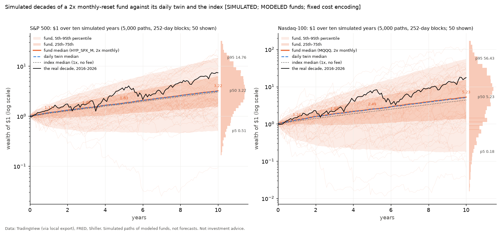

# B11: Monte Carlo paths of the calendar-reset funds

*Data: TradingView (via local export), FRED, Shiller. Simulated paths of modeled funds, not forecasts. Not investment advice.*

```
Inputs: 8 files; prices from <external>/library, rates from <external>/rates
  SP_SPX_daily.csv: 19333 rows, 1950-01-03 to 2026-11-02, sha256 b146c9af89cc
  SP_SPXTR_daily.csv: 9787 rows, 1988-01-04 to 2026-11-03, sha256 edab5090825e
  AMEX_SPY_daily.csv: 8498 rows, 1993-01-29 to 2026-11-02, sha256 643d6ef08b88
  NASDAQ_NDX_daily.csv: 10519 rows, 1985-01-31 to 2026-10-30, sha256 79d8e8688fa3
  NASDAQ_XNDX_daily.csv: 5019 rows, 2006-11-08 to 2026-10-30, sha256 d7dcc6dffa24
  NASDAQ_QQQ_daily.csv: 6955 rows, 1999-03-10 to 2026-10-30, sha256 f096cd6c6b75
  DFF.csv: 26424 rows, 1954-07-01 to 2026-11-03, sha256 e84a934a5014
  TB3MS.csv: 1112 rows, 1934-01-01 to 2026-08-01, sha256 ebf04b1ae5bc
SPX early-reset trigger: the AMEX:SPY price (daily low) from 1993-01-29, scaled to the SP:SPX price index before that; trigger basis 'etf'; drop 35% from the fund's base; fill mode 'level'.
SPX day counts: financing (reference rate and swap spread) ACT/360; expense ratio ACT/365 (calendar days between rows, so weekends and holidays accrue).
SPX reset dates: last NYSE session of the week / month / quarter from 1970-01-01 (calendar_letf/nyse.py, refuses data that lack it); before that the last row of the period.
NDX early-reset trigger: the NASDAQ:QQQ price (daily low) from 1999-03-10, scaled to the NASDAQ:NDX price index before that; trigger basis 'etf'; drop 35% from the fund's base; fill mode 'level'.
NDX day counts: financing (reference rate and swap spread) ACT/360; expense ratio ACT/365 (calendar days between rows, so weekends and holidays accrue).
NDX reset dates: last NYSE session of the week / month / quarter from 1970-01-01 (calendar_letf/nyse.py, refuses data that lack it); before that the last row of the period.
History cut at 2026-09-30 (scripts/run_sub2x.py STUDY_END); B17 history optimum read from results/sub2x.json (sha256 1e24b28ef6fd); seed 20261106.
```

Every path is ten years of made-up history on the real NYSE calendar of the ten years to the study end. Its days copy real days in blocks, so the paths keep the real joint moves of the index, its price, its intraday low and the rate. These distributions show the spread of outcomes under that resampling. They are not confidence intervals for the true gap. Each median carries a distribution-free 95% interval for the Monte Carlo error; each mean carries +/- one Monte Carlo SE.

## S&P 500 (blocks from 1950-01-04 to 2026-09-30)

### The reset gap (calendar fund minus daily twin, CAGR points a year), fixed cost encoding

| block | product | reset | years | median | median 95% (MC) | mean +/- SE | p5 / p95 | calendar ahead |
|---|---|---|---|---|---|---|---|---|
| 21 | SPYQ | quarterly | 1 | +0.49 | [+0.44, +0.54] | +0.19 +/- 0.03 | -3.50 / +2.82 | 63% |
| 21 | SPYQ | quarterly | 3 | +0.32 | [+0.28, +0.35] | +0.14 +/- 0.02 | -2.22 / +2.11 | 61% |
| 21 | SPYQ | quarterly | 5 | +0.28 | [+0.25, +0.31] | +0.12 +/- 0.02 | -1.85 / +1.73 | 62% |
| 21 | SPYQ | quarterly | 10 | +0.23 | [+0.20, +0.25] | +0.12 +/- 0.01 | -1.52 / +1.31 | 64% |
| 21 | HYP_SPX_M | monthly | 1 | +0.24 | [+0.20, +0.28] | +0.21 +/- 0.02 | -2.04 / +2.26 | 60% |
| 21 | HYP_SPX_M | monthly | 3 | +0.18 | [+0.16, +0.20] | +0.13 +/- 0.01 | -1.39 / +1.55 | 60% |
| 21 | HYP_SPX_M | monthly | 5 | +0.17 | [+0.14, +0.19] | +0.12 +/- 0.01 | -1.14 / +1.26 | 61% |
| 21 | HYP_SPX_M | monthly | 10 | +0.17 | [+0.15, +0.18] | +0.12 +/- 0.01 | -0.88 / +0.96 | 63% |
| 21 | HYP_SPX_W | weekly | 1 | -0.03 | [-0.05, -0.01] | +0.04 +/- 0.01 | -1.09 / +1.39 | 48% |
| 21 | HYP_SPX_W | weekly | 3 | -0.01 | [-0.02, +0.00] | +0.04 +/- 0.01 | -0.68 / +1.09 | 49% |
| 21 | HYP_SPX_W | weekly | 5 | +0.01 | [-0.00, +0.02] | +0.05 +/- 0.01 | -0.55 / +0.92 | 51% |
| 21 | HYP_SPX_W | weekly | 10 | +0.03 | [+0.02, +0.04] | +0.06 +/- 0.00 | -0.42 / +0.66 | 54% |
| 63 | SPYQ | quarterly | 1 | +0.46 | [+0.41, +0.51] | +0.18 +/- 0.04 | -3.52 / +3.11 | 62% |
| 63 | SPYQ | quarterly | 3 | +0.36 | [+0.32, +0.40] | +0.05 +/- 0.03 | -3.02 / +2.15 | 63% |
| 63 | SPYQ | quarterly | 5 | +0.31 | [+0.28, +0.34] | -0.00 +/- 0.02 | -3.54 / +1.83 | 63% |
| 63 | SPYQ | quarterly | 10 | +0.22 | [+0.19, +0.25] | -0.04 +/- 0.02 | -2.61 / +1.38 | 60% |
| 63 | HYP_SPX_M | monthly | 1 | +0.16 | [+0.13, +0.19] | +0.11 +/- 0.02 | -2.13 / +2.18 | 57% |
| 63 | HYP_SPX_M | monthly | 3 | +0.13 | [+0.11, +0.16] | +0.10 +/- 0.01 | -1.39 / +1.53 | 58% |
| 63 | HYP_SPX_M | monthly | 5 | +0.13 | [+0.11, +0.15] | +0.09 +/- 0.01 | -1.19 / +1.26 | 59% |
| 63 | HYP_SPX_M | monthly | 10 | +0.13 | [+0.11, +0.15] | +0.10 +/- 0.01 | -0.90 / +0.98 | 61% |
| 63 | HYP_SPX_W | weekly | 1 | -0.04 | [-0.06, -0.03] | +0.04 +/- 0.01 | -1.11 / +1.37 | 46% |
| 63 | HYP_SPX_W | weekly | 3 | -0.02 | [-0.03, -0.01] | +0.05 +/- 0.01 | -0.70 / +1.22 | 47% |
| 63 | HYP_SPX_W | weekly | 5 | -0.01 | [-0.02, +0.00] | +0.05 +/- 0.01 | -0.58 / +1.05 | 49% |
| 63 | HYP_SPX_W | weekly | 10 | +0.01 | [+0.00, +0.02] | +0.06 +/- 0.01 | -0.46 / +0.73 | 52% |
| 126 | SPYQ | quarterly | 1 | +0.38 | [+0.33, +0.42] | +0.16 +/- 0.03 | -3.41 / +3.07 | 61% |
| 126 | SPYQ | quarterly | 3 | +0.29 | [+0.25, +0.33] | +0.05 +/- 0.03 | -3.11 / +2.18 | 61% |
| 126 | SPYQ | quarterly | 5 | +0.27 | [+0.23, +0.29] | +0.02 +/- 0.02 | -3.12 / +1.86 | 62% |
| 126 | SPYQ | quarterly | 10 | +0.19 | [+0.17, +0.23] | -0.02 +/- 0.02 | -2.44 / +1.40 | 60% |
| 126 | HYP_SPX_M | monthly | 1 | +0.11 | [+0.08, +0.14] | +0.10 +/- 0.02 | -1.87 / +2.20 | 55% |
| 126 | HYP_SPX_M | monthly | 3 | +0.11 | [+0.08, +0.13] | +0.10 +/- 0.01 | -1.30 / +1.50 | 57% |
| 126 | HYP_SPX_M | monthly | 5 | +0.12 | [+0.10, +0.14] | +0.10 +/- 0.01 | -1.05 / +1.28 | 58% |
| 126 | HYP_SPX_M | monthly | 10 | +0.12 | [+0.10, +0.13] | +0.09 +/- 0.01 | -0.85 / +0.98 | 60% |
| 126 | HYP_SPX_W | weekly | 1 | -0.06 | [-0.07, -0.04] | +0.02 +/- 0.01 | -1.09 / +1.32 | 45% |
| 126 | HYP_SPX_W | weekly | 3 | -0.04 | [-0.06, -0.03] | +0.04 +/- 0.01 | -0.74 / +1.34 | 45% |
| 126 | HYP_SPX_W | weekly | 5 | -0.04 | [-0.05, -0.03] | +0.04 +/- 0.01 | -0.60 / +1.13 | 45% |
| 126 | HYP_SPX_W | weekly | 10 | -0.01 | [-0.02, -0.00] | +0.05 +/- 0.01 | -0.46 / +0.77 | 49% |
| 252 | SPYQ | quarterly | 1 | +0.33 | [+0.29, +0.36] | +0.18 +/- 0.03 | -2.92 / +3.01 | 62% |
| 252 | SPYQ | quarterly | 3 | +0.26 | [+0.23, +0.30] | +0.04 +/- 0.03 | -3.04 / +2.17 | 61% |
| 252 | SPYQ | quarterly | 5 | +0.26 | [+0.23, +0.29] | +0.02 +/- 0.02 | -2.99 / +1.84 | 62% |
| 252 | SPYQ | quarterly | 10 | +0.19 | [+0.17, +0.22] | -0.04 +/- 0.02 | -2.40 / +1.40 | 60% |
| 252 | HYP_SPX_M | monthly | 1 | +0.11 | [+0.08, +0.13] | +0.11 +/- 0.02 | -1.66 / +2.21 | 55% |
| 252 | HYP_SPX_M | monthly | 3 | +0.09 | [+0.06, +0.12] | +0.08 +/- 0.01 | -1.34 / +1.60 | 56% |
| 252 | HYP_SPX_M | monthly | 5 | +0.11 | [+0.09, +0.13] | +0.10 +/- 0.01 | -1.14 / +1.36 | 58% |
| 252 | HYP_SPX_M | monthly | 10 | +0.11 | [+0.09, +0.12] | +0.09 +/- 0.01 | -0.88 / +1.00 | 59% |
| 252 | HYP_SPX_W | weekly | 1 | -0.07 | [-0.08, -0.05] | +0.01 +/- 0.01 | -1.04 / +1.36 | 44% |
| 252 | HYP_SPX_W | weekly | 3 | -0.05 | [-0.06, -0.04] | +0.04 +/- 0.01 | -0.80 / +1.51 | 45% |
| 252 | HYP_SPX_W | weekly | 5 | -0.03 | [-0.04, -0.02] | +0.06 +/- 0.01 | -0.66 / +1.25 | 46% |
| 252 | HYP_SPX_W | weekly | 10 | -0.01 | [-0.02, +0.00] | +0.06 +/- 0.01 | -0.50 / +0.84 | 49% |

### Ten years: wealth of $1, drawdown, early resets and wipeouts (fixed cost)

| block | product | fund p5 / median / p95 | twin | index | median max DD | paths with an early reset | wiped (fund / twin) | fund beats index |
|---|---|---|---|---|---|---|---|---|
| 21 | SPYQ | 0.59 / 3.29 / 16.35 | 0.62 / 3.24 / 16.01 | 1.37 / 3.06 / 6.69 | -57% | 2.7% | 0.00% / 0.00% | 57% |
| 21 | HYP_SPX_M | 0.62 / 3.30 / 16.28 | 0.62 / 3.24 / 16.01 | 1.37 / 3.06 / 6.69 | -57% | 0.3% | 0.00% / 0.00% | 56% |
| 21 | HYP_SPX_W | 0.62 / 3.27 / 16.08 | 0.62 / 3.24 / 16.01 | 1.37 / 3.06 / 6.69 | -56% | 0.0% | 0.00% / 0.00% | 55% |
| 63 | SPYQ | 0.51 / 3.11 / 15.09 | 0.55 / 3.08 / 14.46 | 1.32 / 2.99 / 6.37 | -60% | 10.4% | 0.00% / 0.00% | 53% |
| 63 | HYP_SPX_M | 0.55 / 3.11 / 14.81 | 0.55 / 3.08 / 14.46 | 1.32 / 2.99 / 6.37 | -59% | 0.2% | 0.00% / 0.00% | 54% |
| 63 | HYP_SPX_W | 0.56 / 3.10 / 14.46 | 0.55 / 3.08 / 14.46 | 1.32 / 2.99 / 6.37 | -58% | 0.0% | 0.00% / 0.00% | 53% |
| 126 | SPYQ | 0.53 / 3.32 / 15.15 | 0.59 / 3.28 / 14.68 | 1.36 / 3.07 / 6.35 | -61% | 9.8% | 0.00% / 0.00% | 56% |
| 126 | HYP_SPX_M | 0.59 / 3.29 / 14.96 | 0.59 / 3.28 / 14.68 | 1.36 / 3.07 / 6.35 | -60% | 0.3% | 0.00% / 0.00% | 55% |
| 126 | HYP_SPX_W | 0.59 / 3.28 / 14.81 | 0.59 / 3.28 / 14.68 | 1.36 / 3.07 / 6.35 | -59% | 0.0% | 0.00% / 0.00% | 55% |
| 252 | SPYQ | 0.46 / 3.23 / 14.99 | 0.50 / 3.18 / 14.42 | 1.27 / 3.03 / 6.28 | -63% | 10.2% | 0.00% / 0.00% | 54% |
| 252 | HYP_SPX_M | 0.51 / 3.22 / 14.76 | 0.50 / 3.18 / 14.42 | 1.27 / 3.03 / 6.28 | -62% | 0.3% | 0.00% / 0.00% | 54% |
| 252 | HYP_SPX_W | 0.51 / 3.19 / 14.60 | 0.50 / 3.18 / 14.42 | 1.27 / 3.03 / 6.28 | -59% | 0.0% | 0.00% / 0.00% | 54% |

### Zero costs (the reset effect alone), 10 years

| block | product | median | median 95% (MC) | mean +/- SE | p5 / p95 | calendar ahead |
|---|---|---|---|---|---|---|
| 21 | SPYQ | -0.02 | [-0.04, +0.01] | -0.11 +/- 0.01 | -1.78 / +1.17 | 49% |
| 21 | HYP_SPX_M | +0.11 | [+0.08, +0.12] | +0.06 +/- 0.01 | -0.99 / +0.94 | 58% |
| 21 | HYP_SPX_W | +0.01 | [+0.00, +0.02] | +0.05 +/- 0.01 | -0.48 / +0.71 | 52% |
| 63 | SPYQ | -0.01 | [-0.04, +0.01] | -0.24 +/- 0.02 | -2.77 / +1.27 | 49% |
| 63 | HYP_SPX_M | +0.07 | [+0.05, +0.09] | +0.04 +/- 0.01 | -1.00 / +0.99 | 55% |
| 63 | HYP_SPX_W | -0.00 | [-0.01, +0.01] | +0.05 +/- 0.01 | -0.50 / +0.78 | 50% |
| 126 | SPYQ | -0.03 | [-0.06, -0.00] | -0.21 +/- 0.02 | -2.57 / +1.25 | 49% |
| 126 | HYP_SPX_M | +0.05 | [+0.03, +0.07] | +0.03 +/- 0.01 | -0.94 / +0.99 | 54% |
| 126 | HYP_SPX_W | -0.03 | [-0.04, -0.02] | +0.04 +/- 0.01 | -0.51 / +0.83 | 46% |
| 252 | SPYQ | -0.03 | [-0.06, -0.01] | -0.22 +/- 0.02 | -2.54 / +1.27 | 48% |
| 252 | HYP_SPX_M | +0.05 | [+0.03, +0.06] | +0.03 +/- 0.01 | -0.97 / +1.02 | 54% |
| 252 | HYP_SPX_W | -0.03 | [-0.04, -0.02] | +0.05 +/- 0.01 | -0.54 / +0.89 | 47% |

### C5: the gap by the path's own volatility and trend (block 252; a mechanism, not a timing rule)

| product | years | low vol | mid vol | high vol | low trend | mid trend | high trend | high - low vol mean |
|---|---|---|---|---|---|---|---|---|
| SPYQ | 1 | +0.13 | +0.42 | +0.99 | +0.12 | +0.66 | +0.13 | +0.59 (z +6.3) |
| SPYQ | 3 | +0.12 | +0.37 | +0.55 | +0.07 | +0.39 | +0.30 | -0.09 (z -1.3) |
| SPYQ | 5 | +0.15 | +0.41 | +0.37 | +0.02 | +0.38 | +0.34 | -0.26 (z -4.4) |
| SPYQ | 10 | +0.18 | +0.29 | -0.01 | -0.07 | +0.26 | +0.29 | -0.46 (z -11.0) |
| HYP_SPX_M | 1 | -0.04 | +0.10 | +0.56 | -0.02 | +0.26 | +0.12 | +0.53 (z +8.3) |
| HYP_SPX_M | 3 | -0.06 | +0.13 | +0.44 | -0.00 | +0.11 | +0.14 | +0.33 (z +8.4) |
| HYP_SPX_M | 5 | -0.03 | +0.14 | +0.40 | +0.07 | +0.12 | +0.15 | +0.29 (z +9.3) |
| HYP_SPX_M | 10 | +0.00 | +0.11 | +0.34 | +0.07 | +0.12 | +0.12 | +0.22 (z +10.5) |
| HYP_SPX_W | 1 | -0.12 | -0.09 | +0.17 | -0.15 | -0.04 | -0.01 | +0.43 (z +11.0) |
| HYP_SPX_W | 3 | -0.13 | -0.06 | +0.24 | -0.05 | -0.06 | -0.04 | +0.51 (z +19.4) |
| HYP_SPX_W | 5 | -0.11 | -0.06 | +0.35 | -0.00 | -0.05 | -0.03 | +0.51 (z +25.2) |
| HYP_SPX_W | 10 | -0.11 | -0.03 | +0.36 | +0.04 | -0.02 | -0.02 | +0.44 (z +32.8) |

Median gap in each cell of low / mid / high volatility (rows) by low / mid / high trend (columns), 10 years:

SPYQ:

| vol \ trend | low | mid | high |
|---|---|---|---|
| low | +0.02 | +0.23 | +0.22 |
| mid | +0.11 | +0.34 | +0.41 |
| high | -0.40 | +0.24 | +0.47 |

HYP_SPX_M:

| vol \ trend | low | mid | high |
|---|---|---|---|
| low | -0.10 | +0.02 | +0.04 |
| mid | -0.00 | +0.13 | +0.21 |
| high | +0.29 | +0.36 | +0.36 |

HYP_SPX_W:

| vol \ trend | low | mid | high |
|---|---|---|---|
| low | -0.16 | -0.12 | -0.09 |
| mid | -0.10 | -0.02 | +0.02 |
| high | +0.36 | +0.35 | +0.37 |

### B17 on paths: the best L of each path (growth over ten years)

| block | cost | reset | range | median best L | p10-p90 | paths at 1x | paths at the top | L of the median growth curve | history (B17) |
|---|---|---|---|---|---|---|---|---|---|
| 63 | b19 | daily | <= 2 | 2.00 | 1.00-2.00 | 25% | 68% | 2.00 | 2.00 |
| 63 | b19 | daily | <= 3 | 3.00 | 1.00-3.00 | 25% | 50% | 2.90 | 2.70 |
| 63 | b19 | weekly | <= 2 | 2.00 | 1.00-2.00 | 25% | 68% | 2.00 | 2.00 |
| 63 | b19 | weekly | <= 3 | 2.95 | 1.00-3.00 | 25% | 49% | 2.95 | 2.85 |
| 63 | b19 | monthly | <= 2 | 2.00 | 1.00-2.00 | 25% | 68% | 2.00 | 2.00 |
| 63 | b19 | monthly | <= 3 | 2.85 | 1.00-3.00 | 25% | 48% | 2.85 | 2.50 |
| 63 | b19 | quarterly | <= 2 | 2.00 | 1.00-2.00 | 24% | 66% | 2.00 | 1.90 |
| 63 | b19 | quarterly | <= 3 | 2.75 | 1.00-3.00 | 24% | 42% | 2.75 | 1.90 |
| 63 | base | daily | <= 2 | 2.00 | 1.00-2.00 | 38% | 61% | 2.00 | 2.00 |
| 63 | base | daily | <= 3 | 2.65 | 1.00-3.00 | 38% | 44% | 2.65 | 2.40 |
| 63 | base | weekly | <= 2 | 2.00 | 1.00-2.00 | 38% | 61% | 2.00 | 2.00 |
| 63 | base | weekly | <= 3 | 2.60 | 1.00-3.00 | 38% | 43% | 2.55 | 2.50 |
| 63 | base | monthly | <= 2 | 2.00 | 1.00-2.00 | 38% | 61% | 2.00 | 2.00 |
| 63 | base | monthly | <= 3 | 2.55 | 1.00-3.00 | 38% | 43% | 2.55 | 2.50 |
| 63 | base | quarterly | <= 2 | 2.00 | 1.00-2.00 | 37% | 60% | 2.00 | 1.90 |
| 63 | base | quarterly | <= 3 | 2.55 | 1.00-3.00 | 37% | 38% | 2.10 | 1.90 |
| 252 | b19 | daily | <= 2 | 2.00 | 1.00-2.00 | 26% | 68% | 2.00 | 2.00 |
| 252 | b19 | daily | <= 3 | 3.00 | 1.00-3.00 | 26% | 51% | 3.00 | 2.70 |
| 252 | b19 | weekly | <= 2 | 2.00 | 1.00-2.00 | 25% | 69% | 2.00 | 2.00 |
| 252 | b19 | weekly | <= 3 | 2.98 | 1.00-3.00 | 25% | 50% | 2.95 | 2.85 |
| 252 | b19 | monthly | <= 2 | 2.00 | 1.00-2.00 | 25% | 68% | 2.00 | 2.00 |
| 252 | b19 | monthly | <= 3 | 2.90 | 1.00-3.00 | 25% | 49% | 3.00 | 2.50 |
| 252 | b19 | quarterly | <= 2 | 2.00 | 1.00-2.00 | 25% | 66% | 2.00 | 1.90 |
| 252 | b19 | quarterly | <= 3 | 2.75 | 1.00-3.00 | 25% | 43% | 2.65 | 1.90 |
| 252 | base | daily | <= 2 | 2.00 | 1.00-2.00 | 38% | 61% | 2.00 | 2.00 |
| 252 | base | daily | <= 3 | 2.70 | 1.00-3.00 | 38% | 46% | 2.65 | 2.40 |
| 252 | base | weekly | <= 2 | 2.00 | 1.00-2.00 | 37% | 62% | 2.00 | 2.00 |
| 252 | base | weekly | <= 3 | 2.65 | 1.00-3.00 | 37% | 44% | 2.75 | 2.50 |
| 252 | base | monthly | <= 2 | 2.00 | 1.00-2.00 | 37% | 61% | 2.00 | 2.00 |
| 252 | base | monthly | <= 3 | 2.60 | 1.00-3.00 | 37% | 44% | 2.75 | 2.50 |
| 252 | base | quarterly | <= 2 | 2.00 | 1.00-2.00 | 36% | 60% | 2.00 | 1.90 |
| 252 | base | quarterly | <= 3 | 2.55 | 1.00-3.00 | 36% | 39% | 2.50 | 1.90 |

### The mechanism: AR(1) paths, 2x, zero cost, no trigger (log gap per year)

| phi | reset | mean +/- SE | predicted (second order) |
|---|---|---|---|
| -0.10 | weekly | +0.36 +/- 0.00 | +0.36 |
| -0.10 | monthly | +0.38 +/- 0.01 | +0.32 |
| -0.10 | quarterly | +0.28 +/- 0.01 | +0.08 |
| -0.05 | weekly | +0.18 +/- 0.00 | +0.17 |
| -0.05 | monthly | +0.17 +/- 0.01 | +0.11 |
| -0.05 | quarterly | +0.08 +/- 0.01 | -0.14 |
| +0.00 | weekly | -0.01 +/- 0.00 | -0.02 |
| +0.00 | monthly | -0.06 +/- 0.01 | -0.12 |
| +0.00 | quarterly | -0.17 +/- 0.01 | -0.37 |
| +0.05 | weekly | -0.21 +/- 0.00 | -0.24 |
| +0.05 | monthly | -0.29 +/- 0.01 | -0.37 |
| +0.05 | quarterly | -0.38 +/- 0.01 | -0.63 |
| +0.10 | weekly | -0.43 +/- 0.00 | -0.47 |
| +0.10 | monthly | -0.56 +/- 0.01 | -0.65 |
| +0.10 | quarterly | -0.67 +/- 0.02 | -0.92 |

### Stress: Flat decade (every daily move less the history's mean)

| product | gap median (10y) | gap mean +/- SE | fund median wealth | twin | index | wiped (fund / twin) | early reset |
|---|---|---|---|---|---|---|---|
| SPYQ | -0.15 | -0.39 +/- 0.02 | 0.32 | 0.33 | 0.98 | 0.0% / 0.0% | 16% |
| HYP_SPX_M | +0.01 | -0.01 +/- 0.01 | 0.33 | 0.33 | 0.98 | 0.0% / 0.0% | 0% |
| HYP_SPX_W | -0.02 | +0.02 +/- 0.01 | 0.33 | 0.33 | 0.98 | 0.0% / 0.0% | 0% |

### Stress: Rate shock (blocks only from high or rising rates while the S&P 500 fell)

Eras 1973-01-02 to 1974-12-31, 1980-12-01 to 1982-08-12, 2022-01-03 to 2022-10-12; 1131 days; mean rate 10.44%; index mean log return -21.60% a year.

| product | gap median (10y) | gap mean +/- SE | fund median wealth | twin | index | wiped (fund / twin) | early reset |
|---|---|---|---|---|---|---|---|
| SPYQ | -1.01 | -1.07 +/- 0.02 | 0.00 | 0.01 | 0.17 | 0.0% / 0.0% | 0% |
| HYP_SPX_M | -0.59 | -0.59 +/- 0.01 | 0.00 | 0.01 | 0.17 | 0.0% / 0.0% | 0% |
| HYP_SPX_W | -0.49 | -0.50 +/- 0.00 | 0.00 | 0.01 | 0.17 | 0.0% / 0.0% | 0% |

### Stress: 1929-39 (PARAMETRIC: Shiller monthly prices 1929-08 to 1939-08, daily SD 1.96%, rate 0% ASSUMED)

| product | gap median | fund median wealth | twin | index | wiped (fund / twin) | early reset | fund p5 / p95 |
|---|---|---|---|---|---|---|---|
| SPYQ | -4.45 | 0.07 | 0.12 | 0.66 | 0.0% / 0.0% | 37% | 0.06 / 0.07 |
| HYP_SPX_M | -0.36 | 0.11 | 0.12 | 0.66 | 0.0% / 0.0% | 0% | 0.11 / 0.11 |
| HYP_SPX_W | -0.08 | 0.12 | 0.12 | 0.66 | 0.0% / 0.0% | 0% | 0.11 / 0.12 |

### Stress: 1929-39 (PARAMETRIC: Shiller monthly prices 1929-08 to 1939-08, daily SD 1.96%, rate 4% ASSUMED)

| product | gap median | fund median wealth | twin | index | wiped (fund / twin) | early reset | fund p5 / p95 |
|---|---|---|---|---|---|---|---|
| SPYQ | -4.78 | 0.04 | 0.08 | 0.66 | 0.0% / 0.0% | 38% | 0.04 / 0.04 |
| HYP_SPX_M | -0.46 | 0.07 | 0.08 | 0.66 | 0.0% / 0.0% | 0% | 0.07 / 0.07 |
| HYP_SPX_W | -0.07 | 0.08 | 0.08 | 0.66 | 0.0% / 0.0% | 0% | 0.07 / 0.08 |

## Nasdaq-100 (blocks from 1985-02-01 to 2026-09-30)

### The reset gap (calendar fund minus daily twin, CAGR points a year), fixed cost encoding

| block | product | reset | years | median | median 95% (MC) | mean +/- SE | p5 / p95 | calendar ahead |
|---|---|---|---|---|---|---|---|---|
| 21 | MQQQ | monthly | 1 | +1.22 | [+1.12, +1.31] | +1.03 +/- 0.06 | -5.96 / +7.38 | 67% |
| 21 | MQQQ | monthly | 3 | +1.01 | [+0.95, +1.09] | +0.60 +/- 0.04 | -4.97 / +4.47 | 68% |
| 21 | MQQQ | monthly | 5 | +0.84 | [+0.78, +0.89] | +0.51 +/- 0.03 | -4.21 / +3.67 | 67% |
| 21 | MQQQ | monthly | 10 | +0.77 | [+0.73, +0.83] | +0.50 +/- 0.02 | -2.81 / +2.79 | 68% |
| 21 | QQQP | quarterly | 1 | +1.74 | [+1.59, +1.85] | +0.86 +/- 0.09 | -10.16 / +8.84 | 67% |
| 21 | QQQP | quarterly | 3 | +1.21 | [+1.10, +1.33] | +0.60 +/- 0.05 | -6.99 / +5.63 | 65% |
| 21 | QQQP | quarterly | 5 | +1.03 | [+0.95, +1.13] | +0.47 +/- 0.04 | -5.61 / +4.67 | 64% |
| 21 | QQQP | quarterly | 10 | +0.75 | [+0.67, +0.83] | +0.40 +/- 0.03 | -3.94 / +3.65 | 63% |
| 21 | HYP_NDX_W | weekly | 1 | +0.55 | [+0.51, +0.61] | +0.70 +/- 0.03 | -2.40 / +4.30 | 66% |
| 21 | HYP_NDX_W | weekly | 3 | +0.59 | [+0.56, +0.62] | +0.60 +/- 0.02 | -1.43 / +2.64 | 72% |
| 21 | HYP_NDX_W | weekly | 5 | +0.59 | [+0.56, +0.62] | +0.59 +/- 0.01 | -1.04 / +2.17 | 75% |
| 21 | HYP_NDX_W | weekly | 10 | +0.60 | [+0.58, +0.62] | +0.58 +/- 0.01 | -0.67 / +1.74 | 81% |
| 63 | MQQQ | monthly | 1 | +0.91 | [+0.83, +0.99] | +0.71 +/- 0.06 | -6.00 / +7.01 | 66% |
| 63 | MQQQ | monthly | 3 | +0.87 | [+0.80, +0.95] | +0.51 +/- 0.04 | -5.22 / +4.31 | 68% |
| 63 | MQQQ | monthly | 5 | +0.83 | [+0.78, +0.88] | +0.47 +/- 0.03 | -4.37 / +3.58 | 68% |
| 63 | MQQQ | monthly | 10 | +0.69 | [+0.63, +0.74] | +0.42 +/- 0.02 | -2.85 / +2.78 | 67% |
| 63 | QQQP | quarterly | 1 | +1.21 | [+1.08, +1.36] | -0.25 +/- 0.11 | -14.42 / +9.17 | 63% |
| 63 | QQQP | quarterly | 3 | +0.37 | [+0.22, +0.50] | -0.99 +/- 0.07 | -10.64 / +5.76 | 53% |
| 63 | QQQP | quarterly | 5 | -0.30 | [-0.45, -0.14] | -1.15 +/- 0.06 | -8.87 / +4.59 | 48% |
| 63 | QQQP | quarterly | 10 | -0.95 | [-1.06, -0.84] | -1.20 +/- 0.04 | -6.70 / +3.35 | 39% |
| 63 | HYP_NDX_W | weekly | 1 | +0.40 | [+0.36, +0.43] | +0.61 +/- 0.03 | -2.03 / +4.06 | 64% |
| 63 | HYP_NDX_W | weekly | 3 | +0.59 | [+0.55, +0.62] | +0.60 +/- 0.02 | -1.48 / +2.70 | 73% |
| 63 | HYP_NDX_W | weekly | 5 | +0.63 | [+0.60, +0.66] | +0.62 +/- 0.01 | -1.07 / +2.22 | 77% |
| 63 | HYP_NDX_W | weekly | 10 | +0.62 | [+0.59, +0.65] | +0.60 +/- 0.01 | -0.62 / +1.75 | 82% |
| 126 | MQQQ | monthly | 1 | +0.89 | [+0.82, +0.96] | +0.93 +/- 0.05 | -4.25 / +6.75 | 70% |
| 126 | MQQQ | monthly | 3 | +0.88 | [+0.83, +0.92] | +0.55 +/- 0.04 | -4.76 / +4.15 | 70% |
| 126 | MQQQ | monthly | 5 | +0.80 | [+0.76, +0.85] | +0.46 +/- 0.03 | -4.62 / +3.34 | 70% |
| 126 | MQQQ | monthly | 10 | +0.67 | [+0.63, +0.72] | +0.40 +/- 0.02 | -2.80 / +2.60 | 69% |
| 126 | QQQP | quarterly | 1 | +1.05 | [+0.97, +1.15] | +0.15 +/- 0.09 | -11.39 / +9.26 | 63% |
| 126 | QQQP | quarterly | 3 | +0.52 | [+0.39, +0.63] | -0.76 +/- 0.07 | -10.17 / +5.33 | 55% |
| 126 | QQQP | quarterly | 5 | -0.06 | [-0.18, +0.06] | -1.01 +/- 0.06 | -8.26 / +4.31 | 49% |
| 126 | QQQP | quarterly | 10 | -1.06 | [-1.20, -0.95] | -1.26 +/- 0.04 | -6.52 / +3.09 | 38% |
| 126 | HYP_NDX_W | weekly | 1 | +0.34 | [+0.31, +0.37] | +0.61 +/- 0.03 | -1.92 / +4.27 | 64% |
| 126 | HYP_NDX_W | weekly | 3 | +0.53 | [+0.50, +0.57] | +0.61 +/- 0.02 | -1.20 / +2.73 | 72% |
| 126 | HYP_NDX_W | weekly | 5 | +0.59 | [+0.56, +0.62] | +0.60 +/- 0.01 | -1.04 / +2.26 | 75% |
| 126 | HYP_NDX_W | weekly | 10 | +0.62 | [+0.60, +0.65] | +0.61 +/- 0.01 | -0.64 / +1.83 | 81% |
| 252 | MQQQ | monthly | 1 | +0.73 | [+0.69, +0.78] | +0.89 +/- 0.06 | -4.59 / +7.83 | 69% |
| 252 | MQQQ | monthly | 3 | +0.82 | [+0.75, +0.87] | +0.55 +/- 0.04 | -5.14 / +4.55 | 70% |
| 252 | MQQQ | monthly | 5 | +0.76 | [+0.72, +0.82] | +0.45 +/- 0.03 | -4.98 / +3.64 | 69% |
| 252 | MQQQ | monthly | 10 | +0.68 | [+0.63, +0.71] | +0.40 +/- 0.02 | -2.92 / +2.75 | 68% |
| 252 | QQQP | quarterly | 1 | +0.99 | [+0.92, +1.07] | +0.28 +/- 0.10 | -11.15 / +8.23 | 65% |
| 252 | QQQP | quarterly | 3 | +0.68 | [+0.59, +0.78] | -0.65 +/- 0.07 | -10.16 / +5.40 | 59% |
| 252 | QQQP | quarterly | 5 | +0.12 | [-0.02, +0.25] | -1.05 +/- 0.06 | -8.70 / +4.15 | 51% |
| 252 | QQQP | quarterly | 10 | -0.92 | [-1.06, -0.78] | -1.29 +/- 0.04 | -7.03 / +2.99 | 41% |
| 252 | HYP_NDX_W | weekly | 1 | +0.29 | [+0.25, +0.31] | +0.67 +/- 0.04 | -2.26 / +5.33 | 64% |
| 252 | HYP_NDX_W | weekly | 3 | +0.47 | [+0.43, +0.50] | +0.61 +/- 0.02 | -1.40 / +3.09 | 70% |
| 252 | HYP_NDX_W | weekly | 5 | +0.53 | [+0.50, +0.57] | +0.62 +/- 0.02 | -1.05 / +2.54 | 74% |
| 252 | HYP_NDX_W | weekly | 10 | +0.61 | [+0.58, +0.63] | +0.62 +/- 0.01 | -0.70 / +1.97 | 79% |

### Ten years: wealth of $1, drawdown, early resets and wipeouts (fixed cost)

| block | product | fund p5 / median / p95 | twin | index | median max DD | paths with an early reset | wiped (fund / twin) | fund beats index |
|---|---|---|---|---|---|---|---|---|
| 21 | MQQQ | 0.30 / 4.29 / 50.40 | 0.31 / 4.06 / 46.81 | 1.15 / 4.02 / 13.21 | -75% | 12.5% | 0.00% / 0.00% | 53% |
| 21 | QQQP | 0.28 / 4.34 / 49.79 | 0.32 / 4.08 / 46.95 | 1.15 / 4.02 / 13.21 | -76% | 21.7% | 0.00% / 0.00% | 54% |
| 21 | HYP_NDX_W | 0.32 / 4.29 / 49.42 | 0.32 / 4.08 / 46.95 | 1.15 / 4.02 / 13.21 | -74% | 0.0% | 0.00% / 0.00% | 54% |
| 63 | MQQQ | 0.24 / 4.49 / 54.51 | 0.26 / 4.21 / 51.58 | 1.07 / 4.08 / 13.70 | -78% | 14.1% | 0.00% / 0.00% | 54% |
| 63 | QQQP | 0.17 / 3.90 / 51.78 | 0.26 / 4.22 / 51.73 | 1.07 / 4.08 / 13.70 | -81% | 54.5% | 0.00% / 0.00% | 48% |
| 63 | HYP_NDX_W | 0.28 / 4.50 / 54.98 | 0.26 / 4.22 / 51.73 | 1.07 / 4.08 / 13.70 | -76% | 0.0% | 0.00% / 0.00% | 54% |
| 126 | MQQQ | 0.26 / 4.80 / 51.80 | 0.26 / 4.61 / 48.91 | 1.10 / 4.20 / 13.28 | -78% | 14.4% | 0.00% / 0.00% | 56% |
| 126 | QQQP | 0.16 / 4.22 / 51.33 | 0.26 / 4.62 / 49.06 | 1.10 / 4.20 / 13.28 | -82% | 53.4% | 0.00% / 0.00% | 50% |
| 126 | HYP_NDX_W | 0.27 / 4.85 / 51.09 | 0.26 / 4.62 / 49.06 | 1.10 / 4.20 / 13.28 | -77% | 0.0% | 0.00% / 0.00% | 57% |
| 252 | MQQQ | 0.18 / 5.23 / 56.43 | 0.18 / 5.17 / 51.26 | 0.95 / 4.37 / 13.56 | -79% | 15.5% | 0.00% / 0.00% | 56% |
| 252 | QQQP | 0.10 / 4.68 / 57.15 | 0.18 / 5.18 / 51.41 | 0.95 / 4.37 / 13.56 | -82% | 51.6% | 0.00% / 0.00% | 52% |
| 252 | HYP_NDX_W | 0.20 / 5.43 / 54.89 | 0.18 / 5.18 / 51.41 | 0.95 / 4.37 / 13.56 | -78% | 0.0% | 0.00% / 0.00% | 58% |

### Zero costs (the reset effect alone), 10 years

| block | product | median | median 95% (MC) | mean +/- SE | p5 / p95 | calendar ahead |
|---|---|---|---|---|---|---|
| 21 | MQQQ | +0.77 | [+0.72, +0.83] | +0.50 +/- 0.02 | -2.91 / +2.88 | 68% |
| 21 | QQQP | +0.60 | [+0.52, +0.68] | +0.27 +/- 0.03 | -4.12 / +3.57 | 60% |
| 21 | HYP_NDX_W | +0.63 | [+0.61, +0.66] | +0.61 +/- 0.01 | -0.71 / +1.83 | 81% |
| 63 | MQQQ | +0.67 | [+0.62, +0.72] | +0.41 +/- 0.03 | -3.01 / +2.89 | 67% |
| 63 | QQQP | -1.05 | [-1.18, -0.93] | -1.33 +/- 0.04 | -6.73 / +3.13 | 36% |
| 63 | HYP_NDX_W | +0.65 | [+0.62, +0.68] | +0.63 +/- 0.01 | -0.66 / +1.86 | 81% |
| 126 | MQQQ | +0.66 | [+0.62, +0.71] | +0.39 +/- 0.02 | -2.95 / +2.69 | 68% |
| 126 | QQQP | -1.23 | [-1.31, -1.14] | -1.40 +/- 0.04 | -6.54 / +2.85 | 35% |
| 126 | HYP_NDX_W | +0.66 | [+0.63, +0.68] | +0.65 +/- 0.01 | -0.69 / +1.94 | 81% |
| 252 | MQQQ | +0.65 | [+0.60, +0.69] | +0.38 +/- 0.03 | -3.10 / +2.84 | 67% |
| 252 | QQQP | -1.07 | [-1.19, -0.92] | -1.45 +/- 0.04 | -6.89 / +2.64 | 37% |
| 252 | HYP_NDX_W | +0.64 | [+0.60, +0.67] | +0.65 +/- 0.01 | -0.76 / +2.09 | 79% |

### C5: the gap by the path's own volatility and trend (block 252; a mechanism, not a timing rule)

| product | years | low vol | mid vol | high vol | low trend | mid trend | high trend | high - low vol mean |
|---|---|---|---|---|---|---|---|---|
| MQQQ | 1 | +0.33 | +1.08 | +1.61 | +0.47 | +0.73 | +1.24 | +1.74 (z +9.9) |
| MQQQ | 3 | +0.57 | +1.04 | +1.11 | +0.41 | +0.76 | +1.35 | +0.42 (z +4.6) |
| MQQQ | 5 | +0.62 | +0.93 | +0.96 | +0.37 | +0.71 | +1.26 | +0.14 (z +1.8) |
| MQQQ | 10 | +0.67 | +0.73 | +0.62 | +0.31 | +0.64 | +1.06 | +0.07 (z +1.2) |
| QQQP | 1 | +0.52 | +1.58 | +2.03 | +0.51 | +1.35 | +1.24 | +0.11 (z +0.4) |
| QQQP | 3 | +0.92 | +1.41 | -2.73 | -2.71 | +1.18 | +1.40 | -3.10 (z -19.7) |
| QQQP | 5 | +0.91 | +0.70 | -3.44 | -3.26 | +0.64 | +1.28 | -3.61 (z -27.8) |
| QQQP | 10 | +0.73 | -0.96 | -2.98 | -2.90 | -0.75 | +0.86 | -3.16 (z -32.4) |
| HYP_NDX_W | 1 | +0.01 | +0.32 | +1.27 | +0.31 | +0.15 | +0.49 | +2.02 (z +19.9) |
| HYP_NDX_W | 3 | +0.10 | +0.49 | +1.35 | +0.62 | +0.27 | +0.59 | +1.26 (z +28.0) |
| HYP_NDX_W | 5 | +0.18 | +0.67 | +1.13 | +0.71 | +0.35 | +0.62 | +0.99 (z +28.7) |
| HYP_NDX_W | 10 | +0.30 | +0.67 | +0.99 | +0.71 | +0.51 | +0.59 | +0.73 (z +28.8) |

Median gap in each cell of low / mid / high volatility (rows) by low / mid / high trend (columns), 10 years:

MQQQ:

| vol \ trend | low | mid | high |
|---|---|---|---|
| low | +0.18 | +0.52 | +0.88 |
| mid | +0.30 | +0.73 | +1.27 |
| high | +0.36 | +0.92 | +1.55 |

QQQP:

| vol \ trend | low | mid | high |
|---|---|---|---|
| low | -0.95 | +0.45 | +1.05 |
| mid | -2.17 | -1.02 | +0.75 |
| high | -3.81 | -2.45 | -0.67 |

HYP_NDX_W:

| vol \ trend | low | mid | high |
|---|---|---|---|
| low | +0.24 | +0.23 | +0.37 |
| mid | +0.54 | +0.65 | +0.84 |
| high | +0.90 | +1.06 | +1.34 |

### B17 on paths: the best L of each path (growth over ten years)

| block | cost | reset | range | median best L | p10-p90 | paths at 1x | paths at the top | L of the median growth curve | history (B17) |
|---|---|---|---|---|---|---|---|---|---|
| 63 | b19 | daily | <= 2 | 2.00 | 1.00-2.00 | 30% | 51% | 2.00 | 1.95 |
| 63 | b19 | daily | <= 3 | 2.00 | 1.00-3.00 | 30% | 25% | 2.00 | 1.95 |
| 63 | b19 | weekly | <= 2 | 2.00 | 1.00-2.00 | 28% | 54% | 2.00 | 2.00 |
| 63 | b19 | weekly | <= 3 | 2.10 | 1.00-3.00 | 28% | 25% | 2.05 | 2.10 |
| 63 | b19 | monthly | <= 2 | 2.00 | 1.00-2.00 | 28% | 51% | 2.00 | 1.80 |
| 63 | b19 | monthly | <= 3 | 2.10 | 1.00-3.00 | 28% | 23% | 2.15 | 1.80 |
| 63 | b19 | quarterly | <= 2 | 1.80 | 1.00-2.00 | 29% | 40% | 1.75 | 1.65 |
| 63 | b19 | quarterly | <= 3 | 1.90 | 1.00-3.00 | 29% | 20% | 1.75 | 1.65 |
| 63 | base | daily | <= 2 | 1.90 | 1.00-2.00 | 41% | 47% | 1.85 | 1.85 |
| 63 | base | daily | <= 3 | 1.90 | 1.00-3.00 | 41% | 22% | 1.85 | 1.85 |
| 63 | base | weekly | <= 2 | 2.00 | 1.00-2.00 | 39% | 51% | 2.00 | 2.00 |
| 63 | base | weekly | <= 3 | 2.00 | 1.00-3.00 | 39% | 23% | 2.00 | 2.00 |
| 63 | base | monthly | <= 2 | 1.90 | 1.00-2.00 | 39% | 48% | 1.85 | 1.80 |
| 63 | base | monthly | <= 3 | 1.95 | 1.00-3.00 | 39% | 20% | 1.85 | 1.80 |
| 63 | base | quarterly | <= 2 | 1.75 | 1.00-2.00 | 40% | 37% | 1.65 | 1.60 |
| 63 | base | quarterly | <= 3 | 1.80 | 1.00-3.00 | 40% | 18% | 1.65 | 1.60 |
| 252 | b19 | daily | <= 2 | 2.00 | 1.00-2.00 | 29% | 55% | 2.00 | 1.95 |
| 252 | b19 | daily | <= 3 | 2.15 | 1.00-3.00 | 29% | 32% | 2.15 | 1.95 |
| 252 | b19 | weekly | <= 2 | 2.00 | 1.00-2.00 | 28% | 58% | 2.00 | 2.00 |
| 252 | b19 | weekly | <= 3 | 2.25 | 1.00-3.00 | 28% | 32% | 2.15 | 2.10 |
| 252 | b19 | monthly | <= 2 | 2.00 | 1.00-2.00 | 28% | 53% | 2.00 | 1.80 |
| 252 | b19 | monthly | <= 3 | 2.20 | 1.00-3.00 | 28% | 29% | 2.15 | 1.80 |
| 252 | b19 | quarterly | <= 2 | 1.85 | 1.00-2.00 | 29% | 43% | 1.80 | 1.65 |
| 252 | b19 | quarterly | <= 3 | 2.05 | 1.00-3.00 | 29% | 24% | 1.80 | 1.65 |
| 252 | base | daily | <= 2 | 2.00 | 1.00-2.00 | 39% | 51% | 1.95 | 1.85 |
| 252 | base | daily | <= 3 | 2.05 | 1.00-3.00 | 39% | 29% | 2.05 | 1.85 |
| 252 | base | weekly | <= 2 | 2.00 | 1.00-2.00 | 37% | 54% | 2.00 | 2.00 |
| 252 | base | weekly | <= 3 | 2.15 | 1.00-3.00 | 37% | 29% | 2.10 | 2.00 |
| 252 | base | monthly | <= 2 | 2.00 | 1.00-2.00 | 37% | 50% | 2.00 | 1.80 |
| 252 | base | monthly | <= 3 | 2.10 | 1.00-3.00 | 37% | 27% | 2.00 | 1.80 |
| 252 | base | quarterly | <= 2 | 1.80 | 1.00-2.00 | 38% | 41% | 1.65 | 1.60 |
| 252 | base | quarterly | <= 3 | 1.95 | 1.00-3.00 | 38% | 23% | 1.65 | 1.60 |

### The mechanism: AR(1) paths, 2x, zero cost, no trigger (log gap per year)

| phi | reset | mean +/- SE | predicted (second order) |
|---|---|---|---|
| -0.10 | weekly | +0.96 +/- 0.01 | +0.97 |
| -0.10 | monthly | +1.09 +/- 0.02 | +0.91 |
| -0.10 | quarterly | +1.04 +/- 0.03 | +0.45 |
| -0.05 | weekly | +0.51 +/- 0.01 | +0.48 |
| -0.05 | monthly | +0.58 +/- 0.02 | +0.37 |
| -0.05 | quarterly | +0.51 +/- 0.03 | -0.11 |
| +0.00 | weekly | -0.01 +/- 0.01 | -0.05 |
| +0.00 | monthly | -0.06 +/- 0.02 | -0.23 |
| +0.00 | quarterly | -0.17 +/- 0.03 | -0.70 |
| +0.05 | weekly | -0.57 +/- 0.01 | -0.62 |
| +0.05 | monthly | -0.71 +/- 0.02 | -0.89 |
| +0.05 | quarterly | -0.88 +/- 0.04 | -1.41 |
| +0.10 | weekly | -1.14 +/- 0.01 | -1.23 |
| +0.10 | monthly | -1.46 +/- 0.02 | -1.63 |
| +0.10 | quarterly | -1.61 +/- 0.04 | -2.18 |

### Stress: Flat decade (every daily move less the history's mean)

| product | gap median (10y) | gap mean +/- SE | fund median wealth | twin | index | wiped (fund / twin) | early reset |
|---|---|---|---|---|---|---|---|
| MQQQ | +0.40 | +0.21 +/- 0.03 | 0.32 | 0.32 | 1.11 | 0.0% / 0.0% | 15% |
| QQQP | -1.28 | -1.46 +/- 0.06 | 0.27 | 0.33 | 1.11 | 0.0% / 0.0% | 60% |
| HYP_NDX_W | +0.47 | +0.47 +/- 0.01 | 0.34 | 0.33 | 1.11 | 0.0% / 0.0% | 0% |


