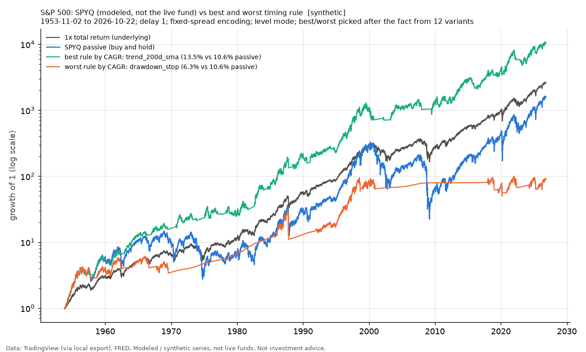
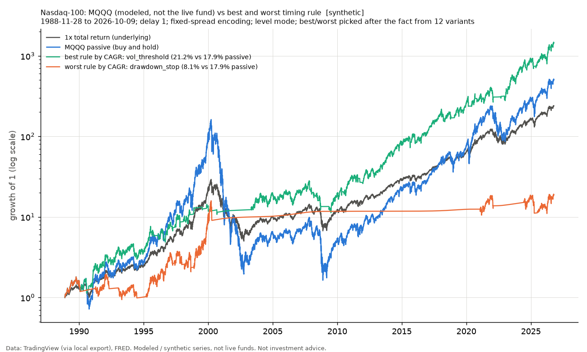

# Timing rules on 2x calendar-reset funds and their daily twins (step 4)

Run 2026-11-06. Script `scripts/run_strategies.py`; numbers in `strategies.json`; tables per start in `results/raw/` (git-ignored). **Every series here is synthetic. SPYQ, MQQQ and QQQP are modeled, not the live funds; HYP_SPX_M is a MODELED design (MODELED: a live fund of this design traded 2024-08-30 to 2025-02-28; no live fund exists today); TWIN_* are synthetic daily-reset comparison funds. Research tooling, not investment advice.**

## Inputs and conventions

```text
Inputs: 9 files; prices from <external>/library, rates from <external>/rates
  SP_SPX_daily.csv: 19333 rows, 1950-01-03 to 2026-11-02, sha256 b146c9af89cc
  SP_SPXTR_daily.csv: 9787 rows, 1988-01-04 to 2026-11-03, sha256 edab5090825e
  AMEX_SPY_daily.csv: 8498 rows, 1993-01-29 to 2026-11-02, sha256 643d6ef08b88
  NASDAQ_NDX_daily.csv: 10519 rows, 1985-01-31 to 2026-10-30, sha256 79d8e8688fa3
  NASDAQ_XNDX_daily.csv: 5019 rows, 2006-11-08 to 2026-10-30, sha256 d7dcc6dffa24
  NASDAQ_QQQ_daily.csv: 6955 rows, 1999-03-10 to 2026-10-30, sha256 f096cd6c6b75
  DFF.csv: 26424 rows, 1954-07-01 to 2026-11-03, sha256 e84a934a5014
  TB3MS.csv: 1112 rows, 1934-01-01 to 2026-08-01, sha256 ebf04b1ae5bc
  DTB3.csv: 18201 rows, 1954-01-04 to 2026-11-03, sha256 e5fa1cb67237
SPX early-reset trigger: the AMEX:SPY price (daily low) from 1993-01-29, scaled to the SP:SPX price index before that; trigger basis 'etf'; drop 35% from the fund's base; fill mode 'level'.
SPX day counts: financing (reference rate and swap spread) ACT/360; expense ratio ACT/365 (calendar days between rows, so weekends and holidays accrue).
SPX reset dates: last NYSE session of the week / month / quarter from 1970-01-01 (calendar_letf/nyse.py, refuses data that lack it); before that the last row of the period.
NDX early-reset trigger: the NASDAQ:QQQ price (daily low) from 1999-03-10, scaled to the NASDAQ:NDX price index before that; trigger basis 'etf'; drop 35% from the fund's base; fill mode 'level'.
NDX day counts: financing (reference rate and swap spread) ACT/360; expense ratio ACT/365 (calendar days between rows, so weekends and holidays accrue).
NDX reset dates: last NYSE session of the week / month / quarter from 1970-01-01 (calendar_letf/nyse.py, refuses data that lack it); before that the last row of the period.
Signals read the INDEX price (SP:SPX, NASDAQ:NDX), never the ETF-based trigger series.
MODELED: a live fund of this design traded 2024-08-30 to 2025-02-28; no live fund exists today
```

## Method in brief

- **Rules (all fixed before testing, none tuned).** `trend_50d_ema`; `trend_50d_sma`; `trend_200d_ema`; `trend_200d_sma`; `trend_200w_ema`; `trend_200w_sma`; `guppy`; `guppy_f200`; `guppy_weekly`; `guppy_weekly_f200`; `vol_threshold`; `drawdown_stop`. Trend rules: hold while the underlying's close is above its 50-day / 200-day / 200-week average (simple or exponential). Clean Guppy: buy when the slow ribbon (EMAs 24..66) stacks up, sell when it stacks down (from any state), hold through gray, start flat; `_f200` also requires close > 200 EMA; daily and weekly bars. `vol_threshold`: hold while the 21-day realized volatility of the underlying is below 25% a year. `drawdown_stop`: cash while the product NAV is more than 30% below its running peak, back in at a new peak (path-dependent).
- **Multiple-testing count: 12 rule variants** (6 trend, 4 Guppy, 1 volatility, 1 drawdown stop), each at 3 delays = 36 rule-delay runs per product, on 3 distinct products on the S&P 500 and 4 on the Nasdaq-100 x 2 cost encodings. The best of them is inflated by that count; a pre-fixed rule such as Guppy's original lengths counts as one. The in/out-of-sample split below is an era check on rules that were never tuned, not a validation of a fitted rule.
- **Execution.** A signal decided on close t is filled at close t+delay and earns the product's return from t+delay to t+delay+1. Base delay 1; 2 and 3 are the delay tests. Wealth = (position x product NAV return) + (1 - position) x cash return, less half_spread x |change of position| each time the position changes. Cash earns the 3-month T-bill (FRED DTB3, known the day before). The run starts at the rule's first valid signal, already holding its first position (no charge for the first purchase, for rules and passive alike). Buying mid-period gets the floated leverage automatically (NAV units).
- **Edge** = the rule's CAGR minus buy-and-hold of the same product over the identical window, in percentage points a year (pp). Positive = the rule did better. **Cost drag** = CAGR with zero trading cost minus CAGR with the half-spread, pp a year. **Whipsaw** = a COMPLETE in-market spell (entry then exit) or cash spell shorter than 10 trading days. **Trades** = changes of position (entries + exits).
- **Multi-start.** Every month-end start with 10 years ahead. Rules that read only the past (trend, Guppy, volatility) have one wealth path and the window is the ratio W[end]/W[start], as in step 3; this treats a Guppy follower as already running (holding its previous state) on the start date. The drawdown stop depends on where the investor starts, so it is run once per start with only the history from that start (its window begins at the first fill close, start + delay). In-sample / out-of-sample windows lie ENTIRELY inside each era (split 1990-01-01 on the S&P 500, 2005-01-01 on the Nasdaq-100).
- **Half-spread assumptions.**

| applies to | per unit of position changed | status | source |
|---|---|---|---|
| tradr_live | 0.10% | ASSUMED | DESIGN section 7 / PROMPT.md STRATEGIES: thin Tradr funds (QQQP ~4k shares a day, SPYQ ~4.5k); not measured from quotes. Sensitivity: the study also reports twice this cost |
| modeled_or_twin | 0.02% | ASSUMED | DESIGN section 7: a liquid SPY/QQQ-like product; modeled products (no live fund of the design trades today) and daily twins do not trade, so this is a stand-in |

- **Cost convention note.** DESIGN section 7 writes the cost as |dw| x 2 x half_spread but also says a round trip costs two half-spreads; the code charges one half-spread per unit of position changed (round trip = exactly 2 half-spreads). The column `edge @2x cost` in table 1 repeats every run with the literal double charge.

## Rules and when each first has a signal

| rule | variant | all parameters | nominal warm-up rows | path-dependent | first signal SPX | first signal NDX |
|---|---|---|---|---|---|---|
| `trend_50d_ema` | {"kind": "ema"} | {"kind": "ema"} | 49 | no | 1950-03-15 | 1985-04-12 |
| `trend_50d_sma` | {"kind": "sma"} | {"kind": "sma"} | 49 | no | 1950-03-15 | 1985-04-12 |
| `trend_200d_ema` | {"kind": "ema"} | {"kind": "ema"} | 199 | no | 1950-10-18 | 1985-11-13 |
| `trend_200d_sma` | {"kind": "sma"} | {"kind": "sma"} | 199 | no | 1950-10-18 | 1985-11-13 |
| `trend_200w_ema` | {"kind": "ema"} | {"kind": "ema"} | 995 | no | 1953-10-30 | 1988-11-25 |
| `trend_200w_sma` | {"kind": "sma"} | {"kind": "sma"} | 995 | no | 1953-10-30 | 1988-11-25 |
| `guppy` | {"filter_200": false} | {"filter_200": false} | 65 | no | 1950-04-06 | 1985-05-06 |
| `guppy_f200` | {"filter_200": true} | {"filter_200": true} | 199 | no | 1950-10-18 | 1985-11-13 |
| `guppy_weekly` | {"filter_200": false} | {"filter_200": false} | 325 | no | 1951-04-06 | 1986-05-02 |
| `guppy_weekly_f200` | {"filter_200": true} | {"filter_200": true} | 995 | no | 1953-10-30 | 1988-11-25 |
| `vol_threshold` | defaults | {"threshold": 0.25, "window": 21} | 21 | no | 1950-02-01 | 1985-03-04 |
| `drawdown_stop` | defaults | {"drop": 0.3} | 0 | yes | 1950-01-03 | 1985-01-31 |

- SPX: the common window of table 6 starts with a signal on 1953-10-30 (the latest first signal of any rule).
- NDX: the common window of table 6 starts with a signal on 1988-11-25 (the latest first signal of any rule).


---

# S&P 500

Underlying banner: `[SPX_TR] symbols: SP:SPX, SP:SPXTR; basis: constructed; published 1988-01-04 on (PUBLISHED (SP:SPXTR as exported)); before that price + Shiller's measured monthly dividend yield (mean 4.10%/yr over the pre-splice years) (MEASURED (Shiller monthly D/P; quarterly dividends interpolated to months by the source)); splice date 1988-01-04; days missing from the published series carried by the price move: ['1994-04-27']; stale published rows on non-trading days dropped: ['2001-09-11', '2001-09-12', '2001-09-13', '2001-09-14']; published rows after the price file's last date dropped: ['2026-11-03'] (top up the price file)`

Twins shown once: TWIN_HYP_SPX_M is identical to TWIN_SPYQ (same index, same fee, same costs).

Reference rate: FRED DFF (effective fed funds), lagged one row; TB3MS proxy where DFF is not yet published; proxy rows 1125. Cash: FRED DTB3 (3-month T-bill), lagged one row; TB3MS prior-month average as a proxy before 1954-01-04; proxy rows 1000 (until 1954-01-04); last DTB3 date 2026-11-03, stale rows 0.

## S&P 500 headline. 10-year median edge over buy-and-hold (delay 1, month-end starts): fixed | rate encoding; share of starts the rule beats buy-and-hold

*Underlying: S&P 500 total return 1950-01-03 to 2026-10-22 (signals read the price index SP:SPX). Window: month-end starts, 10-year horizon, delay 1. Encoding: fixed spread 2.6% of NAV: spread 2.60% of NAV a year + 1 x reference rate on the borrowed turn + product fee [ASSUMED]. Early-reset trigger: the AMEX:SPY price (daily low) from 1993-01-29, scaled to the SP:SPX price index before that, drop 35%, mode level. Cash: FRED DTB3 (3-month T-bill), lagged one row; TB3MS prior-month average as a proxy before 1954-01-04 (1000 proxy rows). Half-spread 0.10% on SPYQ / MQQQ / QQQP, 0.02% on modeled products and twins [ASSUMED]; fees: SPYQ 1.00% [VERIFIED_prospectus_2026-07-31]; HYP_SPX_M 1.00% [ASSUMED]; HYP_SPX_W 1.00% [ASSUMED]; daily twins copy their fund's fee and status. Cost, spread and rate turns ASSUMED (fitted 2024-26). Cells: median edge pp | wins; first the fixed-spread encoding, then the rate-proportional one. All series synthetic; products other than SPYQ / MQQQ / QQQP are MODELED designs, twins are comparison series.*

| rule | SPYQ | TWIN_SPYQ | HYP_SPX_M |
|---|---|---|---|
| `trend_50d_ema` | -0.87 (48%) \| -0.72 (48%) | -0.06 (50%) \| +0.22 (51%) | -0.45 (46%) \| -0.53 (47%) |
| `trend_50d_sma` | -1.01 (46%) \| -0.46 (46%) | -0.77 (50%) \| -0.13 (49%) | -1.34 (47%) \| -0.87 (47%) |
| `trend_200d_ema` | +1.90 (65%) \| +1.83 (67%) | +1.55 (61%) \| +1.90 (62%) | +1.53 (57%) \| +1.96 (60%) |
| `trend_200d_sma` | +4.02 (70%) \| +4.03 (71%) | +3.75 (73%) \| +3.68 (73%) | +2.89 (70%) \| +3.07 (72%) |
| `trend_200w_ema` | -2.12 (33%) \| -2.11 (35%) | -2.18 (28%) \| -1.82 (28%) | -2.03 (28%) \| -1.78 (28%) |
| `trend_200w_sma` | -0.90 (36%) \| -0.89 (37%) | -1.31 (26%) \| -0.92 (27%) | -1.10 (21%) \| -1.37 (16%) |
| `guppy` | +0.12 (53%) \| +0.09 (50%) | -0.40 (48%) \| -0.33 (48%) | -0.40 (48%) \| -0.38 (48%) |
| `guppy_f200` | +1.79 (59%) \| +1.73 (62%) | +1.91 (60%) \| +1.69 (64%) | +1.19 (60%) \| +1.16 (61%) |
| `guppy_weekly` | -0.00 (39%) \| +0.00 (41%) | +0.00 (37%) \| -0.00 (37%) | -0.00 (36%) \| -0.00 (36%) |
| `guppy_weekly_f200` | -2.14 (31%) \| -2.12 (32%) | -3.09 (26%) \| -2.74 (26%) | -2.87 (19%) \| -2.51 (20%) |
| `vol_threshold` | +0.56 (57%) \| +0.55 (58%) | +0.21 (56%) \| +0.20 (56%) | +0.11 (55%) \| +0.12 (55%) |
| `drawdown_stop` | -4.67 (33%) \| -4.80 (33%) | -5.42 (28%) \| -4.79 (30%) | -4.84 (27%) \| -4.73 (28%) |

## S&P 500 1. Full-history runs, delay 1, fixed-spread encoding (each rule from its first valid signal; benchmarks over the identical window)



*Chart: S&P 500 common window, SPYQ, delay 1, fixed-spread encoding; best and worst rule by CAGR picked after the fact. Data: TradingView (via local export), FRED. Modeled / synthetic series, not live funds. Not investment advice.*

**SPYQ**

*Underlying: S&P 500 total return 1950-01-03 to 2026-10-22 (signals read the price index SP:SPX). Window: each rule's own start to 2026-10-22. Encoding: fixed spread 2.6% of NAV: spread 2.60% of NAV a year + 1 x reference rate on the borrowed turn + product fee [ASSUMED]. Early-reset trigger: the AMEX:SPY price (daily low) from 1993-01-29, scaled to the SP:SPX price index before that, drop 35%, mode level. Cash: FRED DTB3 (3-month T-bill), lagged one row; TB3MS prior-month average as a proxy before 1954-01-04 (1000 proxy rows). Half-spread 0.10% on SPYQ / MQQQ / QQQP, 0.02% on modeled products and twins [ASSUMED]; fees: SPYQ 1.00% [VERIFIED_prospectus_2026-07-31]; HYP_SPX_M 1.00% [ASSUMED]; HYP_SPX_W 1.00% [ASSUMED]; daily twins copy their fund's fee and status. Cost, spread and rate turns ASSUMED (fitted 2024-26). All series synthetic; products other than SPYQ / MQQQ / QQQP are MODELED designs, twins are comparison series.*

| rule | start | CAGR | edge pp | edge @2x cost | vol | max DD | Calmar | Sortino | time under water | trades/yr | cost drag pp/yr | whipsaws in/cash | invested | passive CAGR | passive max DD | passive Calmar | 1x CAGR | 1x max DD |
|---|---|---|---|---|---|---|---|---|---|---|---|---|---|---|---|---|---|---|
| `trend_50d_ema` | 1950-03-16 | 8.5% | -2.87 | -4.78 | 19% | -77% | 0.11 | 0.73 | 96% | 17.70 | 1.938 | 387/489 | 66% | 11.4% | -93% | 0.12 | 11.6% | -55% |
| `trend_50d_sma` | 1950-03-16 | 8.1% | -3.33 | -5.00 | 19% | -60% | 0.13 | 0.70 | 96% | 15.56 | 1.695 | 335/416 | 65% | 11.4% | -93% | 0.12 | 11.6% | -55% |
| `trend_200d_ema` | 1950-10-19 | 12.3% | +1.32 | +0.53 | 21% | -48% | 0.26 | 0.93 | 94% | 6.97 | 0.786 | 166/188 | 74% | 11.0% | -93% | 0.12 | 11.5% | -55% |
| `trend_200d_sma` | 1950-10-19 | 13.7% | +2.68 | +2.01 | 21% | -46% | 0.30 | 1.03 | 93% | 5.92 | 0.675 | 131/151 | 72% | 11.0% | -93% | 0.12 | 11.5% | -55% |
| `trend_200w_ema` | 1953-11-02 | 9.1% | -1.45 | -1.60 | 28% | -71% | 0.13 | 0.63 | 95% | 1.37 | 0.150 | 14/21 | 86% | 10.6% | -93% | 0.11 | 11.4% | -55% |
| `trend_200w_sma` | 1953-11-02 | 8.9% | -1.69 | -1.79 | 28% | -73% | 0.12 | 0.62 | 96% | 0.99 | 0.107 | 4/12 | 85% | 10.6% | -93% | 0.11 | 11.4% | -55% |
| `guppy` | 1950-04-10 | 11.6% | +0.27 | +0.06 | 23% | -64% | 0.18 | 0.83 | 94% | 1.80 | 0.202 | 1/1 | 71% | 11.3% | -93% | 0.12 | 11.6% | -55% |
| `guppy_f200` | 1950-10-19 | 11.9% | +0.92 | +0.47 | 20% | -48% | 0.25 | 0.93 | 94% | 4.03 | 0.452 | 61/84 | 68% | 11.0% | -93% | 0.12 | 11.5% | -55% |
| `guppy_weekly` | 1951-04-09 | 10.6% | -0.16 | -0.19 | 29% | -65% | 0.16 | 0.70 | 95% | 0.26 | 0.029 | 0/0 | 84% | 10.8% | -93% | 0.12 | 11.4% | -55% |
| `guppy_weekly_f200` | 1953-11-02 | 7.7% | -2.93 | -3.04 | 27% | -74% | 0.10 | 0.57 | 96% | 0.99 | 0.106 | 7/13 | 81% | 10.6% | -93% | 0.11 | 11.4% | -55% |
| `vol_threshold` | 1950-02-02 | 11.2% | -0.22 | -0.38 | 27% | -85% | 0.13 | 0.74 | 94% | 1.49 | 0.166 | 17/25 | 94% | 11.4% | -93% | 0.12 | 11.7% | -55% |
| `drawdown_stop` | 1950-01-04 | 7.4% | -4.09 | -4.12 | 18% | -64% | 0.12 | 0.66 | 88% | 0.29 | 0.031 | 0/0 | 41% | 11.5% | -93% | 0.12 | 11.7% | -55% |

**TWIN_SPYQ**

*Underlying: S&P 500 total return 1950-01-03 to 2026-10-22 (signals read the price index SP:SPX). Window: each rule's own start to 2026-10-22. Encoding: fixed spread 2.6% of NAV: spread 2.60% of NAV a year + 1 x reference rate on the borrowed turn + product fee [ASSUMED]. Early-reset trigger: the AMEX:SPY price (daily low) from 1993-01-29, scaled to the SP:SPX price index before that, drop 35%, mode level. Cash: FRED DTB3 (3-month T-bill), lagged one row; TB3MS prior-month average as a proxy before 1954-01-04 (1000 proxy rows). Half-spread 0.10% on SPYQ / MQQQ / QQQP, 0.02% on modeled products and twins [ASSUMED]; fees: SPYQ 1.00% [VERIFIED_prospectus_2026-07-31]; HYP_SPX_M 1.00% [ASSUMED]; HYP_SPX_W 1.00% [ASSUMED]; daily twins copy their fund's fee and status. Cost, spread and rate turns ASSUMED (fitted 2024-26). All series synthetic; products other than SPYQ / MQQQ / QQQP are MODELED designs, twins are comparison series.*

| rule | start | CAGR | edge pp | edge @2x cost | vol | max DD | Calmar | Sortino | time under water | trades/yr | cost drag pp/yr | whipsaws in/cash | invested | passive CAGR | passive max DD | passive Calmar | 1x CAGR | 1x max DD |
|---|---|---|---|---|---|---|---|---|---|---|---|---|---|---|---|---|---|---|
| `trend_50d_ema` | 1950-03-16 | 10.2% | -1.88 | -2.27 | 20% | -76% | 0.13 | 0.82 | 95% | 17.70 | 0.391 | 387/489 | 66% | 12.0% | -91% | 0.13 | 11.6% | -55% |
| `trend_50d_sma` | 1950-03-16 | 9.4% | -2.60 | -2.94 | 20% | -59% | 0.16 | 0.78 | 96% | 15.56 | 0.341 | 335/416 | 65% | 12.0% | -91% | 0.13 | 11.6% | -55% |
| `trend_200d_ema` | 1950-10-19 | 13.0% | +1.34 | +1.18 | 21% | -47% | 0.27 | 0.96 | 94% | 6.97 | 0.158 | 166/188 | 74% | 11.7% | -91% | 0.13 | 11.5% | -55% |
| `trend_200d_sma` | 1950-10-19 | 14.3% | +2.60 | +2.46 | 21% | -44% | 0.32 | 1.05 | 93% | 5.92 | 0.135 | 131/151 | 72% | 11.7% | -91% | 0.13 | 11.5% | -55% |
| `trend_200w_ema` | 1953-11-02 | 9.6% | -1.67 | -1.70 | 26% | -68% | 0.14 | 0.66 | 95% | 1.37 | 0.030 | 14/21 | 86% | 11.3% | -91% | 0.12 | 11.4% | -55% |
| `trend_200w_sma` | 1953-11-02 | 9.2% | -2.04 | -2.06 | 26% | -73% | 0.13 | 0.65 | 96% | 0.99 | 0.022 | 4/12 | 85% | 11.3% | -91% | 0.12 | 11.4% | -55% |
| `guppy` | 1950-04-10 | 11.7% | -0.26 | -0.30 | 22% | -59% | 0.20 | 0.84 | 94% | 1.80 | 0.040 | 1/1 | 71% | 12.0% | -91% | 0.13 | 11.6% | -55% |
| `guppy_f200` | 1950-10-19 | 12.4% | +0.68 | +0.59 | 20% | -48% | 0.26 | 0.95 | 94% | 4.03 | 0.090 | 61/84 | 68% | 11.7% | -91% | 0.13 | 11.5% | -55% |
| `guppy_weekly` | 1951-04-09 | 10.5% | -0.94 | -0.95 | 27% | -64% | 0.17 | 0.71 | 95% | 0.26 | 0.006 | 0/0 | 84% | 11.5% | -91% | 0.13 | 11.4% | -55% |
| `guppy_weekly_f200` | 1953-11-02 | 8.1% | -3.22 | -3.24 | 26% | -72% | 0.11 | 0.59 | 96% | 0.99 | 0.021 | 7/13 | 81% | 11.3% | -91% | 0.12 | 11.4% | -55% |
| `vol_threshold` | 1950-02-02 | 11.7% | -0.33 | -0.36 | 26% | -84% | 0.14 | 0.77 | 94% | 1.49 | 0.033 | 17/25 | 94% | 12.1% | -91% | 0.13 | 11.7% | -55% |
| `drawdown_stop` | 1950-01-04 | 7.0% | -5.10 | -5.11 | 18% | -59% | 0.12 | 0.63 | 95% | 0.34 | 0.007 | 0/0 | 46% | 12.1% | -91% | 0.13 | 11.7% | -55% |

**HYP_SPX_M**

*Underlying: S&P 500 total return 1950-01-03 to 2026-10-22 (signals read the price index SP:SPX). Window: each rule's own start to 2026-10-22. Encoding: fixed spread 2.6% of NAV: spread 2.60% of NAV a year + 1 x reference rate on the borrowed turn + product fee [ASSUMED]. Early-reset trigger: the AMEX:SPY price (daily low) from 1993-01-29, scaled to the SP:SPX price index before that, drop 35%, mode level. Cash: FRED DTB3 (3-month T-bill), lagged one row; TB3MS prior-month average as a proxy before 1954-01-04 (1000 proxy rows). Half-spread 0.10% on SPYQ / MQQQ / QQQP, 0.02% on modeled products and twins [ASSUMED]; fees: SPYQ 1.00% [VERIFIED_prospectus_2026-07-31]; HYP_SPX_M 1.00% [ASSUMED]; HYP_SPX_W 1.00% [ASSUMED]; daily twins copy their fund's fee and status. Cost, spread and rate turns ASSUMED (fitted 2024-26). All series synthetic; products other than SPYQ / MQQQ / QQQP are MODELED designs, twins are comparison series.*

| rule | start | CAGR | edge pp | edge @2x cost | vol | max DD | Calmar | Sortino | time under water | trades/yr | cost drag pp/yr | whipsaws in/cash | invested | passive CAGR | passive max DD | passive Calmar | 1x CAGR | 1x max DD |
|---|---|---|---|---|---|---|---|---|---|---|---|---|---|---|---|---|---|---|
| `trend_50d_ema` | 1950-03-16 | 10.1% | -2.31 | -2.70 | 20% | -75% | 0.13 | 0.82 | 95% | 17.70 | 0.390 | 387/489 | 66% | 12.4% | -89% | 0.14 | 11.6% | -55% |
| `trend_50d_sma` | 1950-03-16 | 9.4% | -3.04 | -3.38 | 20% | -58% | 0.16 | 0.78 | 95% | 15.56 | 0.341 | 335/416 | 65% | 12.4% | -89% | 0.14 | 11.6% | -55% |
| `trend_200d_ema` | 1950-10-19 | 13.0% | +0.92 | +0.77 | 21% | -48% | 0.27 | 0.96 | 94% | 6.97 | 0.158 | 166/188 | 74% | 12.1% | -89% | 0.14 | 11.5% | -55% |
| `trend_200d_sma` | 1950-10-19 | 14.3% | +2.20 | +2.07 | 21% | -44% | 0.33 | 1.05 | 93% | 5.92 | 0.135 | 131/151 | 72% | 12.1% | -89% | 0.14 | 11.5% | -55% |
| `trend_200w_ema` | 1953-11-02 | 9.6% | -2.08 | -2.11 | 27% | -70% | 0.14 | 0.66 | 95% | 1.37 | 0.030 | 14/21 | 86% | 11.7% | -89% | 0.13 | 11.4% | -55% |
| `trend_200w_sma` | 1953-11-02 | 9.3% | -2.44 | -2.46 | 27% | -72% | 0.13 | 0.64 | 95% | 0.99 | 0.022 | 4/12 | 85% | 11.7% | -89% | 0.13 | 11.4% | -55% |
| `guppy` | 1950-04-10 | 11.8% | -0.58 | -0.62 | 23% | -64% | 0.18 | 0.84 | 94% | 1.80 | 0.040 | 1/1 | 71% | 12.4% | -89% | 0.14 | 11.6% | -55% |
| `guppy_f200` | 1950-10-19 | 12.4% | +0.29 | +0.20 | 20% | -48% | 0.26 | 0.95 | 94% | 4.03 | 0.090 | 61/84 | 68% | 12.1% | -89% | 0.14 | 11.5% | -55% |
| `guppy_weekly` | 1951-04-09 | 10.8% | -1.08 | -1.09 | 28% | -64% | 0.17 | 0.72 | 95% | 0.26 | 0.006 | 0/0 | 84% | 11.9% | -89% | 0.13 | 11.4% | -55% |
| `guppy_weekly_f200` | 1953-11-02 | 8.1% | -3.61 | -3.63 | 27% | -74% | 0.11 | 0.59 | 96% | 0.99 | 0.021 | 7/13 | 81% | 11.7% | -89% | 0.13 | 11.4% | -55% |
| `vol_threshold` | 1950-02-02 | 11.5% | -0.97 | -1.00 | 27% | -84% | 0.14 | 0.75 | 94% | 1.49 | 0.033 | 17/25 | 94% | 12.5% | -89% | 0.14 | 11.7% | -55% |
| `drawdown_stop` | 1950-01-04 | 8.3% | -4.18 | -4.19 | 19% | -64% | 0.13 | 0.70 | 88% | 0.29 | 0.006 | 0/0 | 47% | 12.5% | -89% | 0.14 | 11.7% | -55% |

**Rate-proportional encoding (compact), delay 1**

*Underlying: S&P 500 total return 1950-01-03 to 2026-10-22 (signals read the price index SP:SPX). Window: each rule's own start to 2026-10-22. Encoding: rate-proportional (1.4% spread + 1.3 x rate): spread 1.40% of NAV a year + 1.3 x reference rate on the borrowed turn + product fee [ASSUMED]. Early-reset trigger: the AMEX:SPY price (daily low) from 1993-01-29, scaled to the SP:SPX price index before that, drop 35%, mode level. Cash: FRED DTB3 (3-month T-bill), lagged one row; TB3MS prior-month average as a proxy before 1954-01-04 (1000 proxy rows). Half-spread 0.10% on SPYQ / MQQQ / QQQP, 0.02% on modeled products and twins [ASSUMED]; fees: SPYQ 1.00% [VERIFIED_prospectus_2026-07-31]; HYP_SPX_M 1.00% [ASSUMED]; HYP_SPX_W 1.00% [ASSUMED]; daily twins copy their fund's fee and status. Cost, spread and rate turns ASSUMED (fitted 2024-26). All series synthetic; products other than SPYQ / MQQQ / QQQP are MODELED designs, twins are comparison series.*

| rule (CAGR / max DD (edge pp)) | SPYQ | TWIN_SPYQ | HYP_SPX_M |
|---|---|---|---|
| `trend_50d_ema` | 8.5% / -77% (edge -2.72) | 10.1% / -76% (edge -1.76) | 10.1% / -75% (edge -2.18) |
| `trend_50d_sma` | 8.0% / -60% (edge -3.19) | 9.4% / -59% (edge -2.48) | 9.4% / -58% (edge -2.91) |
| `trend_200d_ema` | 12.3% / -48% (edge +1.45) | 13.0% / -48% (edge +1.45) | 13.0% / -48% (edge +1.05) |
| `trend_200d_sma` | 13.7% / -46% (edge +2.82) | 14.3% / -45% (edge +2.73) | 14.2% / -44% (edge +2.34) |
| `trend_200w_ema` | 9.0% / -75% (edge -1.41) | 9.5% / -72% (edge -1.63) | 9.4% / -74% (edge -2.05) |
| `trend_200w_sma` | 8.7% / -73% (edge -1.66) | 9.1% / -73% (edge -2.02) | 9.1% / -72% (edge -2.42) |
| `guppy` | 11.6% / -64% (edge +0.41) | 11.7% / -59% (edge -0.13) | 11.8% / -64% (edge -0.45) |
| `guppy_f200` | 11.9% / -49% (edge +1.08) | 12.4% / -48% (edge +0.82) | 12.3% / -49% (edge +0.44) |
| `guppy_weekly` | 10.5% / -65% (edge -0.12) | 10.4% / -64% (edge -0.91) | 10.6% / -64% (edge -1.05) |
| `guppy_weekly_f200` | 7.5% / -77% (edge -2.88) | 7.9% / -75% (edge -3.17) | 7.9% / -77% (edge -3.57) |
| `vol_threshold` | 11.0% / -85% (edge -0.23) | 11.6% / -84% (edge -0.34) | 11.3% / -84% (edge -0.98) |
| `drawdown_stop` | 7.3% / -64% (edge -4.01) | 8.2% / -59% (edge -3.77) | 8.3% / -64% (edge -4.06) |

**Full-history CAGR by delay 1 / 2 / 3 (fixed encoding)**

| rule | SPYQ | TWIN_SPYQ | HYP_SPX_M |
|---|---|---|---|
| `trend_50d_ema` | 8.5% / 9.5% / 8.6% | 10.2% / 11.0% / 10.2% | 10.1% / 11.0% / 10.1% |
| `trend_50d_sma` | 8.1% / 8.2% / 7.0% | 9.4% / 9.6% / 8.4% | 9.4% / 9.6% / 8.4% |
| `trend_200d_ema` | 12.3% / 11.1% / 11.4% | 13.0% / 12.1% / 12.2% | 13.0% / 11.8% / 12.1% |
| `trend_200d_sma` | 13.7% / 11.7% / 12.0% | 14.3% / 12.6% / 12.7% | 14.3% / 12.4% / 12.6% |
| `trend_200w_ema` | 9.1% / 9.9% / 10.6% | 9.6% / 10.0% / 10.8% | 9.6% / 10.1% / 10.9% |
| `trend_200w_sma` | 8.9% / 9.4% / 9.9% | 9.2% / 9.5% / 9.9% | 9.3% / 9.6% / 10.1% |
| `guppy` | 11.6% / 10.5% / 11.1% | 11.7% / 10.8% / 11.3% | 11.8% / 10.8% / 11.3% |
| `guppy_f200` | 11.9% / 10.6% / 11.5% | 12.4% / 11.2% / 11.9% | 12.4% / 11.1% / 11.9% |
| `guppy_weekly` | 10.6% / 10.6% / 10.4% | 10.5% / 10.5% / 10.3% | 10.8% / 10.7% / 10.6% |
| `guppy_weekly_f200` | 7.7% / 8.5% / 9.3% | 8.1% / 8.6% / 9.4% | 8.1% / 8.8% / 9.6% |
| `vol_threshold` | 11.2% / 11.9% / 11.9% | 11.7% / 12.3% / 12.2% | 11.5% / 12.1% / 12.2% |
| `drawdown_stop` | 7.4% / 7.2% / 7.3% | 7.0% / 6.8% / 7.2% | 8.3% / 8.2% / 8.5% |

## S&P 500 2. Multi-start 10-year windows (delay 1, every month-end start)

**SPYQ, fixed-spread encoding**

*Underlying: S&P 500 total return 1950-01-03 to 2026-10-22 (signals read the price index SP:SPX). Window: month-end starts, 10-year horizon, delay 1. Encoding: fixed spread 2.6% of NAV: spread 2.60% of NAV a year + 1 x reference rate on the borrowed turn + product fee [ASSUMED]. Early-reset trigger: the AMEX:SPY price (daily low) from 1993-01-29, scaled to the SP:SPX price index before that, drop 35%, mode level. Cash: FRED DTB3 (3-month T-bill), lagged one row; TB3MS prior-month average as a proxy before 1954-01-04 (1000 proxy rows). Half-spread 0.10% on SPYQ / MQQQ / QQQP, 0.02% on modeled products and twins [ASSUMED]; fees: SPYQ 1.00% [VERIFIED_prospectus_2026-07-31]; HYP_SPX_M 1.00% [ASSUMED]; HYP_SPX_W 1.00% [ASSUMED]; daily twins copy their fund's fee and status. Cost, spread and rate turns ASSUMED (fitted 2024-26). All series synthetic; products other than SPYQ / MQQQ / QQQP are MODELED designs, twins are comparison series.*

| rule | starts | rule median CAGR | passive median CAGR | median edge pp (p10 to p90) | mean edge pp | phase-pooled 95% interval | noisy | rule beats passive | ties (never traded) | rule median max DD | passive median max DD |
|---|---|---|---|---|---|---|---|---|---|---|---|
| `trend_50d_ema` | 799 | 7.5% | 10.8% | -0.87 (-16.2 to +12.8) | -2.22 | [-13.93, +9.52] (t with 5 df) | NOISY | 48% | 0% | -40% | -65% |
| `trend_50d_sma` | 799 | 5.4% | 10.8% | -1.01 (-16.5 to +10.1) | -2.47 | [-13.03, +8.13] (t with 5 df) | NOISY | 46% | 0% | -38% | -65% |
| `trend_200d_ema` | 792 | 11.2% | 10.6% | +1.90 (-7.6 to +11.0) | +1.65 | [-5.62, +8.94] (t with 5 df) | NOISY | 65% | 0% | -36% | -65% |
| `trend_200d_sma` | 792 | 12.8% | 10.6% | +4.02 (-6.5 to +12.3) | +3.29 | [-4.13, +10.76] (t with 5 df) | NOISY | 70% | 0% | -34% | -65% |
| `trend_200w_ema` | 755 | 8.6% | 9.9% | -2.12 (-7.3 to +4.7) | -1.17 | [-6.39, +4.10] (t with 5 df) | NOISY | 33% | 5% | -53% | -65% |
| `trend_200w_sma` | 755 | 7.5% | 9.9% | -0.90 (-6.9 to +2.7) | -1.44 | [-6.19, +3.35] (t with 5 df) | NOISY | 36% | 1% | -58% | -65% |
| `guppy` | 798 | 9.7% | 10.7% | +0.12 (-8.7 to +10.4) | +0.64 | [-7.08, +8.38] (t with 5 df) | NOISY | 53% | 0% | -39% | -65% |
| `guppy_f200` | 792 | 10.0% | 10.6% | +1.79 (-9.1 to +12.0) | +1.16 | [-7.15, +9.47] (t with 5 df) | NOISY | 59% | 0% | -33% | -65% |
| `guppy_weekly` | 786 | 9.3% | 10.5% | -0.00 (-6.1 to +6.0) | -0.03 | [-5.37, +5.35] (t with 5 df) | NOISY | 39% | 17% | -54% | -65% |
| `guppy_weekly_f200` | 755 | 6.6% | 9.9% | -2.14 (-9.4 to +3.9) | -2.42 | [-8.52, +3.75] (t with 5 df) | NOISY | 31% | 5% | -52% | -65% |
| `vol_threshold` | 799 | 10.9% | 10.8% | +0.56 (-6.9 to +8.6) | -0.00 | [-5.13, +5.13] (t with 5 df) | NOISY | 57% | 0% | -63% | -65% |
| `drawdown_stop` | 799 | 5.6% | 10.8% | -4.67 (-10.8 to +8.5) | -2.92 | [-11.10, +5.28] (t with 5 df) | NOISY | 33% | 0% | -40% | -65% |

**TWIN_SPYQ, fixed-spread encoding**

*Underlying: S&P 500 total return 1950-01-03 to 2026-10-22 (signals read the price index SP:SPX). Window: month-end starts, 10-year horizon, delay 1. Encoding: fixed spread 2.6% of NAV: spread 2.60% of NAV a year + 1 x reference rate on the borrowed turn + product fee [ASSUMED]. Early-reset trigger: the AMEX:SPY price (daily low) from 1993-01-29, scaled to the SP:SPX price index before that, drop 35%, mode level. Cash: FRED DTB3 (3-month T-bill), lagged one row; TB3MS prior-month average as a proxy before 1954-01-04 (1000 proxy rows). Half-spread 0.10% on SPYQ / MQQQ / QQQP, 0.02% on modeled products and twins [ASSUMED]; fees: SPYQ 1.00% [VERIFIED_prospectus_2026-07-31]; HYP_SPX_M 1.00% [ASSUMED]; HYP_SPX_W 1.00% [ASSUMED]; daily twins copy their fund's fee and status. Cost, spread and rate turns ASSUMED (fitted 2024-26). All series synthetic; products other than SPYQ / MQQQ / QQQP are MODELED designs, twins are comparison series.*

| rule | starts | rule median CAGR | passive median CAGR | median edge pp (p10 to p90) | mean edge pp | phase-pooled 95% interval | noisy | rule beats passive | ties (never traded) | rule median max DD | passive median max DD |
|---|---|---|---|---|---|---|---|---|---|---|---|
| `trend_50d_ema` | 799 | 9.1% | 11.0% | -0.06 (-14.1 to +12.2) | -1.27 | [-11.85, +9.33] (t with 5 df) | NOISY | 50% | 0% | -38% | -61% |
| `trend_50d_sma` | 799 | 6.7% | 11.0% | -0.77 (-14.6 to +9.3) | -1.77 | [-11.33, +7.82] (t with 5 df) | NOISY | 50% | 0% | -36% | -61% |
| `trend_200d_ema` | 792 | 11.8% | 10.9% | +1.55 (-6.5 to +9.7) | +1.64 | [-4.95, +8.24] (t with 5 df) | NOISY | 61% | 0% | -36% | -61% |
| `trend_200d_sma` | 792 | 13.2% | 10.9% | +3.75 (-5.7 to +11.4) | +3.18 | [-3.55, +9.96] (t with 5 df) | NOISY | 73% | 0% | -33% | -61% |
| `trend_200w_ema` | 755 | 8.5% | 10.3% | -2.18 (-5.3 to +3.5) | -1.46 | [-5.72, +2.83] (t with 5 df) | NOISY | 28% | 5% | -53% | -61% |
| `trend_200w_sma` | 755 | 7.6% | 10.3% | -1.31 (-5.6 to +1.4) | -1.87 | [-5.79, +2.07] (t with 5 df) | NOISY | 26% | 1% | -56% | -61% |
| `guppy` | 798 | 9.8% | 11.0% | -0.40 (-8.6 to +8.7) | +0.10 | [-6.83, +7.04] (t with 5 df) | NOISY | 48% | 0% | -38% | -61% |
| `guppy_f200` | 792 | 10.3% | 10.9% | +1.91 (-8.2 to +10.5) | +0.91 | [-6.55, +8.35] (t with 5 df) | NOISY | 60% | 0% | -31% | -61% |
| `guppy_weekly` | 786 | 8.9% | 10.8% | +0.00 (-6.2 to +3.4) | -0.85 | [-5.45, +3.78] (t with 5 df) | NOISY | 37% | 17% | -53% | -61% |
| `guppy_weekly_f200` | 755 | 6.8% | 10.3% | -3.09 (-8.1 to +3.0) | -2.79 | [-8.04, +2.51] (t with 5 df) | NOISY | 26% | 5% | -53% | -61% |
| `vol_threshold` | 799 | 11.4% | 11.0% | +0.21 (-6.0 to +6.1) | -0.12 | [-4.05, +3.82] (t with 5 df) | NOISY | 56% | 0% | -59% | -61% |
| `drawdown_stop` | 799 | 5.4% | 11.0% | -5.42 (-11.1 to +5.8) | -3.94 | [-11.31, +3.45] (t with 5 df) | NOISY | 28% | 0% | -39% | -61% |

**HYP_SPX_M, fixed-spread encoding**

*Underlying: S&P 500 total return 1950-01-03 to 2026-10-22 (signals read the price index SP:SPX). Window: month-end starts, 10-year horizon, delay 1. Encoding: fixed spread 2.6% of NAV: spread 2.60% of NAV a year + 1 x reference rate on the borrowed turn + product fee [ASSUMED]. Early-reset trigger: the AMEX:SPY price (daily low) from 1993-01-29, scaled to the SP:SPX price index before that, drop 35%, mode level. Cash: FRED DTB3 (3-month T-bill), lagged one row; TB3MS prior-month average as a proxy before 1954-01-04 (1000 proxy rows). Half-spread 0.10% on SPYQ / MQQQ / QQQP, 0.02% on modeled products and twins [ASSUMED]; fees: SPYQ 1.00% [VERIFIED_prospectus_2026-07-31]; HYP_SPX_M 1.00% [ASSUMED]; HYP_SPX_W 1.00% [ASSUMED]; daily twins copy their fund's fee and status. Cost, spread and rate turns ASSUMED (fitted 2024-26). All series synthetic; products other than SPYQ / MQQQ / QQQP are MODELED designs, twins are comparison series.*

| rule | starts | rule median CAGR | passive median CAGR | median edge pp (p10 to p90) | mean edge pp | phase-pooled 95% interval | noisy | rule beats passive | ties (never traded) | rule median max DD | passive median max DD |
|---|---|---|---|---|---|---|---|---|---|---|---|
| `trend_50d_ema` | 799 | 9.1% | 11.5% | -0.45 (-15.2 to +11.9) | -1.68 | [-12.55, +9.23] (t with 5 df) | NOISY | 46% | 0% | -38% | -64% |
| `trend_50d_sma` | 799 | 6.7% | 11.5% | -1.34 (-15.6 to +9.4) | -2.19 | [-12.03, +7.69] (t with 5 df) | NOISY | 47% | 0% | -36% | -64% |
| `trend_200d_ema` | 792 | 11.6% | 11.2% | +1.53 (-7.5 to +9.7) | +1.24 | [-5.62, +8.12] (t with 5 df) | NOISY | 57% | 0% | -35% | -64% |
| `trend_200d_sma` | 792 | 13.2% | 11.2% | +2.89 (-6.6 to +11.6) | +2.81 | [-4.07, +9.73] (t with 5 df) | NOISY | 70% | 0% | -33% | -64% |
| `trend_200w_ema` | 755 | 9.0% | 10.3% | -2.03 (-6.5 to +2.5) | -1.85 | [-5.98, +2.32] (t with 5 df) | NOISY | 28% | 5% | -52% | -64% |
| `trend_200w_sma` | 755 | 7.8% | 10.3% | -1.10 (-6.3 to +1.1) | -2.26 | [-6.21, +1.73] (t with 5 df) | NOISY | 21% | 1% | -58% | -64% |
| `guppy` | 798 | 9.9% | 11.5% | -0.40 (-8.7 to +8.9) | -0.23 | [-7.09, +6.65] (t with 5 df) | NOISY | 48% | 0% | -40% | -64% |
| `guppy_f200` | 792 | 10.4% | 11.2% | +1.19 (-8.6 to +10.4) | +0.52 | [-7.05, +8.10] (t with 5 df) | NOISY | 60% | 0% | -32% | -64% |
| `guppy_weekly` | 786 | 9.5% | 11.1% | -0.00 (-6.1 to +3.3) | -0.98 | [-5.31, +3.38] (t with 5 df) | NOISY | 36% | 17% | -52% | -64% |
| `guppy_weekly_f200` | 755 | 7.1% | 10.3% | -2.87 (-8.7 to +2.5) | -3.15 | [-8.26, +2.02] (t with 5 df) | NOISY | 19% | 5% | -51% | -64% |
| `vol_threshold` | 799 | 11.0% | 11.5% | +0.11 (-6.6 to +4.9) | -0.76 | [-4.74, +3.22] (t with 5 df) | NOISY | 55% | 0% | -63% | -64% |
| `drawdown_stop` | 799 | 5.6% | 11.4% | -4.84 (-12.3 to +7.1) | -4.07 | [-11.93, +3.82] (t with 5 df) | NOISY | 27% | 0% | -38% | -64% |

Windows overlap heavily (a start shares 119 of its 120 months with the next), so the win shares are not independent observations; do not read them as p-values. The interval is the passive study's headline convention (non-overlapping windows pooled over start phases, mean +/- t(df) x SE; ASSUMPTIONS section 7); NOISY = it covers zero; 'too few windows' = fewer than 3 non-overlapping windows in the smallest phase, where the interval is not read (the coverage simulation starts at 3). The mean sits next to the median because the edges are skewed by the windows that contain a crash. A TIE is a window where the rule stayed invested throughout and never traded, so it equals buy-and-hold to rounding; ties are not counted as wins.

**Full-run edge by era (delay 1, fixed encoding; one run per era, descriptive)**: boundaries 1990-01-01, 2009-01-01.

| rule | 1950-01-04 to 1989-12-29 | 1950-02-02 to 1989-12-29 | 1950-03-16 to 1989-12-29 | 1950-04-10 to 1989-12-29 | 1950-10-19 to 1989-12-29 | 1951-04-09 to 1989-12-29 | 1953-11-02 to 1989-12-29 | 1989-12-29 to 2008-12-31 | 2008-12-31 to 2026-10-22 |
|---|---|---|---|---|---|---|---|---|---|
| `trend_50d_ema` | - | - | +1.67 | - | - | - | - | -3.63 | -12.36 |
| `trend_50d_sma` | - | - | +0.51 | - | - | - | - | -1.33 | -14.54 |
| `trend_200d_ema` | - | - | - | - | +3.93 | - | - | +5.47 | -9.64 |
| `trend_200d_sma` | - | - | - | - | +5.29 | - | - | +6.91 | -8.37 |
| `trend_200w_ema` | - | - | - | - | - | - | -3.12 | +6.94 | -7.81 |
| `trend_200w_sma` | - | - | - | - | - | - | -2.29 | +5.78 | -9.30 |
| `guppy` | - | - | - | +1.25 | - | - | - | +4.52 | -7.21 |
| `guppy_f200` | - | - | - | - | +3.20 | - | - | +4.33 | -8.46 |
| `guppy_weekly` | - | - | - | - | - | -2.15 | - | +7.68 | -4.91 |
| `guppy_weekly_f200` | - | - | - | - | - | - | -5.22 | +7.04 | -9.68 |
| `vol_threshold` | - | -0.05 | - | - | - | - | - | +0.25 | -1.21 |
| `drawdown_stop` | -2.45 | - | - | - | - | - | - | +8.18 | -21.53 |

(Edges for SPYQ; the other series are in the JSON under `eras`.)

**Era-difference test (delay 1, fixed encoding, SPYQ)**: daily log edge of the rule over passive; mean per era in pp a year with Newey-West SE at Bartlett lags 21, 63, 252; z for the last two eras and for all earlier history against the last era. A z within +/- 2 at every lag: not distinguishable from chance on one history.

| rule | era 1 mean (SE at lag 63) | era 2 mean (SE at lag 63) | era 3 mean (SE at lag 63) | z last two eras (lags 21 / 63 / 252) | z all earlier vs last |
|---|---|---|---|---|---|
| `trend_50d_ema` | +1.49 (3.59) | -3.63 (7.49) | -10.69 (4.61) | +0.78 / +0.80 / +0.75 | +1.54 / +1.83 / +2.13 |
| `trend_50d_sma` | +0.46 (3.47) | -1.31 (7.00) | -12.70 (4.70) | +1.25 / +1.35 / +1.34 | +1.82 / +2.20 / +2.71 |
| `trend_200d_ema` | +3.49 (3.29) | +5.23 (6.86) | -8.24 (4.54) | +1.60 / +1.64 / +1.62 | +1.94 / +2.22 / +2.70 |
| `trend_200d_sma` | +4.67 (3.38) | +6.57 (6.88) | -7.11 (4.71) | +1.60 / +1.64 / +1.61 | +1.90 / +2.18 / +2.73 |
| `trend_200w_ema` | -2.88 (2.90) | +6.59 (6.25) | -6.62 (4.50) | +1.83 / +1.72 / +1.72 | +1.32 / +1.31 / +1.41 |
| `trend_200w_sma` | -2.11 (2.84) | +5.52 (6.37) | -7.94 (4.69) | +1.83 / +1.70 / +1.63 | +1.56 / +1.54 / +1.62 |
| `guppy` | +1.11 (3.24) | +4.34 (6.87) | -6.10 (4.38) | +1.27 / +1.28 / +1.27 | +1.36 / +1.54 / +1.73 |
| `guppy_f200` | +2.85 (3.55) | +4.16 (7.17) | -7.19 (4.83) | +1.29 / +1.31 / +1.25 | +1.55 / +1.78 / +2.07 |
| `guppy_weekly` | -1.97 (2.92) | +7.27 (6.28) | -4.11 (3.15) | +1.76 / +1.62 / +1.54 | +1.23 / +1.22 / +1.20 |
| `guppy_weekly_f200` | -4.87 (3.24) | +6.68 (6.38) | -8.27 (4.55) | +2.03 / +1.91 / +1.89 | +1.35 / +1.34 / +1.42 |
| `vol_threshold` | -0.05 (1.05) | +0.25 (5.40) | -1.00 (4.23) | +0.18 / +0.18 / +0.20 | +0.20 / +0.23 / +0.29 |
| `drawdown_stop` | -2.22 (3.77) | +7.72 (7.40) | -19.43 (5.73) | +2.87 / +2.90 / +2.87 | +2.77 / +3.04 / +3.52 |

## S&P 500 3. In-sample vs out-of-sample (split 1990-01-01; all rules fixed before testing)

A. Median 10-year edge pp (rule beats passive %) for windows ENTIRELY inside each era; delay 1. Cell: in-sample / out-of-sample, fixed encoding | rate encoding.

*Underlying: S&P 500 total return 1950-01-03 to 2026-10-22 (signals read the price index SP:SPX). Window: 10-year windows inside the era (in-sample ends 1990-01-01; out-of-sample starts 1990-01-01). Encoding: fixed spread 2.6% of NAV: spread 2.60% of NAV a year + 1 x reference rate on the borrowed turn + product fee [ASSUMED]. Early-reset trigger: the AMEX:SPY price (daily low) from 1993-01-29, scaled to the SP:SPX price index before that, drop 35%, mode level. Cash: FRED DTB3 (3-month T-bill), lagged one row; TB3MS prior-month average as a proxy before 1954-01-04 (1000 proxy rows). Half-spread 0.10% on SPYQ / MQQQ / QQQP, 0.02% on modeled products and twins [ASSUMED]; fees: SPYQ 1.00% [VERIFIED_prospectus_2026-07-31]; HYP_SPX_M 1.00% [ASSUMED]; HYP_SPX_W 1.00% [ASSUMED]; daily twins copy their fund's fee and status. Cost, spread and rate turns ASSUMED (fitted 2024-26). All series synthetic; products other than SPYQ / MQQQ / QQQP are MODELED designs, twins are comparison series.*

| rule | SPYQ | TWIN_SPYQ | HYP_SPX_M |
|---|---|---|---|
| `trend_50d_ema` | +4.83 (76%) / -10.19 (35%) \| +4.84 (76%) / -10.30 (34%) | +5.36 (78%) / -8.18 (34%) \| +5.34 (80%) / -8.33 (34%) | +5.43 (78%) / -9.02 (26%) \| +5.46 (80%) / -9.07 (25%) |
| `trend_50d_sma` | +4.18 (79%) / -5.89 (26%) \| +4.42 (80%) / -5.96 (25%) | +4.32 (86%) / -4.36 (26%) \| +4.75 (86%) / -4.38 (26%) | +4.61 (85%) / -5.05 (20%) \| +4.86 (86%) / -5.08 (20%) |
| `trend_200d_ema` | +4.69 (89%) / +1.35 (60%) \| +4.94 (90%) / +1.08 (59%) | +4.51 (91%) / -0.09 (45%) \| +4.67 (93%) / -0.30 (45%) | +4.64 (90%) / -1.70 (39%) \| +4.80 (93%) / -1.92 (39%) |
| `trend_200d_sma` | +5.16 (94%) / +4.09 (61%) \| +5.62 (94%) / +3.99 (61%) | +5.10 (94%) / +3.16 (61%) \| +5.57 (94%) / +2.94 (61%) | +5.09 (94%) / +1.66 (60%) \| +5.56 (94%) / +1.48 (59%) |
| `trend_200w_ema` | -3.44 (15%) / +2.95 (63%) \| -3.14 (19%) / +2.76 (62%) | -3.67 (6%) / +2.16 (60%) \| -3.53 (7%) / +1.91 (60%) | -3.77 (7%) / +0.89 (59%) \| -3.38 (9%) / +0.62 (56%) |
| `trend_200w_sma` | -3.38 (28%) / +0.75 (57%) \| -3.20 (31%) / +0.54 (56%) | -3.65 (10%) / +0.34 (52%) \| -3.59 (12%) / +0.05 (52%) | -3.73 (12%) / -1.06 (37%) \| -3.58 (15%) / -1.36 (22%) |
| `guppy` | +1.55 (63%) / +2.90 (61%) \| +1.52 (57%) / +2.82 (61%) | +0.90 (52%) / +2.92 (61%) \| +0.87 (53%) / +2.74 (61%) | +0.95 (53%) / +2.17 (61%) \| +1.06 (54%) / +1.92 (60%) |
| `guppy_f200` | +3.76 (76%) / +1.82 (59%) \| +3.91 (82%) / +1.73 (59%) | +3.07 (79%) / +2.03 (60%) \| +3.27 (84%) / +1.89 (60%) | +3.39 (80%) / +0.78 (58%) \| +3.50 (85%) / +0.52 (54%) |
| `guppy_weekly` | -4.15 (29%) / +3.25 (64%) \| -4.01 (33%) / +3.06 (63%) | -4.22 (27%) / +2.91 (61%) \| -3.97 (27%) / +2.72 (61%) | -4.18 (27%) / +2.07 (59%) \| -3.96 (27%) / +1.86 (59%) |
| `guppy_weekly_f200` | -6.04 (13%) / +3.07 (61%) \| -5.94 (15%) / +2.86 (61%) | -6.22 (3%) / +1.24 (59%) \| -6.03 (3%) / +0.96 (58%) | -6.29 (3%) / -0.06 (42%) \| -6.10 (4%) / -0.35 (42%) |
| `vol_threshold` | +0.86 (79%) / +0.72 (53%) \| +0.96 (81%) / +0.61 (53%) | +0.63 (76%) / +0.68 (54%) \| +0.64 (76%) / +0.60 (54%) | +0.53 (79%) / -0.30 (48%) \| +0.54 (79%) / -0.38 (48%) |
| `drawdown_stop` | -4.69 (34%) / -2.33 (44%) \| -4.84 (34%) / -2.66 (43%) | -5.91 (27%) / -3.71 (39%) \| -5.03 (33%) / -3.90 (37%) | -4.92 (32%) / -3.86 (33%) \| -4.75 (34%) / -3.94 (31%) |

(Number of windows, e.g. `trend_50d_ema` on SPYQ: 358 in-sample, 322 out-of-sample.)

B. Full-run CAGR edge pp over passive, in-sample era (rule start to split) / out-of-sample era (split to end); delay 1. Cell: fixed | rate.

| rule | SPYQ | TWIN_SPYQ | HYP_SPX_M |
|---|---|---|---|
| `trend_50d_ema` | +1.67 / -7.55 \| +2.06 / -7.70 | +2.38 / -6.27 \| +2.72 / -6.40 | +2.48 / -7.28 \| +2.83 / -7.41 |
| `trend_50d_sma` | +0.51 / -7.32 \| +0.90 / -7.47 | +1.04 / -6.37 \| +1.38 / -6.50 | +1.10 / -7.35 \| +1.45 / -7.49 |
| `trend_200d_ema` | +3.93 / -1.41 \| +4.28 / -1.53 | +3.85 / -1.27 \| +4.15 / -1.37 | +3.91 / -2.20 \| +4.22 / -2.30 |
| `trend_200d_sma` | +5.29 / -0.05 \| +5.67 / -0.17 | +5.14 / -0.04 \| +5.47 / -0.14 | +5.20 / -0.93 \| +5.53 / -1.04 |
| `trend_200w_ema` | -3.12 / +0.23 \| -2.89 / +0.10 | -3.35 / +0.02 \| -3.14 / -0.11 | -3.35 / -0.81 \| -3.14 / -0.94 |
| `trend_200w_sma` | -2.29 / -1.09 \| -2.09 / -1.23 | -2.83 / -1.24 \| -2.66 / -1.39 | -2.76 / -2.11 \| -2.58 / -2.26 |
| `guppy` | +1.25 / -0.78 \| +1.62 / -0.90 | +0.67 / -1.24 \| +1.00 / -1.35 | +0.79 / -2.04 \| +1.14 / -2.15 |
| `guppy_f200` | +3.20 / -1.46 \| +3.61 / -1.59 | +2.84 / -1.56 \| +3.21 / -1.68 | +2.95 / -2.49 \| +3.32 / -2.61 |
| `guppy_weekly` | -2.15 / +1.99 \| -1.95 / +1.87 | -2.91 / +1.16 \| -2.73 / +1.05 | -2.71 / +0.68 \| -2.53 / +0.57 |
| `guppy_weekly_f200` | -5.22 / -0.60 \| -4.96 / -0.74 | -5.61 / -0.80 \| -5.37 / -0.94 | -5.53 / -1.66 \| -5.29 / -1.80 |
| `vol_threshold` | -0.05 / -0.39 \| -0.00 / -0.48 | +0.02 / -0.70 \| +0.05 / -0.77 | -0.43 / -1.55 \| -0.39 / -1.63 |
| `drawdown_stop` | -2.45 / -5.83 \| -2.40 / -5.75 | -4.54 / -5.71 \| -2.01 / -5.64 | -2.51 / -5.97 \| -2.28 / -5.99 |

## S&P 500 4. Delay sensitivity: 10-year median edge over passive at delay 1 / 2 / 3 (pp)

FLAG = the edge changes sign at delay 2 or 3 (SIGN CHANGES) or falls to half its delay-1 size or less (HALVES). Cell: fixed encoding; flag from the fixed encoding, then from the rate encoding.

*Underlying: S&P 500 total return 1950-01-03 to 2026-10-22 (signals read the price index SP:SPX). Window: month-end starts, 10-year horizon, delays 1-3. Encoding: fixed spread 2.6% of NAV: spread 2.60% of NAV a year + 1 x reference rate on the borrowed turn + product fee [ASSUMED]. Early-reset trigger: the AMEX:SPY price (daily low) from 1993-01-29, scaled to the SP:SPX price index before that, drop 35%, mode level. Cash: FRED DTB3 (3-month T-bill), lagged one row; TB3MS prior-month average as a proxy before 1954-01-04 (1000 proxy rows). Half-spread 0.10% on SPYQ / MQQQ / QQQP, 0.02% on modeled products and twins [ASSUMED]; fees: SPYQ 1.00% [VERIFIED_prospectus_2026-07-31]; HYP_SPX_M 1.00% [ASSUMED]; HYP_SPX_W 1.00% [ASSUMED]; daily twins copy their fund's fee and status. Cost, spread and rate turns ASSUMED (fitted 2024-26). All series synthetic; products other than SPYQ / MQQQ / QQQP are MODELED designs, twins are comparison series.*

| rule | SPYQ | TWIN_SPYQ | HYP_SPX_M | flags (fixed) | flags (rate) |
|---|---|---|---|---|---|
| `trend_50d_ema` | -0.87 / -1.64 / -1.69 | -0.06 / -0.28 / -0.64 | -0.45 / -0.53 / -1.02 | - | TWIN_SPYQ: SIGN CHANGES |
| `trend_50d_sma` | -1.01 / -3.17 / -4.05 | -0.77 / -2.66 / -3.28 | -1.34 / -3.31 / -3.83 | - | - |
| `trend_200d_ema` | +1.90 / +1.88 / +1.20 | +1.55 / +1.41 / +0.48 | +1.53 / +1.16 / +0.01 | TWIN_SPYQ: HALVES; HYP_SPX_M: HALVES | TWIN_SPYQ: HALVES; HYP_SPX_M: HALVES |
| `trend_200d_sma` | +4.02 / +2.07 / +1.05 | +3.75 / +1.55 / +1.30 | +2.89 / +1.20 / +0.71 | SPYQ: HALVES; TWIN_SPYQ: HALVES; HYP_SPX_M: HALVES | SPYQ: HALVES; TWIN_SPYQ: HALVES; HYP_SPX_M: HALVES |
| `trend_200w_ema` | -2.12 / -1.21 / -1.07 | -2.18 / -2.03 / -0.91 | -2.03 / -1.88 / -0.86 | TWIN_SPYQ: HALVES; HYP_SPX_M: HALVES | SPYQ: HALVES; TWIN_SPYQ: HALVES; HYP_SPX_M: HALVES |
| `trend_200w_sma` | -0.90 / -1.12 / -1.04 | -1.31 / -1.88 / -1.06 | -1.10 / -1.88 / -1.08 | - | - |
| `guppy` | +0.12 / +1.13 / +1.01 | -0.40 / +0.47 / +0.48 | -0.40 / +0.32 / +0.48 | TWIN_SPYQ: SIGN CHANGES; HYP_SPX_M: SIGN CHANGES | TWIN_SPYQ: SIGN CHANGES; HYP_SPX_M: SIGN CHANGES |
| `guppy_f200` | +1.79 / +2.26 / +2.19 | +1.91 / +1.70 / +1.64 | +1.19 / +1.15 / +1.29 | - | - |
| `guppy_weekly` | -0.00 / +0.00 / -0.00 | +0.00 / -0.00 / -0.00 | -0.00 / -0.00 / -0.00 | - | - |
| `guppy_weekly_f200` | -2.14 / -1.50 / -1.31 | -3.09 / -3.02 / -1.59 | -2.87 / -2.92 / -1.50 | - | HYP_SPX_M: HALVES |
| `vol_threshold` | +0.56 / +1.14 / +0.96 | +0.21 / +0.80 / +1.01 | +0.11 / +0.81 / +0.98 | - | - |
| `drawdown_stop` | -4.67 / -4.53 / -4.19 | -5.42 / -5.73 / -4.25 | -4.84 / -4.82 / -4.23 | - | - |

## S&P 500 5. Clean Guppy specifics

Counts are on the underlying's slow ribbon (the bars the rule trades on: days, or weeks for `guppy_weekly`). **Direct jumps** = the state goes straight from red to green or green to red with no gray bar between; the Pine alert fires only on gray->green / gray->red, so those would be silent live. Return columns are for SPYQ (fixed encoding, delay 1).

| rule | bars | green / red / gray share | direct jumps (red->green, green->red) | buy / sell events | trades after delay 1 | trades/yr | whipsaws in/cash | invested | CAGR | passive CAGR | edge pp |
|---|---|---|---|---|---|---|---|---|---|---|---|
| `guppy` | 19261 | 58% / 21% / 21% | 0 (0, 0) | 70 / 69 | 138 | 1.80 | 1/1 | 71% | 11.6% | 11.3% | +0.27 |
| `guppy_f200` | 19261 | 58% / 21% / 21% | 0 (0, 0) | 154 / 153 | 306 | 4.03 | 61/84 | 68% | 11.9% | 11.0% | +0.92 |
| `guppy_weekly` | 3943 | 70% / 11% / 19% | 0 (0, 0) | 11 / 10 | 20 | 0.26 | 0/0 | 84% | 10.6% | 10.8% | -0.16 |
| `guppy_weekly_f200` | 3943 | 70% / 11% / 19% | 0 (0, 0) | 37 / 36 | 72 | 0.99 | 7/13 | 81% | 7.7% | 10.6% | -2.93 |

## S&P 500 6. Same-window comparison (every rule from the same first signal; start 1953-11-02; delay 1)

The 200-week rules need about four years of history, so tables 1-5 start them later. Here every rule starts on the same day. Cell: CAGR / max drawdown (edge pp), fixed | rate encoding.

*Underlying: S&P 500 total return 1950-01-03 to 2026-10-22 (signals read the price index SP:SPX). Window: 1953-11-02 to 2026-10-22, common start for every rule. Encoding: fixed spread 2.6% of NAV: spread 2.60% of NAV a year + 1 x reference rate on the borrowed turn + product fee [ASSUMED]. Early-reset trigger: the AMEX:SPY price (daily low) from 1993-01-29, scaled to the SP:SPX price index before that, drop 35%, mode level. Cash: FRED DTB3 (3-month T-bill), lagged one row; TB3MS prior-month average as a proxy before 1954-01-04 (1000 proxy rows). Half-spread 0.10% on SPYQ / MQQQ / QQQP, 0.02% on modeled products and twins [ASSUMED]; fees: SPYQ 1.00% [VERIFIED_prospectus_2026-07-31]; HYP_SPX_M 1.00% [ASSUMED]; HYP_SPX_W 1.00% [ASSUMED]; daily twins copy their fund's fee and status. Cost, spread and rate turns ASSUMED (fitted 2024-26). All series synthetic; products other than SPYQ / MQQQ / QQQP are MODELED designs, twins are comparison series.*

| benchmark | CAGR / max DD (fixed \| rate) |
|---|---|
| passive SPYQ | 10.6% / -93% \| 10.4% / -93% |
| passive TWIN_SPYQ | 11.3% / -91% \| 11.1% / -90% |
| passive HYP_SPX_M | 11.7% / -89% \| 11.5% / -88% |
1x total return: 11.4% / -55%.

| rule | SPYQ | TWIN_SPYQ | HYP_SPX_M |
|---|---|---|---|
| `trend_50d_ema` | 8.2% / -77% (-2.41) \| 8.1% / -77% (-2.24) | 9.8% / -76% (-1.45) \| 9.8% / -76% (-1.31) | 9.8% / -75% (-1.89) \| 9.8% / -75% (-1.74) |
| `trend_50d_sma` | 7.9% / -60% (-2.72) \| 7.8% / -60% (-2.56) | 9.3% / -59% (-2.03) \| 9.2% / -59% (-1.89) | 9.2% / -58% (-2.48) \| 9.2% / -58% (-2.33) |
| `trend_200d_ema` | 12.1% / -48% (+1.46) \| 12.0% / -48% (+1.60) | 12.7% / -47% (+1.46) \| 12.7% / -48% (+1.59) | 12.7% / -48% (+1.03) \| 12.6% / -48% (+1.16) |
| `trend_200d_sma` | 13.5% / -46% (+2.90) \| 13.4% / -46% (+3.06) | 14.1% / -44% (+2.81) \| 14.0% / -45% (+2.95) | 14.1% / -44% (+2.40) \| 14.0% / -44% (+2.54) |
| `trend_200w_ema` | 9.1% / -71% (-1.45) \| 9.0% / -75% (-1.41) | 9.6% / -68% (-1.67) \| 9.5% / -72% (-1.63) | 9.6% / -70% (-2.08) \| 9.4% / -74% (-2.05) |
| `trend_200w_sma` | 8.9% / -73% (-1.69) \| 8.7% / -73% (-1.66) | 9.2% / -73% (-2.04) \| 9.1% / -73% (-2.02) | 9.3% / -72% (-2.44) \| 9.1% / -72% (-2.42) |
| `guppy` | 11.3% / -64% (+0.66) \| 11.2% / -64% (+0.81) | 11.4% / -59% (+0.11) \| 11.3% / -59% (+0.25) | 11.5% / -64% (-0.23) \| 11.4% / -64% (-0.08) |
| `guppy_f200` | 11.7% / -48% (+1.13) \| 11.7% / -49% (+1.29) | 12.2% / -48% (+0.87) \| 12.1% / -48% (+1.02) | 12.2% / -48% (+0.47) \| 12.1% / -49% (+0.62) |
| `guppy_weekly` | 10.4% / -65% (-0.17) \| 10.3% / -65% (-0.13) | 10.3% / -64% (-0.98) \| 10.1% / -64% (-0.94) | 10.6% / -64% (-1.12) \| 10.4% / -64% (-1.08) |
| `guppy_weekly_f200` | 7.7% / -74% (-2.93) \| 7.5% / -77% (-2.88) | 8.1% / -72% (-3.22) \| 7.9% / -75% (-3.17) | 8.1% / -74% (-3.61) \| 7.9% / -77% (-3.57) |
| `vol_threshold` | 10.4% / -85% (-0.25) \| 10.1% / -85% (-0.26) | 10.9% / -84% (-0.37) \| 10.7% / -84% (-0.39) | 10.7% / -84% (-1.03) \| 10.4% / -84% (-1.05) |
| `drawdown_stop` | 6.3% / -64% (-4.27) \| 6.2% / -64% (-4.18) | 6.0% / -59% (-5.32) \| 7.2% / -59% (-3.93) | 7.3% / -64% (-4.36) \| 7.2% / -64% (-4.24) |

## S&P 500 7. Sensitivity: the v1 trigger (index price, close only) next to the base case

Base case: the AMEX:SPY price (daily low) from 1993-01-29, scaled to the SP:SPX price index before that. Sensitivity (the trigger of the v1 results): the SP:SPX price index, close. Signals, costs and delay are the same; only the early-reset trigger of the funds changes. Cell: 10-year median edge pp (rule beats passive %), delay 1, fixed encoding; base | v1 trigger. Last row: passive median 10-year CAGR of each product over the windows of the first rule listed (a rule's windows start after its warm-up), base | v1 trigger.

| rule | SPYQ | TWIN_SPYQ | HYP_SPX_M |
|---|---|---|---|
| `trend_50d_ema` | -0.87 (48%) \| -0.90 (48%) | -0.06 (50%) \| -0.06 (50%) | -0.45 (46%) \| -0.45 (46%) |
| `trend_50d_sma` | -1.01 (46%) \| -1.19 (46%) | -0.77 (50%) \| -0.77 (50%) | -1.34 (47%) \| -1.34 (47%) |
| `trend_200d_ema` | +1.90 (65%) \| +1.65 (63%) | +1.55 (61%) \| +1.55 (61%) | +1.53 (57%) \| +1.53 (57%) |
| `trend_200d_sma` | +4.02 (70%) \| +3.98 (70%) | +3.75 (73%) \| +3.75 (73%) | +2.89 (70%) \| +2.89 (70%) |
| `trend_200w_ema` | -2.12 (33%) \| -2.12 (33%) | -2.18 (28%) \| -2.18 (28%) | -2.03 (28%) \| -2.03 (28%) |
| `trend_200w_sma` | -0.90 (36%) \| -0.90 (35%) | -1.31 (26%) \| -1.31 (26%) | -1.10 (21%) \| -1.10 (21%) |
| `guppy` | +0.12 (53%) \| +0.12 (53%) | -0.40 (48%) \| -0.40 (48%) | -0.40 (48%) \| -0.40 (48%) |
| `guppy_f200` | +1.79 (59%) \| +1.79 (59%) | +1.91 (60%) \| +1.91 (60%) | +1.19 (60%) \| +1.19 (60%) |
| `guppy_weekly` | -0.00 (39%) \| -0.00 (39%) | +0.00 (37%) \| +0.00 (37%) | -0.00 (36%) \| -0.00 (36%) |
| `guppy_weekly_f200` | -2.14 (31%) \| -2.14 (31%) | -3.09 (26%) \| -3.09 (26%) | -2.87 (19%) \| -2.87 (19%) |
| `vol_threshold` | +0.56 (57%) \| +0.56 (57%) | +0.21 (56%) \| +0.21 (56%) | +0.11 (55%) \| +0.11 (55%) |
| `drawdown_stop` | -4.67 (33%) \| -4.67 (33%) | -5.42 (28%) \| -5.42 (28%) | -4.84 (27%) \| -4.84 (27%) |
| passive median CAGR (windows of `trend_50d_ema`) | 10.8% \| 10.8% | 11.0% \| 11.0% | 11.5% \| 11.5% |

Early-reset dates of the passive products (full history, fixed encoding): SPYQ: base 2008-11-20 | v1 2008-11-20; HYP_SPX_M: base none | v1 none.


---

# Nasdaq-100

Underlying banner: `[NDX_TR] symbols: NASDAQ:NDX, NASDAQ:XNDX; basis: constructed; published 2010-01-04 on (VERIFIED (NASDAQ:XNDX, anchor-checked)); 2006-11-08..2010-01-04 price + 0.73%/yr (MEASURED (level change of mis-dated XNDX block)); 1999-03-05..2006-11-08 price + QQQ's fiscal-year income yield (mean 0.35%/yr; MEASURED (QQQ gross income / average net assets by fiscal year; SEC 485BPOS financial highlights)); before 1999-03-05 price + 0.30%/yr (ASSUMED); splice date 2010-01-04; days missing from the published series carried by the price move: ['2012-10-31']`

Reference rate: FRED DFF (effective fed funds), lagged one row; TB3MS proxy where DFF is not yet published; proxy rows 0. Cash: FRED DTB3 (3-month T-bill), lagged one row; TB3MS prior-month average as a proxy before 1954-01-04; proxy rows 0 (until None); last DTB3 date 2026-11-03, stale rows 0.

## Nasdaq-100 headline. 10-year median edge over buy-and-hold (delay 1, month-end starts): fixed | rate encoding; share of starts the rule beats buy-and-hold

*Underlying: Nasdaq-100 total return 1985-01-31 to 2026-10-09 (signals read the price index NASDAQ:NDX). Window: month-end starts, 10-year horizon, delay 1. Encoding: fixed spread 2.6% of NAV: spread 2.60% of NAV a year + 1 x reference rate on the borrowed turn + product fee [ASSUMED]. Early-reset trigger: the NASDAQ:QQQ price (daily low) from 1999-03-10, scaled to the NASDAQ:NDX price index before that, drop 35%, mode level. Cash: FRED DTB3 (3-month T-bill), lagged one row; TB3MS prior-month average as a proxy before 1954-01-04 (0 proxy rows). Half-spread 0.10% on SPYQ / MQQQ / QQQP, 0.02% on modeled products and twins [ASSUMED]; fees: MQQQ 1.03% [VERIFIED_prospectus_2026-07-31]; QQQP 1.00% [VERIFIED_prospectus_2026-07-31]; HYP_NDX_W 1.00% [ASSUMED]; daily twins copy their fund's fee and status. Cost, spread and rate turns ASSUMED (fitted 2024-26). Cells: median edge pp | wins; first the fixed-spread encoding, then the rate-proportional one. All series synthetic; products other than SPYQ / MQQQ / QQQP are MODELED designs, twins are comparison series.*

| rule | MQQQ | TWIN_MQQQ | QQQP | TWIN_QQQP |
|---|---|---|---|---|
| `trend_50d_ema` | -9.91 (34%) \| -10.06 (34%) | -6.45 (33%) \| -6.66 (33%) | -6.64 (37%) \| -6.91 (37%) | -6.46 (33%) \| -6.67 (33%) |
| `trend_50d_sma` | -7.09 (40%) \| -7.40 (40%) | -4.24 (37%) \| -4.45 (38%) | -3.54 (42%) \| -3.85 (42%) | -4.26 (37%) \| -4.47 (38%) |
| `trend_200d_ema` | -5.73 (37%) \| -5.95 (37%) | -3.72 (37%) \| -3.74 (37%) | -3.50 (37%) \| -3.71 (37%) | -3.73 (37%) \| -3.75 (37%) |
| `trend_200d_sma` | -5.33 (37%) \| -5.56 (37%) | -3.27 (37%) \| -3.48 (37%) | -2.28 (42%) \| -2.57 (41%) | -3.28 (37%) \| -3.49 (37%) |
| `trend_200w_ema` | +0.53 (57%) \| +0.42 (57%) | +1.63 (61%) \| +1.53 (61%) | +3.74 (65%) \| +3.63 (65%) | +1.63 (61%) \| +1.53 (61%) |
| `trend_200w_sma` | -0.62 (38%) \| -0.57 (38%) | -0.64 (39%) \| -0.60 (39%) | -0.00 (47%) \| +0.00 (47%) | -0.64 (39%) \| -0.60 (39%) |
| `guppy` | -3.60 (35%) \| -3.88 (34%) | -2.14 (38%) \| -2.40 (36%) | +0.33 (51%) \| +0.05 (51%) | -2.14 (38%) \| -2.41 (36%) |
| `guppy_f200` | -5.39 (34%) \| -5.64 (34%) | -3.61 (37%) \| -3.88 (35%) | -3.26 (45%) \| -3.54 (41%) | -3.63 (37%) \| -3.89 (35%) |
| `guppy_weekly` | -4.17 (34%) \| -4.35 (34%) | -3.36 (35%) \| -3.54 (35%) | -0.32 (36%) \| -0.49 (36%) | -3.37 (35%) \| -3.54 (35%) |
| `guppy_weekly_f200` | -0.35 (41%) \| -0.42 (40%) | +0.00 (47%) \| -0.02 (41%) | +1.16 (52%) \| +0.99 (52%) | -0.00 (47%) \| -0.02 (41%) |
| `vol_threshold` | +2.26 (59%) \| +2.08 (59%) | +3.14 (66%) \| +3.12 (64%) | +5.87 (63%) \| +5.69 (63%) | +3.14 (66%) \| +3.12 (64%) |
| `drawdown_stop` | -9.19 (33%) \| -9.58 (34%) | -8.59 (34%) \| -9.55 (34%) | -8.63 (35%) \| -8.75 (35%) | -8.61 (34%) \| -9.56 (34%) |

## Nasdaq-100 1. Full-history runs, delay 1, fixed-spread encoding (each rule from its first valid signal; benchmarks over the identical window)



*Chart: Nasdaq-100 common window, MQQQ, delay 1, fixed-spread encoding; best and worst rule by CAGR picked after the fact. Data: TradingView (via local export), FRED. Modeled / synthetic series, not live funds. Not investment advice.*

**MQQQ**

*Underlying: Nasdaq-100 total return 1985-01-31 to 2026-10-09 (signals read the price index NASDAQ:NDX). Window: each rule's own start to 2026-10-09. Encoding: fixed spread 2.6% of NAV: spread 2.60% of NAV a year + 1 x reference rate on the borrowed turn + product fee [ASSUMED]. Early-reset trigger: the NASDAQ:QQQ price (daily low) from 1999-03-10, scaled to the NASDAQ:NDX price index before that, drop 35%, mode level. Cash: FRED DTB3 (3-month T-bill), lagged one row; TB3MS prior-month average as a proxy before 1954-01-04 (0 proxy rows). Half-spread 0.10% on SPYQ / MQQQ / QQQP, 0.02% on modeled products and twins [ASSUMED]; fees: MQQQ 1.03% [VERIFIED_prospectus_2026-07-31]; QQQP 1.00% [VERIFIED_prospectus_2026-07-31]; HYP_NDX_W 1.00% [ASSUMED]; daily twins copy their fund's fee and status. Cost, spread and rate turns ASSUMED (fitted 2024-26). All series synthetic; products other than SPYQ / MQQQ / QQQP are MODELED designs, twins are comparison series.*

| rule | start | CAGR | edge pp | edge @2x cost | vol | max DD | Calmar | Sortino | time under water | trades/yr | cost drag pp/yr | whipsaws in/cash | invested | passive CAGR | passive max DD | passive Calmar | 1x CAGR | 1x max DD |
|---|---|---|---|---|---|---|---|---|---|---|---|---|---|---|---|---|---|---|
| `trend_50d_ema` | 1985-04-15 | 11.7% | -3.96 | -6.12 | 32% | -83% | 0.14 | 0.71 | 97% | 19.50 | 2.201 | 255/312 | 68% | 15.6% | -99% | 0.16 | 15.1% | -83% |
| `trend_50d_sma` | 1985-04-15 | 14.1% | -1.55 | -3.43 | 32% | -70% | 0.20 | 0.81 | 96% | 16.56 | 1.904 | 207/246 | 66% | 15.6% | -99% | 0.16 | 15.1% | -83% |
| `trend_200d_ema` | 1985-11-14 | 17.6% | +1.75 | +0.92 | 37% | -65% | 0.27 | 0.87 | 95% | 7.04 | 0.832 | 77/109 | 78% | 15.9% | -99% | 0.16 | 15.2% | -83% |
| `trend_200d_sma` | 1985-11-14 | 16.3% | +0.45 | -0.33 | 37% | -70% | 0.23 | 0.83 | 95% | 6.75 | 0.788 | 84/103 | 76% | 15.9% | -99% | 0.16 | 15.2% | -83% |
| `trend_200w_ema` | 1988-11-28 | 20.6% | +2.74 | +2.63 | 45% | -92% | 0.22 | 0.93 | 95% | 0.90 | 0.109 | 4/9 | 86% | 17.9% | -99% | 0.18 | 15.6% | -83% |
| `trend_200w_sma` | 1988-11-28 | 19.9% | +2.08 | +2.01 | 46% | -93% | 0.21 | 0.91 | 95% | 0.58 | 0.070 | 2/6 | 87% | 17.9% | -99% | 0.18 | 15.6% | -83% |
| `guppy` | 1985-05-07 | 14.0% | -1.75 | -1.94 | 39% | -86% | 0.16 | 0.75 | 95% | 1.71 | 0.196 | 0/1 | 74% | 15.8% | -99% | 0.16 | 15.2% | -83% |
| `guppy_f200` | 1985-11-14 | 14.3% | -1.60 | -2.10 | 36% | -76% | 0.19 | 0.77 | 96% | 4.43 | 0.508 | 33/58 | 72% | 15.9% | -99% | 0.16 | 15.2% | -83% |
| `guppy_weekly` | 1986-05-05 | 13.1% | -1.70 | -1.72 | 48% | -96% | 0.14 | 0.71 | 97% | 0.20 | 0.023 | 0/0 | 88% | 14.8% | -99% | 0.15 | 14.7% | -83% |
| `guppy_weekly_f200` | 1988-11-28 | 17.6% | -0.26 | -0.36 | 44% | -93% | 0.19 | 0.85 | 96% | 0.79 | 0.094 | 4/8 | 83% | 17.9% | -99% | 0.18 | 15.6% | -83% |
| `vol_threshold` | 1985-03-05 | 19.0% | +3.78 | +3.19 | 31% | -60% | 0.32 | 1.01 | 93% | 4.95 | 0.591 | 52/53 | 73% | 15.2% | -99% | 0.15 | 14.9% | -83% |
| `drawdown_stop` | 1985-02-01 | 4.7% | -10.41 | -10.46 | 25% | -68% | 0.07 | 0.42 | 99% | 0.48 | 0.050 | 0/0 | 26% | 15.1% | -99% | 0.15 | 14.9% | -83% |

**TWIN_MQQQ**

*Underlying: Nasdaq-100 total return 1985-01-31 to 2026-10-09 (signals read the price index NASDAQ:NDX). Window: each rule's own start to 2026-10-09. Encoding: fixed spread 2.6% of NAV: spread 2.60% of NAV a year + 1 x reference rate on the borrowed turn + product fee [ASSUMED]. Early-reset trigger: the NASDAQ:QQQ price (daily low) from 1999-03-10, scaled to the NASDAQ:NDX price index before that, drop 35%, mode level. Cash: FRED DTB3 (3-month T-bill), lagged one row; TB3MS prior-month average as a proxy before 1954-01-04 (0 proxy rows). Half-spread 0.10% on SPYQ / MQQQ / QQQP, 0.02% on modeled products and twins [ASSUMED]; fees: MQQQ 1.03% [VERIFIED_prospectus_2026-07-31]; QQQP 1.00% [VERIFIED_prospectus_2026-07-31]; HYP_NDX_W 1.00% [ASSUMED]; daily twins copy their fund's fee and status. Cost, spread and rate turns ASSUMED (fitted 2024-26). All series synthetic; products other than SPYQ / MQQQ / QQQP are MODELED designs, twins are comparison series.*

| rule | start | CAGR | edge pp | edge @2x cost | vol | max DD | Calmar | Sortino | time under water | trades/yr | cost drag pp/yr | whipsaws in/cash | invested | passive CAGR | passive max DD | passive Calmar | 1x CAGR | 1x max DD |
|---|---|---|---|---|---|---|---|---|---|---|---|---|---|---|---|---|---|---|
| `trend_50d_ema` | 1985-04-15 | 13.1% | -2.24 | -2.68 | 33% | -83% | 0.16 | 0.76 | 97% | 19.50 | 0.442 | 255/312 | 68% | 15.4% | -99% | 0.16 | 15.1% | -83% |
| `trend_50d_sma` | 1985-04-15 | 15.3% | -0.10 | -0.48 | 33% | -72% | 0.21 | 0.85 | 96% | 16.56 | 0.382 | 207/246 | 66% | 15.4% | -99% | 0.16 | 15.1% | -83% |
| `trend_200d_ema` | 1985-11-14 | 18.4% | +2.80 | +2.63 | 37% | -65% | 0.28 | 0.90 | 95% | 7.04 | 0.167 | 77/109 | 78% | 15.6% | -99% | 0.16 | 15.2% | -83% |
| `trend_200d_sma` | 1985-11-14 | 16.9% | +1.25 | +1.09 | 37% | -71% | 0.24 | 0.85 | 95% | 6.75 | 0.158 | 84/103 | 76% | 15.6% | -99% | 0.16 | 15.2% | -83% |
| `trend_200w_ema` | 1988-11-28 | 19.7% | +3.17 | +3.15 | 43% | -93% | 0.21 | 0.91 | 95% | 0.90 | 0.022 | 4/9 | 86% | 16.6% | -99% | 0.17 | 15.6% | -83% |
| `trend_200w_sma` | 1988-11-28 | 19.1% | +2.49 | +2.48 | 44% | -93% | 0.20 | 0.88 | 96% | 0.58 | 0.014 | 2/6 | 87% | 16.6% | -99% | 0.17 | 15.6% | -83% |
| `guppy` | 1985-05-07 | 14.0% | -1.51 | -1.55 | 37% | -86% | 0.16 | 0.75 | 96% | 1.71 | 0.039 | 0/1 | 74% | 15.5% | -99% | 0.16 | 15.2% | -83% |
| `guppy_f200` | 1985-11-14 | 14.8% | -0.86 | -0.96 | 35% | -76% | 0.20 | 0.79 | 96% | 4.43 | 0.102 | 33/58 | 72% | 15.6% | -99% | 0.16 | 15.2% | -83% |
| `guppy_weekly` | 1986-05-05 | 13.2% | -1.34 | -1.35 | 45% | -96% | 0.14 | 0.71 | 97% | 0.20 | 0.005 | 0/0 | 88% | 14.5% | -99% | 0.15 | 14.7% | -83% |
| `guppy_weekly_f200` | 1988-11-28 | 16.7% | +0.13 | +0.11 | 42% | -93% | 0.18 | 0.82 | 96% | 0.79 | 0.019 | 4/8 | 83% | 16.6% | -99% | 0.17 | 15.6% | -83% |
| `vol_threshold` | 1985-03-05 | 19.5% | +4.57 | +4.46 | 31% | -59% | 0.33 | 1.03 | 93% | 4.95 | 0.118 | 52/53 | 73% | 15.0% | -99% | 0.15 | 14.9% | -83% |
| `drawdown_stop` | 1985-02-01 | 3.7% | -11.18 | -11.19 | 25% | -66% | 0.06 | 0.37 | 99% | 0.53 | 0.011 | 0/0 | 26% | 14.9% | -99% | 0.15 | 14.9% | -83% |

**QQQP**

*Underlying: Nasdaq-100 total return 1985-01-31 to 2026-10-09 (signals read the price index NASDAQ:NDX). Window: each rule's own start to 2026-10-09. Encoding: fixed spread 2.6% of NAV: spread 2.60% of NAV a year + 1 x reference rate on the borrowed turn + product fee [ASSUMED]. Early-reset trigger: the NASDAQ:QQQ price (daily low) from 1999-03-10, scaled to the NASDAQ:NDX price index before that, drop 35%, mode level. Cash: FRED DTB3 (3-month T-bill), lagged one row; TB3MS prior-month average as a proxy before 1954-01-04 (0 proxy rows). Half-spread 0.10% on SPYQ / MQQQ / QQQP, 0.02% on modeled products and twins [ASSUMED]; fees: MQQQ 1.03% [VERIFIED_prospectus_2026-07-31]; QQQP 1.00% [VERIFIED_prospectus_2026-07-31]; HYP_NDX_W 1.00% [ASSUMED]; daily twins copy their fund's fee and status. Cost, spread and rate turns ASSUMED (fitted 2024-26). All series synthetic; products other than SPYQ / MQQQ / QQQP are MODELED designs, twins are comparison series.*

| rule | start | CAGR | edge pp | edge @2x cost | vol | max DD | Calmar | Sortino | time under water | trades/yr | cost drag pp/yr | whipsaws in/cash | invested | passive CAGR | passive max DD | passive Calmar | 1x CAGR | 1x max DD |
|---|---|---|---|---|---|---|---|---|---|---|---|---|---|---|---|---|---|---|
| `trend_50d_ema` | 1985-04-15 | 11.6% | -0.68 | -2.84 | 31% | -82% | 0.14 | 0.71 | 97% | 19.50 | 2.199 | 255/312 | 68% | 12.3% | -100% | 0.12 | 15.1% | -83% |
| `trend_50d_sma` | 1985-04-15 | 14.0% | +1.69 | -0.18 | 31% | -68% | 0.20 | 0.82 | 96% | 16.56 | 1.903 | 207/246 | 66% | 12.3% | -100% | 0.12 | 15.1% | -83% |
| `trend_200d_ema` | 1985-11-14 | 17.3% | +4.83 | +4.00 | 37% | -65% | 0.27 | 0.87 | 95% | 7.04 | 0.830 | 77/109 | 78% | 12.5% | -100% | 0.13 | 15.2% | -83% |
| `trend_200d_sma` | 1985-11-14 | 16.1% | +3.62 | +2.84 | 37% | -69% | 0.23 | 0.83 | 95% | 6.75 | 0.786 | 84/103 | 76% | 12.5% | -100% | 0.13 | 15.2% | -83% |
| `trend_200w_ema` | 1988-11-28 | 19.6% | +5.38 | +5.28 | 46% | -94% | 0.21 | 0.90 | 95% | 0.90 | 0.108 | 4/9 | 86% | 14.2% | -100% | 0.14 | 15.6% | -83% |
| `trend_200w_sma` | 1988-11-28 | 19.3% | +5.09 | +5.02 | 47% | -94% | 0.21 | 0.89 | 95% | 0.58 | 0.069 | 2/6 | 87% | 14.2% | -100% | 0.14 | 15.6% | -83% |
| `guppy` | 1985-05-07 | 13.9% | +1.51 | +1.31 | 38% | -85% | 0.16 | 0.75 | 95% | 1.71 | 0.195 | 0/1 | 74% | 12.4% | -100% | 0.12 | 15.2% | -83% |
| `guppy_f200` | 1985-11-14 | 14.0% | +1.48 | +0.98 | 35% | -77% | 0.18 | 0.76 | 96% | 4.43 | 0.507 | 33/58 | 72% | 12.5% | -100% | 0.13 | 15.2% | -83% |
| `guppy_weekly` | 1986-05-05 | 12.3% | +0.87 | +0.85 | 49% | -97% | 0.13 | 0.70 | 97% | 0.20 | 0.022 | 0/0 | 88% | 11.5% | -100% | 0.12 | 14.7% | -83% |
| `guppy_weekly_f200` | 1988-11-28 | 16.7% | +2.48 | +2.39 | 46% | -94% | 0.18 | 0.82 | 96% | 0.79 | 0.093 | 4/8 | 83% | 14.2% | -100% | 0.14 | 15.6% | -83% |
| `vol_threshold` | 1985-03-05 | 19.1% | +7.26 | +6.67 | 31% | -59% | 0.33 | 1.02 | 93% | 4.95 | 0.591 | 52/53 | 73% | 11.9% | -100% | 0.12 | 14.9% | -83% |
| `drawdown_stop` | 1985-02-01 | 4.7% | -7.13 | -7.17 | 23% | -72% | 0.06 | 0.44 | 99% | 0.34 | 0.035 | 0/0 | 18% | 11.8% | -100% | 0.12 | 14.9% | -83% |

**TWIN_QQQP**

*Underlying: Nasdaq-100 total return 1985-01-31 to 2026-10-09 (signals read the price index NASDAQ:NDX). Window: each rule's own start to 2026-10-09. Encoding: fixed spread 2.6% of NAV: spread 2.60% of NAV a year + 1 x reference rate on the borrowed turn + product fee [ASSUMED]. Early-reset trigger: the NASDAQ:QQQ price (daily low) from 1999-03-10, scaled to the NASDAQ:NDX price index before that, drop 35%, mode level. Cash: FRED DTB3 (3-month T-bill), lagged one row; TB3MS prior-month average as a proxy before 1954-01-04 (0 proxy rows). Half-spread 0.10% on SPYQ / MQQQ / QQQP, 0.02% on modeled products and twins [ASSUMED]; fees: MQQQ 1.03% [VERIFIED_prospectus_2026-07-31]; QQQP 1.00% [VERIFIED_prospectus_2026-07-31]; HYP_NDX_W 1.00% [ASSUMED]; daily twins copy their fund's fee and status. Cost, spread and rate turns ASSUMED (fitted 2024-26). All series synthetic; products other than SPYQ / MQQQ / QQQP are MODELED designs, twins are comparison series.*

| rule | start | CAGR | edge pp | edge @2x cost | vol | max DD | Calmar | Sortino | time under water | trades/yr | cost drag pp/yr | whipsaws in/cash | invested | passive CAGR | passive max DD | passive Calmar | 1x CAGR | 1x max DD |
|---|---|---|---|---|---|---|---|---|---|---|---|---|---|---|---|---|---|---|
| `trend_50d_ema` | 1985-04-15 | 13.2% | -2.25 | -2.69 | 33% | -83% | 0.16 | 0.76 | 97% | 19.50 | 0.442 | 255/312 | 68% | 15.4% | -99% | 0.16 | 15.1% | -83% |
| `trend_50d_sma` | 1985-04-15 | 15.3% | -0.11 | -0.49 | 33% | -72% | 0.21 | 0.85 | 96% | 16.56 | 0.382 | 207/246 | 66% | 15.4% | -99% | 0.16 | 15.1% | -83% |
| `trend_200d_ema` | 1985-11-14 | 18.4% | +2.79 | +2.63 | 37% | -65% | 0.29 | 0.90 | 95% | 7.04 | 0.167 | 77/109 | 78% | 15.7% | -99% | 0.16 | 15.2% | -83% |
| `trend_200d_sma` | 1985-11-14 | 16.9% | +1.24 | +1.09 | 37% | -71% | 0.24 | 0.85 | 95% | 6.75 | 0.158 | 84/103 | 76% | 15.7% | -99% | 0.16 | 15.2% | -83% |
| `trend_200w_ema` | 1988-11-28 | 19.8% | +3.17 | +3.15 | 43% | -93% | 0.21 | 0.91 | 95% | 0.90 | 0.022 | 4/9 | 86% | 16.6% | -99% | 0.17 | 15.6% | -83% |
| `trend_200w_sma` | 1988-11-28 | 19.1% | +2.49 | +2.48 | 44% | -93% | 0.21 | 0.88 | 96% | 0.58 | 0.014 | 2/6 | 87% | 16.6% | -99% | 0.17 | 15.6% | -83% |
| `guppy` | 1985-05-07 | 14.1% | -1.52 | -1.55 | 37% | -86% | 0.16 | 0.75 | 96% | 1.71 | 0.039 | 0/1 | 74% | 15.6% | -99% | 0.16 | 15.2% | -83% |
| `guppy_f200` | 1985-11-14 | 14.8% | -0.87 | -0.97 | 35% | -76% | 0.20 | 0.79 | 96% | 4.43 | 0.102 | 33/58 | 72% | 15.7% | -99% | 0.16 | 15.2% | -83% |
| `guppy_weekly` | 1986-05-05 | 13.2% | -1.35 | -1.35 | 45% | -96% | 0.14 | 0.71 | 97% | 0.20 | 0.005 | 0/0 | 88% | 14.6% | -99% | 0.15 | 14.7% | -83% |
| `guppy_weekly_f200` | 1988-11-28 | 16.7% | +0.12 | +0.11 | 42% | -93% | 0.18 | 0.82 | 96% | 0.79 | 0.019 | 4/8 | 83% | 16.6% | -99% | 0.17 | 15.6% | -83% |
| `vol_threshold` | 1985-03-05 | 19.6% | +4.57 | +4.45 | 31% | -59% | 0.33 | 1.03 | 93% | 4.95 | 0.118 | 52/53 | 73% | 15.0% | -99% | 0.15 | 14.9% | -83% |
| `drawdown_stop` | 1985-02-01 | 3.8% | -11.15 | -11.16 | 25% | -66% | 0.06 | 0.38 | 99% | 0.53 | 0.011 | 0/0 | 26% | 14.9% | -99% | 0.15 | 14.9% | -83% |

**Rate-proportional encoding (compact), delay 1**

*Underlying: Nasdaq-100 total return 1985-01-31 to 2026-10-09 (signals read the price index NASDAQ:NDX). Window: each rule's own start to 2026-10-09. Encoding: rate-proportional (1.4% spread + 1.3 x rate): spread 1.40% of NAV a year + 1.3 x reference rate on the borrowed turn + product fee [ASSUMED]. Early-reset trigger: the NASDAQ:QQQ price (daily low) from 1999-03-10, scaled to the NASDAQ:NDX price index before that, drop 35%, mode level. Cash: FRED DTB3 (3-month T-bill), lagged one row; TB3MS prior-month average as a proxy before 1954-01-04 (0 proxy rows). Half-spread 0.10% on SPYQ / MQQQ / QQQP, 0.02% on modeled products and twins [ASSUMED]; fees: MQQQ 1.03% [VERIFIED_prospectus_2026-07-31]; QQQP 1.00% [VERIFIED_prospectus_2026-07-31]; HYP_NDX_W 1.00% [ASSUMED]; daily twins copy their fund's fee and status. Cost, spread and rate turns ASSUMED (fitted 2024-26). All series synthetic; products other than SPYQ / MQQQ / QQQP are MODELED designs, twins are comparison series.*

| rule (CAGR / max DD (edge pp)) | MQQQ | TWIN_MQQQ | QQQP | TWIN_QQQP |
|---|---|---|---|---|
| `trend_50d_ema` | 11.8% / -83% (edge -4.02) | 13.3% / -83% (edge -2.29) | 11.7% / -81% (edge -0.73) | 13.3% / -83% (edge -2.30) |
| `trend_50d_sma` | 14.2% / -70% (edge -1.61) | 15.4% / -72% (edge -0.16) | 14.1% / -68% (edge +1.65) | 15.4% / -72% (edge -0.17) |
| `trend_200d_ema` | 17.8% / -65% (edge +1.70) | 18.6% / -65% (edge +2.75) | 17.5% / -65% (edge +4.79) | 18.6% / -65% (edge +2.75) |
| `trend_200d_sma` | 16.5% / -70% (edge +0.40) | 17.0% / -71% (edge +1.20) | 16.3% / -69% (edge +3.58) | 17.1% / -71% (edge +1.19) |
| `trend_200w_ema` | 20.8% / -93% (edge +2.65) | 20.0% / -93% (edge +3.08) | 19.8% / -94% (edge +5.30) | 20.0% / -93% (edge +3.08) |
| `trend_200w_sma` | 20.2% / -93% (edge +1.98) | 19.3% / -93% (edge +2.40) | 19.5% / -93% (edge +5.01) | 19.3% / -93% (edge +2.40) |
| `guppy` | 14.2% / -86% (edge -1.77) | 14.2% / -86% (edge -1.53) | 14.1% / -85% (edge +1.48) | 14.2% / -86% (edge -1.54) |
| `guppy_f200` | 14.4% / -76% (edge -1.65) | 14.9% / -76% (edge -0.92) | 14.1% / -77% (edge +1.43) | 15.0% / -76% (edge -0.93) |
| `guppy_weekly` | 13.2% / -96% (edge -1.78) | 13.3% / -96% (edge -1.43) | 12.5% / -97% (edge +0.78) | 13.4% / -96% (edge -1.43) |
| `guppy_weekly_f200` | 17.8% / -93% (edge -0.37) | 16.9% / -93% (edge +0.03) | 16.9% / -94% (edge +2.38) | 17.0% / -93% (edge +0.02) |
| `vol_threshold` | 19.1% / -60% (edge +3.72) | 19.7% / -59% (edge +4.52) | 19.3% / -59% (edge +7.21) | 19.7% / -59% (edge +4.51) |
| `drawdown_stop` | 5.2% / -69% (edge -10.14) | 3.8% / -69% (edge -11.24) | 4.9% / -73% (edge -7.12) | 3.9% / -69% (edge -11.24) |

**Full-history CAGR by delay 1 / 2 / 3 (fixed encoding)**

| rule | MQQQ | TWIN_MQQQ | QQQP | TWIN_QQQP |
|---|---|---|---|---|
| `trend_50d_ema` | 11.7% / 12.8% / 12.2% | 13.1% / 14.5% / 13.8% | 11.6% / 12.8% / 12.0% | 13.2% / 14.5% / 13.8% |
| `trend_50d_sma` | 14.1% / 11.4% / 12.5% | 15.3% / 12.7% / 13.7% | 14.0% / 11.2% / 12.5% | 15.3% / 12.8% / 13.7% |
| `trend_200d_ema` | 17.6% / 17.3% / 14.3% | 18.4% / 18.2% / 14.8% | 17.3% / 16.8% / 13.8% | 18.4% / 18.3% / 14.9% |
| `trend_200d_sma` | 16.3% / 15.0% / 15.6% | 16.9% / 15.8% / 16.0% | 16.1% / 14.7% / 14.9% | 16.9% / 15.8% / 16.0% |
| `trend_200w_ema` | 20.6% / 21.6% / 21.8% | 19.7% / 20.7% / 20.8% | 19.6% / 20.7% / 21.0% | 19.8% / 20.7% / 20.8% |
| `trend_200w_sma` | 19.9% / 20.3% / 20.1% | 19.1% / 19.4% / 19.3% | 19.3% / 19.7% / 19.6% | 19.1% / 19.4% / 19.4% |
| `guppy` | 14.0% / 13.0% / 12.9% | 14.0% / 13.4% / 13.2% | 13.9% / 12.9% / 12.5% | 14.1% / 13.4% / 13.2% |
| `guppy_f200` | 14.3% / 15.1% / 11.3% | 14.8% / 15.5% / 11.7% | 14.0% / 14.8% / 10.7% | 14.8% / 15.6% / 11.7% |
| `guppy_weekly` | 13.1% / 12.5% / 11.9% | 13.2% / 12.7% / 12.3% | 12.3% / 11.5% / 10.9% | 13.2% / 12.8% / 12.3% |
| `guppy_weekly_f200` | 17.6% / 18.6% / 18.8% | 16.7% / 17.7% / 17.8% | 16.7% / 17.9% / 18.1% | 16.7% / 17.7% / 17.8% |
| `vol_threshold` | 19.0% / 17.6% / 21.5% | 19.5% / 18.5% / 21.8% | 19.1% / 17.6% / 21.6% | 19.6% / 18.5% / 21.9% |
| `drawdown_stop` | 4.7% / 5.8% / 4.3% | 3.7% / 4.1% / 3.6% | 4.7% / 5.5% / 4.3% | 3.8% / 4.2% / 3.7% |

## Nasdaq-100 2. Multi-start 10-year windows (delay 1, every month-end start)

**MQQQ, fixed-spread encoding**

*Underlying: Nasdaq-100 total return 1985-01-31 to 2026-10-09 (signals read the price index NASDAQ:NDX). Window: month-end starts, 10-year horizon, delay 1. Encoding: fixed spread 2.6% of NAV: spread 2.60% of NAV a year + 1 x reference rate on the borrowed turn + product fee [ASSUMED]. Early-reset trigger: the NASDAQ:QQQ price (daily low) from 1999-03-10, scaled to the NASDAQ:NDX price index before that, drop 35%, mode level. Cash: FRED DTB3 (3-month T-bill), lagged one row; TB3MS prior-month average as a proxy before 1954-01-04 (0 proxy rows). Half-spread 0.10% on SPYQ / MQQQ / QQQP, 0.02% on modeled products and twins [ASSUMED]; fees: MQQQ 1.03% [VERIFIED_prospectus_2026-07-31]; QQQP 1.00% [VERIFIED_prospectus_2026-07-31]; HYP_NDX_W 1.00% [ASSUMED]; daily twins copy their fund's fee and status. Cost, spread and rate turns ASSUMED (fitted 2024-26). All series synthetic; products other than SPYQ / MQQQ / QQQP are MODELED designs, twins are comparison series.*

| rule | starts | rule median CAGR | passive median CAGR | median edge pp (p10 to p90) | mean edge pp | phase-pooled 95% interval | noisy | rule beats passive | ties (never traded) | rule median max DD | passive median max DD |
|---|---|---|---|---|---|---|---|---|---|---|---|
| `trend_50d_ema` | 378 | 10.4% | 15.9% | -9.91 (-24.0 to +10.3) | -6.09 | [-45.96, +33.58] (t with 2 df) | NOISY | 34% | 0% | -59% | -83% |
| `trend_50d_sma` | 378 | 12.5% | 15.9% | -7.09 (-23.7 to +17.3) | -3.28 | [-50.01, +43.24] (t with 2 df) | NOISY | 40% | 0% | -48% | -83% |
| `trend_200d_ema` | 371 | 18.9% | 15.9% | -5.73 (-16.9 to +27.6) | +2.38 | [-49.84, +54.65] (t with 2 df) | NOISY | 37% | 0% | -49% | -83% |
| `trend_200d_sma` | 371 | 17.5% | 15.9% | -5.33 (-17.1 to +24.0) | +1.20 | [-46.20, +48.66] (t with 2 df) | NOISY | 37% | 0% | -42% | -83% |
| `trend_200w_ema` | 335 | 22.4% | 15.4% | +0.53 (-3.8 to +14.2) | +3.72 | [-64.32, +72.07] (t with 1 df) | too few windows | 57% | 10% | -66% | -83% |
| `trend_200w_sma` | 335 | 22.6% | 15.4% | -0.62 (-5.8 to +16.2) | +2.87 | [-92.42, +98.36] (t with 1 df) | too few windows | 38% | 9% | -72% | -83% |
| `guppy` | 377 | 14.7% | 15.9% | -3.60 (-16.3 to +13.3) | -1.27 | [-35.85, +33.33] (t with 2 df) | NOISY | 35% | 0% | -51% | -83% |
| `guppy_f200` | 371 | 13.1% | 15.9% | -5.39 (-19.7 to +18.9) | -2.23 | [-46.20, +41.69] (t with 2 df) | NOISY | 34% | 0% | -51% | -83% |
| `guppy_weekly` | 365 | 17.1% | 16.2% | -4.17 (-6.9 to +9.0) | -0.50 | [-21.93, +20.98] (t with 2 df) | NOISY | 34% | 10% | -74% | -83% |
| `guppy_weekly_f200` | 335 | 21.0% | 15.4% | -0.35 (-7.0 to +14.1) | +1.87 | [-76.87, +80.96] (t with 1 df) | too few windows | 41% | 9% | -62% | -83% |
| `vol_threshold` | 379 | 18.2% | 15.9% | +2.26 (-9.5 to +15.4) | +2.38 | [-32.66, +37.32] (t with 2 df) | NOISY | 59% | 0% | -36% | -83% |
| `drawdown_stop` | 379 | 13.3% | 15.7% | -9.19 (-21.2 to +23.2) | -3.33 | [-56.71, +50.31] (t with 2 df) | NOISY | 33% | 0% | -44% | -83% |

**TWIN_MQQQ, fixed-spread encoding**

*Underlying: Nasdaq-100 total return 1985-01-31 to 2026-10-09 (signals read the price index NASDAQ:NDX). Window: month-end starts, 10-year horizon, delay 1. Encoding: fixed spread 2.6% of NAV: spread 2.60% of NAV a year + 1 x reference rate on the borrowed turn + product fee [ASSUMED]. Early-reset trigger: the NASDAQ:QQQ price (daily low) from 1999-03-10, scaled to the NASDAQ:NDX price index before that, drop 35%, mode level. Cash: FRED DTB3 (3-month T-bill), lagged one row; TB3MS prior-month average as a proxy before 1954-01-04 (0 proxy rows). Half-spread 0.10% on SPYQ / MQQQ / QQQP, 0.02% on modeled products and twins [ASSUMED]; fees: MQQQ 1.03% [VERIFIED_prospectus_2026-07-31]; QQQP 1.00% [VERIFIED_prospectus_2026-07-31]; HYP_NDX_W 1.00% [ASSUMED]; daily twins copy their fund's fee and status. Cost, spread and rate turns ASSUMED (fitted 2024-26). All series synthetic; products other than SPYQ / MQQQ / QQQP are MODELED designs, twins are comparison series.*

| rule | starts | rule median CAGR | passive median CAGR | median edge pp (p10 to p90) | mean edge pp | phase-pooled 95% interval | noisy | rule beats passive | ties (never traded) | rule median max DD | passive median max DD |
|---|---|---|---|---|---|---|---|---|---|---|---|
| `trend_50d_ema` | 378 | 11.6% | 15.8% | -6.45 (-20.6 to +11.7) | -3.72 | [-40.96, +33.37] (t with 2 df) | NOISY | 33% | 0% | -58% | -84% |
| `trend_50d_sma` | 378 | 13.6% | 15.8% | -4.24 (-20.1 to +18.2) | -1.22 | [-45.17, +42.59] (t with 2 df) | NOISY | 37% | 0% | -47% | -84% |
| `trend_200d_ema` | 371 | 19.3% | 15.6% | -3.72 (-14.4 to +28.6) | +3.96 | [-47.36, +55.36] (t with 2 df) | NOISY | 37% | 0% | -48% | -84% |
| `trend_200d_sma` | 371 | 17.9% | 15.6% | -3.27 (-14.9 to +24.8) | +2.59 | [-43.71, +48.97] (t with 2 df) | NOISY | 37% | 0% | -41% | -84% |
| `trend_200w_ema` | 335 | 21.2% | 13.7% | +1.63 (-3.5 to +14.7) | +4.19 | [-61.57, +70.28] (t with 1 df) | too few windows | 61% | 10% | -67% | -84% |
| `trend_200w_sma` | 335 | 21.0% | 13.7% | -0.64 (-4.4 to +16.2) | +3.33 | [-86.84, +93.73] (t with 1 df) | too few windows | 39% | 9% | -71% | -84% |
| `guppy` | 377 | 14.3% | 15.9% | -2.14 (-15.2 to +13.6) | -0.65 | [-34.76, +33.52] (t with 2 df) | NOISY | 38% | 0% | -52% | -84% |
| `guppy_f200` | 371 | 13.3% | 15.6% | -3.61 (-17.7 to +20.1) | -0.84 | [-44.51, +42.83] (t with 2 df) | NOISY | 37% | 0% | -50% | -84% |
| `guppy_weekly` | 365 | 16.6% | 15.1% | -3.36 (-7.0 to +9.6) | -0.07 | [-21.60, +21.50] (t with 2 df) | NOISY | 35% | 10% | -72% | -84% |
| `guppy_weekly_f200` | 335 | 19.6% | 13.7% | +0.00 (-6.8 to +14.5) | +2.33 | [-74.02, +79.07] (t with 1 df) | too few windows | 47% | 9% | -63% | -84% |
| `vol_threshold` | 379 | 18.4% | 15.8% | +3.14 (-7.8 to +16.3) | +3.66 | [-31.06, +38.31] (t with 2 df) | NOISY | 66% | 0% | -37% | -84% |
| `drawdown_stop` | 379 | 12.3% | 15.8% | -8.59 (-21.7 to +24.7) | -2.94 | [-57.87, +52.37] (t with 2 df) | NOISY | 34% | 0% | -43% | -84% |

**QQQP, fixed-spread encoding**

*Underlying: Nasdaq-100 total return 1985-01-31 to 2026-10-09 (signals read the price index NASDAQ:NDX). Window: month-end starts, 10-year horizon, delay 1. Encoding: fixed spread 2.6% of NAV: spread 2.60% of NAV a year + 1 x reference rate on the borrowed turn + product fee [ASSUMED]. Early-reset trigger: the NASDAQ:QQQ price (daily low) from 1999-03-10, scaled to the NASDAQ:NDX price index before that, drop 35%, mode level. Cash: FRED DTB3 (3-month T-bill), lagged one row; TB3MS prior-month average as a proxy before 1954-01-04 (0 proxy rows). Half-spread 0.10% on SPYQ / MQQQ / QQQP, 0.02% on modeled products and twins [ASSUMED]; fees: MQQQ 1.03% [VERIFIED_prospectus_2026-07-31]; QQQP 1.00% [VERIFIED_prospectus_2026-07-31]; HYP_NDX_W 1.00% [ASSUMED]; daily twins copy their fund's fee and status. Cost, spread and rate turns ASSUMED (fitted 2024-26). All series synthetic; products other than SPYQ / MQQQ / QQQP are MODELED designs, twins are comparison series.*

| rule | starts | rule median CAGR | passive median CAGR | median edge pp (p10 to p90) | mean edge pp | phase-pooled 95% interval | noisy | rule beats passive | ties (never traded) | rule median max DD | passive median max DD |
|---|---|---|---|---|---|---|---|---|---|---|---|
| `trend_50d_ema` | 378 | 10.5% | 12.8% | -6.64 (-23.4 to +17.4) | -2.62 | [-49.93, +44.52] (t with 2 df) | NOISY | 37% | 0% | -59% | -87% |
| `trend_50d_sma` | 378 | 12.5% | 12.8% | -3.54 (-23.2 to +24.3) | +0.17 | [-53.97, +54.14] (t with 2 df) | NOISY | 42% | 0% | -47% | -87% |
| `trend_200d_ema` | 371 | 18.7% | 12.7% | -3.50 (-16.8 to +33.7) | +5.74 | [-54.04, +65.61] (t with 2 df) | NOISY | 37% | 0% | -48% | -87% |
| `trend_200d_sma` | 371 | 17.4% | 12.7% | -2.28 (-16.7 to +31.4) | +4.69 | [-51.05, +60.52] (t with 2 df) | NOISY | 42% | 0% | -43% | -87% |
| `trend_200w_ema` | 335 | 20.8% | 11.5% | +3.74 (-4.1 to +20.0) | +6.55 | [-76.97, +90.56] (t with 1 df) | too few windows | 65% | 10% | -68% | -87% |
| `trend_200w_sma` | 335 | 21.5% | 11.5% | -0.00 (-3.0 to +22.1) | +6.06 | [-101.70, +114.22] (t with 1 df) | too few windows | 47% | 9% | -71% | -87% |
| `guppy` | 377 | 14.9% | 12.9% | +0.33 (-15.4 to +20.3) | +2.28 | [-40.49, +45.12] (t with 2 df) | NOISY | 51% | 0% | -51% | -87% |
| `guppy_f200` | 371 | 12.9% | 12.7% | -3.26 (-19.0 to +24.4) | +1.07 | [-49.73, +51.87] (t with 2 df) | NOISY | 45% | 0% | -50% | -87% |
| `guppy_weekly` | 365 | 15.2% | 12.7% | -0.32 (-6.7 to +14.4) | +2.33 | [-24.16, +28.89] (t with 2 df) | NOISY | 36% | 10% | -73% | -87% |
| `guppy_weekly_f200` | 335 | 20.0% | 11.5% | +1.16 (-7.2 to +19.7) | +4.74 | [-88.58, +98.60] (t with 1 df) | too few windows | 52% | 9% | -64% | -87% |
| `vol_threshold` | 379 | 18.6% | 12.7% | +5.87 (-8.8 to +22.0) | +6.17 | [-35.72, +48.00] (t with 2 df) | NOISY | 63% | 0% | -36% | -87% |
| `drawdown_stop` | 379 | 14.5% | 12.8% | -8.63 (-19.2 to +33.5) | +1.16 | [-61.23, +63.94] (t with 2 df) | NOISY | 35% | 0% | -42% | -87% |

**TWIN_QQQP, fixed-spread encoding**

*Underlying: Nasdaq-100 total return 1985-01-31 to 2026-10-09 (signals read the price index NASDAQ:NDX). Window: month-end starts, 10-year horizon, delay 1. Encoding: fixed spread 2.6% of NAV: spread 2.60% of NAV a year + 1 x reference rate on the borrowed turn + product fee [ASSUMED]. Early-reset trigger: the NASDAQ:QQQ price (daily low) from 1999-03-10, scaled to the NASDAQ:NDX price index before that, drop 35%, mode level. Cash: FRED DTB3 (3-month T-bill), lagged one row; TB3MS prior-month average as a proxy before 1954-01-04 (0 proxy rows). Half-spread 0.10% on SPYQ / MQQQ / QQQP, 0.02% on modeled products and twins [ASSUMED]; fees: MQQQ 1.03% [VERIFIED_prospectus_2026-07-31]; QQQP 1.00% [VERIFIED_prospectus_2026-07-31]; HYP_NDX_W 1.00% [ASSUMED]; daily twins copy their fund's fee and status. Cost, spread and rate turns ASSUMED (fitted 2024-26). All series synthetic; products other than SPYQ / MQQQ / QQQP are MODELED designs, twins are comparison series.*

| rule | starts | rule median CAGR | passive median CAGR | median edge pp (p10 to p90) | mean edge pp | phase-pooled 95% interval | noisy | rule beats passive | ties (never traded) | rule median max DD | passive median max DD |
|---|---|---|---|---|---|---|---|---|---|---|---|
| `trend_50d_ema` | 378 | 11.7% | 15.9% | -6.46 (-20.6 to +11.7) | -3.73 | [-40.97, +33.37] (t with 2 df) | NOISY | 33% | 0% | -58% | -84% |
| `trend_50d_sma` | 378 | 13.6% | 15.9% | -4.26 (-20.1 to +18.2) | -1.23 | [-45.19, +42.59] (t with 2 df) | NOISY | 37% | 0% | -47% | -84% |
| `trend_200d_ema` | 371 | 19.3% | 15.6% | -3.73 (-14.4 to +28.6) | +3.96 | [-47.37, +55.36] (t with 2 df) | NOISY | 37% | 0% | -48% | -84% |
| `trend_200d_sma` | 371 | 17.9% | 15.6% | -3.28 (-14.9 to +24.8) | +2.58 | [-43.72, +48.97] (t with 2 df) | NOISY | 37% | 0% | -41% | -84% |
| `trend_200w_ema` | 335 | 21.3% | 13.7% | +1.63 (-3.5 to +14.6) | +4.19 | [-61.56, +70.26] (t with 1 df) | too few windows | 61% | 10% | -67% | -84% |
| `trend_200w_sma` | 335 | 21.0% | 13.7% | -0.64 (-4.4 to +16.1) | +3.32 | [-86.84, +93.72] (t with 1 df) | too few windows | 39% | 9% | -70% | -84% |
| `guppy` | 377 | 14.3% | 15.9% | -2.14 (-15.2 to +13.6) | -0.66 | [-34.77, +33.51] (t with 2 df) | NOISY | 38% | 0% | -52% | -84% |
| `guppy_f200` | 371 | 13.4% | 15.6% | -3.63 (-17.7 to +20.1) | -0.85 | [-44.52, +42.82] (t with 2 df) | NOISY | 37% | 0% | -50% | -84% |
| `guppy_weekly` | 365 | 16.6% | 15.2% | -3.37 (-7.0 to +9.5) | -0.08 | [-21.60, +21.50] (t with 2 df) | NOISY | 35% | 10% | -72% | -84% |
| `guppy_weekly_f200` | 335 | 19.6% | 13.7% | -0.00 (-6.8 to +14.5) | +2.32 | [-74.02, +79.06] (t with 1 df) | too few windows | 47% | 9% | -62% | -84% |
| `vol_threshold` | 379 | 18.4% | 15.9% | +3.14 (-7.8 to +16.3) | +3.65 | [-31.07, +38.30] (t with 2 df) | NOISY | 66% | 0% | -37% | -84% |
| `drawdown_stop` | 379 | 12.3% | 15.8% | -8.61 (-21.7 to +24.6) | -2.95 | [-57.89, +52.36] (t with 2 df) | NOISY | 34% | 0% | -43% | -84% |

Windows overlap heavily (a start shares 119 of its 120 months with the next), so the win shares are not independent observations; do not read them as p-values. The interval is the passive study's headline convention (non-overlapping windows pooled over start phases, mean +/- t(df) x SE; ASSUMPTIONS section 7); NOISY = it covers zero; 'too few windows' = fewer than 3 non-overlapping windows in the smallest phase, where the interval is not read (the coverage simulation starts at 3). The mean sits next to the median because the edges are skewed by the windows that contain a crash. A TIE is a window where the rule stayed invested throughout and never traded, so it equals buy-and-hold to rounding; ties are not counted as wins.

**Full-run edge by era (delay 1, fixed encoding; one run per era, descriptive)**: boundaries 2005-01-01, 2009-01-01.

| rule | 1985-02-01 to 2004-12-31 | 1985-03-05 to 2004-12-31 | 1985-04-15 to 2004-12-31 | 1985-05-07 to 2004-12-31 | 1985-11-14 to 2004-12-31 | 1986-05-05 to 2004-12-31 | 1988-11-28 to 2004-12-31 | 2004-12-31 to 2008-12-31 | 2008-12-31 to 2026-10-09 |
|---|---|---|---|---|---|---|---|---|---|
| `trend_50d_ema` | - | - | +5.31 | - | - | - | - | +9.94 | -20.12 |
| `trend_50d_sma` | - | - | +9.56 | - | - | - | - | +12.96 | -19.93 |
| `trend_200d_ema` | - | - | - | - | +9.82 | - | - | +22.32 | -14.68 |
| `trend_200d_sma` | - | - | - | - | +5.90 | - | - | +20.02 | -12.77 |
| `trend_200w_ema` | - | - | - | - | - | - | +8.99 | +9.28 | -6.09 |
| `trend_200w_sma` | - | - | - | - | - | - | +10.01 | +9.26 | -8.55 |
| `guppy` | - | - | - | +1.21 | - | - | - | +15.82 | -11.54 |
| `guppy_f200` | - | - | - | - | +2.54 | - | - | +21.38 | -14.23 |
| `guppy_weekly` | - | - | - | - | - | +1.79 | - | +7.73 | -9.47 |
| `guppy_weekly_f200` | - | - | - | - | - | - | +5.53 | +9.28 | -9.59 |
| `vol_threshold` | - | +7.89 | - | - | - | - | - | +13.01 | -5.02 |
| `drawdown_stop` | -1.17 | - | - | - | - | - | - | +25.75 | -32.44 |

(Edges for MQQQ; the other series are in the JSON under `eras`.)

**Era-difference test (delay 1, fixed encoding, MQQQ)**: daily log edge of the rule over passive; mean per era in pp a year with Newey-West SE at Bartlett lags 21, 63, 252; z for the last two eras and for all earlier history against the last era. A z within +/- 2 at every lag: not distinguishable from chance on one history.

| rule | era 1 mean (SE at lag 63) | era 2 mean (SE at lag 63) | era 3 mean (SE at lag 63) | z last two eras (lags 21 / 63 / 252) | z all earlier vs last |
|---|---|---|---|---|---|
| `trend_50d_ema` | +4.75 (10.62) | +12.03 (23.34) | -16.15 (5.36) | +1.28 / +1.18 / +1.24 | +1.98 / +2.00 / +2.01 |
| `trend_50d_sma` | +8.40 (10.36) | +15.42 (23.49) | -15.99 (4.74) | +1.42 / +1.31 / +1.37 | +2.32 / +2.41 / +2.30 |
| `trend_200d_ema` | +8.60 (9.71) | +25.25 (22.15) | -11.52 (4.67) | +1.79 / +1.62 / +1.74 | +2.34 / +2.28 / +2.06 |
| `trend_200d_sma` | +5.25 (10.11) | +22.92 (23.35) | -9.94 (4.49) | +1.57 / +1.38 / +1.47 | +1.81 / +1.76 / +1.65 |
| `trend_200w_ema` | +7.69 (8.59) | +11.28 (21.00) | -4.62 (2.67) | +0.86 / +0.75 / +0.79 | +1.52 / +1.54 / +1.43 |
| `trend_200w_sma` | +8.53 (8.27) | +11.26 (11.63) | -6.55 (3.15) | +1.52 / +1.48 / +1.54 | +2.01 / +2.03 / +1.75 |
| `guppy` | +1.10 (9.74) | +18.53 (23.61) | -8.94 (5.07) | +1.31 / +1.14 / +1.33 | +1.29 / +1.25 / +1.23 |
| `guppy_f200` | +2.29 (10.43) | +24.31 (23.88) | -11.15 (5.18) | +1.66 / +1.45 / +1.56 | +1.63 / +1.58 / +1.46 |
| `guppy_weekly` | +1.66 (6.94) | +9.48 (10.11) | -7.28 (3.31) | +1.57 / +1.58 / +1.65 | +1.55 / +1.51 / +1.29 |
| `guppy_weekly_f200` | +4.80 (9.09) | +11.28 (21.00) | -7.38 (3.33) | +1.00 / +0.88 / +0.92 | +1.50 / +1.49 / +1.35 |
| `vol_threshold` | +7.03 (11.06) | +15.48 (19.85) | -3.79 (5.12) | +1.00 / +0.94 / +1.06 | +1.12 / +1.11 / +0.93 |
| `drawdown_stop` | -1.08 (11.28) | +28.62 (26.93) | -27.51 (7.28) | +2.21 / +2.01 / +2.04 | +2.50 / +2.46 / +2.21 |

## Nasdaq-100 3. In-sample vs out-of-sample (split 2005-01-01; all rules fixed before testing)

A. Median 10-year edge pp (rule beats passive %) for windows ENTIRELY inside each era; delay 1. Cell: in-sample / out-of-sample, fixed encoding | rate encoding.

*Underlying: Nasdaq-100 total return 1985-01-31 to 2026-10-09 (signals read the price index NASDAQ:NDX). Window: 10-year windows inside the era (in-sample ends 2005-01-01; out-of-sample starts 2005-01-01). Encoding: fixed spread 2.6% of NAV: spread 2.60% of NAV a year + 1 x reference rate on the borrowed turn + product fee [ASSUMED]. Early-reset trigger: the NASDAQ:QQQ price (daily low) from 1999-03-10, scaled to the NASDAQ:NDX price index before that, drop 35%, mode level. Cash: FRED DTB3 (3-month T-bill), lagged one row; TB3MS prior-month average as a proxy before 1954-01-04 (0 proxy rows). Half-spread 0.10% on SPYQ / MQQQ / QQQP, 0.02% on modeled products and twins [ASSUMED]; fees: MQQQ 1.03% [VERIFIED_prospectus_2026-07-31]; QQQP 1.00% [VERIFIED_prospectus_2026-07-31]; HYP_NDX_W 1.00% [ASSUMED]; daily twins copy their fund's fee and status. Cost, spread and rate turns ASSUMED (fitted 2024-26). All series synthetic; products other than SPYQ / MQQQ / QQQP are MODELED designs, twins are comparison series.*

| rule | MQQQ | TWIN_MQQQ | QQQP | TWIN_QQQP |
|---|---|---|---|---|
| `trend_50d_ema` | -2.39 (34%) / -14.96 (0%) \| -2.14 (35%) / -15.34 (0%) | -3.49 (31%) / -11.12 (0%) \| -3.25 (31%) / -11.48 (0%) | -1.19 (44%) / -13.26 (0%) \| -0.90 (44%) / -13.64 (0%) | -3.50 (31%) / -11.13 (0%) \| -3.26 (31%) / -11.49 (0%) |
| `trend_50d_sma` | +0.67 (54%) / -16.25 (0%) \| +0.94 (54%) / -16.67 (0%) | -0.57 (44%) / -12.73 (0%) \| -0.33 (45%) / -13.09 (0%) | +1.54 (57%) / -14.22 (0%) \| +1.83 (58%) / -14.64 (0%) | -0.58 (44%) / -12.74 (0%) \| -0.34 (45%) / -13.10 (0%) |
| `trend_200d_ema` | -6.32 (43%) / -8.86 (0%) \| -6.12 (43%) / -9.13 (0%) | -7.92 (43%) / -6.56 (0%) \| -7.71 (43%) / -6.81 (0%) | -5.70 (43%) / -6.63 (0%) \| -5.46 (43%) / -6.86 (0%) | -7.93 (43%) / -6.56 (0%) \| -7.72 (43%) / -6.82 (0%) |
| `trend_200d_sma` | -10.11 (43%) / -6.18 (0%) \| -9.86 (43%) / -6.42 (0%) | -11.85 (43%) / -4.06 (1%) \| -11.61 (43%) / -4.27 (1%) | -9.49 (43%) / -5.76 (11%) \| -9.23 (43%) / -6.05 (10%) | -11.86 (43%) / -4.07 (1%) \| -11.62 (43%) / -4.28 (1%) |
| `trend_200w_ema` | +11.84 (92%) / -0.00 (27%) \| +11.80 (92%) / -0.00 (27%) | +11.28 (92%) / +0.00 (32%) \| +11.24 (92%) / -0.00 (32%) | +16.24 (93%) / -0.00 (33%) \| +16.20 (93%) / -0.00 (33%) | +11.28 (92%) / -0.00 (32%) \| +11.24 (92%) / -0.00 (32%) |
| `trend_200w_sma` | +12.86 (64%) / -2.98 (0%) \| +12.81 (64%) / -3.00 (0%) | +12.07 (64%) / -2.74 (0%) \| +12.03 (64%) / -2.76 (0%) | +17.56 (93%) / -1.46 (1%) \| +17.51 (93%) / -1.62 (1%) | +12.07 (64%) / -2.74 (0%) \| +12.03 (64%) / -2.77 (0%) |
| `guppy` | -7.36 (37%) / -5.26 (1%) \| -7.09 (37%) / -5.47 (0%) | -9.30 (37%) / -4.08 (6%) \| -9.04 (37%) / -4.29 (4%) | -6.75 (40%) / -4.82 (25%) \| -6.46 (40%) / -5.06 (25%) | -9.31 (37%) / -4.09 (6%) \| -9.05 (37%) / -4.30 (4%) |
| `guppy_f200` | -9.09 (33%) / -7.64 (0%) \| -8.87 (33%) / -7.91 (0%) | -10.53 (34%) / -5.76 (5%) \| -10.26 (34%) / -5.99 (4%) | -8.24 (37%) / -6.82 (11%) \| -7.95 (37%) / -7.13 (8%) | -10.55 (34%) / -5.77 (5%) \| -10.27 (34%) / -6.00 (4%) |
| `guppy_weekly` | -5.56 (42%) / -4.36 (1%) \| -5.51 (42%) / -4.55 (1%) | -5.83 (43%) / -3.51 (1%) \| -5.77 (43%) / -3.69 (1%) | -5.33 (44%) / -0.33 (1%) \| -5.28 (44%) / -0.51 (1%) | -5.84 (43%) / -3.51 (1%) \| -5.78 (43%) / -3.69 (1%) |
| `guppy_weekly_f200` | +11.84 (64%) / -2.14 (5%) \| +11.80 (64%) / -2.32 (5%) | +11.28 (64%) / -1.01 (18%) \| +11.24 (64%) / -1.18 (5%) | +16.24 (64%) / -0.03 (29%) \| +16.20 (64%) / -0.12 (29%) | +11.28 (64%) / -1.02 (18%) \| +11.24 (64%) / -1.18 (5%) |
| `vol_threshold` | +0.91 (57%) / -1.75 (33%) \| +1.03 (57%) / -2.01 (33%) | -0.68 (49%) / +0.29 (55%) \| -0.57 (49%) / +0.07 (50%) | +2.08 (58%) / -0.61 (36%) \| +2.22 (58%) / -0.88 (36%) | -0.69 (49%) / +0.28 (55%) \| -0.58 (49%) / +0.06 (50%) |
| `drawdown_stop` | -12.94 (37%) / -13.69 (0%) \| -12.41 (38%) / -14.01 (0%) | -15.88 (39%) / -13.82 (0%) \| -16.01 (39%) / -14.12 (0%) | -11.25 (40%) / -12.11 (0%) \| -10.92 (40%) / -12.12 (0%) | -15.90 (39%) / -13.82 (0%) \| -16.03 (39%) / -14.13 (0%) |

(Number of windows, e.g. `trend_50d_ema` on MQQQ: 117 in-sample, 142 out-of-sample.)

B. Full-run CAGR edge pp over passive, in-sample era (rule start to split) / out-of-sample era (split to end); delay 1. Cell: fixed | rate.

| rule | MQQQ | TWIN_MQQQ | QQQP | TWIN_QQQP |
|---|---|---|---|---|
| `trend_50d_ema` | +5.31 / -12.67 \| +5.43 / -12.97 | +5.13 / -9.09 \| +5.24 / -9.36 | +9.52 / -10.38 \| +9.66 / -10.68 | +5.12 / -9.10 \| +5.23 / -9.37 |
| `trend_50d_sma` | +9.56 / -11.83 \| +9.68 / -12.14 | +9.07 / -8.52 \| +9.18 / -8.80 | +13.64 / -9.50 \| +13.78 / -9.82 | +9.06 / -8.53 \| +9.17 / -8.81 |
| `trend_200d_ema` | +9.82 / -5.67 \| +9.84 / -5.85 | +9.80 / -3.53 \| +9.82 / -3.69 | +13.90 / -3.61 \| +13.94 / -3.79 | +9.80 / -3.54 \| +9.81 / -3.70 |
| `trend_200d_sma` | +5.90 / -4.66 \| +5.96 / -4.86 | +5.49 / -2.67 \| +5.54 / -2.85 | +10.30 / -2.71 \| +10.37 / -2.92 | +5.49 / -2.68 \| +5.53 / -2.85 |
| `trend_200w_ema` | +8.99 / -2.05 \| +8.82 / -2.12 | +9.11 / -1.35 \| +8.94 / -1.42 | +13.08 / -0.61 \| +12.91 / -0.69 | +9.10 / -1.35 \| +8.93 / -1.42 |
| `trend_200w_sma` | +10.01 / -3.93 \| +9.84 / -4.02 | +9.99 / -3.15 \| +9.81 / -3.24 | +14.23 / -1.96 \| +14.06 / -2.04 | +9.98 / -3.15 \| +9.81 / -3.24 |
| `guppy` | +1.21 / -4.65 \| +1.33 / -4.85 | +0.43 / -3.37 \| +0.54 / -3.56 | +5.61 / -2.58 \| +5.74 / -2.79 | +0.42 / -3.38 \| +0.53 / -3.57 |
| `guppy_f200` | +2.54 / -5.51 \| +2.62 / -5.74 | +2.26 / -3.77 \| +2.33 / -3.97 | +6.46 / -3.31 \| +6.56 / -3.55 | +2.25 / -3.78 \| +2.32 / -3.98 |
| `guppy_weekly` | +1.79 / -5.01 \| +1.69 / -5.11 | +2.09 / -4.53 \| +1.99 / -4.62 | +4.92 / -3.05 \| +4.81 / -3.15 | +2.09 / -4.53 \| +1.99 / -4.63 |
| `guppy_weekly_f200` | +5.53 / -4.72 \| +5.38 / -4.83 | +5.57 / -4.03 \| +5.42 / -4.13 | +9.78 / -3.23 \| +9.63 / -3.34 | +5.56 / -4.03 \| +5.41 / -4.13 |
| `vol_threshold` | +7.89 / -0.30 \| +7.94 / -0.50 | +7.57 / +1.65 \| +7.60 / +1.47 | +12.28 / +2.20 \| +12.34 / +1.99 | +7.56 / +1.64 \| +7.59 / +1.46 |
| `drawdown_stop` | -1.17 / -19.25 \| -1.32 / -18.68 | -1.86 / -19.86 \| -2.08 / -19.86 | +4.35 / -18.11 \| +4.53 / -18.35 | -1.88 / -19.79 \| -2.10 / -19.84 |

## Nasdaq-100 4. Delay sensitivity: 10-year median edge over passive at delay 1 / 2 / 3 (pp)

FLAG = the edge changes sign at delay 2 or 3 (SIGN CHANGES) or falls to half its delay-1 size or less (HALVES). Cell: fixed encoding; flag from the fixed encoding, then from the rate encoding.

*Underlying: Nasdaq-100 total return 1985-01-31 to 2026-10-09 (signals read the price index NASDAQ:NDX). Window: month-end starts, 10-year horizon, delays 1-3. Encoding: fixed spread 2.6% of NAV: spread 2.60% of NAV a year + 1 x reference rate on the borrowed turn + product fee [ASSUMED]. Early-reset trigger: the NASDAQ:QQQ price (daily low) from 1999-03-10, scaled to the NASDAQ:NDX price index before that, drop 35%, mode level. Cash: FRED DTB3 (3-month T-bill), lagged one row; TB3MS prior-month average as a proxy before 1954-01-04 (0 proxy rows). Half-spread 0.10% on SPYQ / MQQQ / QQQP, 0.02% on modeled products and twins [ASSUMED]; fees: MQQQ 1.03% [VERIFIED_prospectus_2026-07-31]; QQQP 1.00% [VERIFIED_prospectus_2026-07-31]; HYP_NDX_W 1.00% [ASSUMED]; daily twins copy their fund's fee and status. Cost, spread and rate turns ASSUMED (fitted 2024-26). All series synthetic; products other than SPYQ / MQQQ / QQQP are MODELED designs, twins are comparison series.*

| rule | MQQQ | TWIN_MQQQ | QQQP | TWIN_QQQP | flags (fixed) | flags (rate) |
|---|---|---|---|---|---|---|
| `trend_50d_ema` | -9.91 / -9.89 / -8.39 | -6.45 / -6.51 / -5.47 | -6.64 / -7.26 / -5.05 | -6.46 / -6.52 / -5.48 | - | - |
| `trend_50d_sma` | -7.09 / -9.65 / -8.88 | -4.24 / -6.85 / -5.92 | -3.54 / -7.05 / -5.12 | -4.26 / -6.87 / -5.94 | - | - |
| `trend_200d_ema` | -5.73 / -4.78 / -6.99 | -3.72 / -2.87 / -5.07 | -3.50 / -2.42 / -3.33 | -3.73 / -2.87 / -5.08 | - | - |
| `trend_200d_sma` | -5.33 / -4.21 / -5.72 | -3.27 / -1.48 / -3.62 | -2.28 / -2.47 / -1.99 | -3.28 / -1.48 / -3.63 | TWIN_MQQQ: HALVES; TWIN_QQQP: HALVES | TWIN_MQQQ: HALVES; TWIN_QQQP: HALVES |
| `trend_200w_ema` | +0.53 / +1.11 / +0.74 | +1.63 / +2.22 / +1.84 | +3.74 / +4.49 / +4.15 | +1.63 / +2.21 / +1.84 | - | - |
| `trend_200w_sma` | -0.62 / +0.00 / -0.14 | -0.64 / +0.00 / -0.12 | -0.00 / +1.16 / +0.53 | -0.64 / +0.00 / -0.12 | MQQQ: HALVES; TWIN_MQQQ: HALVES; TWIN_QQQP: HALVES | MQQQ: HALVES; TWIN_MQQQ: HALVES; TWIN_QQQP: HALVES |
| `guppy` | -3.60 / -4.03 / -3.61 | -2.14 / -2.69 / -2.92 | +0.33 / -0.25 / -1.82 | -2.14 / -2.70 / -2.93 | QQQP: SIGN CHANGES | QQQP: SIGN CHANGES |
| `guppy_f200` | -5.39 / -4.08 / -8.60 | -3.61 / -2.62 / -7.67 | -3.26 / -2.34 / -5.43 | -3.63 / -2.63 / -7.68 | - | - |
| `guppy_weekly` | -4.17 / -5.17 / -4.91 | -3.36 / -4.49 / -5.03 | -0.32 / -1.63 / -4.14 | -3.37 / -4.49 / -5.04 | - | - |
| `guppy_weekly_f200` | -0.35 / +0.00 / -0.00 | +0.00 / +0.00 / +0.00 | +1.16 / +1.56 / +1.42 | -0.00 / +0.00 / +0.00 | MQQQ: HALVES | MQQQ: HALVES; TWIN_MQQQ: HALVES; TWIN_QQQP: HALVES |
| `vol_threshold` | +2.26 / +0.40 / +5.77 | +3.14 / +2.11 / +7.21 | +5.87 / +4.28 / +10.12 | +3.14 / +2.11 / +7.20 | MQQQ: HALVES | MQQQ: HALVES |
| `drawdown_stop` | -9.19 / -8.92 / -9.45 | -8.59 / -9.57 / -10.22 | -8.63 / -8.88 / -9.51 | -8.61 / -9.59 / -10.23 | - | - |

## Nasdaq-100 5. Clean Guppy specifics

Counts are on the underlying's slow ribbon (the bars the rule trades on: days, or weeks for `guppy_weekly`). **Direct jumps** = the state goes straight from red to green or green to red with no gray bar between; the Pine alert fires only on gray->green / gray->red, so those would be silent live. Return columns are for MQQQ (fixed encoding, delay 1).

| rule | bars | green / red / gray share | direct jumps (red->green, green->red) | buy / sell events | trades after delay 1 | trades/yr | whipsaws in/cash | invested | CAGR | passive CAGR | edge pp |
|---|---|---|---|---|---|---|---|---|---|---|---|
| `guppy` | 10439 | 61% / 18% / 21% | 0 (0, 0) | 36 / 35 | 71 | 1.71 | 0/1 | 74% | 14.0% | 15.8% | -1.75 |
| `guppy_f200` | 10439 | 61% / 18% / 21% | 0 (0, 0) | 91 / 90 | 181 | 4.43 | 33/58 | 72% | 14.3% | 15.9% | -1.60 |
| `guppy_weekly` | 2111 | 77% / 9% / 14% | 0 (0, 0) | 5 / 4 | 8 | 0.20 | 0/0 | 88% | 13.1% | 14.8% | -1.70 |
| `guppy_weekly_f200` | 2111 | 77% / 9% / 14% | 0 (0, 0) | 16 / 15 | 30 | 0.79 | 4/8 | 83% | 17.6% | 17.9% | -0.26 |

## Nasdaq-100 6. Same-window comparison (every rule from the same first signal; start 1988-11-28; delay 1)

The 200-week rules need about four years of history, so tables 1-5 start them later. Here every rule starts on the same day. Cell: CAGR / max drawdown (edge pp), fixed | rate encoding.

*Underlying: Nasdaq-100 total return 1985-01-31 to 2026-10-09 (signals read the price index NASDAQ:NDX). Window: 1988-11-28 to 2026-10-09, common start for every rule. Encoding: fixed spread 2.6% of NAV: spread 2.60% of NAV a year + 1 x reference rate on the borrowed turn + product fee [ASSUMED]. Early-reset trigger: the NASDAQ:QQQ price (daily low) from 1999-03-10, scaled to the NASDAQ:NDX price index before that, drop 35%, mode level. Cash: FRED DTB3 (3-month T-bill), lagged one row; TB3MS prior-month average as a proxy before 1954-01-04 (0 proxy rows). Half-spread 0.10% on SPYQ / MQQQ / QQQP, 0.02% on modeled products and twins [ASSUMED]; fees: MQQQ 1.03% [VERIFIED_prospectus_2026-07-31]; QQQP 1.00% [VERIFIED_prospectus_2026-07-31]; HYP_NDX_W 1.00% [ASSUMED]; daily twins copy their fund's fee and status. Cost, spread and rate turns ASSUMED (fitted 2024-26). All series synthetic; products other than SPYQ / MQQQ / QQQP are MODELED designs, twins are comparison series.*

| benchmark | CAGR / max DD (fixed \| rate) |
|---|---|
| passive MQQQ | 17.9% / -99% \| 18.2% / -99% |
| passive TWIN_MQQQ | 16.6% / -99% \| 16.9% / -99% |
| passive QQQP | 14.2% / -100% \| 14.5% / -100% |
| passive TWIN_QQQP | 16.6% / -99% \| 16.9% / -99% |
1x total return: 15.6% / -83%.

| rule | MQQQ | TWIN_MQQQ | QQQP | TWIN_QQQP |
|---|---|---|---|---|
| `trend_50d_ema` | 11.4% / -83% (-6.47) \| 11.6% / -83% (-6.59) | 12.8% / -83% (-3.76) \| 13.0% / -83% (-3.86) | 11.4% / -82% (-2.82) \| 11.6% / -81% (-2.93) | 12.8% / -83% (-3.77) \| 13.1% / -83% (-3.87) |
| `trend_50d_sma` | 13.7% / -70% (-4.16) \| 13.9% / -70% (-4.28) | 14.9% / -72% (-1.71) \| 15.1% / -72% (-1.81) | 13.7% / -68% (-0.52) \| 13.9% / -68% (-0.62) | 14.9% / -72% (-1.72) \| 15.1% / -72% (-1.82) |
| `trend_200d_ema` | 19.9% / -65% (+2.02) \| 20.1% / -65% (+1.94) | 20.3% / -65% (+3.76) \| 20.6% / -65% (+3.69) | 19.7% / -65% (+5.48) \| 19.9% / -65% (+5.42) | 20.4% / -65% (+3.75) \| 20.6% / -65% (+3.68) |
| `trend_200d_sma` | 19.0% / -70% (+1.16) \| 19.3% / -70% (+1.08) | 19.2% / -71% (+2.68) \| 19.5% / -71% (+2.60) | 18.9% / -69% (+4.68) \| 19.1% / -69% (+4.61) | 19.3% / -71% (+2.67) \| 19.5% / -71% (+2.59) |
| `trend_200w_ema` | 20.6% / -92% (+2.74) \| 20.8% / -93% (+2.65) | 19.7% / -93% (+3.17) \| 20.0% / -93% (+3.08) | 19.6% / -94% (+5.38) \| 19.8% / -94% (+5.30) | 19.8% / -93% (+3.17) \| 20.0% / -93% (+3.08) |
| `trend_200w_sma` | 19.9% / -93% (+2.08) \| 20.2% / -93% (+1.98) | 19.1% / -93% (+2.49) \| 19.3% / -93% (+2.40) | 19.3% / -94% (+5.09) \| 19.5% / -93% (+5.01) | 19.1% / -93% (+2.49) \| 19.3% / -93% (+2.40) |
| `guppy` | 16.9% / -86% (-0.99) \| 17.1% / -86% (-1.06) | 16.4% / -86% (-0.21) \| 16.6% / -86% (-0.29) | 16.9% / -85% (+2.66) \| 17.1% / -85% (+2.59) | 16.4% / -86% (-0.22) \| 16.6% / -86% (-0.29) |
| `guppy_f200` | 16.0% / -76% (-1.82) \| 16.3% / -76% (-1.92) | 16.2% / -76% (-0.32) \| 16.5% / -76% (-0.42) | 15.8% / -77% (+1.60) \| 16.0% / -77% (+1.51) | 16.3% / -76% (-0.33) \| 16.5% / -76% (-0.43) |
| `guppy_weekly` | 16.0% / -96% (-1.86) \| 16.2% / -96% (-1.95) | 15.1% / -96% (-1.46) \| 15.3% / -96% (-1.55) | 15.2% / -97% (+0.95) \| 15.4% / -97% (+0.86) | 15.1% / -96% (-1.46) \| 15.4% / -96% (-1.55) |
| `guppy_weekly_f200` | 17.6% / -93% (-0.26) \| 17.8% / -93% (-0.37) | 16.7% / -93% (+0.13) \| 16.9% / -93% (+0.03) | 16.7% / -94% (+2.48) \| 16.9% / -94% (+2.38) | 16.7% / -93% (+0.12) \| 17.0% / -93% (+0.02) |
| `vol_threshold` | 21.2% / -60% (+3.33) \| 21.4% / -60% (+3.26) | 21.4% / -59% (+4.84) \| 21.7% / -59% (+4.77) | 21.5% / -59% (+7.30) \| 21.8% / -59% (+7.24) | 21.4% / -59% (+4.83) \| 21.7% / -59% (+4.76) |
| `drawdown_stop` | 8.1% / -51% (-9.81) \| 8.8% / -48% (-9.38) | 7.0% / -57% (-9.56) \| 7.2% / -52% (-9.74) | 8.6% / -51% (-5.67) \| 8.6% / -52% (-5.91) | 7.1% / -56% (-9.53) \| 7.2% / -52% (-9.73) |

## Nasdaq-100 7. Sensitivity: the v1 trigger (index price, close only) next to the base case

Base case: the NASDAQ:QQQ price (daily low) from 1999-03-10, scaled to the NASDAQ:NDX price index before that. Sensitivity (the trigger of the v1 results): the NASDAQ:NDX price index, close. Signals, costs and delay are the same; only the early-reset trigger of the funds changes. Cell: 10-year median edge pp (rule beats passive %), delay 1, fixed encoding; base | v1 trigger. Last row: passive median 10-year CAGR of each product over the windows of the first rule listed (a rule's windows start after its warm-up), base | v1 trigger.

| rule | MQQQ | TWIN_MQQQ | QQQP | TWIN_QQQP |
|---|---|---|---|---|
| `trend_50d_ema` | -9.91 (34%) \| -9.91 (34%) | -6.45 (33%) \| -6.45 (33%) | -6.64 (37%) \| -9.25 (37%) | -6.46 (33%) \| -6.46 (33%) |
| `trend_50d_sma` | -7.09 (40%) \| -7.09 (40%) | -4.24 (37%) \| -4.24 (37%) | -3.54 (42%) \| -6.96 (41%) | -4.26 (37%) \| -4.26 (37%) |
| `trend_200d_ema` | -5.73 (37%) \| -5.73 (37%) | -3.72 (37%) \| -3.72 (37%) | -3.50 (37%) \| -5.17 (37%) | -3.73 (37%) \| -3.73 (37%) |
| `trend_200d_sma` | -5.33 (37%) \| -5.33 (37%) | -3.27 (37%) \| -3.27 (37%) | -2.28 (42%) \| -4.90 (37%) | -3.28 (37%) \| -3.28 (37%) |
| `trend_200w_ema` | +0.53 (57%) \| +0.53 (57%) | +1.63 (61%) \| +1.63 (61%) | +3.74 (65%) \| +0.83 (58%) | +1.63 (61%) \| +1.63 (61%) |
| `trend_200w_sma` | -0.62 (38%) \| -0.62 (38%) | -0.64 (39%) \| -0.64 (39%) | -0.00 (47%) \| -0.00 (45%) | -0.64 (39%) \| -0.64 (39%) |
| `guppy` | -3.60 (35%) \| -3.60 (35%) | -2.14 (38%) \| -2.14 (38%) | +0.33 (51%) \| -3.03 (36%) | -2.14 (38%) \| -2.14 (38%) |
| `guppy_f200` | -5.39 (34%) \| -5.39 (34%) | -3.61 (37%) \| -3.61 (37%) | -3.26 (45%) \| -4.66 (35%) | -3.63 (37%) \| -3.63 (37%) |
| `guppy_weekly` | -4.17 (34%) \| -4.17 (34%) | -3.36 (35%) \| -3.36 (35%) | -0.32 (36%) \| -3.52 (36%) | -3.37 (35%) \| -3.37 (35%) |
| `guppy_weekly_f200` | -0.35 (41%) \| -0.35 (41%) | +0.00 (47%) \| +0.00 (47%) | +1.16 (52%) \| -0.31 (41%) | -0.00 (47%) \| -0.00 (47%) |
| `vol_threshold` | +2.26 (59%) \| +2.26 (59%) | +3.14 (66%) \| +3.14 (66%) | +5.87 (63%) \| +3.00 (61%) | +3.14 (66%) \| +3.14 (66%) |
| `drawdown_stop` | -9.19 (33%) \| -9.19 (33%) | -8.59 (34%) \| -8.59 (34%) | -8.63 (35%) \| -8.81 (35%) | -8.61 (34%) \| -8.61 (34%) |
| passive median CAGR (windows of `trend_50d_ema`) | 15.9% \| 15.9% | 15.8% \| 15.8% | 12.8% \| 15.3% | 15.9% \| 15.9% |

Early-reset dates of the passive products (full history, fixed encoding): MQQQ: base 1987-10-26 | v1 1987-10-26; QQQP: base 1987-10-26, 2000-12-20, 2001-09-19, 2008-11-21 | v1 1987-10-26, 2000-12-20, 2001-09-20.


# Timing

Whole script 10.5 s wall (including numba cache load, data load 1.0 s, charts and files).


# What this cannot tell you

- **The weekly products and the live funds are modeled.** There is no live calendar fund before 2024-08; every rule result is a simulation on a synthetic NAV with ASSUMED residual costs (FINDINGS F3-F5), carried into history under two encodings that disagree by more than a point a year when rates move (the passive study's `encoding_gap` table). Regime-dependent exposure does not net that out, which is why both are shown.
- **Half-spreads are assumed**, not measured from quotes; QQQP and SPYQ trade a few thousand shares a day, so a real round trip may cost more than 0.20%. The `edge @2x cost` column shows the literal-formula alternative.
- **Whole-sample caveats of step 3 still apply**: pre-1988 S&P dividends are Shiller's measured monthly series and Nasdaq-100 dividends are QQQ's measured yields for 1999-2006 and assumed (0.3% a year) before 1999, pre-1954 reference and cash rates are a TB3MS proxy, the 35% trigger is tested on the ETF's daily low in the base case (the v1 close-only index trigger is section 7) and has never fired live.
- **One history.** Windows overlap; the Nasdaq-100 sample has few independent 10-year windows. Few rules x few eras means any single edge can be luck; the multiple-testing count is stated at the top.
- **Guppy multi-start treats the follower as already running.** A Guppy investor who starts flat on a given day and waits for the first green is a different (and path-dependent) experiment, not run here.
- **Taxes, slippage beyond the half-spread, market impact, intraday execution and cash-account frictions are not modeled.** Signals are close-to-close with at least a one-day delay.
- **Best/worst-rule charts are chosen after the fact** from 12 variants and are illustrations, not findings.
- Research tooling, not investment advice.
