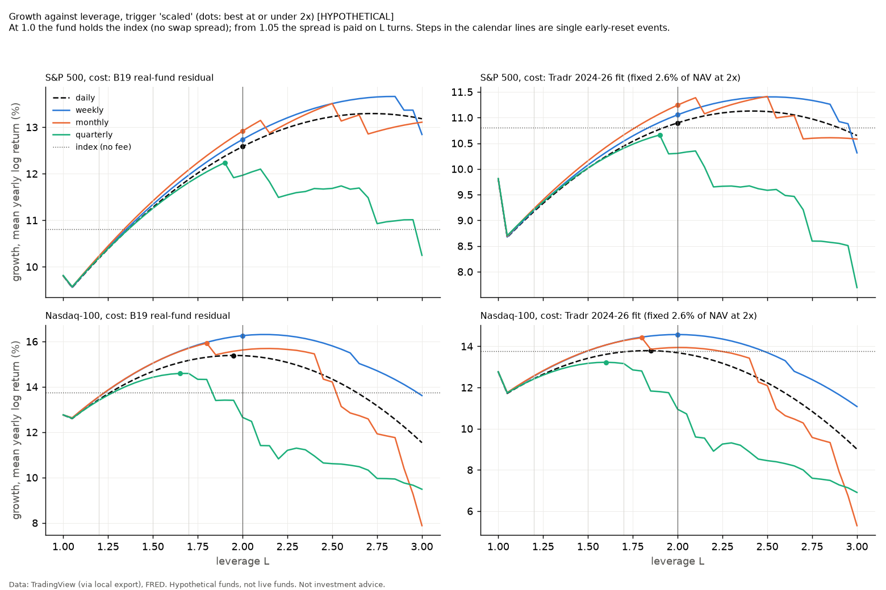

# B17: sub-2x calendar leverage and the best L

*Data: TradingView (via local export), FRED. Hypothetical funds, not live funds. Not investment advice.*

```
Inputs: 8 files; prices from <external>/library, rates from <external>/rates
  SP_SPX_daily.csv: 19333 rows, 1950-01-03 to 2026-11-02, sha256 b146c9af89cc
  SP_SPXTR_daily.csv: 9787 rows, 1988-01-04 to 2026-11-03, sha256 edab5090825e
  AMEX_SPY_daily.csv: 8498 rows, 1993-01-29 to 2026-11-02, sha256 643d6ef08b88
  NASDAQ_NDX_daily.csv: 10519 rows, 1985-01-31 to 2026-10-30, sha256 79d8e8688fa3
  NASDAQ_XNDX_daily.csv: 5019 rows, 2006-11-08 to 2026-10-30, sha256 d7dcc6dffa24
  NASDAQ_QQQ_daily.csv: 6955 rows, 1999-03-10 to 2026-10-30, sha256 f096cd6c6b75
  DFF.csv: 26424 rows, 1954-07-01 to 2026-11-03, sha256 e84a934a5014
  TB3MS.csv: 1112 rows, 1934-01-01 to 2026-08-01, sha256 ebf04b1ae5bc
SPX early-reset trigger: the AMEX:SPY price (daily low) from 1993-01-29, scaled to the SP:SPX price index before that; trigger basis 'etf'; drop 35% from the fund's base; fill mode 'level'.
SPX day counts: financing (reference rate and swap spread) ACT/360; expense ratio ACT/365 (calendar days between rows, so weekends and holidays accrue).
SPX reset dates: last NYSE session of the week / month / quarter from 1970-01-01 (calendar_letf/nyse.py, refuses data that lack it); before that the last row of the period.
NDX early-reset trigger: the NASDAQ:QQQ price (daily low) from 1999-03-10, scaled to the NASDAQ:NDX price index before that; trigger basis 'etf'; drop 35% from the fund's base; fill mode 'level'.
NDX day counts: financing (reference rate and swap spread) ACT/360; expense ratio ACT/365 (calendar days between rows, so weekends and holidays accrue).
NDX reset dates: last NYSE session of the week / month / quarter from 1970-01-01 (calendar_letf/nyse.py, refuses data that lack it); before that the last row of the period.
B17 trigger rules replace the 35% drop above: none (a 1/L in-period fall wipes the fund out), scaled (early reset at a 70% / L index fall), fixed35 (35% at any L).
Study end fixed at 2026-09-30; B19 cost anchor read from results/live_monthly.json (sha256 acfc84c2fbae).
```

All funds here are HYPOTHETICAL: no index fund below 2x with a calendar reset exists. The results answer what the design would have done, at the stated costs, on the history of each index.

## Cost cases (spread per NAV at 2x; carried to L on the stated basis)

| case | spread at 2x | source |
|---|---|---|
| spread0 | 0.00% | sensitivity: no swap spread (rate and fee only) |
| b19 | 0.94% | B19: median fitted residual of 5 real monthly-reset fund fits (0.469% per turn, range 0.085% to 0.562%), x 2 turns |
| base | 2.60% | (i) fixed spread per NAV 2.6%; FINDINGS F3/F5: residual of the filed costs fitted on 2024-26 (SPYQ/MQQQ/QQQP), not measured before 2024 |
| double | 5.20% | sensitivity: 2 x the base spread |

Fee 1.00% on every design (Tradr 1.00% (SPYQ / QQQP, prospectus 2026-07-31, VERIFIED), applied to every B17 design); the 1.2x weekly design is also run at 0.99%. Financing: (L - 1) x fed funds on the borrowed part. Basis: 'notional' (spread on L turns) is the base; 'borrowed' (spread on L - 1 turns, the index held directly) is shown next to it.

Multiple testing: 1,640 variants per index on the notional basis (41 L x (3 resets x 3 trigger rules + daily) x 4 cost cases), plus the borrowed basis. The 0.05 grid is one curve per design, and the best L is a plateau, not a pick from the list; even so, the largest of many noisy numbers is biased up.

## S&P 500 (1951-2025 full years; data to 2026-09-30)

Index (total return, no fee): CAGR 11.71%, max drawdown -55.3%, 10-year median CAGR 11.12%, 10-year 5th-percentile wealth 1.31.

### The best L (growth = mean yearly log return; plateau = within one SE of the best)

| cost | reset | trigger | range | best L | plateau | rising at top | growth %/yr | best - 2x (95%) | best - 1x (95%) | best - index (95%) | best L (p5 10y) | best L (CAGR/DD) |
|---|---|---|---|---|---|---|---|---|---|---|---|---|
| b19 | daily | - | <= 2 | 2.00 | 1.85-2.00 | yes | +12.58 | n/a | [-1.41, +6.97] valid | [-2.41, +5.97] valid | 1.00 | 1.00 |
| b19 | daily | - | <= 3 | 2.70 | 1.00-3.00 (gaps) | no | +13.29 | [-2.46, +3.88] valid | [-3.85, +10.83] valid | [-4.85, +9.83] valid | 1.00 | 1.00 |
| b19 | weekly | none | <= 2 | 2.00 | 2.00-2.00 | yes | +12.74 | n/a | [-1.23, +7.10] valid | [-2.23, +6.10] valid | 1.00 | 1.00 |
| b19 | weekly | none | <= 3 | 2.85 | 1.00-3.00 (gaps) | no | +13.66 | [-2.91, +4.75] valid | [-4.13, +11.84] valid | [-5.13, +10.84] valid | 1.00 | 1.00 |
| b19 | weekly | scaled | <= 2 | 2.00 | 2.00-2.00 | yes | +12.74 | n/a | [-1.23, +7.10] valid | [-2.23, +6.10] valid | 1.00 | 1.00 |
| b19 | weekly | scaled | <= 3 | 2.85 | 1.00-2.95 (gaps) | no | +13.66 | [-2.91, +4.75] valid | [-4.13, +11.84] valid | [-5.13, +10.84] valid | 1.00 | 1.00 |
| b19 | monthly | none | <= 2 | 2.00 | 2.00-2.00 | yes | +12.92 | n/a | [-0.97, +7.19] valid | [-1.97, +6.20] valid | 1.00 | 1.00 |
| b19 | monthly | none | <= 3 | 2.90 | 1.30-3.00 | no | +14.05 | [-2.83, +5.09] valid | [-3.78, +12.27] valid | [-4.78, +11.27] valid | 1.00 | 1.00 |
| b19 | monthly | scaled | <= 2 | 2.00 | 2.00-2.00 | yes | +12.92 | n/a | [-0.97, +7.19] valid | [-1.97, +6.20] valid | 1.00 | 1.00 |
| b19 | monthly | scaled | <= 3 | 2.50 | 1.45-3.00 | yes | +13.51 | [-1.75, +2.93] valid | [-2.64, +10.04] valid | [-3.64, +9.05] valid | 1.00 | 1.00 |
| b19 | quarterly | none | <= 2 | 2.00 | 1.55-2.00 | yes | +12.40 | n/a | [-1.68, +6.85] valid | [-2.67, +5.86] valid | 1.00 | 1.00 |
| b19 | quarterly | none | <= 3 | 2.35 | 1.00-2.80 (gaps) | no | +12.67 | [-1.42, +1.96] valid | [-3.09, +8.79] valid | [-4.08, +7.81] valid | 1.00 | 1.00 |
| b19 | quarterly | scaled | <= 2 | 1.90 | 1.65-2.00 | yes | +12.24 | [-0.85, +1.40] too narrow | [-1.38, +6.23] valid | [-2.38, +5.25] valid | 1.00 | 1.00 |
| b19 | quarterly | scaled | <= 3 | 1.90 | 1.65-3.00 | no | +12.24 | [-0.85, +1.40] too narrow | [-1.38, +6.23] valid | [-2.38, +5.25] valid | 1.00 | 1.00 |
| base | daily | - | <= 2 | 2.00 | 1.00-2.00 (gaps) | yes | +10.90 | n/a | [-3.09, +5.28] valid | [-4.10, +4.28] valid | 1.00 | 1.00 |
| base | daily | - | <= 3 | 2.40 | 1.00-3.00 | no | +11.13 | [-1.55, +2.01] valid | [-4.64, +7.29] valid | [-5.64, +6.29] valid | 1.00 | 1.00 |
| base | weekly | none | <= 2 | 2.00 | 1.00-2.00 (gaps) | yes | +11.05 | n/a | [-2.92, +5.41] valid | [-3.92, +4.42] valid | 1.00 | 1.00 |
| base | weekly | none | <= 3 | 2.50 | 1.00-3.00 | no | +11.40 | [-1.87, +2.57] valid | [-4.78, +7.97] valid | [-5.78, +6.98] valid | 1.00 | 1.00 |
| base | weekly | scaled | <= 2 | 2.00 | 1.00-2.00 (gaps) | yes | +11.05 | n/a | [-2.92, +5.41] valid | [-3.92, +4.42] valid | 1.00 | 1.00 |
| base | weekly | scaled | <= 3 | 2.50 | 1.00-3.00 | no | +11.40 | [-1.87, +2.57] valid | [-4.78, +7.97] valid | [-5.78, +6.98] valid | 1.00 | 1.00 |
| base | monthly | none | <= 2 | 2.00 | 1.00-2.00 (gaps) | yes | +11.24 | n/a | [-2.66, +5.53] valid | [-3.66, +4.53] valid | 1.00 | 1.00 |
| base | monthly | none | <= 3 | 2.60 | 1.00-3.00 | no | +11.73 | [-2.12, +3.09] valid | [-4.77, +8.62] valid | [-5.77, +7.62] valid | 1.00 | 1.00 |
| base | monthly | scaled | <= 2 | 2.00 | 1.00-2.00 (gaps) | yes | +11.24 | n/a | [-2.66, +5.53] valid | [-3.66, +4.53] valid | 1.00 | 1.00 |
| base | monthly | scaled | <= 3 | 2.50 | 1.00-3.00 | no | +11.41 | [-2.18, +2.52] valid | [-4.76, +7.97] valid | [-5.76, +6.97] valid | 1.00 | 1.00 |
| base | quarterly | none | <= 2 | 2.00 | 1.00-2.00 | yes | +10.74 | n/a | [-3.38, +5.23] valid | [-4.37, +4.24] valid | 1.00 | 1.00 |
| base | quarterly | none | <= 3 | 2.15 | 1.00-2.80 | no | +10.78 | [-0.67, +0.76] valid | [-4.04, +5.98] valid | [-5.04, +4.99] valid | 1.00 | 1.00 |
| base | quarterly | scaled | <= 2 | 1.90 | 1.00-2.00 (gaps) | yes | +10.66 | [-0.77, +1.49] too narrow | [-2.99, +4.69] valid | [-3.99, +3.70] valid | 1.00 | 1.00 |
| base | quarterly | scaled | <= 3 | 1.90 | 1.00-3.00 (gaps) | no | +10.66 | [-0.77, +1.49] too narrow | [-2.99, +4.69] valid | [-3.99, +3.70] valid | 1.00 | 1.00 |

### Named points (notional basis)

| L | cost | reset | trigger | CAGR | max DD | 10y median CAGR | 10y p5 wealth | gap vs daily (yearly, 95%) | minus index (yearly, 95%) | CAGR borrowed basis | early resets | wiped out | break-even fee (approx. 95%) |
|---|---|---|---|---|---|---|---|---|---|---|---|---|---|
| 1.2 | b19 | daily | - | 11.09% | -64.5% | 10.67% | 1.05 | n/a | [-1.43, +0.19] valid | 11.51% | 0 | - | 0.45% [-0.43%, 1.19%] valid |
| 1.2 | b19 | weekly | none | 11.11% | -64.2% | 10.66% | 1.05 | [-0.01, +0.05] too narrow | [-1.41, +0.21] valid | 11.54% | 0 | - | - |
| 1.2 | b19 | weekly | scaled | 11.11% | -64.2% | 10.66% | 1.05 | [-0.01, +0.05] too narrow | [-1.41, +0.21] valid | 11.54% | 0 | - | 0.47% [-0.41%, 1.21%] valid |
| 1.2 | b19 | monthly | none | 11.14% | -63.7% | 10.70% | 1.05 | [+0.01, +0.09] too narrow | [-1.37, +0.23] valid | 11.56% | 0 | - | - |
| 1.2 | b19 | monthly | scaled | 11.14% | -63.7% | 10.70% | 1.05 | [+0.01, +0.09] too narrow | [-1.37, +0.23] valid | 11.56% | 0 | - | 0.49% [-0.37%, 1.23%] valid |
| 1.2 | b19 | quarterly | none | 11.10% | -64.4% | 10.64% | 1.03 | [-0.05, +0.07] too narrow | [-1.43, +0.21] valid | 11.52% | 0 | - | - |
| 1.2 | b19 | quarterly | scaled | 11.10% | -64.4% | 10.64% | 1.03 | [-0.05, +0.07] too narrow | [-1.43, +0.21] valid | 11.52% | 0 | - | 0.45% [-0.43%, 1.21%] valid |
| 1.2 | base | daily | - | 9.97% | -67.6% | 9.55% | 0.95 | n/a | [-2.44, -0.82] valid | 11.14% | 0 | - | loses [-1.44%, 0.18%] valid |
| 1.2 | base | weekly | none | 10.00% | -67.3% | 9.55% | 0.95 | [-0.01, +0.05] too narrow | [-2.42, -0.80] valid | 11.16% | 0 | - | - |
| 1.2 | base | weekly | scaled | 10.00% | -67.3% | 9.55% | 0.95 | [-0.01, +0.05] too narrow | [-2.42, -0.80] valid | 11.16% | 0 | - | loses [-1.42%, 0.20%] valid |
| 1.2 | base | monthly | none | 10.03% | -66.9% | 9.59% | 0.95 | [+0.01, +0.10] too narrow | [-2.38, -0.77] valid | 11.19% | 0 | - | - |
| 1.2 | base | monthly | scaled | 10.03% | -66.9% | 9.59% | 0.95 | [+0.01, +0.10] too narrow | [-2.38, -0.77] valid | 11.19% | 0 | - | loses [-1.38%, 0.23%] valid |
| 1.2 | base | quarterly | none | 10.01% | -67.6% | 9.55% | 0.93 | [-0.03, +0.09] too narrow | [-2.43, -0.77] valid | 11.15% | 0 | - | - |
| 1.2 | base | quarterly | scaled | 10.01% | -67.6% | 9.55% | 0.93 | [-0.03, +0.09] too narrow | [-2.43, -0.77] valid | 11.15% | 0 | - | loses [-1.43%, 0.23%] valid |
| 1.5 | b19 | daily | - | 12.42% | -76.3% | 12.05% | 0.90 | n/a | [-1.58, +2.53] valid | 12.69% | 0 | - | 1.64% [-0.58%, 3.53%] valid |
| 1.5 | b19 | weekly | none | 12.49% | -75.7% | 11.96% | 0.88 | [-0.03, +0.16] too narrow | [-1.51, +2.58] valid | 12.76% | 0 | - | - |
| 1.5 | b19 | weekly | scaled | 12.49% | -75.7% | 11.96% | 0.88 | [-0.03, +0.16] too narrow | [-1.51, +2.58] valid | 12.76% | 0 | - | 1.70% [-0.51%, 3.58%] valid |
| 1.5 | b19 | monthly | none | 12.57% | -74.6% | 12.04% | 0.88 | [-0.00, +0.27] too narrow | [-1.40, +2.62] valid | 12.84% | 0 | - | - |
| 1.5 | b19 | monthly | scaled | 12.57% | -74.6% | 12.04% | 0.88 | [-0.00, +0.27] too narrow | [-1.40, +2.62] valid | 12.84% | 0 | - | 1.77% [-0.40%, 3.62%] valid |
| 1.5 | b19 | quarterly | none | 12.40% | -76.1% | 11.96% | 0.83 | [-0.21, +0.16] too narrow | [-1.62, +2.52] valid | 12.66% | 0 | - | - |
| 1.5 | b19 | quarterly | scaled | 12.40% | -76.1% | 11.96% | 0.83 | [-0.21, +0.16] too narrow | [-1.62, +2.52] valid | 12.66% | 0 | - | 1.62% [-0.62%, 3.52%] valid |
| 1.5 | base | daily | - | 11.01% | -78.9% | 10.64% | 0.79 | n/a | [-2.84, +1.26] valid | 11.74% | 0 | - | 0.37% [-1.84%, 2.26%] valid |
| 1.5 | base | weekly | none | 11.08% | -78.3% | 10.55% | 0.77 | [-0.03, +0.16] too narrow | [-2.77, +1.32] valid | 11.81% | 0 | - | - |
| 1.5 | base | weekly | scaled | 11.08% | -78.3% | 10.55% | 0.77 | [-0.03, +0.16] too narrow | [-2.77, +1.32] valid | 11.81% | 0 | - | 0.43% [-1.77%, 2.32%] valid |
| 1.5 | base | monthly | none | 11.17% | -77.3% | 10.64% | 0.77 | [+0.01, +0.28] too narrow | [-2.67, +1.37] valid | 11.90% | 0 | - | - |
| 1.5 | base | monthly | scaled | 11.17% | -77.3% | 10.64% | 0.77 | [+0.01, +0.28] too narrow | [-2.67, +1.37] valid | 11.90% | 0 | - | 0.52% [-1.67%, 2.37%] valid |
| 1.5 | base | quarterly | none | 11.01% | -78.8% | 10.59% | 0.73 | [-0.18, +0.19] too narrow | [-2.87, +1.30] valid | 11.73% | 0 | - | - |
| 1.5 | base | quarterly | scaled | 11.01% | -78.8% | 10.59% | 0.73 | [-0.18, +0.19] too narrow | [-2.87, +1.30] valid | 11.73% | 0 | - | 0.37% [-1.87%, 2.30%] valid |
| 1.7 | b19 | daily | - | 13.17% | -82.3% | 12.48% | 0.80 | n/a | [-1.82, +3.97] valid | 13.33% | 0 | - | 2.30% [-0.82%, 4.97%] valid |
| 1.7 | b19 | weekly | none | 13.28% | -81.5% | 12.52% | 0.77 | [-0.06, +0.25] too narrow | [-1.71, +4.05] valid | 13.44% | 0 | - | - |
| 1.7 | b19 | weekly | scaled | 13.28% | -81.5% | 12.52% | 0.77 | [-0.06, +0.25] too narrow | [-1.71, +4.05] valid | 13.44% | 0 | - | 2.40% [-0.71%, 5.05%] valid |
| 1.7 | b19 | monthly | none | 13.41% | -80.2% | 12.65% | 0.77 | [-0.01, +0.42] too narrow | [-1.55, +4.12] valid | 13.57% | 0 | - | - |
| 1.7 | b19 | monthly | scaled | 13.41% | -80.2% | 12.65% | 0.77 | [-0.01, +0.42] too narrow | [-1.55, +4.12] valid | 13.57% | 0 | - | 2.51% [-0.55%, 5.12%] valid |
| 1.7 | b19 | quarterly | none | 13.10% | -82.2% | 12.43% | 0.71 | [-0.37, +0.23] too narrow | [-1.92, +3.93] valid | 13.26% | 0 | - | - |
| 1.7 | b19 | quarterly | scaled | 13.10% | -82.2% | 12.43% | 0.71 | [-0.37, +0.23] too narrow | [-1.92, +3.93] valid | 13.26% | 0 | - | 2.25% [-0.92%, 4.93%] valid |
| 1.7 | base | daily | - | 11.56% | -84.5% | 10.88% | 0.69 | n/a | [-3.25, +2.54] valid | 12.00% | 0 | - | 0.87% [-2.25%, 3.54%] valid |
| 1.7 | base | weekly | none | 11.67% | -83.8% | 10.92% | 0.67 | [-0.06, +0.25] too narrow | [-3.15, +2.62] valid | 12.11% | 0 | - | - |
| 1.7 | base | weekly | scaled | 11.67% | -83.8% | 10.92% | 0.67 | [-0.06, +0.25] too narrow | [-3.15, +2.62] valid | 12.11% | 0 | - | 0.96% [-2.15%, 3.62%] valid |
| 1.7 | base | monthly | none | 11.80% | -82.7% | 11.05% | 0.66 | [+0.00, +0.43] too narrow | [-2.98, +2.70] valid | 12.24% | 0 | - | - |
| 1.7 | base | monthly | scaled | 11.80% | -82.7% | 11.05% | 0.66 | [+0.00, +0.43] too narrow | [-2.98, +2.70] valid | 12.24% | 0 | - | 1.09% [-1.98%, 3.70%] valid |
| 1.7 | base | quarterly | none | 11.52% | -84.4% | 10.86% | 0.61 | [-0.34, +0.26] too narrow | [-3.35, +2.55] valid | 11.95% | 0 | - | - |
| 1.7 | base | quarterly | scaled | 11.52% | -84.4% | 10.86% | 0.61 | [-0.34, +0.26] too narrow | [-3.35, +2.55] valid | 11.95% | 0 | - | 0.83% [-2.35%, 3.55%] valid |
| 2 | b19 | daily | - | 14.09% | -89.0% | 12.89% | 0.65 | n/a | [-2.41, +5.97] valid | 14.09% | 0 | - | 3.11% [-1.41%, 6.97%] valid |
| 2 | b19 | weekly | none | 14.26% | -88.2% | 13.08% | 0.61 | [-0.11, +0.41] too narrow | [-2.23, +6.10] valid | 14.26% | 0 | - | - |
| 2 | b19 | weekly | scaled | 14.26% | -88.2% | 13.08% | 0.61 | [-0.11, +0.41] too narrow | [-2.23, +6.10] valid | 14.26% | 0 | - | 3.26% [-1.23%, 7.10%] valid |
| 2 | b19 | monthly | none | 14.47% | -86.7% | 13.34% | 0.62 | [-0.03, +0.70] too narrow | [-1.97, +6.20] valid | 14.47% | 0 | - | - |
| 2 | b19 | monthly | scaled | 14.47% | -86.7% | 13.34% | 0.62 | [-0.03, +0.70] too narrow | [-1.97, +6.20] valid | 14.47% | 0 | - | 3.45% [-0.97%, 7.20%] valid |
| 2 | b19 | quarterly | none | 13.88% | -89.0% | 12.85% | 0.53 | [-0.71, +0.34] too narrow | [-2.67, +5.86] valid | 13.88% | 0 | - | - |
| 2 | b19 | quarterly | scaled | 13.40% | -92.0% | 12.60% | 0.52 | [-1.47, +0.24] too narrow | [-3.52, +5.84] valid | 13.40% | 1 | - | 2.51% [-2.52%, 6.84%] valid |
| 2 | base | daily | - | 12.18% | -90.5% | 11.00% | 0.55 | n/a | [-4.10, +4.28] valid | 12.18% | 0 | - | 1.42% [-3.10%, 5.28%] valid |
| 2 | base | weekly | none | 12.35% | -89.8% | 11.19% | 0.52 | [-0.10, +0.42] too narrow | [-3.92, +4.42] valid | 12.35% | 0 | - | - |
| 2 | base | weekly | scaled | 12.35% | -89.8% | 11.19% | 0.52 | [-0.10, +0.42] too narrow | [-3.92, +4.42] valid | 12.35% | 0 | - | 1.58% [-2.92%, 5.42%] valid |
| 2 | base | monthly | none | 12.57% | -88.6% | 11.46% | 0.52 | [-0.02, +0.71] too narrow | [-3.66, +4.53] valid | 12.57% | 0 | - | - |
| 2 | base | monthly | scaled | 12.57% | -88.6% | 11.46% | 0.52 | [-0.02, +0.71] too narrow | [-3.66, +4.53] valid | 12.57% | 0 | - | 1.77% [-2.66%, 5.53%] valid |
| 2 | base | quarterly | none | 12.01% | -90.7% | 11.00% | 0.44 | [-0.70, +0.38] too narrow | [-4.37, +4.24] valid | 12.01% | 0 | - | - |
| 2 | base | quarterly | scaled | 11.53% | -93.3% | 10.75% | 0.43 | [-1.48, +0.29] too narrow | [-5.22, +4.22] valid | 11.53% | 1 | - | 0.84% [-4.22%, 5.22%] valid |

### The 1.2x weekly design with no intra-week reset (fee 0.99%)

| cost | CAGR | max DD | gap vs 1.2x daily (yearly, 95%) | minus index (yearly, 95%) | wiped out |
|---|---|---|---|---|---|
| b19 | 11.12% | -64.1% | [+0.00, +0.06] too narrow | [-1.40, +0.22] valid | - |
| base | 10.01% | -67.3% | [+0.00, +0.06] too narrow | [-2.41, -0.79] valid | - |

### Break-even fee: the largest fee at which the fund grows as fast as the index (full history)

| basis | cost | reset | 1.2x | 1.5x | 1.7x | 2x | 3x | L with the highest |
|---|---|---|---|---|---|---|---|---|
| notional | b19 | daily | 0.45% | 1.64% | 2.30% | 3.11% | 4.04% | 2.85 (4.08%) |
| notional | b19 | weekly | 0.47% | 1.70% | 2.40% | 3.26% | 3.72% | 2.85 (4.47%) |
| notional | b19 | monthly | 0.49% | 1.77% | 2.51% | 3.45% | 3.99% | 2.50 (4.21%) |
| notional | b19 | quarterly | 0.45% | 1.62% | 2.25% | 2.51% | 1.18% | 1.90 (2.74%) |
| notional | base | daily | loses | 0.37% | 0.87% | 1.42% | 1.52% | 2.55 (1.81%) |
| notional | base | weekly | loses | 0.43% | 0.96% | 1.58% | 1.19% | 2.65 (2.12%) |
| notional | base | monthly | loses | 0.52% | 1.09% | 1.77% | 1.47% | 2.50 (2.11%) |
| notional | base | quarterly | loses | 0.37% | 0.83% | 0.84% | loses | 1.90 (1.16%) |
| borrowed | b19 | daily | 0.83% | 1.87% | 2.44% | 3.11% | 3.57% | 2.65 (3.72%) |
| borrowed | b19 | weekly | 0.85% | 1.93% | 2.54% | 3.26% | 3.25% | 2.80 (4.07%) |
| borrowed | b19 | monthly | 0.87% | 2.01% | 2.66% | 3.45% | 3.52% | 2.50 (3.97%) |
| borrowed | b19 | quarterly | 0.83% | 1.85% | 2.39% | 2.51% | 0.71% | 1.90 (2.79%) |
| borrowed | base | daily | 0.49% | 1.03% | 1.26% | 1.42% | 0.20% | 2.05 (1.42%) |
| borrowed | base | weekly | 0.51% | 1.09% | 1.36% | 1.58% | loses | 2.15 (1.60%) |
| borrowed | base | monthly | 0.54% | 1.17% | 1.48% | 1.77% | 0.16% | 2.10 (1.81%) |
| borrowed | base | quarterly | 0.50% | 1.02% | 1.22% | 0.84% | loses | 1.90 (1.29%) |

### Out of sample (L chosen on the early era, at or under 2x)

| cost | reset | chosen on | L | scored on | best L there | growth at chosen | growth at best | growth at 2x | index | regret (95%) | era z (lags 0, 1, 2) |
|---|---|---|---|---|---|---|---|---|---|---|---|
| b19 | daily | 1951-1989 | 2.00 | 1990-2025 | 2.00 | +12.35 | +12.35 | +12.35 | +10.25 | same L | - |
| b19 | weekly | 1951-1989 | 2.00 | 1990-2025 | 2.00 | +12.74 | +12.74 | +12.74 | +10.25 | same L | - |
| b19 | monthly | 1951-1989 | 2.00 | 1990-2025 | 2.00 | +13.37 | +13.37 | +13.37 | +10.25 | same L | - |
| b19 | quarterly | 1951-1989 | 2.00 | 1990-2025 | 1.90 | +12.03 | +12.65 | +12.03 | +10.25 | [-1.67, +2.92] too narrow | +0.59 / +0.60 / +0.61 |
| base | daily | 1951-1989 | 2.00 | 1990-2025 | 2.00 | +10.66 | +10.66 | +10.66 | +10.25 | same L | - |
| base | weekly | 1951-1989 | 2.00 | 1990-2025 | 2.00 | +11.06 | +11.06 | +11.06 | +10.25 | same L | - |
| base | monthly | 1951-1989 | 2.00 | 1990-2025 | 2.00 | +11.70 | +11.70 | +11.70 | +10.25 | same L | - |
| base | quarterly | 1951-1989 | 1.00 | 1990-2025 | 1.90 | +9.26 | +11.08 | +10.36 | +10.25 | [-3.86, +7.49] valid | +0.48 / +0.49 / +0.52 |

### Walk-forward (L chosen again every 10 years on all earlier years, at or under 2x)

| cost | reset | choices | years | walk-forward growth | fixed 2x | fixed 1x fund | index |
|---|---|---|---|---|---|---|---|
| b19 | daily | 1961:2.00 1971:2.00 1981:2.00 1991:2.00 2001:2.00 2011:2.00 2021:2.00 | 1961-2025 | +10.73 | +10.73 | +9.16 | +10.16 |
| b19 | weekly | 1961:2.00 1971:2.00 1981:2.00 1991:2.00 2001:2.00 2011:2.00 2021:2.00 | 1961-2025 | +10.90 | +10.90 | +9.16 | +10.16 |
| b19 | monthly | 1961:2.00 1971:2.00 1981:2.00 1991:2.00 2001:2.00 2011:2.00 2021:2.00 | 1961-2025 | +11.17 | +11.17 | +9.16 | +10.16 |
| b19 | quarterly | 1961:2.00 1971:2.00 1981:2.00 1991:1.95 2001:2.00 2011:1.90 2021:1.90 | 1961-2025 | +9.86 | +10.09 | +9.17 | +10.16 |
| base | daily | 1961:2.00 1971:2.00 1981:2.00 1991:2.00 2001:2.00 2011:1.00 2021:2.00 | 1961-2025 | +8.03 | +9.04 | +9.16 | +10.16 |
| base | weekly | 1961:2.00 1971:2.00 1981:2.00 1991:2.00 2001:2.00 2011:1.00 2021:2.00 | 1961-2025 | +8.15 | +9.22 | +9.16 | +10.16 |
| base | monthly | 1961:2.00 1971:2.00 1981:2.00 1991:2.00 2001:2.00 2011:2.00 2021:2.00 | 1961-2025 | +9.49 | +9.49 | +9.16 | +10.16 |
| base | quarterly | 1961:2.00 1971:2.00 1981:1.95 1991:1.00 2001:2.00 2011:1.00 2021:1.90 | 1961-2025 | +6.24 | +8.42 | +9.17 | +10.16 |

### C13: the zero-cost reset gap at L against L(L-1)/2 x the 2x gap

| reset | 2x gap (log, full history) | 1.2x ratio (pred 0.12) | 1.5x ratio (pred 0.375) | 1.7x ratio (pred 0.595) | 3x ratio (pred 3) | largest error at or under 2x |
|---|---|---|---|---|---|---|
| weekly | +0.1080 | 0.120 | 0.375 | 0.595 | 3.006 | 0.1% |
| monthly | +0.2261 | 0.119 | 0.375 | 0.596 | 2.862 | 0.9% |
| quarterly | -0.2050 | 0.104 | 0.335 | 0.551 | n/a | 13.8% |

### C10: the second-order break-even fee of a daily fund against the kernel's

Largest difference 0.053 points over 71 cases (daily funds, 1 < L <= 2, both bases and both cost anchors, where a break-even fee exists).

### C14: Kelly's closed form against the daily curve's best L (full history)

| cost | closed form L* | grid best L (1-3) |
|---|---|---|
| spread0 | 3.16 | 3.00 |
| b19 | 2.96 | 2.85 |
| base | 2.62 | 2.55 |
| double | 2.09 | 1.00 |

### Wipeouts (notional basis, base cost)

quarterly fixed35 2.80x on 2008-11-20, quarterly fixed35 2.85x on 2008-11-20, quarterly fixed35 2.90x on 2008-11-20, quarterly fixed35 2.95x on 2008-11-20, quarterly fixed35 3.00x on 2008-11-20, quarterly none 2.85x on 2008-11-20, quarterly none 2.90x on 2008-11-20, quarterly none 2.95x on 2008-11-20, quarterly none 3.00x on 2008-11-20


## Nasdaq-100 (1986-2025 full years; data to 2026-09-30)

Index (total return, no fee): CAGR 14.81%, max drawdown -82.9%, 10-year median CAGR 14.92%, 10-year 5th-percentile wealth 0.71.

### The best L (growth = mean yearly log return; plateau = within one SE of the best)

| cost | reset | trigger | range | best L | plateau | rising at top | growth %/yr | best - 2x (95%) | best - 1x (95%) | best - index (95%) | best L (p5 10y) | best L (CAGR/DD) |
|---|---|---|---|---|---|---|---|---|---|---|---|---|
| b19 | daily | - | <= 2 | 1.95 | 1.00-2.00 | no | +15.39 | [-0.55, +0.57] valid | [-7.28, +12.53] valid | [-8.28, +11.53] valid | 1.00 | 1.00 |
| b19 | daily | - | <= 3 | 1.95 | 1.00-3.00 | no | +15.39 | [-0.55, +0.57] valid | [-7.28, +12.53] valid | [-8.28, +11.53] valid | 1.00 | 1.00 |
| b19 | weekly | none | <= 2 | 2.00 | 1.00-2.00 | yes | +16.26 | n/a | [-6.87, +13.87] valid | [-7.87, +12.87] valid | 1.00 | 1.00 |
| b19 | weekly | none | <= 3 | 2.10 | 1.00-3.00 | no | +16.31 | [-1.09, +1.19] valid | [-7.96, +15.05] valid | [-8.96, +14.06] valid | 1.00 | 1.00 |
| b19 | weekly | scaled | <= 2 | 2.00 | 1.00-2.00 | yes | +16.26 | n/a | [-6.87, +13.87] valid | [-7.87, +12.87] valid | 1.00 | 1.00 |
| b19 | weekly | scaled | <= 3 | 2.10 | 1.00-3.00 | no | +16.31 | [-1.09, +1.19] valid | [-7.96, +15.05] valid | [-8.96, +14.06] valid | 1.00 | 1.00 |
| b19 | monthly | none | <= 2 | 2.00 | 1.00-2.00 | yes | +16.16 | n/a | [-7.04, +13.84] valid | [-8.04, +12.85] too narrow | 1.00 | 1.00 |
| b19 | monthly | none | <= 3 | 2.05 | 1.00-2.60 | no | +16.17 | [-0.57, +0.60] too narrow | [-7.61, +14.44] valid | [-8.61, +13.44] valid | 1.00 | 1.00 |
| b19 | monthly | scaled | <= 2 | 1.80 | 1.00-2.00 | yes | +15.93 | [-2.35, +2.95] too narrow | [-5.02, +11.35] valid | [-6.02, +10.36] valid | 1.00 | 1.00 |
| b19 | monthly | scaled | <= 3 | 1.80 | 1.00-3.00 | no | +15.93 | [-2.35, +2.95] valid | [-5.02, +11.35] valid | [-6.02, +10.36] valid | 1.00 | 1.00 |
| b19 | quarterly | none | <= 2 | 1.65 | 1.00-2.00 | no | +14.59 | [-4.29, +5.75] too narrow | [-5.37, +9.02] too narrow | [-6.37, +8.04] too narrow | 1.00 | 1.00 |
| b19 | quarterly | none | <= 3 | 1.65 | 1.00-2.55 | no | +14.59 | [-4.29, +5.75] too narrow | [-5.37, +9.02] too narrow | [-6.37, +8.04] too narrow | 1.00 | 1.00 |
| b19 | quarterly | scaled | <= 2 | 1.65 | 1.00-2.00 | no | +14.59 | [-3.74, +7.62] too narrow | [-5.37, +9.02] too narrow | [-6.37, +8.04] too narrow | 1.00 | 1.00 |
| b19 | quarterly | scaled | <= 3 | 1.65 | 1.00-3.00 | no | +14.59 | [-3.74, +7.62] too narrow | [-5.37, +9.02] too narrow | [-6.37, +8.04] too narrow | 1.00 | 1.00 |
| base | daily | - | <= 2 | 1.85 | 1.00-2.00 | no | +13.79 | [-1.57, +1.77] valid | [-7.76, +9.83] valid | [-8.76, +8.83] valid | 1.00 | 1.00 |
| base | daily | - | <= 3 | 1.85 | 1.00-3.00 | no | +13.79 | [-1.57, +1.77] too narrow | [-7.76, +9.83] valid | [-8.76, +8.83] valid | 1.00 | 1.00 |
| base | weekly | none | <= 2 | 2.00 | 1.00-2.00 | yes | +14.57 | n/a | [-8.57, +12.19] valid | [-9.57, +11.20] valid | 1.00 | 1.00 |
| base | weekly | none | <= 3 | 2.00 | 1.00-3.00 | no | +14.57 | n/a | [-8.57, +12.19] valid | [-9.57, +11.20] valid | 1.00 | 1.00 |
| base | weekly | scaled | <= 2 | 2.00 | 1.00-2.00 | yes | +14.57 | n/a | [-8.57, +12.19] valid | [-9.57, +11.20] valid | 1.00 | 1.00 |
| base | weekly | scaled | <= 3 | 2.00 | 1.00-3.00 | no | +14.57 | n/a | [-8.57, +12.19] valid | [-9.57, +11.20] valid | 1.00 | 1.00 |
| base | monthly | none | <= 2 | 1.95 | 1.00-2.00 | no | +14.49 | [-0.57, +0.59] too narrow | [-8.17, +11.63] valid | [-9.17, +10.64] valid | 1.00 | 1.00 |
| base | monthly | none | <= 3 | 1.95 | 1.00-2.60 | no | +14.49 | [-0.57, +0.59] too narrow | [-8.17, +11.63] valid | [-9.17, +10.64] valid | 1.00 | 1.00 |
| base | monthly | scaled | <= 2 | 1.80 | 1.00-2.00 | yes | +14.42 | [-2.18, +3.13] valid | [-6.56, +9.87] valid | [-7.56, +8.88] too narrow | 1.00 | 1.00 |
| base | monthly | scaled | <= 3 | 1.80 | 1.00-3.00 | no | +14.42 | [-2.18, +3.13] valid | [-6.56, +9.87] valid | [-7.56, +8.88] valid | 1.00 | 1.00 |
| base | quarterly | none | <= 2 | 1.60 | 1.00-2.00 | no | +13.23 | [-4.63, +6.80] too narrow | [-6.18, +7.09] too narrow | [-7.18, +6.12] too narrow | 1.00 | 1.00 |
| base | quarterly | none | <= 3 | 1.60 | 1.00-2.50 | no | +13.23 | [-4.63, +6.80] too narrow | [-6.18, +7.09] too narrow | [-7.18, +6.12] too narrow | 1.00 | 1.00 |
| base | quarterly | scaled | <= 2 | 1.60 | 1.00-2.00 | no | +13.23 | [-4.05, +8.62] too narrow | [-6.18, +7.09] too narrow | [-7.18, +6.12] too narrow | 1.00 | 1.00 |
| base | quarterly | scaled | <= 3 | 1.60 | 1.00-3.00 | no | +13.23 | [-4.05, +8.62] too narrow | [-6.18, +7.09] too narrow | [-7.18, +6.12] too narrow | 1.00 | 1.00 |

### Named points (notional basis)

| L | cost | reset | trigger | CAGR | max DD | 10y median CAGR | 10y p5 wealth | gap vs daily (yearly, 95%) | minus index (yearly, 95%) | CAGR borrowed basis | early resets | wiped out | break-even fee (approx. 95%) |
|---|---|---|---|---|---|---|---|---|---|---|---|---|---|
| 1.2 | b19 | daily | - | 14.46% | -89.6% | 14.18% | 0.46 | n/a | [-2.28, +1.66] valid | 14.90% | 0 | - | 0.70% [-1.28%, 2.66%] valid |
| 1.2 | b19 | weekly | none | 14.59% | -89.5% | 14.39% | 0.47 | [+0.05, +0.19] too narrow | [-2.14, +1.76] valid | 15.03% | 0 | - | - |
| 1.2 | b19 | weekly | scaled | 14.59% | -89.5% | 14.39% | 0.47 | [+0.05, +0.19] too narrow | [-2.14, +1.76] valid | 15.03% | 0 | - | 0.81% [-1.14%, 2.76%] valid |
| 1.2 | b19 | monthly | none | 14.60% | -89.5% | 14.36% | 0.47 | [+0.03, +0.23] valid | [-2.13, +1.77] valid | 15.03% | 0 | - | - |
| 1.2 | b19 | monthly | scaled | 14.60% | -89.5% | 14.36% | 0.47 | [+0.03, +0.23] valid | [-2.13, +1.77] valid | 15.03% | 0 | - | 0.82% [-1.13%, 2.77%] valid |
| 1.2 | b19 | quarterly | none | 14.40% | -90.1% | 13.95% | 0.44 | [-0.25, +0.17] too narrow | [-2.41, +1.71] too narrow | 14.83% | 0 | - | - |
| 1.2 | b19 | quarterly | scaled | 14.40% | -90.1% | 13.95% | 0.44 | [-0.25, +0.17] too narrow | [-2.41, +1.71] valid | 14.83% | 0 | - | 0.64% [-1.41%, 2.71%] valid |
| 1.2 | base | daily | - | 13.31% | -89.9% | 13.03% | 0.41 | n/a | [-3.30, +0.65] valid | 14.51% | 0 | - | loses [-2.30%, 1.65%] valid |
| 1.2 | base | weekly | none | 13.44% | -89.8% | 13.24% | 0.42 | [+0.06, +0.19] too narrow | [-3.16, +0.75] valid | 14.64% | 0 | - | - |
| 1.2 | base | weekly | scaled | 13.44% | -89.8% | 13.24% | 0.42 | [+0.06, +0.19] too narrow | [-3.16, +0.75] valid | 14.64% | 0 | - | loses [-2.16%, 1.75%] valid |
| 1.2 | base | monthly | none | 13.45% | -89.8% | 13.21% | 0.42 | [+0.04, +0.24] valid | [-3.15, +0.78] valid | 14.65% | 0 | - | - |
| 1.2 | base | monthly | scaled | 13.45% | -89.8% | 13.21% | 0.42 | [+0.04, +0.24] valid | [-3.15, +0.78] valid | 14.65% | 0 | - | loses [-2.15%, 1.78%] valid |
| 1.2 | base | quarterly | none | 13.28% | -90.4% | 12.81% | 0.40 | [-0.24, +0.21] too narrow | [-3.43, +0.75] too narrow | 14.45% | 0 | - | - |
| 1.2 | base | quarterly | scaled | 13.28% | -90.4% | 12.81% | 0.40 | [-0.24, +0.21] too narrow | [-3.43, +0.75] too narrow | 14.45% | 0 | - | loses [-2.43%, 1.75%] too narrow |
| 1.5 | b19 | daily | - | 15.91% | -95.1% | 15.65% | 0.27 | n/a | [-4.11, +5.97] valid | 16.19% | 0 | - | 1.95% [-3.11%, 6.97%] valid |
| 1.5 | b19 | weekly | none | 16.31% | -94.9% | 16.03% | 0.29 | [+0.15, +0.57] too narrow | [-3.70, +6.27] valid | 16.59% | 0 | - | - |
| 1.5 | b19 | weekly | scaled | 16.31% | -94.9% | 16.03% | 0.29 | [+0.15, +0.57] too narrow | [-3.70, +6.27] valid | 16.59% | 0 | - | 2.30% [-2.70%, 7.27%] valid |
| 1.5 | b19 | monthly | none | 16.30% | -94.9% | 16.16% | 0.29 | [+0.03, +0.69] valid | [-3.70, +6.27] valid | 16.58% | 0 | - | - |
| 1.5 | b19 | monthly | scaled | 16.30% | -94.9% | 16.16% | 0.29 | [+0.03, +0.69] valid | [-3.70, +6.27] valid | 16.58% | 0 | - | 2.29% [-2.70%, 7.27%] valid |
| 1.5 | b19 | quarterly | none | 15.57% | -95.8% | 15.76% | 0.23 | [-1.00, +0.48] too narrow | [-4.72, +6.04] too narrow | 15.84% | 0 | - | - |
| 1.5 | b19 | quarterly | scaled | 15.57% | -95.8% | 15.76% | 0.23 | [-1.00, +0.48] too narrow | [-4.72, +6.04] too narrow | 15.84% | 0 | - | 1.66% [-3.72%, 7.04%] too narrow |
| 1.5 | base | daily | - | 14.45% | -95.2% | 14.20% | 0.24 | n/a | [-5.38, +4.70] valid | 15.21% | 0 | - | 0.69% [-4.38%, 5.70%] valid |
| 1.5 | base | weekly | none | 14.85% | -95.1% | 14.58% | 0.26 | [+0.15, +0.57] too narrow | [-4.97, +5.01] valid | 15.61% | 0 | - | - |
| 1.5 | base | weekly | scaled | 14.85% | -95.1% | 14.58% | 0.26 | [+0.15, +0.57] too narrow | [-4.97, +5.01] valid | 15.61% | 0 | - | 1.04% [-3.97%, 6.01%] valid |
| 1.5 | base | monthly | none | 14.85% | -95.1% | 14.71% | 0.26 | [+0.04, +0.70] valid | [-4.97, +5.03] valid | 15.60% | 0 | - | - |
| 1.5 | base | monthly | scaled | 14.85% | -95.1% | 14.71% | 0.26 | [+0.04, +0.70] valid | [-4.97, +5.03] valid | 15.60% | 0 | - | 1.03% [-3.97%, 6.03%] valid |
| 1.5 | base | quarterly | none | 14.14% | -96.0% | 14.34% | 0.20 | [-1.02, +0.53] too narrow | [-6.02, +4.85] too narrow | 14.88% | 0 | - | - |
| 1.5 | base | quarterly | scaled | 14.14% | -96.0% | 14.34% | 0.20 | [-1.02, +0.53] too narrow | [-6.02, +4.85] too narrow | 14.88% | 0 | - | 0.41% [-5.02%, 5.85%] too narrow |
| 1.7 | b19 | daily | - | 16.50% | -97.1% | 16.55% | 0.18 | n/a | [-5.75, +8.57] valid | 16.66% | 0 | - | 2.46% [-4.75%, 9.57%] valid |
| 1.7 | b19 | weekly | none | 17.12% | -97.0% | 17.10% | 0.20 | [+0.21, +0.89] too narrow | [-5.13, +9.05] valid | 17.29% | 0 | - | - |
| 1.7 | b19 | weekly | scaled | 17.12% | -97.0% | 17.10% | 0.20 | [+0.21, +0.89] too narrow | [-5.13, +9.05] valid | 17.29% | 0 | - | 3.00% [-4.13%, 10.05%] valid |
| 1.7 | b19 | monthly | none | 17.08% | -97.0% | 17.32% | 0.20 | [-0.01, +1.07] valid | [-5.16, +9.05] valid | 17.24% | 0 | - | - |
| 1.7 | b19 | monthly | scaled | 17.08% | -97.0% | 17.32% | 0.20 | [-0.01, +1.07] valid | [-5.16, +9.05] valid | 17.24% | 0 | - | 2.96% [-4.16%, 10.05%] valid |
| 1.7 | b19 | quarterly | none | 15.78% | -98.0% | 16.93% | 0.13 | [-1.91, +0.75] too narrow | [-7.02, +8.68] too narrow | 15.94% | 0 | - | - |
| 1.7 | b19 | quarterly | scaled | 15.78% | -98.0% | 16.93% | 0.13 | [-1.91, +0.75] too narrow | [-7.02, +8.68] too narrow | 15.94% | 0 | - | 1.84% [-6.02%, 9.68%] too narrow |
| 1.7 | base | daily | - | 14.84% | -97.4% | 14.89% | 0.15 | n/a | [-7.19, +7.14] valid | 15.30% | 0 | - | 1.03% [-6.19%, 8.14%] valid |
| 1.7 | base | weekly | none | 15.46% | -97.2% | 15.44% | 0.17 | [+0.21, +0.90] too narrow | [-6.56, +7.62] valid | 15.92% | 0 | - | - |
| 1.7 | base | weekly | scaled | 15.46% | -97.2% | 15.44% | 0.17 | [+0.21, +0.90] too narrow | [-6.56, +7.62] valid | 15.92% | 0 | - | 1.56% [-5.56%, 8.62%] valid |
| 1.7 | base | monthly | none | 15.42% | -97.2% | 15.66% | 0.17 | [+0.00, +1.08] valid | [-6.61, +7.64] valid | 15.87% | 0 | - | - |
| 1.7 | base | monthly | scaled | 15.42% | -97.2% | 15.66% | 0.17 | [+0.00, +1.08] valid | [-6.61, +7.64] valid | 15.87% | 0 | - | 1.53% [-5.61%, 8.64%] valid |
| 1.7 | base | quarterly | none | 14.14% | -98.2% | 15.29% | 0.11 | [-1.95, +0.81] too narrow | [-8.52, +7.33] too narrow | 14.59% | 0 | - | - |
| 1.7 | base | quarterly | scaled | 14.14% | -98.2% | 15.29% | 0.11 | [-1.95, +0.81] too narrow | [-8.52, +7.33] too narrow | 14.59% | 0 | - | 0.42% [-7.52%, 8.33%] too narrow |
| 2 | b19 | daily | - | 16.80% | -98.9% | 17.85% | 0.09 | n/a | [-8.84, +12.08] valid | 16.80% | 0 | - | 2.71% [-7.84%, 13.08%] valid |
| 2 | b19 | weekly | none | 17.80% | -98.7% | 18.55% | 0.10 | [+0.29, +1.47] too narrow | [-7.87, +12.87] valid | 17.80% | 0 | - | - |
| 2 | b19 | weekly | scaled | 17.80% | -98.7% | 18.55% | 0.10 | [+0.29, +1.47] too narrow | [-7.87, +12.87] valid | 17.80% | 0 | - | 3.57% [-6.87%, 13.87%] valid |
| 2 | b19 | monthly | none | 17.64% | -98.8% | 18.25% | 0.10 | [-0.17, +1.74] valid | [-8.04, +12.85] valid | 17.64% | 0 | - | - |
| 2 | b19 | monthly | scaled | 17.04% | -98.8% | 17.85% | 0.10 | [-1.53, +2.03] too narrow | [-8.75, +12.49] valid | 17.04% | 1 | - | 2.92% [-7.75%, 13.49%] valid |
| 2 | b19 | quarterly | none | 14.98% | -99.5% | 17.75% | 0.04 | [-4.35, +1.31] too narrow | [-12.07, +12.28] too narrow | 14.98% | 0 | - | - |
| 2 | b19 | quarterly | scaled | 13.66% | -99.5% | 14.55% | 0.04 | [-5.95, +0.50] too narrow | [-13.82, +11.61] too narrow | 13.66% | 4 | - | 0.01% [-12.82%, 12.61%] too narrow |
| 2 | base | daily | - | 14.84% | -99.1% | 15.88% | 0.07 | n/a | [-10.53, +10.40] valid | 14.84% | 0 | - | 1.03% [-9.53%, 11.40%] valid |
| 2 | base | weekly | none | 15.83% | -98.9% | 16.57% | 0.09 | [+0.29, +1.47] too narrow | [-9.57, +11.20] valid | 15.83% | 0 | - | - |
| 2 | base | weekly | scaled | 15.83% | -98.9% | 16.57% | 0.09 | [+0.29, +1.47] too narrow | [-9.57, +11.20] valid | 15.83% | 0 | - | 1.88% [-8.57%, 12.20%] valid |
| 2 | base | monthly | none | 15.68% | -99.0% | 16.27% | 0.09 | [-0.16, +1.74] valid | [-9.76, +11.20] too narrow | 15.68% | 0 | - | - |
| 2 | base | monthly | scaled | 15.09% | -99.0% | 15.89% | 0.09 | [-1.53, +2.04] too narrow | [-10.47, +10.84] too narrow | 15.09% | 1 | - | 1.24% [-9.47%, 11.84%] too narrow |
| 2 | base | quarterly | none | 13.02% | -99.6% | 15.81% | 0.04 | [-4.49, +1.39] too narrow | [-13.93, +10.69] too narrow | 13.02% | 0 | - | - |
| 2 | base | quarterly | scaled | 11.73% | -99.6% | 12.65% | 0.03 | [-6.06, +0.57] too narrow | [-15.65, +10.02] too narrow | 11.73% | 4 | - | loses [-14.65%, 11.02%] too narrow |

### The 1.2x weekly design with no intra-week reset (fee 0.99%)

| cost | CAGR | max DD | gap vs 1.2x daily (yearly, 95%) | minus index (yearly, 95%) | wiped out |
|---|---|---|---|---|---|
| b19 | 14.61% | -89.5% | [+0.06, +0.20] too narrow | [-2.13, +1.77] valid | - |
| base | 13.45% | -89.8% | [+0.07, +0.20] too narrow | [-3.15, +0.76] valid | - |

### Break-even fee: the largest fee at which the fund grows as fast as the index (full history)

| basis | cost | reset | 1.2x | 1.5x | 1.7x | 2x | 3x | L with the highest |
|---|---|---|---|---|---|---|---|---|
| notional | b19 | daily | 0.70% | 1.95% | 2.46% | 2.71% | loses | 2.00 (2.71%) |
| notional | b19 | weekly | 0.81% | 2.30% | 3.00% | 3.57% | 1.15% | 2.15 (3.64%) |
| notional | b19 | monthly | 0.82% | 2.29% | 2.96% | 2.92% | loses | 1.80 (3.19%) |
| notional | b19 | quarterly | 0.64% | 1.66% | 1.84% | 0.01% | loses | 1.70 (1.84%) |
| notional | base | daily | loses | 0.69% | 1.03% | 1.03% | loses | 1.85 (1.10%) |
| notional | base | weekly | loses | 1.04% | 1.56% | 1.88% | loses | 2.00 (1.88%) |
| notional | base | monthly | loses | 1.03% | 1.53% | 1.24% | loses | 1.80 (1.68%) |
| notional | base | quarterly | loses | 0.41% | 0.42% | loses | loses | 1.60 (0.47%) |
| borrowed | b19 | daily | 1.08% | 2.19% | 2.60% | 2.71% | loses | 1.90 (2.74%) |
| borrowed | b19 | weekly | 1.19% | 2.54% | 3.14% | 3.57% | 0.68% | 2.05 (3.59%) |
| borrowed | b19 | monthly | 1.19% | 2.53% | 3.10% | 2.92% | loses | 1.80 (3.28%) |
| borrowed | b19 | quarterly | 1.02% | 1.90% | 1.98% | 0.01% | loses | 1.65 (2.00%) |
| borrowed | base | daily | 0.74% | 1.35% | 1.42% | 1.03% | loses | 1.65 (1.43%) |
| borrowed | base | weekly | 0.86% | 1.70% | 1.96% | 1.88% | loses | 1.80 (2.00%) |
| borrowed | base | monthly | 0.86% | 1.69% | 1.92% | 1.24% | loses | 1.75 (1.94%) |
| borrowed | base | quarterly | 0.69% | 1.06% | 0.81% | loses | loses | 1.50 (1.06%) |

### Out of sample (L chosen on the early era, at or under 2x)

| cost | reset | chosen on | L | scored on | best L there | growth at chosen | growth at best | growth at 2x | index | regret (95%) | era z (lags 0, 1, 2) |
|---|---|---|---|---|---|---|---|---|---|---|---|
| b19 | daily | 1986-2005 | 1.35 | 2006-2025 | 2.00 | +16.27 | +20.45 | +20.45 | +14.61 | [-4.26, +12.61] too narrow | +0.87 / +0.84 / +0.85 |
| b19 | weekly | 1986-2005 | 1.50 | 2006-2025 | 2.00 | +17.75 | +21.30 | +21.30 | +14.61 | [-2.76, +9.86] too narrow | +0.90 / +0.87 / +0.88 |
| b19 | monthly | 1986-2005 | 1.40 | 2006-2025 | 2.00 | +17.12 | +22.03 | +22.03 | +14.61 | [-2.70, +12.51] too narrow | +1.21 / +1.16 / +1.19 |
| b19 | quarterly | 1986-2005 | 1.00 | 2006-2025 | 1.95 | +13.62 | +21.13 | +19.99 | +14.61 | [-4.46, +19.47] too narrow | +1.24 / +1.14 / +1.16 |
| base | daily | 1986-2005 | 1.00 | 2006-2025 | 2.00 | +13.61 | +18.76 | +18.76 | +14.61 | [-7.59, +17.89] too narrow | +0.83 / +0.81 / +0.83 |
| base | weekly | 1986-2005 | 1.00 | 2006-2025 | 2.00 | +13.61 | +19.62 | +19.62 | +14.61 | [-6.36, +18.38] too narrow | +0.84 / +0.81 / +0.84 |
| base | monthly | 1986-2005 | 1.00 | 2006-2025 | 2.00 | +13.61 | +20.36 | +20.36 | +14.61 | [-5.74, +19.23] too narrow | +1.09 / +1.05 / +1.08 |
| base | quarterly | 1986-2005 | 1.00 | 2006-2025 | 1.95 | +13.62 | +19.53 | +18.34 | +14.61 | [-6.16, +17.99] too narrow | +1.24 / +1.14 / +1.15 |

### Walk-forward (L chosen again every 10 years on all earlier years, at or under 2x)

| cost | reset | choices | years | walk-forward growth | fixed 2x | fixed 1x fund | index |
|---|---|---|---|---|---|---|---|
| b19 | daily | 1996:2.00 2006:1.35 2016:1.60 | 1996-2025 | +12.71 | +14.64 | +12.34 | +13.34 |
| b19 | weekly | 1996:2.00 2006:1.50 2016:1.75 | 1996-2025 | +14.35 | +15.84 | +12.34 | +13.34 |
| b19 | monthly | 1996:1.80 2006:1.40 2016:1.65 | 1996-2025 | +14.42 | +15.99 | +12.34 | +13.34 |
| b19 | quarterly | 1996:1.80 2006:1.00 2016:1.40 | 1996-2025 | +10.87 | +12.37 | +12.34 | +13.34 |
| base | daily | 1996:2.00 2006:1.00 2016:1.00 | 1996-2025 | +9.52 | +12.96 | +12.34 | +13.34 |
| base | weekly | 1996:2.00 2006:1.00 2016:1.00 | 1996-2025 | +10.15 | +14.16 | +12.34 | +13.34 |
| base | monthly | 1996:1.80 2006:1.00 2016:1.00 | 1996-2025 | +10.59 | +14.31 | +12.34 | +13.34 |
| base | quarterly | 1996:1.75 2006:1.00 2016:1.00 | 1996-2025 | +9.11 | +10.65 | +12.34 | +13.34 |

### C13: the zero-cost reset gap at L against L(L-1)/2 x the 2x gap

| reset | 2x gap (log, full history) | 1.2x ratio (pred 0.12) | 1.5x ratio (pred 0.375) | 1.7x ratio (pred 0.595) | 3x ratio (pred 3) | largest error at or under 2x |
|---|---|---|---|---|---|---|
| weekly | +0.3529 | 0.133 | 0.403 | 0.623 | 2.202 | 12.4% |
| monthly | +0.2955 | 0.150 | 0.442 | 0.664 | n/a | 27.7% |
| quarterly | -0.6084 | 0.058 | 0.228 | 0.435 | n/a | 56.3% |

### C10: the second-order break-even fee of a daily fund against the kernel's

Largest difference 0.022 points over 74 cases (daily funds, 1 < L <= 2, both bases and both cost anchors, where a break-even fee exists).

### C14: Kelly's closed form against the daily curve's best L (full history)

| cost | closed form L* | grid best L (1-3) |
|---|---|---|
| spread0 | 2.06 | 2.05 |
| b19 | 1.99 | 2.00 |
| base | 1.86 | 1.85 |
| double | 1.66 | 1.00 |

### Wipeouts (notional basis, base cost)

monthly fixed35 2.85x on 1987-10-26, monthly fixed35 2.90x on 1987-10-26, monthly fixed35 2.95x on 1987-10-26, monthly fixed35 3.00x on 1987-10-26, monthly none 2.65x on 1987-10-26, monthly none 2.70x on 1987-10-26, monthly none 2.75x on 1987-10-26, monthly none 2.80x on 1987-10-26, monthly none 2.85x on 1987-10-26, monthly none 2.90x on 1987-10-26, monthly none 2.95x on 1987-10-26, monthly none 3.00x on 1987-10-26, quarterly fixed35 2.80x on 2000-12-20, quarterly fixed35 2.85x on 1987-10-26, quarterly fixed35 2.90x on 1987-10-26, quarterly fixed35 2.95x on 1987-10-26, quarterly fixed35 3.00x on 1987-10-26, quarterly none 2.55x on 2000-12-20, quarterly none 2.60x on 2000-12-20, quarterly none 2.65x on 1987-10-26, quarterly none 2.70x on 1987-10-26, quarterly none 2.75x on 1987-10-26, quarterly none 2.80x on 1987-10-26, quarterly none 2.85x on 1987-10-26, quarterly none 2.90x on 1987-10-26, quarterly none 2.95x on 1987-10-26, quarterly none 3.00x on 1987-10-26



